# Swing から WinUI4K への書き換え例

この文書では、Swing のコンポーネントでよく書くコードと、それを WinUI4K で書いたコードを並べて示します。
コンポーネントごとに、実際のアプリで使う場面の大半 (目安として 8 割) をカバーするユースケースを選び、
Swing のコードと WinUI4K のコードを対にしました。

WinUI4K に当たるクラスがある Swing のコンポーネント (1〜29 章) と、レイアウト マネージャー ([30 章](#layout)) を扱います。
WinUI4K に当たるクラスが無いコンポーネントは [付録 B](#none) にまとめ、対応する API が無いものは各章の API の対応表で WinUI4K の列を `(なし)` にしています。
画面写真で Swing と比べておかしく見えるところと、Swing から移るときに不自然に感じる API は、[swing_to_winui4k_issues.md](swing_to_winui4k_issues.md) にまとめています。
左に目次を出した HTML 版 ([swing_to_winui4k.html](swing_to_winui4k.html)) もあります。Markdown を直したら、リポジトリのルートで `python tools/md_to_html.py` を実行して作り直します (初回だけ `pip install markdown-it-py`)。

## 目次

- [この文書の読み方](#reading)
- [0. 共通の基本](#basics)
  - [0.1 最小のアプリ](#basics-minimal)
  - [0.2 Swing との主な違い](#basics-differences)
  - [0.3 Kotlin で書く](#basics-kotlin)
- [1. JButton → WButton](#button)
  - [1.1 API の対応表](#button-table)
  - [1.2 ボタンを作ってクリックに応える](#button-click)
  - [1.3 有効・無効を切り替える](#button-enabled)
  - [1.4 アイコンを付ける](#button-icon)
  - [1.5 ツールチップを出す](#button-tooltip)
  - [1.6 ニーモニックでキーボードから押す](#button-mnemonic)
  - [1.7 Enter で押される既定ボタン](#button-default)
  - [1.8 Action でボタンとメニューの処理を共有する](#button-action)
  - [1.9 1 つのリスナーで複数のボタンを処理する](#button-command)
  - [1.10 プログラムからクリックする](#button-doclick)
  - [1.11 フォント・色・平らなボタン](#button-appearance)
  - [1.12 大きさを決める](#button-size)
  - [1.13 時間のかかる処理を裏で動かす](#button-background)
  - [1.14 アクセントとフライアウト](#button-winui)
  - [1.15 Kotlin で書く](#button-kotlin)
  - [1.16 注意点](#button-notes)
- [2. JTextField → WTextField](#textfield)
  - [2.1 API の対応表](#textfield-table)
  - [2.2 入力欄を作って値を読み書きする](#textfield-basic)
  - [2.3 Enter で処理する](#textfield-enter)
  - [2.4 入力のたびに反応する](#textfield-change)
  - [2.5 入力できる文字を制限する](#textfield-filter)
  - [2.6 文字数を制限する](#textfield-maxlength)
  - [2.7 読み取り専用にする](#textfield-readonly)
  - [2.8 案内文 (プレースホルダー) と見出しを付ける](#textfield-placeholder)
  - [2.9 フォーカスを受けたら全選択する](#textfield-selectall)
  - [2.10 フォーカスを外したときに検証する](#textfield-validate)
  - [2.11 選択範囲とキャレットを操作する](#textfield-caret)
  - [2.12 Esc で入力を消すキーバインド](#textfield-keybinding)
  - [2.13 元に戻す・やり直す](#textfield-undo)
  - [2.14 文字の揃えと見た目](#textfield-appearance)
  - [2.15 JPasswordField → WPasswordField](#textfield-password)
  - [2.16 Kotlin で書く](#textfield-kotlin)
  - [2.17 注意点](#textfield-notes)
- [3. JList → WList](#list)
  - [3.1 API の対応表](#list-table)
  - [3.2 固定の項目を並べる](#list-basic)
  - [3.3 モデルで項目を追加・削除する](#list-model)
  - [3.4 選んだ項目を読む](#list-selected)
  - [3.5 選択の変化に反応する](#list-listener)
  - [3.6 複数選択を許す](#list-multiple)
  - [3.7 プログラムから選んでスクロールする](#list-select)
  - [3.8 ダブルクリックで開く](#list-doubleclick)
  - [3.9 独自のオブジェクトを並べて表示を変える](#list-renderer)
  - [3.10 見せる行の数と項目の高さ](#list-rows)
  - [3.11 Delete キーで選んだ項目を消す](#list-delete)
  - [3.12 項目を上下に動かす](#list-move)
  - [3.13 入力に合わせて絞り込む](#list-filter)
  - [3.14 右クリックメニューを付ける](#list-popup)
  - [3.15 項目のクリックとチェックボックスの選択](#list-winui)
  - [3.16 Kotlin で書く](#list-kotlin)
  - [3.17 注意点](#list-notes)
- [4. JLabel → WLabel](#label)
  - [4.1 API の対応表](#label-table)
  - [4.2 ラベルを作って文字を変える](#label-basic)
  - [4.3 フォントと文字色](#label-font)
  - [4.4 アイコンを付ける](#label-icon)
  - [4.5 文字を中央や右に揃える](#label-alignment)
  - [4.6 入力欄に名前を付けてニーモニックで移る](#label-labelfor)
  - [4.7 長い文を折り返す](#label-wrap)
  - [4.8 Kotlin で書く](#label-kotlin)
  - [4.9 注意点](#label-notes)
- [5. JCheckBox → WCheckBox](#checkbox)
  - [5.1 API の対応表](#checkbox-table)
  - [5.2 チェックボックスを作って状態を読む](#checkbox-basic)
  - [5.3 チェックの変化に反応する](#checkbox-listener)
  - [5.4 「すべて選択」でまとめてチェックする](#checkbox-selectall)
  - [5.5 一部だけ選んだ状態 (不確定) を表示する](#checkbox-winui)
  - [5.6 Kotlin で書く](#checkbox-kotlin)
  - [5.7 注意点](#checkbox-notes)
- [6. JRadioButton → WRadioButton](#radio)
  - [6.1 API の対応表](#radio-table)
  - [6.2 ButtonGroup で 1 つだけ選べるようにする](#radio-group)
  - [6.3 選んだボタンを読む](#radio-selected)
  - [6.4 選択の変化に反応する](#radio-listener)
  - [6.5 プログラムから選ぶ・選択を外す](#radio-clear)
  - [6.6 同じパネルに 2 つのグループを置く](#radio-twogroups)
  - [6.7 Kotlin で書く](#radio-kotlin)
  - [6.8 注意点](#radio-notes)
- [7. JToggleButton → WToggleButton](#toggle)
  - [7.1 API の対応表](#toggle-table)
  - [7.2 押すたびにオンとオフを切り替える](#toggle-basic)
  - [7.3 選んでいる間のアイコンを替える](#toggle-icon)
  - [7.4 ButtonGroup で 1 つだけ押せるようにする](#toggle-group)
  - [7.5 Action でボタンとチェックボックスの状態をそろえる](#toggle-action)
  - [7.6 トグル スイッチ](#toggle-winui)
  - [7.7 Kotlin で書く](#toggle-kotlin)
  - [7.8 注意点](#toggle-notes)
- [8. JComboBox → WComboBox](#combo)
  - [8.1 API の対応表](#combo-table)
  - [8.2 固定の項目から選ぶ](#combo-basic)
  - [8.3 選んだ項目の変化に反応する](#combo-listener)
  - [8.4 モデルで項目を追加・削除する](#combo-model)
  - [8.5 一覧に無い値も入力できるようにする](#combo-editable)
  - [8.6 独自のオブジェクトを並べて表示を変える](#combo-renderer)
  - [8.7 見出しと案内文](#combo-winui)
  - [8.8 Kotlin で書く](#combo-kotlin)
  - [8.9 注意点](#combo-notes)
- [9. JSpinner → WSpinner](#spinner)
  - [9.1 API の対応表](#spinner-table)
  - [9.2 数値のスピナーを作る](#spinner-basic)
  - [9.3 値を読んで変化に反応する](#spinner-listener)
  - [9.4 小数の刻みで増減する](#spinner-decimal)
  - [9.5 ほかの値に合わせて範囲を変える](#spinner-range)
  - [9.6 見出し・案内文と式の入力](#spinner-winui)
  - [9.7 Kotlin で書く](#spinner-kotlin)
  - [9.8 注意点](#spinner-notes)
- [10. JSlider → WSlider](#slider)
  - [10.1 API の対応表](#slider-table)
  - [10.2 スライダーを作って値の変化に応える](#slider-basic)
  - [10.3 目盛りを付けて目盛りに吸着させる](#slider-ticks)
  - [10.4 縦向きと反転](#slider-vertical)
  - [10.5 ドラッグを終えたときだけ値を使う](#slider-adjusting)
  - [10.6 見出し・小数の刻み・目盛りの位置](#slider-winui)
  - [10.7 Kotlin で書く](#slider-kotlin)
  - [10.8 注意点](#slider-notes)
- [11. JProgressBar → WProgressBar](#progress)
  - [11.1 API の対応表](#progress-table)
  - [11.2 進み具合を表示する](#progress-basic)
  - [11.3 終わりが分からない処理を表示する](#progress-indeterminate)
  - [11.4 割合を文字で表示する](#progress-string)
  - [11.5 裏の処理から進み具合を更新する](#progress-background)
  - [11.6 スライダーとモデルを共有する](#progress-model)
  - [11.7 進捗リングと一時停止・エラーの表示](#progress-winui)
  - [11.8 Kotlin で書く](#progress-kotlin)
  - [11.9 注意点](#progress-notes)
- [12. JTextArea → WTextPane](#textarea)
  - [12.1 API の対応表](#textarea-table)
  - [12.2 複数行の入力欄を作って値を読み書きする](#textarea-basic)
  - [12.3 長い行を折り返す](#textarea-wrap)
  - [12.4 ログを末尾に足していく](#textarea-append)
  - [12.5 キャレットの行と桁を表示する](#textarea-lines)
  - [12.6 読み取り専用と等幅のフォント](#textarea-appearance)
  - [12.7 見出しと案内文](#textarea-winui)
  - [12.8 Kotlin で書く](#textarea-kotlin)
  - [12.9 注意点](#textarea-notes)
- [13. JTextPane → WTextPane](#textpane)
  - [13.1 API の対応表](#textpane-table)
  - [13.2 書式を付けて文字を入れる](#textpane-styled)
  - [13.3 範囲の書式を変える](#textpane-highlight)
  - [13.4 選んだ文字を太字・斜体にするボタン](#textpane-toggle)
  - [13.5 キャレットの位置の書式を読む](#textpane-caret)
  - [13.6 書式ごと保存して戻す (RTF)](#textpane-rtf)
  - [13.7 JEditorPane の HTML で書式のある文を見せる → WRichTextBlock](#textpane-html)
  - [13.8 Kotlin で書く](#textpane-kotlin)
  - [13.9 注意点](#textpane-notes)
- [14. JPanel → WLayoutPanel](#panel)
  - [14.1 API の対応表](#panel-table)
  - [14.2 パネルを入れ子にして画面を組む](#panel-nest)
  - [14.3 パネルに枠線を付ける](#panel-border)
  - [14.4 パネルの背景に色を塗る](#panel-background)
  - [14.5 パネルの内側に余白を取る](#panel-padding)
  - [14.6 パネルの中身を入れ替える](#panel-swap)
  - [14.7 Kotlin で書く](#panel-kotlin)
  - [14.8 注意点](#panel-notes)
- [15. JScrollPane → WScrollPane](#scroll)
  - [15.1 API の対応表](#scroll-table)
  - [15.2 大きなパネルをスクロールさせる](#scroll-basic)
  - [15.3 スクロールバーの出し方を決める](#scroll-policy)
  - [15.4 プログラムからスクロールする](#scroll-position)
  - [15.5 スクロールに反応する](#scroll-listener)
  - [15.6 中身と一緒にスクロールする見出し (行番号)](#scroll-header)
  - [15.7 Kotlin で書く](#scroll-kotlin)
  - [15.8 注意点](#scroll-notes)
- [16. JScrollBar → WScrollPaneBar](#scrollbar)
  - [16.1 API の対応表](#scrollbar-table)
  - [16.2 行を足したら末尾までスクロールする](#scrollbar-bottom)
  - [16.3 スクロールの位置を値として読む](#scrollbar-listener)
  - [16.4 2 つのスクロールをそろえる](#scrollbar-sync)
  - [16.5 末尾までスクロールしたら続きを読み込む](#scrollbar-loadmore)
  - [16.6 Kotlin で書く](#scrollbar-kotlin)
  - [16.7 注意点](#scrollbar-notes)
- [17. JSplitPane → WSplitPane](#split)
  - [17.1 API の対応表](#split-table)
  - [17.2 左右に分ける](#split-basic)
  - [17.3 上下に分けて割合で配る](#split-vertical)
  - [17.4 仕切りの移動に反応する](#split-listener)
  - [17.5 入れ子にして 3 つに分ける](#split-nested)
  - [17.6 開け閉めするペイン](#split-winui)
  - [17.7 Kotlin で書く](#split-kotlin)
  - [17.8 注意点](#split-notes)
- [18. JTabbedPane → WTabView](#tabbed)
  - [18.1 API の対応表](#tabbed-table)
  - [18.2 タブを足す](#tabbed-basic)
  - [18.3 タブを選ぶ・選択の変化に反応する](#tabbed-select)
  - [18.4 閉じるボタンでタブを閉じる](#tabbed-close)
  - [18.5 タブを無効にする・名前を変える・ニーモニック](#tabbed-state)
  - [18.6 「+」ボタンでタブを足す](#tabbed-winui)
  - [18.7 Kotlin で書く](#tabbed-kotlin)
  - [18.8 注意点](#tabbed-notes)
- [19. JTable → WTable](#table)
  - [19.1 API の対応表](#table-table)
  - [19.2 配列のデータを表にする](#table-basic)
  - [19.3 モデルで行を追加・削除する](#table-model)
  - [19.4 列の型・幅・表示を決める](#table-columns)
  - [19.5 選んだ行を読み、ダブルクリックで開く](#table-selection)
  - [19.6 並べ替えと絞り込み](#table-sort)
  - [19.7 セルを編集して変更に応える](#table-edit)
  - [19.8 Kotlin で書く](#table-kotlin)
  - [19.9 注意点](#table-notes)
- [20. JTree → WTree](#tree)
  - [20.1 API の対応表](#tree-table)
  - [20.2 節を組み立てて木を出す](#tree-basic)
  - [20.3 選択の変化に反応する](#tree-selection)
  - [20.4 プログラムから展開・折りたたむ](#tree-expand)
  - [20.5 モデルで節を追加・削除する](#tree-model)
  - [20.6 レンダラーでアイコンと文字を変える](#tree-renderer)
  - [20.7 根を隠し、展開したときに子を読み込む](#tree-lazy)
  - [20.8 Kotlin で書く](#tree-kotlin)
  - [20.9 注意点](#tree-notes)
- [21. JMenuBar・JMenu・JMenuItem → WMenuBar・WMenuBarItem・WMenuFlyoutItem](#menu)
  - [21.1 API の対応表](#menu-table)
  - [21.2 メニュー バーを付けて項目に応える](#menu-basic)
  - [21.3 ニーモニックとショートカット キー](#menu-keys)
  - [21.4 アイコン・区切り線・サブメニュー](#menu-submenu)
  - [21.5 チェックとラジオボタンの項目](#menu-check)
  - [21.6 メニューを開くときに項目の有効・無効を決める](#menu-listener)
  - [21.7 Kotlin で書く](#menu-kotlin)
  - [21.8 注意点](#menu-notes)
- [22. JPopupMenu → WMenuFlyout](#popup)
  - [22.1 API の対応表](#popup-table)
  - [22.2 部品に右クリックメニューを付ける](#popup-component)
  - [22.3 マウスの位置に自分で開く](#popup-mouse)
  - [22.4 開く直前に項目を変える](#popup-listener)
  - [22.5 ボタンの下にメニューを開く](#popup-button)
  - [22.6 ミニ ツールバー付きの右クリックメニュー](#popup-winui)
  - [22.7 Kotlin で書く](#popup-kotlin)
  - [22.8 注意点](#popup-notes)
- [23. JToolBar → WCommandBar](#toolbar)
  - [23.1 API の対応表](#toolbar-table)
  - [23.2 ボタンを並べたツールバー](#toolbar-basic)
  - [23.3 Action をツールバーとメニューで共有する](#toolbar-action)
  - [23.4 トグルボタンと区切り線](#toolbar-toggle)
  - [23.5 コンボボックスや入力欄を載せる](#toolbar-component)
  - [23.6 ラベルの位置と「…」のメニュー](#toolbar-winui)
  - [23.7 Kotlin で書く](#toolbar-kotlin)
  - [23.8 注意点](#toolbar-notes)
- [24. JFrame → WFrame](#frame)
  - [24.1 API の対応表](#frame-table)
  - [24.2 タイトル・大きさ・位置を決める](#frame-basic)
  - [24.3 閉じる前に確かめる](#frame-closing)
  - [24.4 アイコンを付ける](#frame-icon)
  - [24.5 メニュー バーと状態の行を付ける](#frame-menubar)
  - [24.6 最大化・最小化と大きさの固定](#frame-state)
  - [24.7 タイトル バーに中身を広げる](#frame-winui)
  - [24.8 Kotlin で書く](#frame-kotlin)
  - [24.9 注意点](#frame-notes)
- [25. JDialog → WContentDialog](#dialog)
  - [25.1 API の対応表](#dialog-table)
  - [25.2 OK とキャンセルのダイアログで入力を受け取る](#dialog-basic)
  - [25.3 入力が正しいときだけ閉じる](#dialog-validate)
  - [25.4 Esc や × で閉じさせない](#dialog-close)
  - [25.5 止めずに開いて、閉じたときに結果を受け取る](#dialog-nonblocking)
  - [25.6 Kotlin で書く](#dialog-kotlin)
  - [25.7 注意点](#dialog-notes)
- [26. JOptionPane → WOptionPane](#optionpane)
  - [26.1 API の対応表](#optionpane-table)
  - [26.2 メッセージを出す](#optionpane-message)
  - [26.3 はい・いいえで確かめる](#optionpane-confirm)
  - [26.4 文字を入力してもらう](#optionpane-input)
  - [26.5 一覧から選んでもらう](#optionpane-select)
  - [26.6 ボタンの文字を自分で決める](#optionpane-option)
  - [26.7 Kotlin で書く](#optionpane-kotlin)
  - [26.8 注意点](#optionpane-notes)
- [27. JFileChooser → WFileChooser](#filechooser)
  - [27.1 API の対応表](#filechooser-table)
  - [27.2 開くファイルを選ぶ](#filechooser-open)
  - [27.3 ファイルの種類で絞り込む](#filechooser-filter)
  - [27.4 保存する場所と名前を選ぶ](#filechooser-save)
  - [27.5 フォルダーを選ぶ](#filechooser-folder)
  - [27.6 複数のファイルを選ぶ](#filechooser-multiple)
  - [27.7 Kotlin で書く](#filechooser-kotlin)
  - [27.8 注意点](#filechooser-notes)
- [28. JColorChooser → WColorPicker](#colorchooser)
  - [28.1 API の対応表](#colorchooser-table)
  - [28.2 ダイアログで色を選ぶ](#colorchooser-dialog)
  - [28.3 ウィンドウに置いて色の変化に応える](#colorchooser-embed)
  - [28.4 透明度も選ばせる](#colorchooser-alpha)
  - [28.5 円のスペクトラムと「さらに表示」](#colorchooser-winui)
  - [28.6 Kotlin で書く](#colorchooser-kotlin)
  - [28.7 注意点](#colorchooser-notes)
- [29. JToolTip → WToolTip](#tooltip)
  - [29.1 API の対応表](#tooltip-table)
  - [29.2 ヒントを出す位置を決める](#tooltip-placement)
  - [29.3 何行かの文字や書式を載せる](#tooltip-content)
  - [29.4 プログラムからヒントを出す](#tooltip-show)
  - [29.5 新しい機能を吹き出しで知らせる](#tooltip-winui)
  - [29.6 Kotlin で書く](#tooltip-kotlin)
  - [29.7 注意点](#tooltip-notes)
- [30. レイアウト マネージャー](#layout)
  - [30.1 対応表](#layout-table)
  - [30.2 FlowLayout → WFlowLayout](#layout-flow)
  - [30.3 BorderLayout → WBorderLayout](#layout-border)
  - [30.4 GridLayout → WGridLayout](#layout-grid)
  - [30.5 BoxLayout と Box → WBoxLayout と WBox](#layout-box)
  - [30.6 GridBagLayout → WGrid](#layout-gridbag)
  - [30.7 SpringLayout → WRelativePanel](#layout-spring)
  - [30.8 null レイアウト (setBounds で置く)](#layout-absolute)
  - [30.9 Kotlin で書く](#layout-kotlin)
  - [30.10 注意点](#layout-notes)
- [付録 A. 移植のチェックリスト](#checklist)
- [付録 B. WinUI4K に対応する部品が無いもの](#none)

<a id="reading"></a>
## この文書の読み方

- 各ユースケースは「Swing (Java)」と「WinUI4K (Java)」のコードを並べます。
  WinUI4K は Swing と同じ名前の API を Java からそのまま呼べるので、2 つのコードの**違う行**が移植で直すところです。
- 各章の終わりに、同じ内容を Kotlin で書いた例を載せます。
- コード片は UI スレッドの中 (`SwingUtilities.invokeLater` / `WinUiUtilities.invokeLater` に渡す処理の中) で動かし、
  変数 `frame` (`JFrame` / `WFrame`) があり、[0.1](#basics-minimal) と同じく `FlowLayout` / `WFlowLayout` で並べるものとします。
- import は次のとおりです。WinUI4K のコードは `java.awt` と `javax.swing` を使いません。

  | | import |
  |---|---|
  | Swing | `javax.swing.*`、`javax.swing.event.*`、`javax.swing.text.*`、`java.awt.*`、`java.awt.event.*` |
  | WinUI4K | `com.appkitbox.winui4k.*` |

- 各ユースケースの「実行した画面」は、[`winui4k-sample-swing-to-winui4k`](../winui4k-sample-swing-to-winui4k) モジュールのサンプルを実際に動かして撮った画像です。
  サンプルは `src/main/java/com/appkitbox/winui4k/swing_to_winui4k/<部品>/<ユースケース>/` に、`*Swing.java` と `*WinUI4K.java` の対で置いてあります。
  文書のコード片に、ウィンドウを作って部品を載せる処理と、見どころが画面に出るように起動時に 1 回だけ行う操作 (項目を選ぶ、メニューやダイアログを開くなど) を足したものです。
  マウスは使わず、起動した直後の画面を撮っています。メニュー・ダイアログ・ツールチップは、サンプルが起動時にプログラムから開いたものを、元のウィンドウと重ねて撮っています。
  一部のダイアログのサンプルは、撮る前に Enter・Esc のキーや閉じる操作をウィンドウに送っています (その節の補足に書いています)。
  Swing は既定の Look & Feel (Metal) のままです。
- サンプルを 1 本ずつ動かすときは、リポジトリのルートで次のように実行します。`-Psample` には `swing_to_winui4k` より下のクラス名を書きます。

  ```powershell
  .\gradlew :winui4k-sample-swing-to-winui4k:run "-Psample=jbutton.click.ClickSwing"
  .\gradlew :winui4k-sample-swing-to-winui4k:run "-Psample=jbutton.click.ClickWinUI4K"
  ```

- 画像を撮り直すときは、リポジトリのルートで `.\gradlew :winui4k-all:shadowJar` の後に
  `pwsh winui4k-sample-swing-to-winui4k\capture.ps1` を実行します (`-Component jbutton` で 1 つの部品だけ、`-Only ClickSwing,ClickWinUI4K` で一部だけ撮れます)。
- WinUI4K の大きさと位置の単位は DIP (96 dpi の画面での 1 ピクセル) です。Swing のピクセルと同じ数値を指定すれば、
  ほぼ同じ見た目の大きさになります。

<a id="basics"></a>
## 0. 共通の基本

<a id="basics-minimal"></a>
### 0.1 最小のアプリ

ボタンを 1 つ置いたウィンドウを出すアプリです。

**Swing (Java)**

```java
import java.awt.FlowLayout;
import javax.swing.JButton;
import javax.swing.JFrame;
import javax.swing.SwingUtilities;

public class HelloSwing {
    public static void main(String[] args) {
        SwingUtilities.invokeLater(() -> {
            JFrame frame = new JFrame("Sample");
            frame.setDefaultCloseOperation(JFrame.EXIT_ON_CLOSE);
            frame.setLayout(new FlowLayout());
            frame.add(new JButton("OK"));
            frame.setSize(400, 300);
            frame.setLocationRelativeTo(null);
            frame.setVisible(true);
        });
    }
}
```

**WinUI4K (Java)**

```java
import com.appkitbox.winui4k.WButton;
import com.appkitbox.winui4k.WFlowLayout;
import com.appkitbox.winui4k.WFrame;
import com.appkitbox.winui4k.WinUiUtilities;

public class HelloWinUI {
    public static void main(String[] args) {
        WinUiUtilities.invokeLater(() -> {
            WFrame frame = new WFrame("Sample");
            frame.setLayout(new WFlowLayout());
            frame.add(new WButton("OK"));
            frame.setSize(400, 300);
            frame.setLocationRelativeTo(null);
            frame.setVisible(true);
        });
    }
}
```

<a id="basics-differences"></a>
### 0.2 Swing との主な違い

| 項目 | Swing | WinUI4K |
|---|---|---|
| UI スレッドへの投入 | `SwingUtilities.invokeLater` | `WinUiUtilities.invokeLater` (WinUI がまだ動いていなければ起動してから実行する) |
| UI スレッドかどうか | `SwingUtilities.isEventDispatchThread()` | `WinUiUtilities.isDispatchThread()` |
| × で閉じたとき | 既定は `HIDE_ON_CLOSE`。アプリを終えるには `EXIT_ON_CLOSE` を指定する | 既定は `DISPOSE_ON_CLOSE`。最後のウィンドウが閉じるとアプリが終わる (`WinUiUtilities.setExitOnLastWindowClosed(false)` で止められる) |
| ウィンドウの中身の既定 | `BorderLayout`。制約なしの `frame.add(c)` は中央 | 子を縦に積む `WPanel` (子の間隔 12、周りの余白 24)。`getLayout()` は `null` |
| `BorderLayout` で並べる | `frame.add(c, BorderLayout.NORTH)` | 先に `frame.setLayout(new WBorderLayout())` を呼んでから `frame.add(c, WBorderLayout.NORTH)`。呼ばずに制約を渡すと `IllegalArgumentException` |
| パネル | `new JPanel()` (`FlowLayout`) | `new WLayoutPanel(new WFlowLayout())`。引数なしの `new WLayoutPanel()` はレイアウト マネージャーが `null` で、子が左上に重なる。`new WLayoutPanel(layout)` は `new JPanel(layout)` に当たる |
| 縦か横に一列に並べる | `Box` / `BoxLayout` | `WBox` / `WBoxLayout`。WinUI の StackPanel を包んだ `WPanel` (`new WPanel(8.0, Orientation.HORIZONTAL)` など。8 は子の間隔) も使える |
| 初めのフォーカス | ウィンドウがアクティブになると最初の部品 (ボタン グループのラジオボタンは選ばれているボタン) | 同じ (木は選んだ行、ツール バーは中の最初のボタン)。キーボードのフォーカスの枠は描かない。別の部品にするときは、表示した直後に `requestFocusInWindow()` を呼ぶ |
| 時間待ちの実行 | `javax.swing.Timer` | `WinUiUtilities.schedule(ミリ秒, 処理)` (1 回だけ実行。戻り値の `close()` で取り消せる) |

`WPanel` の縦の並びでは、幅を指定した子は**中央寄せ**になります。左に寄せるときは
`component.setHorizontalAlignment(HorizontalAlignment.LEFT)` を指定します。

<a id="basics-kotlin"></a>
### 0.3 Kotlin で書く

WinUI4K は Kotlin で書かれており、Kotlin からはプロパティとラムダで書けます。

```kotlin
import com.appkitbox.winui4k.WButton
import com.appkitbox.winui4k.WFlowLayout
import com.appkitbox.winui4k.WFrame
import com.appkitbox.winui4k.WinUiUtilities

fun main() {
    WinUiUtilities.invokeLater {
        val frame = WFrame("Sample")
        frame.layout = WFlowLayout()
        frame.add(WButton("OK"))
        frame.setSize(400, 300)
        frame.setLocationRelativeTo(null)
        frame.isVisible = true
    }
}
```

Java の `getText()` / `setText(...)` は Kotlin では `text`、`isEnabled()` / `setEnabled(...)` は `isEnabled` のように、
プロパティとして読み書きします。

<a id="button"></a>
## 1. JButton → WButton

`WButton` は WinUI の `Button` を包んだクラスで、`JButton` の主な API を同じ名前で持っています。

<a id="button-table"></a>
### 1.1 API の対応表

| やりたいこと | Swing | WinUI4K | 違い |
|---|---|---|---|
| 文字のボタン | `new JButton("OK")` | `new WButton("OK")` | 同じ |
| 文字とアイコン | `new JButton("Save", icon)` | `new WButton("Save", Symbol.SAVE)` | アイコンは `Symbol` (組み込み)・`WImageIcon` (画像)・`WFontIcon` (グリフ) |
| クリックに応える | `addActionListener(e -> ...)` | `addActionListener(e -> ...)` | 引数なしの `() -> ...` (`Runnable`) も渡せる |
| 有効・無効 | `setEnabled(false)` | `setEnabled(false)` | 同じ |
| ツールチップ | `setToolTipText("...")` | `setToolTipText("...")` | 同じ |
| ニーモニック | `setMnemonic(KeyEvent.VK_S)` | `setMnemonic('S')` / `setMnemonic(WKeyEvent.VK_S)` | 文字に下線は引かれず、Alt を押すとキーのヒントが出る |
| 既定ボタン | `frame.getRootPane().setDefaultButton(b)` | `frame.setDefaultButton(b)` | 既定ボタンはアクセントの色になる |
| Action | `new JButton(action)` | `new WButton(action)` | `AbstractAction` → `WAbstractAction` |
| コマンド名 | `setActionCommand("save")` | `setActionCommand("save")` | 同じ |
| プログラムからクリック | `doClick()` | `doClick()` | 同じ |
| フォント | `setFont(new Font(...))` | `setFont(new WFont(...))` | `Font` → `WFont` |
| 色 | `setBackground(Color.RED)` | `setBackground(WColor.RED)` | `Color` → `WColor` |
| 平らなボタン | `setContentAreaFilled(false)` | `setContentAreaFilled(false)` | 同じ |
| 枠を消す | `setBorderPainted(false)` | `setBorderPainted(false)` | 同じ |
| フォーカスの枠を消す | `setFocusPainted(false)` | `setFocusPainted(false)` | 同じ |
| アイコンと文字の位置 | `setHorizontalTextPosition(SwingConstants.CENTER)` | `setHorizontalTextPosition(HorizontalTextPosition.CENTER)` | 定数が列挙型になる |
| 大きさ | `setPreferredSize(new Dimension(120, 32))` | `setPreferredSize(new WSize(120, 32))` / `setWidth(120)` | `Dimension` → `WSize` |
| 内側の余白 | `setMargin(new Insets(2, 8, 2, 8))` | `setPadding(8, 2, 8, 2)` / `setPadding(8.0)` | 名前が違う。引数の順も違い、`Insets` は上・左・下・右、`setPadding` は左・上・右・下。WinUI4K の `setMargin` はボタンの外側の余白 |
| 強調したボタン | (なし) | `setAccent(true)` | WinUI のアクセントのスタイル |
| 押すと開くメニュー | `JPopupMenu` を自分で出す | `setFlyout(flyout)` | WinUI のフライアウト |

<a id="button-click"></a>
### 1.2 ボタンを作ってクリックに応える

いちばんよく書くコードです。押すとラベルの文字を変えます。

**Swing (Java)**

```java
JLabel message = new JLabel("Not clicked yet");
JButton button = new JButton("Click me");
button.addActionListener(e -> message.setText("Clicked!"));

frame.add(button);
frame.add(message);
```

**WinUI4K (Java)**

```java
WLabel message = new WLabel("Not clicked yet");
WButton button = new WButton("Click me");
button.addActionListener(e -> message.setText("Clicked!"));

frame.add(button);
frame.add(message);
```

**実行した画面** ([`ClickSwing.java`](../winui4k-sample-swing-to-winui4k/src/main/java/com/appkitbox/winui4k/swing_to_winui4k/jbutton/click/ClickSwing.java) / [`ClickWinUI4K.java`](../winui4k-sample-swing-to-winui4k/src/main/java/com/appkitbox/winui4k/swing_to_winui4k/jbutton/click/ClickWinUI4K.java))

| Swing | WinUI4K |
|---|---|
| 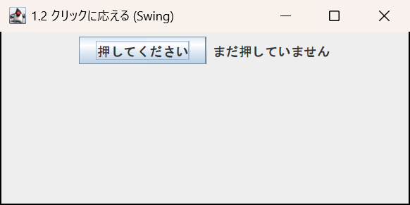 | 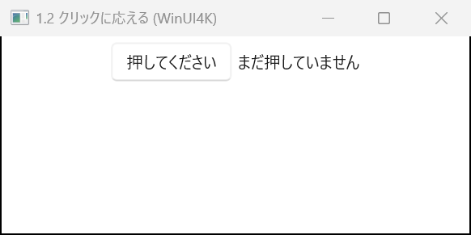 |

イベントを使わないなら、引数のないラムダも渡せます。

```java
button.addActionListener(() -> message.setText("Clicked!"));
```

リスナーを外すときは、渡したものと同じオブジェクトを `removeActionListener` に渡します (Swing と同じ)。

<a id="button-enabled"></a>
### 1.3 有効・無効を切り替える

チェックボックスの状態に合わせて「Next」ボタンを有効にします。

**Swing (Java)**

```java
JCheckBox agree = new JCheckBox("I agree to the terms of use");
JButton next = new JButton("Next");
next.setEnabled(false);
agree.addItemListener(e -> next.setEnabled(agree.isSelected()));
```

**WinUI4K (Java)**

```java
WCheckBox agree = new WCheckBox("I agree to the terms of use");
WButton next = new WButton("Next");
next.setEnabled(false);
agree.addItemListener(e -> next.setEnabled(agree.isSelected()));
```

**実行した画面** ([`EnabledSwing.java`](../winui4k-sample-swing-to-winui4k/src/main/java/com/appkitbox/winui4k/swing_to_winui4k/jbutton/enabled/EnabledSwing.java) / [`EnabledWinUI4K.java`](../winui4k-sample-swing-to-winui4k/src/main/java/com/appkitbox/winui4k/swing_to_winui4k/jbutton/enabled/EnabledWinUI4K.java))

| Swing | WinUI4K |
|---|---|
| 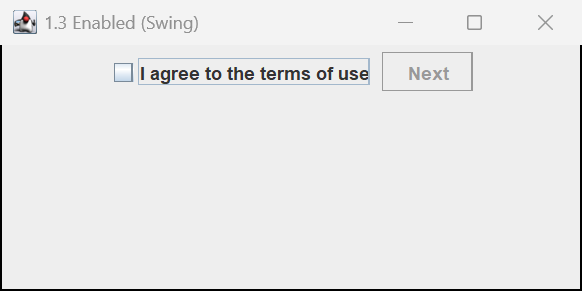 | 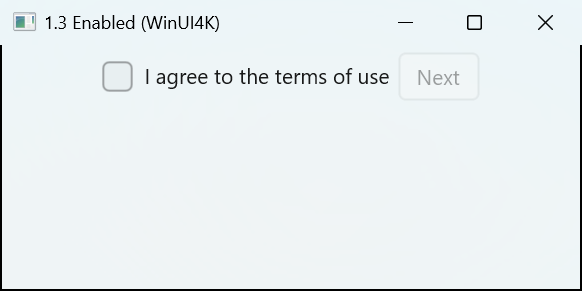 |

無効なボタンは、クリックしても `doClick()` を呼んでもリスナーが呼ばれません (Swing と同じ)。

<a id="button-icon"></a>
### 1.4 アイコンを付ける

**Swing (Java)**

```java
JButton save = new JButton("Save", new ImageIcon("icons/save.png"));
JButton delete = new JButton(new ImageIcon("icons/delete.png"));  // icon only
JButton top = new JButton("Download", new ImageIcon("icons/download.png"));
top.setHorizontalTextPosition(SwingConstants.CENTER);
top.setVerticalTextPosition(SwingConstants.BOTTOM);              // text below the icon
```

**WinUI4K (Java)**

```java
WButton save = new WButton("Save", Symbol.SAVE);                  // built-in Windows icon
WButton delete = new WButton(Symbol.DELETE);                      // icon only
WButton top = new WButton("Download", new WImageIcon("icons/download.png"));  // image file
top.setHorizontalTextPosition(HorizontalTextPosition.CENTER);
top.setVerticalTextPosition(VerticalTextPosition.BOTTOM);
```

**実行した画面** ([`IconSwing.java`](../winui4k-sample-swing-to-winui4k/src/main/java/com/appkitbox/winui4k/swing_to_winui4k/jbutton/icon/IconSwing.java) / [`IconWinUI4K.java`](../winui4k-sample-swing-to-winui4k/src/main/java/com/appkitbox/winui4k/swing_to_winui4k/jbutton/icon/IconWinUI4K.java))

| Swing | WinUI4K |
|---|---|
| 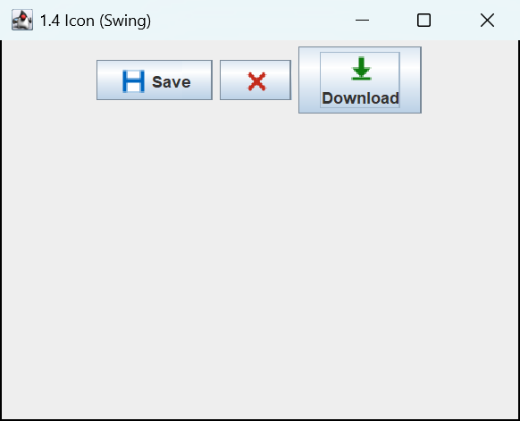 | 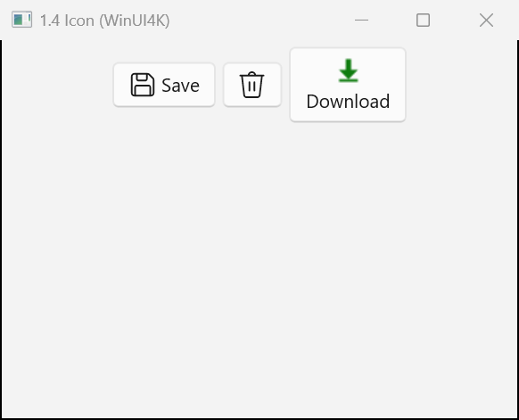 |

- `Symbol` は Windows のアイコン フォント (Segoe Fluent Icons) のアイコンで、テーマの文字色に合わせて描かれます。
  画像を用意しなくてよいので、まず `Symbol` に合うものがないか探すのがおすすめです。
- 画像のアイコンは `WImageIcon` です。`ImageIcon(String)` と同じくファイルのパスを渡し、元の大きさのまま表示します。
- フォントのグリフを使うときは `new WFontIcon("")` のように書きます。
- アイコンと文字の間隔は `setIconTextGap(4)` で変えられます (既定は Swing と同じ 4)。
- 押している間・無効なときのアイコンは `setSelectedIcon` / `setDisabledIcon` で替えられます。

<a id="button-tooltip"></a>
### 1.5 ツールチップを出す

**Swing (Java)**

```java
JButton refresh = new JButton("Refresh");
refresh.setToolTipText("Refresh the list (F5)");
```

**WinUI4K (Java)**

```java
WButton refresh = new WButton("Refresh");
refresh.setToolTipText("Refresh the list (F5)");
```

**実行した画面** ([`ToolTipSwing.java`](../winui4k-sample-swing-to-winui4k/src/main/java/com/appkitbox/winui4k/swing_to_winui4k/jbutton/tooltip/ToolTipSwing.java) / [`ToolTipWinUI4K.java`](../winui4k-sample-swing-to-winui4k/src/main/java/com/appkitbox/winui4k/swing_to_winui4k/jbutton/tooltip/ToolTipWinUI4K.java))

| Swing | WinUI4K |
|---|---|
| 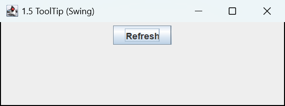 | 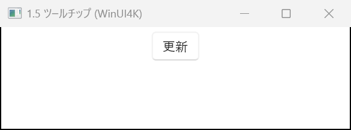 |

WinUI のツールチップ (`ToolTip`) で表示します。表示の位置などを細かく決めるときは、`WToolTip` を作って `setToolTip(toolTip)` に渡します。

<a id="button-mnemonic"></a>
### 1.6 ニーモニックでキーボードから押す

Alt+S で「Save」ボタンを押せるようにします。

**Swing (Java)**

```java
JButton save = new JButton("Save");
save.setMnemonic(KeyEvent.VK_S);
```

**WinUI4K (Java)**

```java
WButton save = new WButton("Save");
save.setMnemonic('S');            // WKeyEvent.VK_S also works
```

**実行した画面** ([`MnemonicSwing.java`](../winui4k-sample-swing-to-winui4k/src/main/java/com/appkitbox/winui4k/swing_to_winui4k/jbutton/mnemonic/MnemonicSwing.java) / [`MnemonicWinUI4K.java`](../winui4k-sample-swing-to-winui4k/src/main/java/com/appkitbox/winui4k/swing_to_winui4k/jbutton/mnemonic/MnemonicWinUI4K.java))

| Swing | WinUI4K |
|---|---|
| 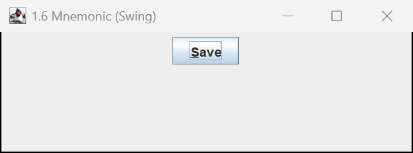 |  |

WinUI のアクセス キー (`AccessKey`) で実現しています。Swing と違い、ラベルの文字に下線は引かれません。
Alt を押すとボタンの上にキーのヒント (「S」) が出て、続けて S を押すとクリックされます。

<a id="button-default"></a>
### 1.7 Enter で押される既定ボタン

ダイアログの「OK」のように、Enter キーで押されるボタンです。

**Swing (Java)**

```java
JButton ok = new JButton("OK");
JButton cancel = new JButton("Cancel");
frame.getRootPane().setDefaultButton(ok);
```

**WinUI4K (Java)**

```java
WButton ok = new WButton("OK");
WButton cancel = new WButton("Cancel");
frame.setDefaultButton(ok);
```

**実行した画面** ([`DefaultButtonSwing.java`](../winui4k-sample-swing-to-winui4k/src/main/java/com/appkitbox/winui4k/swing_to_winui4k/jbutton/defaultbutton/DefaultButtonSwing.java) / [`DefaultButtonWinUI4K.java`](../winui4k-sample-swing-to-winui4k/src/main/java/com/appkitbox/winui4k/swing_to_winui4k/jbutton/defaultbutton/DefaultButtonWinUI4K.java))

| Swing | WinUI4K |
|---|---|
| 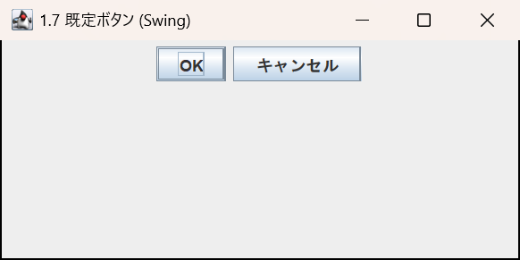 | 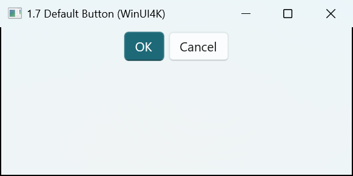 |

- 既定ボタンは WinUI のアクセントの色 (Windows の設定の色) で表示されます。
- 1 行の `WTextField` で Enter を押したとき、その入力欄に `ActionListener` が無ければ既定ボタンが押されます (`JTextField` と同じ)。
- ほかのボタンにフォーカスがあるときは、Enter でそのボタンが押されます。

<a id="button-action"></a>
### 1.8 Action でボタンとメニューの処理を共有する

ボタンとメニューの両方から同じ処理を呼び、無効にするときは両方まとめて無効にします。

**Swing (Java)**

```java
Action saveAction = new AbstractAction("Save", new ImageIcon("icons/save.png")) {
    @Override
    public void actionPerformed(ActionEvent e) {
        save();
    }
};
saveAction.putValue(Action.SHORT_DESCRIPTION, "Save the file");

JButton saveButton = new JButton(saveAction);
JMenuItem saveItem = new JMenuItem(saveAction);

saveAction.setEnabled(false);   // disables both the button and the menu item
```

**WinUI4K (Java)**

```java
WAction saveAction = new WAbstractAction("Save", Symbol.SAVE) {
    @Override
    public void actionPerformed(WActionEvent e) {
        save();
    }
};
saveAction.putValue(WAction.SHORT_DESCRIPTION, "Save the file");

WButton saveButton = new WButton(saveAction);
WMenuFlyoutItem saveItem = new WMenuFlyoutItem(saveAction);

saveAction.setEnabled(false);   // disables both the button and the menu item
```

**実行した画面** ([`ActionSwing.java`](../winui4k-sample-swing-to-winui4k/src/main/java/com/appkitbox/winui4k/swing_to_winui4k/jbutton/action/ActionSwing.java) / [`ActionWinUI4K.java`](../winui4k-sample-swing-to-winui4k/src/main/java/com/appkitbox/winui4k/swing_to_winui4k/jbutton/action/ActionWinUI4K.java))

| Swing | WinUI4K |
|---|---|
| 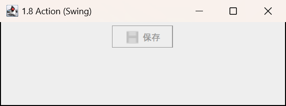 | 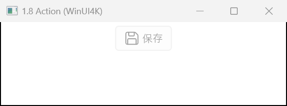 |

- `NAME` は文字、`SMALL_ICON` はアイコン、`SHORT_DESCRIPTION` はツールチップ、`MNEMONIC_KEY` はニーモニックになります (Swing と同じ)。
- アイコンだけのボタンにするときは `saveButton.setHideActionText(true)` を指定します。
- メニュー バーのメニュー項目は `WMenuFlyoutItem` です (`WMenuBar` に入れて `frame.setJMenuBar(menuBar)` で付けます)。

<a id="button-command"></a>
### 1.9 1 つのリスナーで複数のボタンを処理する

電卓のように、たくさんのボタンを 1 つのリスナーで受けます。

**Swing (Java)**

```java
JTextField display = new JTextField(10);
ActionListener append = e -> display.setText(display.getText() + e.getActionCommand());

JPanel keys = new JPanel(new GridLayout(0, 3, 4, 4));
for (int i = 1; i <= 9; i++) {
    JButton key = new JButton(String.valueOf(i));
    key.addActionListener(append);      // the action command defaults to the button text
    keys.add(key);
}
```

**WinUI4K (Java)**

```java
WTextField display = new WTextField(10);
WActionListener append = e -> display.setText(display.getText() + e.getActionCommand());

WLayoutPanel keys = new WLayoutPanel(new WGridLayout(0, 3, 4, 4));
for (int i = 1; i <= 9; i++) {
    WButton key = new WButton(String.valueOf(i));
    key.addActionListener(append);      // the action command defaults to the button text
    keys.add(key);
}
```

**実行した画面** ([`ActionCommandSwing.java`](../winui4k-sample-swing-to-winui4k/src/main/java/com/appkitbox/winui4k/swing_to_winui4k/jbutton/actioncommand/ActionCommandSwing.java) / [`ActionCommandWinUI4K.java`](../winui4k-sample-swing-to-winui4k/src/main/java/com/appkitbox/winui4k/swing_to_winui4k/jbutton/actioncommand/ActionCommandWinUI4K.java))

| Swing | WinUI4K |
|---|---|
| 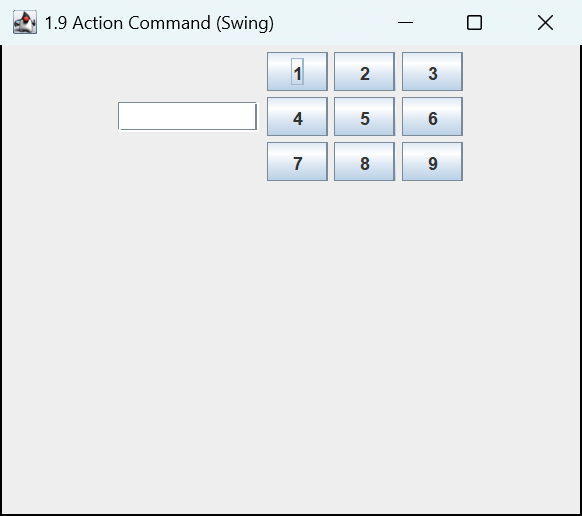 | 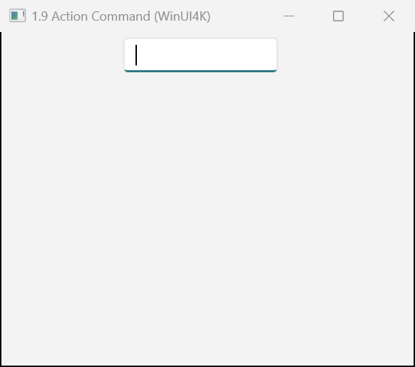 |

- `actionCommand` を設定しないときは、ボタンの文字が `e.getActionCommand()` になります (Swing と同じ)。
  文字と違うコマンド名にするときは `key.setActionCommand("digit-1")` を指定します。
- どのボタンが押されたかは `e.getSource()` でも分かります。
- レイアウト マネージャーを使うパネルは `WLayoutPanel` です (`new JPanel(layout)` に当たります)。引数なしの `new WLayoutPanel()` は `new JPanel()` と違ってレイアウト マネージャーを持たない (`null`) ので、`new JPanel()` は `new WLayoutPanel(new WFlowLayout())` にします。

<a id="button-doclick"></a>
### 1.10 プログラムからクリックする

**Swing (Java)**

```java
search.doClick();
```

**WinUI4K (Java)**

```java
search.doClick();
```

**実行した画面** ([`DoClickSwing.java`](../winui4k-sample-swing-to-winui4k/src/main/java/com/appkitbox/winui4k/swing_to_winui4k/jbutton/doclick/DoClickSwing.java) / [`DoClickWinUI4K.java`](../winui4k-sample-swing-to-winui4k/src/main/java/com/appkitbox/winui4k/swing_to_winui4k/jbutton/doclick/DoClickWinUI4K.java))

| Swing | WinUI4K |
|---|---|
| 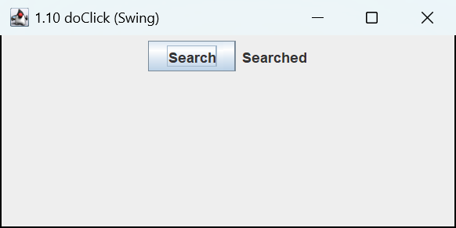 | 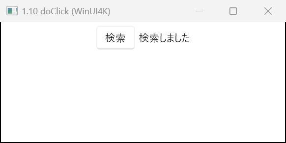 |

マウスで押したときと同じ順にリスナーが呼ばれます。Swing の `doClick(pressTime)` は押した見た目のまま UI スレッドを止めますが、
WinUI4K は押した見た目を作らず、UI スレッドも止めません。

<a id="button-appearance"></a>
### 1.11 フォント・色・平らなボタン

**Swing (Java)**

```java
JButton danger = new JButton("Delete");
danger.setFont(new Font("Yu Gothic UI", Font.BOLD, 14));
danger.setForeground(Color.WHITE);
danger.setBackground(new Color(196, 43, 28));

JButton link = new JButton("Learn more");
link.setContentAreaFilled(false);     // don't paint the background
link.setBorderPainted(false);         // don't paint the border
link.setFocusPainted(false);          // don't paint the focus border
```

**WinUI4K (Java)**

```java
WButton danger = new WButton("Delete");
danger.setFont(new WFont("Yu Gothic UI", WFont.BOLD, 14));
danger.setForeground(WColor.WHITE);
danger.setBackground(new WColor(196, 43, 28));

WButton link = new WButton("Learn more");
link.setContentAreaFilled(false);
link.setBorderPainted(false);
link.setFocusPainted(false);
```

**実行した画面** ([`AppearanceSwing.java`](../winui4k-sample-swing-to-winui4k/src/main/java/com/appkitbox/winui4k/swing_to_winui4k/jbutton/appearance/AppearanceSwing.java) / [`AppearanceWinUI4K.java`](../winui4k-sample-swing-to-winui4k/src/main/java/com/appkitbox/winui4k/swing_to_winui4k/jbutton/appearance/AppearanceWinUI4K.java))

| Swing | WinUI4K |
|---|---|
| 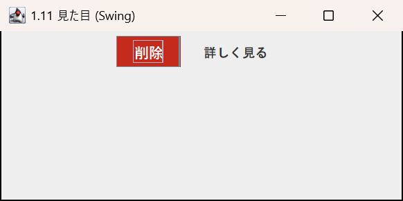 | 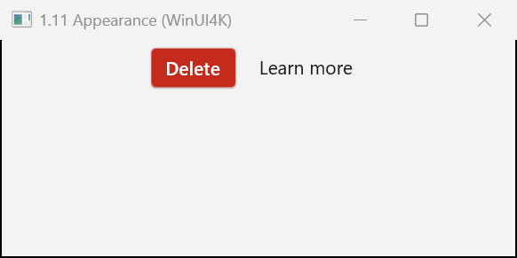 |

- WinUI4K はマウスを重ねたときと押したときの背景色も、指定した色から作ります。
- `setBackground(null)` / `setForeground(null)` でテーマの色に戻ります。
- `setContentAreaFilled(false)` のボタンは WinUI の「Subtle」のスタイル (マウスを重ねたときだけ背景が出る) になります。
- 色を固定すると、ダーク テーマに切り替えたときに読みにくくなることがあります。強調だけなら [1.14](#button-winui) のアクセントを使う方が、
  テーマに合わせて色が変わります。

<a id="button-size"></a>
### 1.12 大きさを決める

**Swing (Java)**

```java
JButton ok = new JButton("OK");
ok.setPreferredSize(new Dimension(120, 32));
```

**WinUI4K (Java)**

```java
WButton ok = new WButton("OK");
ok.setPreferredSize(new WSize(120, 32));
// width only
ok.setWidth(120);
```

**実行した画面** ([`SizeSwing.java`](../winui4k-sample-swing-to-winui4k/src/main/java/com/appkitbox/winui4k/swing_to_winui4k/jbutton/size/SizeSwing.java) / [`SizeWinUI4K.java`](../winui4k-sample-swing-to-winui4k/src/main/java/com/appkitbox/winui4k/swing_to_winui4k/jbutton/size/SizeWinUI4K.java))

| Swing | WinUI4K |
|---|---|
| 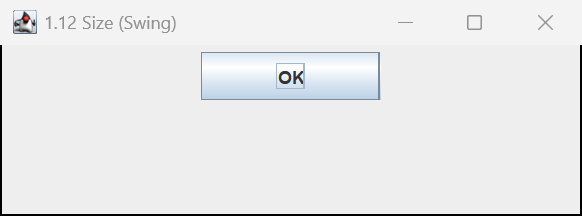 | 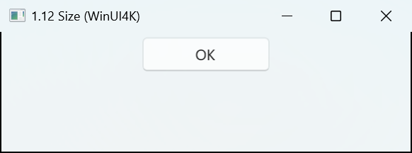 |

`setPreferredSize` は幅と高さを固定します。幅か高さの片方だけを固定するときは `setWidth` / `setHeight` を使います。
最小・最大の大きさは `setMinimumSize` / `setMaximumSize` です。

<a id="button-background"></a>
### 1.13 時間のかかる処理を裏で動かす

ボタンを押したらネットワークからデータを取り、取り終えたら結果を表示します。
処理の間はボタンを無効にします。

**Swing (Java)**

```java
JLabel status = new JLabel();
JButton download = new JButton("Download");
download.addActionListener(e -> {
    download.setEnabled(false);
    status.setText("Downloading...");
    new SwingWorker<String, Void>() {
        @Override
        protected String doInBackground() throws Exception {
            return fetch();                       // runs on another thread
        }

        @Override
        protected void done() {                   // runs on the UI thread
            download.setEnabled(true);
            try {
                status.setText(get());
            } catch (Exception ex) {
                status.setText("Failed: " + ex.getMessage());
            }
        }
    }.execute();
});
```

**WinUI4K (Java)**

```java
WLabel status = new WLabel();
WButton download = new WButton("Download");
download.addActionListener(e -> {
    download.setEnabled(false);
    status.setText("Downloading...");
    CompletableFuture
        .supplyAsync(() -> fetch())               // runs on another thread
        .whenComplete((result, error) -> WinUiUtilities.invokeLater(() -> {   // back to the UI thread
            download.setEnabled(true);
            status.setText(error == null ? result : "Failed: " + error.getMessage());
        }));
});
```

**実行した画面** ([`BackgroundSwing.java`](../winui4k-sample-swing-to-winui4k/src/main/java/com/appkitbox/winui4k/swing_to_winui4k/jbutton/background/BackgroundSwing.java) / [`BackgroundWinUI4K.java`](../winui4k-sample-swing-to-winui4k/src/main/java/com/appkitbox/winui4k/swing_to_winui4k/jbutton/background/BackgroundWinUI4K.java))

| Swing | WinUI4K |
|---|---|
| 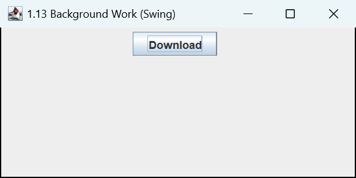 | 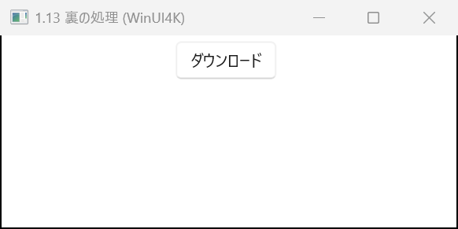 |

WinUI4K には `SwingWorker` に当たるクラスが無いので、`CompletableFuture` や `ExecutorService` で裏の処理を動かし、
画面を触る処理は `WinUiUtilities.invokeLater` で UI スレッドへ戻します。UI スレッドの外から `W*` クラスを触ってはいけないのは
Swing と同じです。

<a id="button-winui"></a>
### 1.14 アクセントとフライアウト

Swing には無いが、WinUI ではよく使う機能です。

```java
// highlight the primary action with the Windows accent color
WButton submit = new WButton("Submit");
submit.setAccent(true);

// a button that opens a menu (in Swing you show a JPopupMenu yourself)
WMenuFlyout menu = new WMenuFlyout();
menu.add("Export as PDF").addActionListener(() -> exportPdf());
menu.add("Export as CSV").addActionListener(() -> exportCsv());
WButton export = new WButton("Export");
export.setFlyout(menu);
```

**実行した画面** ([`AccentFlyoutWinUI4K.java`](../winui4k-sample-swing-to-winui4k/src/main/java/com/appkitbox/winui4k/swing_to_winui4k/jbutton/accentflyout/AccentFlyoutWinUI4K.java))

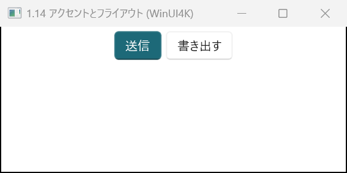

右に下向きの矢印が付いたボタンにするときは `WDropDownButton`、本体と矢印の部分を分けたボタンは `WSplitButton` を使います。

<a id="button-kotlin"></a>
### 1.15 Kotlin で書く

この章のユースケースをまとめて Kotlin で書くと、次のようになります。

```kotlin
import com.appkitbox.winui4k.*
import java.util.concurrent.CompletableFuture

fun main() {
    WinUiUtilities.invokeLater {
        val frame = WFrame("Button sample")
        frame.layout = WFlowLayout()
        val status = WLabel("Not clicked yet")

        // Respond to clicks (1.2)
        val hello = WButton("Click me")
        hello.addActionListener { status.text = "Clicked!" }

        // Icon, tooltip, mnemonic (1.4-1.6)
        val save = WButton("Save", Symbol.SAVE)
        save.toolTipText = "Save the file"
        save.setMnemonic('S')

        // Sharing an Action (1.8)
        val deleteAction = object : WAbstractAction("Delete", Symbol.DELETE) {
            override fun actionPerformed(e: WActionEvent) {
                status.text = "Deleted"
            }
        }
        val delete = WButton(deleteAction)

        // Flat button (1.11)
        val link = WButton("Learn more").apply {
            isContentAreaFilled = false
            isBorderPainted = false
        }

        // Background work (1.13)
        val download = WButton("Download")
        download.addActionListener {
            download.isEnabled = false
            CompletableFuture.supplyAsync { fetch() }.whenComplete { result, error ->
                WinUiUtilities.invokeLater {
                    download.isEnabled = true
                    status.text = if (error == null) result else "Failed: ${error.message}"
                }
            }
        }

        // Default button and accent (1.7, 1.14)
        val ok = WButton("OK")
        ok.addActionListener { e -> status.text = "${e.actionCommand} clicked" }
        frame.defaultButton = ok

        val row = WPanel(8.0, Orientation.HORIZONTAL)
        listOf(hello, save, delete, link, download, ok).forEach { row.add(it) }
        frame.add(row)
        frame.add(status)
        frame.setSize(720, 240)
        frame.isVisible = true
    }
}

private fun fetch(): String {
    Thread.sleep(1000)
    return "Download complete"
}
```

Kotlin では `isEnabled`・`isContentAreaFilled`・`toolTipText`・`defaultButton` のようにプロパティで書けます。
`addActionListener` には、イベントを受け取る `{ e -> ... }` と受け取らない `{ ... }` のどちらも渡せます。

<a id="button-notes"></a>
### 1.16 注意点

- ニーモニックの文字に下線は出ず、Alt を押したときにキーのヒントが出ます。ラベルの文字だけではキーが分からないので、「Save (S)」のように書いたり、ツールチップで知らせたりすると、
  利用者がキーに気づきやすくなります。
- 既定ボタンにすると見た目が変わり、アクセントの色になります。外すと元の見た目に戻ります。
- `JButton` の HTML の文字は使えません。Swing の `<html>` で始まる文字は解釈されず、そのまま表示されます。
  複数行や書式のある中身は `setContent(component)` に `WLabel` などを入れます。
- ボタンのグループ: ラジオボタンをまとめる `ButtonGroup` は `WButtonGroup` です。

<a id="textfield"></a>
## 2. JTextField → WTextField

`WTextField` は WinUI の `TextBox` を包んだクラスです。`JTextField` の主な API に加え、`Document` に当たる `WDocument`
(リスナーとフィルター) も持っています。

<a id="textfield-table"></a>
### 2.1 API の対応表

| やりたいこと | Swing | WinUI4K | 違い |
|---|---|---|---|
| 空の入力欄 | `new JTextField()` | `new WTextField()` | 同じ |
| 列数で幅を決める | `new JTextField(20)` | `new WTextField(20)` | 同じ |
| 初めの文字列 | `new JTextField("Tokyo")` | `WTextField f = new WTextField(); f.setText("Tokyo");` | **`WTextField(String)` は案内文** (下の注意を参照) |
| 読み書き | `getText()` / `setText(...)` | `getText()` / `setText(...)` | 同じ |
| Enter で処理 | `addActionListener(...)` | `addActionListener(...)` | 同じ |
| 変化の通知 | `getDocument().addDocumentListener(...)` | `addDocumentListener(...)` / `addTextChangedListener(text -> ...)` | 入力欄に直接付けられる |
| 入力の制限 | `((AbstractDocument) getDocument()).setDocumentFilter(...)` | `getDocument().setDocumentFilter(...)` | キャストが要らない |
| 文字数の上限 | `DocumentFilter` を書く | `setMaxLength(10)` | WinUI の機能 |
| 読み取り専用 | `setEditable(false)` | `setEditable(false)` | 同じ |
| 案内文 | (なし) | `setPlaceholderText("...")` | WinUI の機能 |
| 見出し | `JLabel` + `setLabelFor` | `setHeader("...")` | 入力欄の上に表示する |
| 全選択 | `selectAll()` | `selectAll()` | 同じ |
| 選択範囲 | `select(s, e)` / `getSelectedText()` | `select(s, e)` / `getSelectedText()` | 同じ |
| キャレット | `setCaretPosition(n)` | `setCaretPosition(n)` | 同じ |
| フォーカス | `requestFocusInWindow()` | `requestFocusInWindow()` | 同じ |
| フォーカスの通知 | `addFocusListener(...)` | `addFocusListener(...)` | 同じ (`FocusAdapter` → `WFocusAdapter`) |
| 入力の検証 | `setInputVerifier(...)` | `addFocusListener(...)` で自分で書く | `InputVerifier` は無い |
| 元に戻す | `UndoManager` を自分で付ける | 組み込み (Ctrl+Z)。`undo()` / `canUndo()` | WinUI の機能 |
| 文字の揃え | `setHorizontalAlignment(JTextField.RIGHT)` | `setTextAlignment(TextAlignment.RIGHT)` | 名前が違う |
| 選択の色 | `setSelectionColor(...)` | `setSelectionColor(...)` | 同じ |
| キャレットの色 | `setCaretColor(...)` | (なし) | 変えられない |
| 無効なときの文字色 | `setDisabledTextColor(...)` | (なし) | 変えられない |
| キーバインド | `getInputMap()` / `getActionMap()` | `getInputMap()` / `getActionMap()` | 同じ |
| パスワード | `JPasswordField` | `WPasswordField` | [2.15](#textfield-password) |
| 複数行 | `JTextArea` | `WTextPane` ([12 章](#textarea))。`WTextField` に `setAcceptsReturn(true)` でも複数行にできる | [2.17](#textfield-notes) |

<a id="textfield-basic"></a>
### 2.2 入力欄を作って値を読み書きする

名前を入れてボタンを押すと、あいさつを表示します。

**Swing (Java)**

```java
JTextField name = new JTextField(20);
name.setText("Smith");
JLabel greeting = new JLabel();
JButton greet = new JButton("Greet");
greet.addActionListener(e -> greeting.setText("Hello, " + name.getText().trim() + "!"));
```

**WinUI4K (Java)**

```java
WTextField name = new WTextField(20);
name.setText("Smith");
WLabel greeting = new WLabel();
WButton greet = new WButton("Greet");
greet.addActionListener(e -> greeting.setText("Hello, " + name.getText().trim() + "!"));
```

**実行した画面** ([`BasicSwing.java`](../winui4k-sample-swing-to-winui4k/src/main/java/com/appkitbox/winui4k/swing_to_winui4k/jtextfield/basic/BasicSwing.java) / [`BasicWinUI4K.java`](../winui4k-sample-swing-to-winui4k/src/main/java/com/appkitbox/winui4k/swing_to_winui4k/jtextfield/basic/BasicWinUI4K.java))

| Swing | WinUI4K |
|---|---|
| 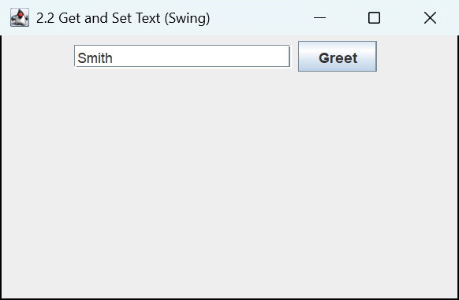 | 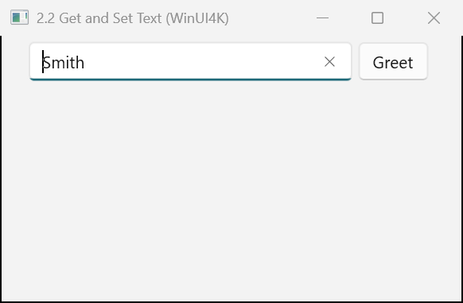 |

`getText()` は今の文字列をそのまま返します (前後の空白も残ります)。

<a id="textfield-enter"></a>
### 2.3 Enter で処理する

検索欄で Enter を押したら検索します。

**Swing (Java)**

```java
JTextField query = new JTextField(20);
query.addActionListener(e -> search(query.getText()));
```

**WinUI4K (Java)**

```java
WTextField query = new WTextField(20);
query.addActionListener(e -> search(query.getText()));
```

**実行した画面** ([`EnterSwing.java`](../winui4k-sample-swing-to-winui4k/src/main/java/com/appkitbox/winui4k/swing_to_winui4k/jtextfield/enter/EnterSwing.java) / [`EnterWinUI4K.java`](../winui4k-sample-swing-to-winui4k/src/main/java/com/appkitbox/winui4k/swing_to_winui4k/jtextfield/enter/EnterWinUI4K.java))

| Swing | WinUI4K |
|---|---|
| 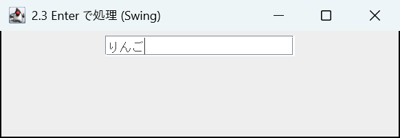 | 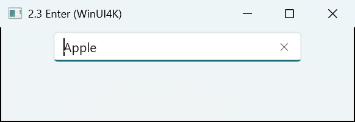 |

- 修飾キーなしの Enter で呼ばれます。`e.getActionCommand()` は、`setActionCommand` を設定していなければ入力欄の文字列です (Swing と同じ)。
- `ActionListener` が 1 つも無い入力欄で Enter を押すと、ウィンドウの既定ボタン ([1.7](#button-default)) が押されます。

<a id="textfield-change"></a>
### 2.4 入力のたびに反応する

入力した文字数を表示し、空のときは「Register」ボタンを無効にします。

**Swing (Java)**

```java
JTextField title = new JTextField(30);
JLabel count = new JLabel("0 characters");
JButton register = new JButton("Register");
register.setEnabled(false);

title.getDocument().addDocumentListener(new DocumentListener() {
    @Override public void insertUpdate(DocumentEvent e) { update(); }
    @Override public void removeUpdate(DocumentEvent e) { update(); }
    @Override public void changedUpdate(DocumentEvent e) { update(); }

    private void update() {
        count.setText(title.getText().length() + " characters");
        register.setEnabled(!title.getText().isEmpty());
    }
});
```

**WinUI4K (Java)**

```java
WTextField title = new WTextField(30);
WLabel count = new WLabel("0 characters");
WButton register = new WButton("Register");
register.setEnabled(false);

title.addTextChangedListener(text -> {
    count.setText(text.length() + " characters");
    register.setEnabled(!text.isEmpty());
});
```

**実行した画面** ([`ChangeSwing.java`](../winui4k-sample-swing-to-winui4k/src/main/java/com/appkitbox/winui4k/swing_to_winui4k/jtextfield/change/ChangeSwing.java) / [`ChangeWinUI4K.java`](../winui4k-sample-swing-to-winui4k/src/main/java/com/appkitbox/winui4k/swing_to_winui4k/jtextfield/change/ChangeWinUI4K.java))

| Swing | WinUI4K |
|---|---|
| 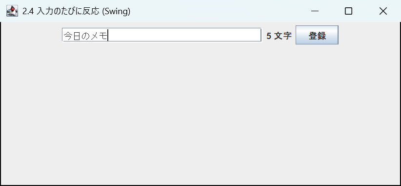 | 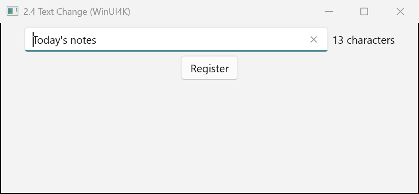 |

どちらのサンプルも、表示する前に `title.setText("Today's notes")` を呼んでいます。Swing の `DocumentListener` と同じく、WinUI4K の `addTextChangedListener` のリスナーも `setText` の中ですぐ呼ばれるので、表示する前の変更も受け取り、画面は「13 characters」になります。同じ文字列を設定し直したときは呼ばれません。

- `addTextChangedListener` は、文字が変わるたびに今の文字列を受け取ります。3 つのメソッドを書き分ける必要がありません。
- Swing と同じ `WDocumentListener` (`insertUpdate` / `removeUpdate` / `changedUpdate`) も使えます。
  変わった位置と長さ (`e.getOffset()` / `e.getLength()`) が要るときはこちらを使います。

  ```java
  title.addDocumentListener(new WDocumentListener() {
      @Override public void insertUpdate(WDocumentEvent e) { update(); }
      @Override public void removeUpdate(WDocumentEvent e) { update(); }
      @Override public void changedUpdate(WDocumentEvent e) { update(); }
  });
  ```

  `title.getDocument().addDocumentListener(...)` と書いても同じです。

<a id="textfield-filter"></a>
### 2.5 入力できる文字を制限する

郵便番号の欄に数字だけを入力できるようにします。

**Swing (Java)**

```java
JTextField zip = new JTextField(8);
((AbstractDocument) zip.getDocument()).setDocumentFilter(new DocumentFilter() {
    @Override
    public void insertString(FilterBypass fb, int offset, String string, AttributeSet attr)
            throws BadLocationException {
        if (isDigits(string)) super.insertString(fb, offset, string, attr);
    }

    @Override
    public void replace(FilterBypass fb, int offset, int length, String text, AttributeSet attrs)
            throws BadLocationException {
        if (text == null || isDigits(text)) super.replace(fb, offset, length, text, attrs);
    }
});

static boolean isDigits(String s) {
    return s.chars().allMatch(Character::isDigit);
}
```

**WinUI4K (Java)**

```java
WTextField zip = new WTextField(8);
zip.getDocument().setDocumentFilter(new WDocumentFilter() {
    @Override
    public void insertString(FilterBypass fb, int offset, String string, WAttributeSet attr) {
        if (isDigits(string)) super.insertString(fb, offset, string, attr);
    }

    @Override
    public void replace(FilterBypass fb, int offset, int length, String text, WAttributeSet attrs) {
        if (text == null || isDigits(text)) super.replace(fb, offset, length, text, attrs);
    }
});
```

**実行した画面** ([`FilterSwing.java`](../winui4k-sample-swing-to-winui4k/src/main/java/com/appkitbox/winui4k/swing_to_winui4k/jtextfield/filter/FilterSwing.java) / [`FilterWinUI4K.java`](../winui4k-sample-swing-to-winui4k/src/main/java/com/appkitbox/winui4k/swing_to_winui4k/jtextfield/filter/FilterWinUI4K.java))

| Swing | WinUI4K |
|---|---|
| 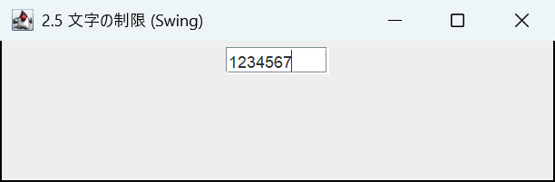 | 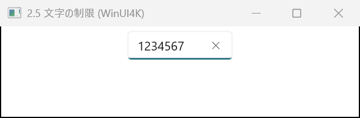 |

- `AbstractDocument` へのキャストと `BadLocationException` の `throws` が要らなくなるほかは、Swing と同じ形です。
- 入力を断ると、入力欄は入力の前の状態のままになります。大文字に直すなど書き換えて通すこともできます
  (`super.replace(fb, offset, length, text.toUpperCase(), attrs)`)。
- 日本語入力 (IME) の変換中の文字も、入力のたびにフィルターを通ります。

<a id="textfield-maxlength"></a>
### 2.6 文字数を制限する

**Swing (Java)**

```java
// Swing has no maximum-length setting, so write a DocumentFilter
((AbstractDocument) code.getDocument()).setDocumentFilter(new DocumentFilter() {
    @Override
    public void replace(FilterBypass fb, int offset, int length, String text, AttributeSet attrs)
            throws BadLocationException {
        int newLength = fb.getDocument().getLength() - length + (text == null ? 0 : text.length());
        if (newLength <= 10) super.replace(fb, offset, length, text, attrs);
    }
    // write insertString the same way
});
```

**WinUI4K (Java)**

```java
code.setMaxLength(10);   // 0 means no limit
```

**実行した画面** ([`MaxLengthSwing.java`](../winui4k-sample-swing-to-winui4k/src/main/java/com/appkitbox/winui4k/swing_to_winui4k/jtextfield/maxlength/MaxLengthSwing.java) / [`MaxLengthWinUI4K.java`](../winui4k-sample-swing-to-winui4k/src/main/java/com/appkitbox/winui4k/swing_to_winui4k/jtextfield/maxlength/MaxLengthWinUI4K.java))

| Swing | WinUI4K |
|---|---|
| 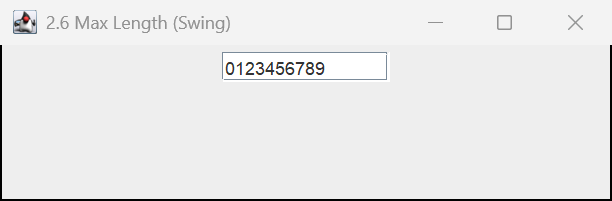 | 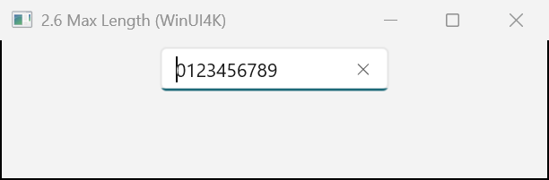 |

WinUI の `TextBox.MaxLength` で、上限を超える分の入力は入りません。

<a id="textfield-readonly"></a>
### 2.7 読み取り専用にする

**Swing (Java)**

```java
JTextField id = new JTextField(10);
id.setText("A-0001");
id.setEditable(false);
```

**WinUI4K (Java)**

```java
WTextField id = new WTextField(10);
id.setText("A-0001");
id.setEditable(false);
```

**実行した画面** ([`ReadOnlySwing.java`](../winui4k-sample-swing-to-winui4k/src/main/java/com/appkitbox/winui4k/swing_to_winui4k/jtextfield/readonly/ReadOnlySwing.java) / [`ReadOnlyWinUI4K.java`](../winui4k-sample-swing-to-winui4k/src/main/java/com/appkitbox/winui4k/swing_to_winui4k/jtextfield/readonly/ReadOnlyWinUI4K.java))

| Swing | WinUI4K |
|---|---|
| 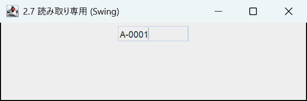 | 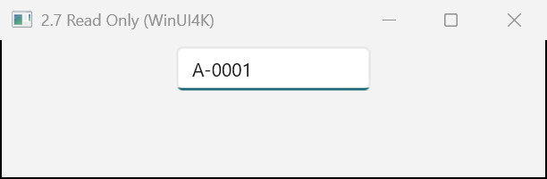 |

読み取り専用でも、選択とコピーはできます (Swing と同じ)。入力も選択もさせないときは `setEnabled(false)` にします。

<a id="textfield-placeholder"></a>
### 2.8 案内文 (プレースホルダー) と見出しを付ける

未入力のときに薄い文字で「e.g. John Smith」と出し、入力欄の上に「Name」と表示します。

**Swing (Java)**

```java
// Swing has no placeholder feature. For a header, put a separate JLabel and tie it with setLabelFor
JLabel label = new JLabel("Name");
JTextField name = new JTextField(20);
label.setLabelFor(name);
label.setDisplayedMnemonic(KeyEvent.VK_N);
frame.add(label);
frame.add(name);
// Draw a placeholder by overriding paintComponent, or rely on a library (e.g. FlatLaf's JTextField.placeholderText)
```

**WinUI4K (Java)**

```java
WTextField name = new WTextField("e.g. John Smith");   // the constructor string is the placeholder
name.setHeader("Name");                             // header shown above the field
frame.add(name);
```

**実行した画面** ([`PlaceholderSwing.java`](../winui4k-sample-swing-to-winui4k/src/main/java/com/appkitbox/winui4k/swing_to_winui4k/jtextfield/placeholder/PlaceholderSwing.java) / [`PlaceholderWinUI4K.java`](../winui4k-sample-swing-to-winui4k/src/main/java/com/appkitbox/winui4k/swing_to_winui4k/jtextfield/placeholder/PlaceholderWinUI4K.java))

| Swing | WinUI4K |
|---|---|
| 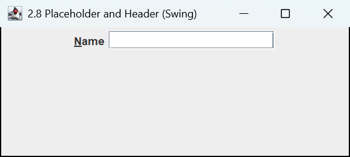 | 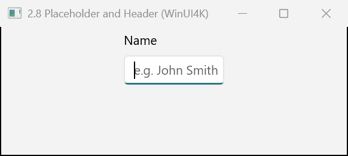 |

- 案内文は `setPlaceholderText(...)` でも設定できます。
- 見出しは入力欄の一部として、入力欄の上に描かれます。
  見出しを別のラベルで置きたいときは、Swing と同じく `WLabel` の `setLabelFor(name)` を使います。

<a id="textfield-selectall"></a>
### 2.9 フォーカスを受けたら全選択する

上書きで入力しやすいように、入力欄に入ったら中身を全部選びます。

**Swing (Java)**

```java
JTextField amount = new JTextField(10);
amount.addFocusListener(new FocusAdapter() {
    @Override
    public void focusGained(FocusEvent e) {
        amount.selectAll();
    }
});
```

**WinUI4K (Java)**

```java
WTextField amount = new WTextField(10);
amount.addFocusListener(new WFocusAdapter() {
    @Override
    public void focusGained(WFocusEvent e) {
        amount.selectAll();
    }
});
```

**実行した画面** ([`SelectAllSwing.java`](../winui4k-sample-swing-to-winui4k/src/main/java/com/appkitbox/winui4k/swing_to_winui4k/jtextfield/selectall/SelectAllSwing.java) / [`SelectAllWinUI4K.java`](../winui4k-sample-swing-to-winui4k/src/main/java/com/appkitbox/winui4k/swing_to_winui4k/jtextfield/selectall/SelectAllWinUI4K.java))

| Swing | WinUI4K |
|---|---|
| 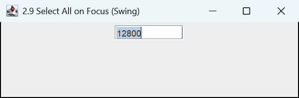 | 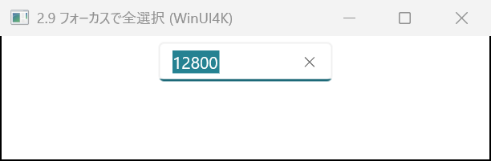 |

画面を開くと、Swing と同じく最初の入力欄にフォーカスが当たります。別の部品に当てるときは、Swing と同じく表示した直後に `requestFocusInWindow()` を呼びます。

<a id="textfield-validate"></a>
### 2.10 フォーカスを外したときに検証する

年齢の欄を離れたときに、0〜150 の数字か確かめます。

**Swing (Java)**

```java
JTextField age = new JTextField(4);
age.setInputVerifier(new InputVerifier() {
    @Override
    public boolean verify(JComponent input) {
        return isValidAge(((JTextField) input).getText());   // if false, focus is not released
    }
});
```

**WinUI4K (Java)**

```java
WTextField age = new WTextField(4);
WLabel error = new WLabel();
error.setForeground(WColor.RED);
age.addFocusListener(new WFocusAdapter() {
    @Override
    public void focusLost(WFocusEvent e) {
        error.setText(isValidAge(age.getText()) ? "" : "Enter a number from 0 to 150");
    }
});
```

**実行した画面** ([`ValidateSwing.java`](../winui4k-sample-swing-to-winui4k/src/main/java/com/appkitbox/winui4k/swing_to_winui4k/jtextfield/validate/ValidateSwing.java) / [`ValidateWinUI4K.java`](../winui4k-sample-swing-to-winui4k/src/main/java/com/appkitbox/winui4k/swing_to_winui4k/jtextfield/validate/ValidateWinUI4K.java))

| Swing | WinUI4K |
|---|---|
| 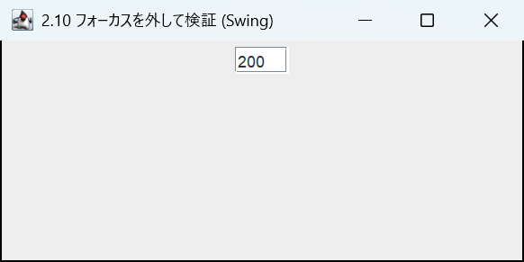 | 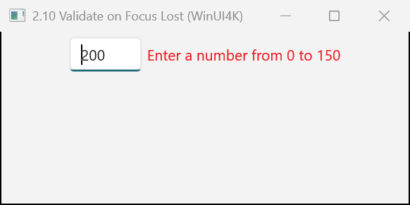 |

WinUI4K には `InputVerifier` が無く、フォーカスが移るのを止めることもできません。フォーカスを外したときにメッセージを出すか、
「Register」ボタンを押したときにまとめて検証します。Windows のアプリではフォーカスを止めず、近くにメッセージを出すのが普通です。

<a id="textfield-caret"></a>
### 2.11 選択範囲とキャレットを操作する

**Swing (Java)**

```java
JTextField text = new JTextField(30);
text.setText("Hello, World");
text.select(7, 12);                          // select "World"
String selected = text.getSelectedText();    // "World"
text.replaceSelection("Swing");              // "Hello, Swing"
text.setCaretPosition(text.getText().length());   // move to the end
text.addCaretListener(e -> position.setText("Position: " + e.getDot()));
```

**WinUI4K (Java)**

```java
WTextField text = new WTextField(30);
text.setText("Hello, World");
text.select(7, 12);
String selected = text.getSelectedText();
text.replaceSelection("WinUI");              // "Hello, WinUI"
text.setCaretPosition(text.getText().length());
text.addCaretListener(e -> position.setText("Position: " + e.getDot()));
```

**実行した画面** ([`CaretSwing.java`](../winui4k-sample-swing-to-winui4k/src/main/java/com/appkitbox/winui4k/swing_to_winui4k/jtextfield/caret/CaretSwing.java) / [`CaretWinUI4K.java`](../winui4k-sample-swing-to-winui4k/src/main/java/com/appkitbox/winui4k/swing_to_winui4k/jtextfield/caret/CaretWinUI4K.java))

| Swing | WinUI4K |
|---|---|
| 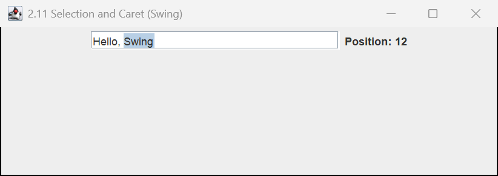 | 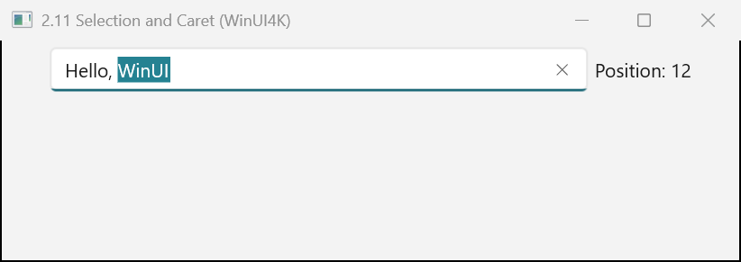 |

`getSelectionStart()` / `getSelectionEnd()`、`moveCaretPosition(n)` (キャレットを動かして選択を広げる) も Swing と同じです。
クリップボードは `copy()` / `cut()` / `paste()` で操作します。

<a id="textfield-keybinding"></a>
### 2.12 Esc で入力を消すキーバインド

**Swing (Java)**

```java
JTextField query = new JTextField(20);
query.getInputMap().put(KeyStroke.getKeyStroke(KeyEvent.VK_ESCAPE, 0), "clear");
query.getActionMap().put("clear", new AbstractAction() {
    @Override
    public void actionPerformed(ActionEvent e) {
        query.setText("");
    }
});
```

**WinUI4K (Java)**

```java
WTextField query = new WTextField(20);
query.getInputMap().put(WKeyStroke.getKeyStroke(WKeyEvent.VK_ESCAPE, 0), "clear");
query.getActionMap().put("clear", new WAbstractAction() {
    @Override
    public void actionPerformed(WActionEvent e) {
        query.setText("");
    }
});
```

**実行した画面** ([`KeyBindingSwing.java`](../winui4k-sample-swing-to-winui4k/src/main/java/com/appkitbox/winui4k/swing_to_winui4k/jtextfield/keybinding/KeyBindingSwing.java) / [`KeyBindingWinUI4K.java`](../winui4k-sample-swing-to-winui4k/src/main/java/com/appkitbox/winui4k/swing_to_winui4k/jtextfield/keybinding/KeyBindingWinUI4K.java))

| Swing | WinUI4K |
|---|---|
| 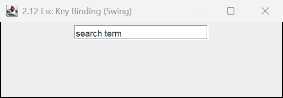 | 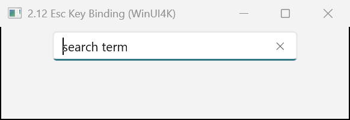 |

`KeyStroke` → `WKeyStroke`、`KeyEvent` → `WKeyEvent` に替えるだけです。`WKeyStroke.getKeyStroke("ctrl ENTER")` のような
文字列の形も使えます。Swing と違い、入力欄の既定のキー操作 (矢印や Ctrl+C など) はマップに入っていません。

<a id="textfield-undo"></a>
### 2.13 元に戻す・やり直す

**Swing (Java)**

```java
JTextField memo = new JTextField(30);
UndoManager undo = new UndoManager();
memo.getDocument().addUndoableEditListener(undo);
memo.getInputMap().put(KeyStroke.getKeyStroke("control Z"), "undo");
memo.getActionMap().put("undo", new AbstractAction() {
    @Override
    public void actionPerformed(ActionEvent e) {
        if (undo.canUndo()) undo.undo();
    }
});
// redo (Ctrl+Y) is written the same way
```

**WinUI4K (Java)**

```java
WTextField memo = new WTextField(30);
// Ctrl+Z / Ctrl+Y work without any code. To call them from a menu or the like:
undoButton.addActionListener(e -> { if (memo.canUndo()) memo.undo(); });
redoButton.addActionListener(e -> { if (memo.canRedo()) memo.redo(); });
```

**実行した画面** ([`UndoSwing.java`](../winui4k-sample-swing-to-winui4k/src/main/java/com/appkitbox/winui4k/swing_to_winui4k/jtextfield/undo/UndoSwing.java) / [`UndoWinUI4K.java`](../winui4k-sample-swing-to-winui4k/src/main/java/com/appkitbox/winui4k/swing_to_winui4k/jtextfield/undo/UndoWinUI4K.java))

| Swing | WinUI4K |
|---|---|
| 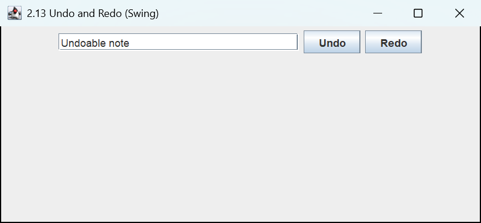 | 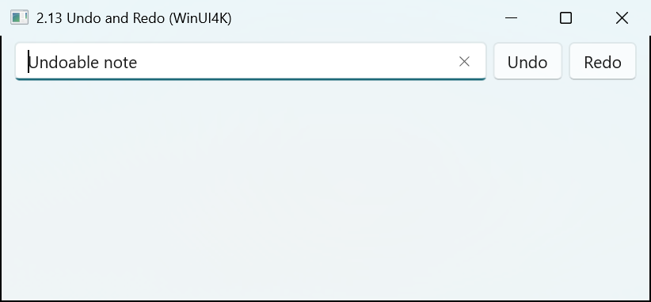 |

WinUI の入力欄は元に戻す・やり直しの機能と右クリックのメニュー (切り取り・コピー・貼り付けなど) を最初から持っています。

<a id="textfield-appearance"></a>
### 2.14 文字の揃えと見た目

金額の欄を右揃えにし、等幅のフォントにします。

**Swing (Java)**

```java
JTextField price = new JTextField(10);
price.setHorizontalAlignment(JTextField.RIGHT);
price.setFont(new Font("Consolas", Font.PLAIN, 14));
price.setForeground(new Color(0, 90, 158));
price.setToolTipText("Amount including tax");
```

**WinUI4K (Java)**

```java
WTextField price = new WTextField(10);
price.setTextAlignment(TextAlignment.RIGHT);
price.setFont(new WFont("Consolas", WFont.PLAIN, 14));
price.setForeground(new WColor(0, 90, 158));
price.setToolTipText("Amount including tax");
```

**実行した画面** ([`AppearanceSwing.java`](../winui4k-sample-swing-to-winui4k/src/main/java/com/appkitbox/winui4k/swing_to_winui4k/jtextfield/appearance/AppearanceSwing.java) / [`AppearanceWinUI4K.java`](../winui4k-sample-swing-to-winui4k/src/main/java/com/appkitbox/winui4k/swing_to_winui4k/jtextfield/appearance/AppearanceWinUI4K.java))

| Swing | WinUI4K |
|---|---|
| 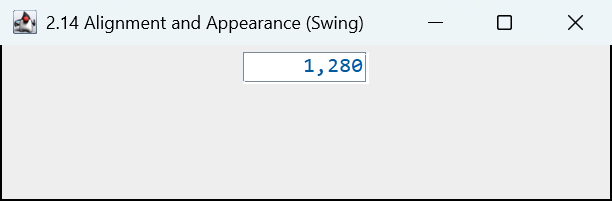 | 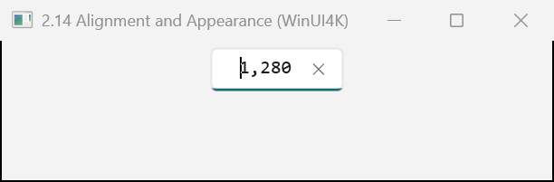 |

**注意**: WinUI4K の `setHorizontalAlignment` は入力欄の中の文字ではなく、入力欄そのものを親の中でどこに置くかの設定です
(すべてのコンポーネントが持つレイアウトの設定)。文字の揃えは `setTextAlignment` を使います。

<a id="textfield-password"></a>
### 2.15 JPasswordField → WPasswordField

**Swing (Java)**

```java
JPasswordField password = new JPasswordField(20);
password.addActionListener(e -> {
    char[] value = password.getPassword();
    try {
        login(value);
    } finally {
        Arrays.fill(value, '\0');
    }
});
```

**WinUI4K (Java)**

```java
WPasswordField password = new WPasswordField(20);
password.setHeader("Password");
password.addActionListener(e -> {
    char[] value = password.getPassword();
    try {
        login(value);
    } finally {
        Arrays.fill(value, '\0');
    }
});
```

**実行した画面** ([`PasswordSwing.java`](../winui4k-sample-swing-to-winui4k/src/main/java/com/appkitbox/winui4k/swing_to_winui4k/jtextfield/password/PasswordSwing.java) / [`PasswordWinUI4K.java`](../winui4k-sample-swing-to-winui4k/src/main/java/com/appkitbox/winui4k/swing_to_winui4k/jtextfield/password/PasswordWinUI4K.java))

| Swing | WinUI4K |
|---|---|
|  |  |

- 伏せ字は `setEchoChar('*')` で変えられます。
- WinUI のパスワード欄では入力中に目のボタンで中身を確かめられます。出し方は `setPasswordRevealMode(PasswordRevealMode.HIDDEN)` などで変えます。
- `WPasswordField` では、利用者の入力は `WDocumentFilter` を通りません (WinUI が入力の前に断る仕組みを持たないため)。

<a id="textfield-kotlin"></a>
### 2.16 Kotlin で書く

この章のユースケースをまとめて Kotlin で書くと、次のようになります。

```kotlin
import com.appkitbox.winui4k.*

fun main() {
    WinUiUtilities.invokeLater {
        val frame = WFrame("Text field sample")
        frame.layout = WFlowLayout()

        // Placeholder, header, Enter, change notification (2.3, 2.4, 2.8)
        val name = WTextField("e.g. John Smith").apply { header = "Name" }
        val count = WLabel("0 characters")
        name.addTextChangedListener { text -> count.text = "${text.length} characters" }
        name.addActionListener { register(name.text) }

        // Digits only, maximum length (2.5, 2.6)
        val zip = WTextField(8).apply {
            header = "ZIP code"
            maxLength = 7
            document.documentFilter = object : WDocumentFilter() {
                override fun insertString(fb: FilterBypass, offset: Int, string: String?, attr: WAttributeSet?) {
                    if (string.orEmpty().all(Char::isDigit)) super.insertString(fb, offset, string, attr)
                }

                override fun replace(fb: FilterBypass, offset: Int, length: Int, text: String?, attrs: WAttributeSet?) {
                    if (text.orEmpty().all(Char::isDigit)) super.replace(fb, offset, length, text, attrs)
                }
            }
        }

        // Select all on focus, validate on focus lost (2.9, 2.10)
        val error = WLabel().apply { foreground = WColor.RED }
        val age = WTextField(4).apply { header = "Age" }
        age.addFocusListener(object : WFocusAdapter() {
            override fun focusGained(e: WFocusEvent) = age.selectAll()

            override fun focusLost(e: WFocusEvent) {
                val valid = age.text.toIntOrNull() in 0..150
                error.text = if (valid) "" else "Enter a number from 0 to 150"
            }
        })

        // Clear with Esc (2.12)
        name.inputMap.put(WKeyStroke.getKeyStroke(WKeyEvent.VK_ESCAPE, 0), "clear")
        name.actionMap.put(
            "clear",
            object : WAbstractAction() {
                override fun actionPerformed(e: WActionEvent) {
                    name.text = ""
                }
            },
        )

        // Right-aligned price, read-only (2.7, 2.14)
        val price = WTextField(10).apply {
            header = "Price"
            textAlignment = TextAlignment.RIGHT
            text = "1,280"
            isEditable = false
        }

        listOf(name, count, zip, age, error, price).forEach { frame.add(it) }
        frame.setSize(480, 560)
        frame.isVisible = true
        name.requestFocusInWindow()
    }
}

private fun register(name: String) = println("Registered: $name")
```

<a id="textfield-notes"></a>
### 2.17 注意点

- `new WTextField("文字列")` の文字列は初めの文字列ではなく案内文になります。`JTextField(String text)` と同じつもりで書くと、
  入力欄は空のまま薄い文字が出ます。初めの文字列は `setText(...)` で入れます。`JTextField(String, int)` に当たるコンストラクターはありません。
  列数だけを渡す `new WTextField(20)` は Swing と同じです。
- `setHorizontalAlignment` は文字の揃えの設定ではありません。文字の揃えは `setTextAlignment` です ([2.14](#textfield-appearance))。
- `InputVerifier` が無いので、フォーカスの移動を止める検証はできません ([2.10](#textfield-validate))。
- 複数行の入力 (`JTextArea`): 行数 (`setRows`)・`append`・行の数を使うなら `WTextPane` です ([12 章](#textarea))。
  文字を入れるだけなら、`WTextField` に `setAcceptsReturn(true)` と `setTextWrapping(TextWrapping.WRAP)` を設定しても、
  複数行の入力欄になります。高さは `setHeight(...)` で決めます。WinUI の入力欄は中身が増えると入力欄の中でスクロールするので
  (スクロールバーは既定のスタイルでは出ません)、`JScrollPane` に当たるものに入れる必要はありません。
- 書式のある文字 (`JTextPane`): `WTextPane` を使います。

<a id="list"></a>
## 3. JList → WList

`WList` は WinUI の `ListView` を包んだクラスです。Swing と同じく、データはモデル (`WListModel`。既定は `WDefaultListModel`) が持ち、
選択は `WListSelectionModel` でも扱えます。

<a id="list-table"></a>
### 3.1 API の対応表

| やりたいこと | Swing | WinUI4K | 違い |
|---|---|---|---|
| 配列から作る | `new JList<>(array)` | `new WList(array)` | **型引数が無い** (`WList` はジェネリクスでない) |
| モデルから作る | `new JList<>(model)` | `new WList(model)` | 同じ |
| スクロール | `new JScrollPane(list)` に入れる | 入れなくてよい | WinUI のリストは自分でスクロールする |
| 動的なデータ | `DefaultListModel<E>` | `WDefaultListModel<E>` | 同じメソッド |
| 選んだ要素 | `getSelectedValue()` (型は `E`) | `getSelectedValue()` (型は `Object`) | キャストが要る。文字列なら `getSelectedItem()` |
| 選んだ位置 | `getSelectedIndex()` | `getSelectedIndex()` | 同じ |
| 複数の選択 | `getSelectedValuesList()` / `getSelectedIndices()` | 同じ | 戻り値は `List<Object>` |
| 選択モード | `setSelectionMode(ListSelectionModel.SINGLE_SELECTION)` | `setSelectionMode(WListSelectionModel.SINGLE_SELECTION)` | **既定が違う** (Swing は複数、WinUI4K は 1 つ) |
| 選択の通知 | `addListSelectionListener(e -> ...)` | `addListSelectionListener(e -> ...)` | 同じ |
| 選ぶ | `setSelectedIndex(i)` / `setSelectedValue(v, true)` | 同じ | 同じ |
| 見えるまでスクロール | `ensureIndexIsVisible(i)` | `ensureIndexIsVisible(i)` | 同じ |
| 位置から要素 | `locationToIndex(point)` | `locationToIndex(point)` | 同じ |
| 表示を変える | `setCellRenderer(...)` | `setCellRenderer(...)` | **呼ぶたびに新しいコンポーネントを返す** |
| 行の数 | `setVisibleRowCount(5)` | `setVisibleRowCount(5)` | 同じ |
| 行の高さ | `setFixedCellHeight(28)` | `setFixedCellHeight(28)` | 同じ |
| 右クリックメニュー | `setComponentPopupMenu(popup)` | `setComponentPopupMenu(flyout)` | `JPopupMenu` → `WMenuFlyout` |
| 項目のクリック | (なし) | `setItemClickEnabled(true)` + `addItemClickListener(...)` | WinUI の機能 |
| 横に流す | `setLayoutOrientation(JList.HORIZONTAL_WRAP)` | (なし) | [3.17](#list-notes) の `WItemsView` を使う |
| ドラッグで並べ替え | `setDragEnabled(true)` | (なし) | この版では扱わない |

<a id="list-basic"></a>
### 3.2 固定の項目を並べる

**Swing (Java)**

```java
String[] fruits = {"Apple", "Orange", "Grape", "Peach", "Cherry"};
JList<String> list = new JList<>(fruits);
list.setSelectionMode(ListSelectionModel.SINGLE_SELECTION);
JScrollPane scroll = new JScrollPane(list);
scroll.setPreferredSize(new Dimension(200, 150));
frame.add(scroll);
```

**WinUI4K (Java)**

```java
String[] fruits = {"Apple", "Orange", "Grape", "Peach", "Cherry"};
WList list = new WList(fruits);           // single selection by default
list.setWidth(200);
list.setHeight(150);
frame.add(list);
```

**実行した画面** ([`BasicSwing.java`](../winui4k-sample-swing-to-winui4k/src/main/java/com/appkitbox/winui4k/swing_to_winui4k/jlist/basic/BasicSwing.java) / [`BasicWinUI4K.java`](../winui4k-sample-swing-to-winui4k/src/main/java/com/appkitbox/winui4k/swing_to_winui4k/jlist/basic/BasicWinUI4K.java))

| Swing | WinUI4K |
|---|---|
|  |  |

- `WList` に型引数はありません (`JList<String>` → `WList`)。
- WinUI のリストは自分でスクロールバーを出すので、`JScrollPane` に当たる `WScrollPane` に入れる必要はありません。
  入れると、リストが表示に要る項目だけを作る仕組み (仮想化) が効かなくなるので、入れないでください。
- 各要素は `toString()` の文字列で表示します (Swing と同じ)。
- Kotlin や Java の `List` からも作れます (`new WList(Arrays.asList("a", "b"))`)。

<a id="list-model"></a>
### 3.3 モデルで項目を追加・削除する

入力欄の文字をリストに足し、選んだ項目を消します。

**Swing (Java)**

```java
DefaultListModel<String> model = new DefaultListModel<>();
model.addElement("Milk");
model.addElement("Eggs");
JList<String> list = new JList<>(model);

JTextField input = new JTextField(15);
JButton add = new JButton("Add");
add.addActionListener(e -> {
    if (!input.getText().isEmpty()) {
        model.addElement(input.getText());
        input.setText("");
    }
});

JButton remove = new JButton("Delete");
remove.addActionListener(e -> {
    int index = list.getSelectedIndex();
    if (index >= 0) model.remove(index);
});

JButton clear = new JButton("Clear all");
clear.addActionListener(e -> model.clear());
```

**WinUI4K (Java)**

```java
WDefaultListModel<String> model = new WDefaultListModel<>();
model.addElement("Milk");
model.addElement("Eggs");
WList list = new WList(model);

WTextField input = new WTextField(15);
WButton add = new WButton("Add");
add.addActionListener(e -> {
    if (!input.getText().isEmpty()) {
        model.addElement(input.getText());
        input.setText("");
    }
});

WButton remove = new WButton("Delete");
remove.addActionListener(e -> {
    int index = list.getSelectedIndex();
    if (index >= 0) model.remove(index);
});

WButton clear = new WButton("Clear all");
clear.addActionListener(e -> model.clear());
```

**実行した画面** ([`ModelSwing.java`](../winui4k-sample-swing-to-winui4k/src/main/java/com/appkitbox/winui4k/swing_to_winui4k/jlist/model/ModelSwing.java) / [`ModelWinUI4K.java`](../winui4k-sample-swing-to-winui4k/src/main/java/com/appkitbox/winui4k/swing_to_winui4k/jlist/model/ModelWinUI4K.java))

| Swing | WinUI4K |
|---|---|
|  |  |

- `WDefaultListModel` は `DefaultListModel` と同じメソッド (`addElement`・`add`・`insertElementAt`・`set`・`remove`・`removeElement`・
  `clear`・`getSize`・`getElementAt`・`indexOf` など) を持ちます。モデルを変えると、その場で表示に写ります。
- 選択はモデルの変更に合わせてずれます (前に挿入すると後ろへずれ、選んだ要素を消すと選択が外れる。Swing と同じ)。
- モデルを作らずに、リストの `addItem("...")` / `removeItem(i)` / `removeAllItems()` で既定のモデルを直接編集することもできます。
- 自分でモデルを作るときは、Swing と同じく `WAbstractListModel` を継承して `getSize()` と `getElementAt(i)` を書きます。

<a id="list-selected"></a>
### 3.4 選んだ項目を読む

**Swing (Java)**

```java
String value = list.getSelectedValue();          // null if nothing is selected
int index = list.getSelectedIndex();             // -1 if nothing is selected
boolean none = list.isSelectionEmpty();
```

**WinUI4K (Java)**

```java
String value = (String) list.getSelectedValue();  // null if nothing is selected
String text = list.getSelectedItem();             // toString() text (null if nothing is selected)
int index = list.getSelectedIndex();              // -1 if nothing is selected
boolean none = list.isSelectionEmpty();
```

**実行した画面** ([`SelectedSwing.java`](../winui4k-sample-swing-to-winui4k/src/main/java/com/appkitbox/winui4k/swing_to_winui4k/jlist/selected/SelectedSwing.java) / [`SelectedWinUI4K.java`](../winui4k-sample-swing-to-winui4k/src/main/java/com/appkitbox/winui4k/swing_to_winui4k/jlist/selected/SelectedWinUI4K.java))

| Swing | WinUI4K |
|---|---|
|  |  |

`getSelectedValue()` はモデルの要素そのもの (`Object`) を返すので、キャストします。
表示している文字列が欲しいだけなら `getSelectedItem()` が便利です。

<a id="list-listener"></a>
### 3.5 選択の変化に反応する

選んだ項目の説明を下に表示します。

**Swing (Java)**

```java
JLabel detail = new JLabel("Select an item");
list.addListSelectionListener(e -> {
    if (e.getValueIsAdjusting()) return;          // skip intermediate events while dragging
    String value = list.getSelectedValue();
    detail.setText(value == null ? "Select an item" : value + " selected");
});
```

**WinUI4K (Java)**

```java
WLabel detail = new WLabel("Select an item");
list.addListSelectionListener(e -> {
    if (e.getValueIsAdjusting()) return;
    Object value = list.getSelectedValue();
    detail.setText(value == null ? "Select an item" : value + " selected");
});
```

**実行した画面** ([`ListenerSwing.java`](../winui4k-sample-swing-to-winui4k/src/main/java/com/appkitbox/winui4k/swing_to_winui4k/jlist/listener/ListenerSwing.java) / [`ListenerWinUI4K.java`](../winui4k-sample-swing-to-winui4k/src/main/java/com/appkitbox/winui4k/swing_to_winui4k/jlist/listener/ListenerWinUI4K.java))

| Swing | WinUI4K |
|---|---|
|  |  |

- WinUI は選択の途中経過を知らせないので、画面の操作では `getValueIsAdjusting()` はいつも `false` です。
  Swing のコードの `if` を残しておいても困りません。
- `e.getFirstIndex()` / `e.getLastIndex()` は、選択が変わったかもしれない範囲です (Swing と同じ)。
- イベントの中身を使わないなら、引数のないラムダ (`() -> ...`) も渡せます。

<a id="list-multiple"></a>
### 3.6 複数選択を許す

Ctrl / Shift で複数を選び、選んだものをまとめて処理します。

**Swing (Java)**

```java
JList<String> files = new JList<>(names);
// MULTIPLE_INTERVAL_SELECTION by default (Ctrl / Shift for multiple)
JButton open = new JButton("Open");
open.addActionListener(e -> {
    for (String name : files.getSelectedValuesList()) openFile(name);
});
```

**WinUI4K (Java)**

```java
WList files = new WList(names);
files.setSelectionMode(WListSelectionModel.MULTIPLE_INTERVAL_SELECTION);   // the default is single selection, so set it explicitly
WButton open = new WButton("Open");
open.addActionListener(e -> {
    for (Object name : files.getSelectedValuesList()) openFile((String) name);
});
```

**実行した画面** ([`MultipleSwing.java`](../winui4k-sample-swing-to-winui4k/src/main/java/com/appkitbox/winui4k/swing_to_winui4k/jlist/multiple/MultipleSwing.java) / [`MultipleWinUI4K.java`](../winui4k-sample-swing-to-winui4k/src/main/java/com/appkitbox/winui4k/swing_to_winui4k/jlist/multiple/MultipleWinUI4K.java))

| Swing | WinUI4K |
|---|---|
|  |  |

- **既定の選択モードが違います**。Swing は複数の区間 (`MULTIPLE_INTERVAL_SELECTION`)、WinUI4K は WinUI の既定に合わせて 1 つだけ (`SINGLE_SELECTION`) です。
- `SINGLE_INTERVAL_SELECTION` (続いた範囲だけ) も指定できます。
- `getSelectedIndices()`・`setSelectionInterval(a, b)`・`addSelectionInterval(a, b)`・`clearSelection()` も Swing と同じです。
- すべて選ぶのは `selectAll()` です。

<a id="list-select"></a>
### 3.7 プログラムから選んでスクロールする

**Swing (Java)**

```java
list.setSelectedIndex(42);
list.ensureIndexIsVisible(42);
// select by value (also scrolls if the second argument is true)
list.setSelectedValue("Grape", true);
list.clearSelection();
```

**WinUI4K (Java)**

```java
list.setSelectedIndex(42);
list.ensureIndexIsVisible(42);
list.setSelectedValue("Grape", true);
list.clearSelection();
```

**実行した画面** ([`SelectSwing.java`](../winui4k-sample-swing-to-winui4k/src/main/java/com/appkitbox/winui4k/swing_to_winui4k/jlist/select/SelectSwing.java) / [`SelectWinUI4K.java`](../winui4k-sample-swing-to-winui4k/src/main/java/com/appkitbox/winui4k/swing_to_winui4k/jlist/select/SelectWinUI4K.java))

| Swing | WinUI4K |
|---|---|
|  |  |

コードは Swing と同じです。表示する前に呼んだ `ensureIndexIsVisible` や `setSelectedValue(..., true)` も、Swing と同じく表示したときに効きます (最初のレイアウトの後でスクロールします)。`setSelectedIndex(-1)` でも選択を外せます。

<a id="list-doubleclick"></a>
### 3.8 ダブルクリックで開く

**Swing (Java)**

```java
list.addMouseListener(new MouseAdapter() {
    @Override
    public void mouseClicked(MouseEvent e) {
        if (e.getClickCount() == 2) {
            int index = list.locationToIndex(e.getPoint());
            if (index >= 0) openItem(list.getModel().getElementAt(index));
        }
    }
});
```

**WinUI4K (Java)**

```java
list.addMouseListener(new WMouseAdapter() {
    @Override
    public void mouseClicked(WMouseEvent e) {
        if (e.getClickCount() == 2) {
            int index = list.locationToIndex(e.getPoint());
            if (index >= 0) openItem(list.getModel().getElementAt(index));
        }
    }
});
```

**実行した画面** ([`DoubleClickSwing.java`](../winui4k-sample-swing-to-winui4k/src/main/java/com/appkitbox/winui4k/swing_to_winui4k/jlist/doubleclick/DoubleClickSwing.java) / [`DoubleClickWinUI4K.java`](../winui4k-sample-swing-to-winui4k/src/main/java/com/appkitbox/winui4k/swing_to_winui4k/jlist/doubleclick/DoubleClickWinUI4K.java))

| Swing | WinUI4K |
|---|---|
|  |  |

- `MouseAdapter` → `WMouseAdapter`、`MouseEvent` → `WMouseEvent` に替えるだけです。ダブルクリックの判定には Windows の設定の時間と範囲を使います。
- タッチやペンでの操作も、マウスの左ボタンとして届きます。
- キーボードでも開けるように、Enter キーのキーバインド ([3.11](#list-delete) と同じ書き方) を足しておくと親切です。
- WinUI のアプリでは 1 回のクリックで開く形 ([3.15](#list-winui) の項目のクリック) もよく使います。

<a id="list-renderer"></a>
### 3.9 独自のオブジェクトを並べて表示を変える

社員のオブジェクトを並べ、「名前 (部署)」とアイコンで表示します。

```java
// Data class shared by Swing and WinUI4K
public final class Employee {
    private final String name;
    private final String department;

    public Employee(String name, String department) {
        this.name = name;
        this.department = department;
    }

    public String getName() { return name; }
    public String getDepartment() { return department; }

    @Override
    public String toString() { return name; }   // text shown when no renderer is used
}
```

**Swing (Java)**

```java
JList<Employee> list = new JList<>(employees);
list.setCellRenderer(new DefaultListCellRenderer() {
    @Override
    public Component getListCellRendererComponent(
            JList<?> list, Object value, int index, boolean isSelected, boolean cellHasFocus) {
        JLabel label = (JLabel) super.getListCellRendererComponent(list, value, index, isSelected, cellHasFocus);
        Employee employee = (Employee) value;
        label.setText(employee.getName() + " (" + employee.getDepartment() + ")");
        label.setIcon(personIcon);
        return label;
    }
});
```

**WinUI4K (Java)**

```java
WList list = new WList(employees);
list.setCellRenderer(new WDefaultListCellRenderer() {
    @Override
    protected String getText(Object value) {
        Employee employee = (Employee) value;
        return employee.getName() + " (" + employee.getDepartment() + ")";
    }

    @Override
    protected WIcon getIcon(Object value) {
        return Symbol.CONTACT;
    }
});
```

**実行した画面** ([`RendererSwing.java`](../winui4k-sample-swing-to-winui4k/src/main/java/com/appkitbox/winui4k/swing_to_winui4k/jlist/renderer/RendererSwing.java) / [`RendererWinUI4K.java`](../winui4k-sample-swing-to-winui4k/src/main/java/com/appkitbox/winui4k/swing_to_winui4k/jlist/renderer/RendererWinUI4K.java))

| Swing | WinUI4K |
|---|---|
|  |  |

`WDefaultListCellRenderer` は、`getText` (文字)・`getIcon` (アイコン)・`configure` (ラベルの飾り) を上書きして使います。
選んだ項目を太字にするなら `configure` を上書きします。

```java
@Override
protected void configure(WLabel label, Object value, int index, boolean isSelected, boolean cellHasFocus) {
    if (isSelected) label.setFont(new WFont("Segoe UI", WFont.BOLD, 14));
}
```

2 行の表示など、ラベル 1 つで足りないときは、レンダラーをラムダで書いてパネルを返します。

```java
list.setCellRenderer((owner, value, index, isSelected, cellHasFocus) -> {
    Employee employee = (Employee) value;
    WPanel cell = new WPanel();
    cell.add(new WLabel(employee.getName()));
    WLabel department = new WLabel(employee.getDepartment());
    department.setForeground(WColor.GRAY);
    cell.add(department);
    return cell;              // create and return a new component on every call
});
```

- **レンダラーは呼ぶたびに新しいコンポーネントを返してください**。Swing はラベル 1 つを使い回して何度も描きますが、
  WinUI のコンポーネントは同時に 1 か所にしか置けないため、同じものを返すと表示に失敗します。
- 選んだ項目の背景と枠は WinUI が描くので、`isSelected` で背景を塗る必要はありません (Swing のように `setOpaque` を気にしなくてよい)。

<a id="list-rows"></a>
### 3.10 見せる行の数と項目の高さ

**Swing (Java)**

```java
list.setVisibleRowCount(5);
list.setFixedCellHeight(28);
```

**WinUI4K (Java)**

```java
list.setFixedCellHeight(28);
list.setVisibleRowCount(5);   // the height becomes 5 rows x 28 + padding
```

**実行した画面** ([`RowsSwing.java`](../winui4k-sample-swing-to-winui4k/src/main/java/com/appkitbox/winui4k/swing_to_winui4k/jlist/rows/RowsSwing.java) / [`RowsWinUI4K.java`](../winui4k-sample-swing-to-winui4k/src/main/java/com/appkitbox/winui4k/swing_to_winui4k/jlist/rows/RowsWinUI4K.java))

| Swing | WinUI4K |
|---|---|
|  |  |

- `setVisibleRowCount` を設定すると、リストの高さがその行数分になります。Swing と違い、設定しないうちは既定の 8 行は大きさに効きません。
- 行の高さを決めていないときは、WinUI の項目の既定の高さ (40) で行数分の高さを見積もります。
- `getFirstVisibleIndex()` / `getLastVisibleIndex()` で、見えている範囲を読めます。

<a id="list-delete"></a>
### 3.11 Delete キーで選んだ項目を消す

**Swing (Java)**

```java
list.getInputMap().put(KeyStroke.getKeyStroke(KeyEvent.VK_DELETE, 0), "delete");
list.getActionMap().put("delete", new AbstractAction() {
    @Override
    public void actionPerformed(ActionEvent e) {
        int index = list.getSelectedIndex();
        if (index >= 0) model.remove(index);
    }
});
```

**WinUI4K (Java)**

```java
list.getInputMap(WComponent.WHEN_ANCESTOR_OF_FOCUSED_COMPONENT)
    .put(WKeyStroke.getKeyStroke(WKeyEvent.VK_DELETE, 0), "delete");
list.getActionMap().put("delete", new WAbstractAction() {
    @Override
    public void actionPerformed(WActionEvent e) {
        int index = list.getSelectedIndex();
        if (index >= 0) model.remove(index);
    }
});
```

**実行した画面** ([`DeleteSwing.java`](../winui4k-sample-swing-to-winui4k/src/main/java/com/appkitbox/winui4k/swing_to_winui4k/jlist/delete/DeleteSwing.java) / [`DeleteWinUI4K.java`](../winui4k-sample-swing-to-winui4k/src/main/java/com/appkitbox/winui4k/swing_to_winui4k/jlist/delete/DeleteWinUI4K.java))

| Swing | WinUI4K |
|---|---|
|  |  |

WinUI のリストでは、キーボードのフォーカスはリストの中の項目にあります。項目にフォーカスがあるときも効くように、
`WHEN_ANCESTOR_OF_FOCUSED_COMPONENT` (リストかその中のどれかにフォーカスがあるとき) のマップに入れてください。

<a id="list-move"></a>
### 3.12 項目を上下に動かす

選んだ項目を 1 つ上へ動かし、選択も付いていかせます。

**Swing (Java)**

```java
JButton up = new JButton("Up");
up.addActionListener(e -> {
    int index = list.getSelectedIndex();
    if (index <= 0) return;
    String item = model.remove(index);
    model.add(index - 1, item);
    list.setSelectedIndex(index - 1);
    list.ensureIndexIsVisible(index - 1);
});
```

**WinUI4K (Java)**

```java
WButton up = new WButton("Up", Symbol.UP);
up.addActionListener(e -> {
    int index = list.getSelectedIndex();
    if (index <= 0) return;
    String item = model.remove(index);
    model.add(index - 1, item);
    list.setSelectedIndex(index - 1);
    list.ensureIndexIsVisible(index - 1);
});
```

**実行した画面** ([`MoveSwing.java`](../winui4k-sample-swing-to-winui4k/src/main/java/com/appkitbox/winui4k/swing_to_winui4k/jlist/move/MoveSwing.java) / [`MoveWinUI4K.java`](../winui4k-sample-swing-to-winui4k/src/main/java/com/appkitbox/winui4k/swing_to_winui4k/jlist/move/MoveWinUI4K.java))

| Swing | WinUI4K |
|---|---|
|  |  |

モデルの操作は Swing とまったく同じです。

<a id="list-filter"></a>
### 3.13 入力に合わせて絞り込む

入力欄に入れた文字を含む項目だけを表示します。

**Swing (Java)**

```java
List<String> all = Arrays.asList("Tokyo", "Osaka", "Nagoya", "Sapporo", "Fukuoka", "Kyoto");
DefaultListModel<String> model = new DefaultListModel<>();
all.forEach(model::addElement);
JList<String> list = new JList<>(model);

JTextField filter = new JTextField(15);
filter.getDocument().addDocumentListener(new DocumentListener() {
    @Override public void insertUpdate(DocumentEvent e) { apply(); }
    @Override public void removeUpdate(DocumentEvent e) { apply(); }
    @Override public void changedUpdate(DocumentEvent e) { apply(); }

    private void apply() {
        model.clear();
        all.stream().filter(s -> s.contains(filter.getText())).forEach(model::addElement);
    }
});
```

**WinUI4K (Java)**

```java
List<String> all = Arrays.asList("Tokyo", "Osaka", "Nagoya", "Sapporo", "Fukuoka", "Kyoto");
WDefaultListModel<String> model = new WDefaultListModel<>();
all.forEach(model::addElement);
WList list = new WList(model);

WTextField filter = new WTextField("Filter");
filter.addTextChangedListener(text -> {
    model.clear();
    all.stream().filter(s -> s.contains(text)).forEach(model::addElement);
});
```

**実行した画面** ([`FilterSwing.java`](../winui4k-sample-swing-to-winui4k/src/main/java/com/appkitbox/winui4k/swing_to_winui4k/jlist/filter/FilterSwing.java) / [`FilterWinUI4K.java`](../winui4k-sample-swing-to-winui4k/src/main/java/com/appkitbox/winui4k/swing_to_winui4k/jlist/filter/FilterWinUI4K.java))

| Swing | WinUI4K |
|---|---|
|  |  |

どちらのサンプルも、表示する前に `filter.setText("ka")` を呼んでいます。[2.4](#textfield-change) と同じく、表示する前の変更も `addTextChangedListener` のリスナーに届くので、最初から絞り込まれます。

候補を出す入力欄そのものが欲しいときは、WinUI の `AutoSuggestBox` を包んだ `WAutoSuggestBox` も使えます。

<a id="list-popup"></a>
### 3.14 右クリックメニューを付ける

**Swing (Java)**

```java
JPopupMenu popup = new JPopupMenu();
JMenuItem rename = new JMenuItem("Rename");
rename.addActionListener(e -> renameSelected());
JMenuItem delete = new JMenuItem("Delete");
delete.addActionListener(e -> deleteSelected());
popup.add(rename);
popup.addSeparator();
popup.add(delete);
list.setComponentPopupMenu(popup);
```

**WinUI4K (Java)**

```java
WMenuFlyout popup = new WMenuFlyout();
popup.add("Rename").addActionListener(() -> renameSelected());
popup.addSeparator();
popup.add(new WMenuFlyoutItem("Delete", Symbol.DELETE)).addActionListener(() -> deleteSelected());
list.setComponentPopupMenu(popup);
```

**実行した画面** ([`PopupSwing.java`](../winui4k-sample-swing-to-winui4k/src/main/java/com/appkitbox/winui4k/swing_to_winui4k/jlist/popup/PopupSwing.java) / [`PopupWinUI4K.java`](../winui4k-sample-swing-to-winui4k/src/main/java/com/appkitbox/winui4k/swing_to_winui4k/jlist/popup/PopupWinUI4K.java))

| Swing | WinUI4K |
|---|---|
|  |  |

- `JPopupMenu` → `WMenuFlyout`、`JMenuItem` → `WMenuFlyoutItem` です。`add(String)` は作った項目を返すので、そのままリスナーを付けられます。
- 右クリックのほか、Shift+F10 やアプリケーション キー、タッチの長押しでも開きます (WinUI の `ContextFlyout`)。

<a id="list-winui"></a>
### 3.15 項目のクリックとチェックボックスの選択

Swing には無いが、WinUI のリストでよく使う機能です。

```java
// Item click: receive a "clicked" event separately from selection (e.g. navigation menus)
WList menu = new WList(new String[] {"Documents", "Pictures", "Music"});
menu.setItemClickEnabled(true);
menu.addItemClickListener(item -> navigateTo(item));   // item is the text of the clicked item

// Multiple selection with check boxes (easier to multi-select by touch)
WList tags = new WList(new String[] {"Work", "Family", "Hobbies", "Shopping"});
tags.setSelectionMode(ListViewSelectionMode.MULTIPLE);
```

**実行した画面** ([`ItemClickWinUI4K.java`](../winui4k-sample-swing-to-winui4k/src/main/java/com/appkitbox/winui4k/swing_to_winui4k/jlist/itemclick/ItemClickWinUI4K.java))


- `addItemClickListener` のリスナーは選択の状態に関係なく、押すたびに呼ばれます。選択させずにクリックだけを受け取るなら
  `setSelectionMode(ListViewSelectionMode.NONE)` と組み合わせます。
- `ListViewSelectionMode` は WinUI の選択モード (`NONE`・`SINGLE`・`MULTIPLE`・`EXTENDED`) です。`MULTIPLE` はクリックで選択を切り替える
  チェックボックスの形、`EXTENDED` は Ctrl / Shift の形 (Swing の `MULTIPLE_INTERVAL_SELECTION` に当たる) です。

<a id="list-kotlin"></a>
### 3.16 Kotlin で書く

この章のユースケースをまとめて Kotlin で書くと、次のようになります。

```kotlin
import com.appkitbox.winui4k.*

data class Employee(val name: String, val department: String) {
    override fun toString() = name
}

fun main() {
    WinUiUtilities.invokeLater {
        val frame = WFrame("List sample")
        frame.layout = WFlowLayout()

        // Model and list (3.3)
        val model = WDefaultListModel<Employee>().apply {
            addElement(Employee("Johnson", "Sales"))
            addElement(Employee("Smith", "Engineering"))
            addElement(Employee("Brown", "Admin"))
        }
        val list = WList(model).apply {
            width = 280.0
            fixedCellHeight = 36
            visibleRowCount = 6
        }

        // Renderer (3.9)
        list.cellRenderer = object : WDefaultListCellRenderer() {
            override fun getText(value: Any?): String {
                val employee = value as Employee
                return "${employee.name} (${employee.department})"
            }

            override fun getIcon(value: Any?): WIcon = Symbol.CONTACT
        }

        // Selection notification (3.5)
        val detail = WLabel("Select an item")
        list.addListSelectionListener {
            val employee = list.selectedValue as Employee?
            detail.text = employee?.let { "${it.name} selected" } ?: "Select an item"
        }

        // Double-click (3.8)
        list.addMouseListener(object : WMouseAdapter() {
            override fun mouseClicked(e: WMouseEvent) {
                if (e.clickCount != 2) return
                val index = list.locationToIndex(e.point)
                if (index >= 0) detail.text = "Opening ${model.getElementAt(index).name}"
            }
        })

        // Delete with the Delete key (3.11)
        val deleteSelected = object : WAbstractAction("Delete", Symbol.DELETE) {
            override fun actionPerformed(e: WActionEvent) {
                val index = list.selectedIndex
                if (index >= 0) model.remove(index)
            }
        }
        list.getInputMap(WComponent.WHEN_ANCESTOR_OF_FOCUSED_COMPONENT)
            .put(WKeyStroke.getKeyStroke(WKeyEvent.VK_DELETE, 0), "delete")
        list.actionMap.put("delete", deleteSelected)

        // Context menu (3.14)
        list.componentPopupMenu = WMenuFlyout().apply { add(deleteSelected) }

        // Add (3.3)
        val name = WTextField("Name")
        val add = WButton("Add", Symbol.ADD)
        add.addActionListener {
            if (name.text.isNotBlank()) {
                model.addElement(Employee(name.text.trim(), "Unassigned"))
                list.selectedIndex = model.size - 1
                list.ensureIndexIsVisible(model.size - 1)
                name.text = ""
            }
        }

        val row = WPanel(8.0, Orientation.HORIZONTAL)
        row.add(name)
        row.add(add)
        row.add(WButton(deleteSelected))
        frame.add(row)
        frame.add(list)
        frame.add(detail)
        frame.setSize(480, 480)
        frame.isVisible = true
    }
}
```

<a id="list-notes"></a>
### 3.17 注意点

- `WList` には型引数がありません。`getSelectedValue()` と `getSelectedValuesList()` は `Object` を返すので、キャストが要ります。
  モデル (`WDefaultListModel<E>`) には型引数があるので、要素はモデルから型付きで読むこともできます (`model.getElementAt(list.getSelectedIndex())`)。
- 既定の選択モードが違い、Swing は複数、WinUI4K は 1 つです ([3.6](#list-multiple))。
- `WList` は `JScrollPane` に当たるものに入れないでください。WinUI のリストは自分でスクロールします。大きさは `setWidth` / `setHeight` か `setVisibleRowCount` で決めます。
- レンダラーは毎回新しいコンポーネントを返す必要があります。Swing のように 1 つのラベルを使い回すと表示に失敗します ([3.9](#list-renderer))。
- フォーカスはリストの中の項目にあるので、キーバインドは `WHEN_ANCESTOR_OF_FOCUSED_COMPONENT` のマップに入れます ([3.11](#list-delete))。
- `setModel` でモデルを差し替えると、表示を作り直して選択を外します (Swing と同じ)。
- ドラッグでの並べ替え・`JList` の `setDragEnabled`: この版では扱いません。
- `setLayoutOrientation` (横に流す並べ方): `WList` にはありません。タイルのように並べるときは WinUI の `ItemsView` を包んだ `WItemsView` を使います。

<a id="label"></a>
## 4. JLabel → WLabel

`WLabel` は WinUI の `TextBlock` (文字を表示する要素) を包んだクラスで、`JLabel` の主な API を同じ名前で持っています。
`TextBlock` は画像を持てないので、アイコンを付けたときは `WLabel` がアイコンと文字を並べて表示します。
`TextBlock` はコントロール (`Control`) ではないため、背景色・枠・有効・無効の灰色の表示はありません。

<a id="label-table"></a>
### 4.1 API の対応表

| やりたいこと | Swing | WinUI4K | 違い |
|---|---|---|---|
| 文字のラベル | `new JLabel("Name")` | `new WLabel("Name")` | 同じ |
| 文字を読み書きする | `getText()` / `setText("...")` | `getText()` / `setText("...")` | 同じ (表示した後に替えても並べ直す。[4.2](#label-basic)) |
| アイコンだけ | `new JLabel(icon)` | `new WLabel(icon)` | アイコンは `Symbol`・`WImageIcon`・`WFontIcon` |
| 文字とアイコン | `new JLabel("...", icon, SwingConstants.LEADING)` | `new WLabel("...", icon)` | 揃えの引数は無い |
| 揃えを指定して作る | `new JLabel("...", SwingConstants.CENTER)` | (なし) | 作った後で `setTextAlignment(TextAlignment.CENTER)` |
| 水平方向の揃え | `setHorizontalAlignment(SwingConstants.RIGHT)` | `setTextAlignment(TextAlignment.RIGHT)` | **名前が違う**。`setHorizontalAlignment` は親の中でのラベルの位置 ([4.5](#label-alignment)) |
| 垂直方向の揃え | `setVerticalAlignment(SwingConstants.TOP)` | (なし) | ラベルは文字の高さに縮むので、ラベル自身の位置を `setVerticalAlignment(VerticalAlignment.TOP)` で決める |
| アイコンと文字の位置 | `setHorizontalTextPosition(SwingConstants.CENTER)` | `setHorizontalTextPosition(HorizontalTextPosition.CENTER)` | 定数が列挙型になる |
| アイコンと文字の間隔 | `setIconTextGap(4)` | `setIconTextGap(4)` | 同じ (既定も 4) |
| フォント | `setFont(new Font(...))` | `setFont(new WFont(...))` | `Font` → `WFont` |
| 文字色 | `setForeground(Color.RED)` | `setForeground(WColor.RED)` | `WColor.RED` は `Color.RED` と少し違う色 ([4.3](#label-font)) |
| 背景色 | `setOpaque(true)` + `setBackground(...)` | (なし) | |
| 枠 | `setBorder(...)` | (なし) | |
| 複数行・書式 | `"<html>...</html>"` | `setTextWrapping(TextWrapping.WRAP)` | HTML は解釈されない ([4.7](#label-wrap)) |
| 収まらない文字を「...」にする | 自動 | `setTextTrimming(TextTrimming.CHARACTER_ELLIPSIS)` | 既定は「...」を付けずに切る |
| 入力欄の名前にする | `setLabelFor(field)` | `setLabelFor(field)` | 同じ |
| ニーモニック | `setDisplayedMnemonic(KeyEvent.VK_N)` | `setDisplayedMnemonic('N')` / `setDisplayedMnemonic(WKeyEvent.VK_N)` | 文字に下線は引かれない ([4.6](#label-labelfor)) |
| ツールチップ | `setToolTipText("...")` | `setToolTipText("...")` | 同じ |
| 無効の表示 | `setEnabled(false)` | `setEnabled(false)` | 文字は灰色にならない ([4.9](#label-notes)) |
| 文字をマウスで選べるようにする | (なし) | `setTextSelectionEnabled(true)` | WinUI の機能 |

<a id="label-basic"></a>
### 4.2 ラベルを作って文字を変える

見出しと、件数を出すラベルを並べます。

**Swing (Java)**

```java
JLabel title = new JLabel("Customers");
JLabel status = new JLabel();
int count = 42;
status.setText("Loaded " + count + " customers");
```

**WinUI4K (Java)**

```java
WLabel title = new WLabel("Customers");
WLabel status = new WLabel();
int count = 42;
status.setText("Loaded " + count + " customers");
```

**実行した画面** ([`BasicSwing.java`](../winui4k-sample-swing-to-winui4k/src/main/java/com/appkitbox/winui4k/swing_to_winui4k/jlabel/basic/BasicSwing.java) / [`BasicWinUI4K.java`](../winui4k-sample-swing-to-winui4k/src/main/java/com/appkitbox/winui4k/swing_to_winui4k/jlabel/basic/BasicWinUI4K.java))

| Swing | WinUI4K |
|---|---|
|  |  |

Swing の既定の Look & Feel (Metal) はラベルを太字で描きますが、WinUI のラベルは標準の太さです。

ウィンドウを表示した後で `setText` で文字を替えても、Swing の `setText` と同じく `WLabel` が自分で `revalidate()` を呼ぶので、
`WFlowLayout` などで並べたラベルは新しい文字の幅で並べ直されます。フォントやアイコンを替えたときも同じです。

<a id="label-font"></a>
### 4.3 フォントと文字色

見出しを大きな太字に、エラーを赤にします。

**Swing (Java)**

```java
JLabel heading = new JLabel("Monthly report");
heading.setFont(heading.getFont().deriveFont(Font.BOLD, 20f));
JLabel error = new JLabel("The file could not be saved.");
error.setForeground(Color.RED);
JLabel note = new JLabel("Last updated: 2026-11-07");
note.setFont(new Font("SansSerif", Font.ITALIC, 12));
```

**WinUI4K (Java)**

```java
WLabel heading = new WLabel("Monthly report");
heading.setFont(heading.getFont().deriveFont(WFont.BOLD, 20f));
WLabel error = new WLabel("The file could not be saved.");
error.setForeground(WColor.RED);
WLabel note = new WLabel("Last updated: 2026-11-07");
note.setFont(new WFont("Segoe UI", WFont.ITALIC, 12));
```

**実行した画面** ([`FontSwing.java`](../winui4k-sample-swing-to-winui4k/src/main/java/com/appkitbox/winui4k/swing_to_winui4k/jlabel/font/FontSwing.java) / [`FontWinUI4K.java`](../winui4k-sample-swing-to-winui4k/src/main/java/com/appkitbox/winui4k/swing_to_winui4k/jlabel/font/FontWinUI4K.java))

| Swing | WinUI4K |
|---|---|
|  |  |

- `getFont()` は設定する前でも今のフォントを返すので、`deriveFont` で太さや大きさだけを変える書き方がそのまま使えます。
- フォント名は Windows のフォントの名前 (`"Segoe UI"`、`"Yu Gothic UI"` など) です。Java の論理フォント名 (`"SansSerif"`・`"Dialog"`) はありません。
- `WColor.RED` は `(237, 28, 36)` で、`Color.RED` の `(255, 0, 0)` とは少し違う色です。同じ色にするときは `new WColor(255, 0, 0)` と書きます。
- 太さだけ・大きさだけを変える `setFontWeight(700)`・`setFontSize(20)` も使えます。下線と取り消し線は `setUnderline(true)`・`setStrikethrough(true)` です。

<a id="label-icon"></a>
### 4.4 アイコンを付ける

**Swing (Java)**

```java
ImageIcon person = new ImageIcon("icons/person.png");
JLabel user = new JLabel("Signed in as alice", person, SwingConstants.LEADING);
JLabel avatar = new JLabel(person);                   // icon only
JLabel profile = new JLabel("Profile", person, SwingConstants.CENTER);
profile.setHorizontalTextPosition(SwingConstants.CENTER);
profile.setVerticalTextPosition(SwingConstants.BOTTOM); // text below the icon
```

**WinUI4K (Java)**

```java
WImageIcon person = new WImageIcon("icons/person.png");
WLabel user = new WLabel("Signed in as alice", person);
WLabel avatar = new WLabel(person);                   // icon only
WLabel profile = new WLabel("Profile", person);
profile.setHorizontalTextPosition(HorizontalTextPosition.CENTER);
profile.setVerticalTextPosition(VerticalTextPosition.BOTTOM); // text below the icon
```

**実行した画面** ([`IconSwing.java`](../winui4k-sample-swing-to-winui4k/src/main/java/com/appkitbox/winui4k/swing_to_winui4k/jlabel/icon/IconSwing.java) / [`IconWinUI4K.java`](../winui4k-sample-swing-to-winui4k/src/main/java/com/appkitbox/winui4k/swing_to_winui4k/jlabel/icon/IconWinUI4K.java))

| Swing | WinUI4K |
|---|---|
|  |  |

画像のアイコン (`WImageIcon`) は、読み込み終えたときにアイコンを表示している部品を並べ直し、`ImageIcon` と同じく画像の元の大きさで表示します。

- `new JLabel(text, icon, SwingConstants.LEADING)` の 3 つ目の引数 (ラベルの中での揃え) を取るコンストラクターはありません。
  揃えは `setTextAlignment` で指定します ([4.5](#label-alignment))。
- 文字の位置は既定で、Swing と同じくアイコンの後ろ (`HorizontalTextPosition.TRAILING`) です。
  ボタンと違い、`HorizontalTextPosition.CENTER` と `VerticalTextPosition.CENTER` で文字をアイコンに重ねることもできます。

<a id="label-alignment"></a>
### 4.5 文字を中央や右に揃える

幅を決めたラベルの中で、文字を左・中央・右に揃えます。

**Swing (Java)**

```java
JLabel left = new JLabel("Left");                      // LEADING by default
JLabel center = new JLabel("Center", SwingConstants.CENTER);
JLabel right = new JLabel("Right");
right.setHorizontalAlignment(SwingConstants.RIGHT);
for (JLabel label : new JLabel[] {left, center, right}) {
    label.setPreferredSize(new Dimension(300, 24));
}
```

**WinUI4K (Java)**

```java
WLabel left = new WLabel("Left");                      // LEFT by default
WLabel center = new WLabel("Center");
center.setTextAlignment(TextAlignment.CENTER);
WLabel right = new WLabel("Right");
right.setTextAlignment(TextAlignment.RIGHT);
for (WLabel label : new WLabel[] {left, center, right}) {
    label.setPreferredSize(new WSize(300, 24));
}
```

**実行した画面** ([`AlignmentSwing.java`](../winui4k-sample-swing-to-winui4k/src/main/java/com/appkitbox/winui4k/swing_to_winui4k/jlabel/alignment/AlignmentSwing.java) / [`AlignmentWinUI4K.java`](../winui4k-sample-swing-to-winui4k/src/main/java/com/appkitbox/winui4k/swing_to_winui4k/jlabel/alignment/AlignmentWinUI4K.java))

| Swing | WinUI4K |
|---|---|
|  |  |

`WLabel` にも `setHorizontalAlignment` がありますが、引数は `HorizontalAlignment` で、**親の中でのラベル自身の位置**を決めるもの
(WinUI の `HorizontalAlignment`) です。`JLabel.setHorizontalAlignment(SwingConstants.RIGHT)` をそのまま
`setHorizontalAlignment(HorizontalAlignment.RIGHT)` に直すと、文字ではなくラベルが右に寄ります。ラベルの中の文字の揃えは `setTextAlignment` です。

<a id="label-labelfor"></a>
### 4.6 入力欄に名前を付けてニーモニックで移る

Alt+N で「Name」の入力欄へ移れるようにします。スクリーン リーダーは、入力欄をラベルの文字の名前で読み上げます。

**Swing (Java)**

```java
JLabel nameLabel = new JLabel("Name:");
JTextField name = new JTextField(15);
nameLabel.setLabelFor(name);
nameLabel.setDisplayedMnemonic(KeyEvent.VK_N);         // Alt+N moves the focus to the field
```

**WinUI4K (Java)**

```java
WLabel nameLabel = new WLabel("Name:");
WTextField name = new WTextField(15);
nameLabel.setLabelFor(name);
nameLabel.setDisplayedMnemonic('N');                   // Alt+N moves the focus to the field
```

**実行した画面** ([`LabelForSwing.java`](../winui4k-sample-swing-to-winui4k/src/main/java/com/appkitbox/winui4k/swing_to_winui4k/jlabel/labelfor/LabelForSwing.java) / [`LabelForWinUI4K.java`](../winui4k-sample-swing-to-winui4k/src/main/java/com/appkitbox/winui4k/swing_to_winui4k/jlabel/labelfor/LabelForWinUI4K.java))

| Swing | WinUI4K |
|---|---|
|  |  |

サンプルでは「Email」の組も並べています。WinUI の入力欄は同じ列数でも Swing より幅が広いので、WinUI4K の画面では 2 つ目の入力欄が次の行に回っています。

- Swing と違い、ラベルの文字 (「N」) に下線は引かれません。Alt を押すと入力欄の上にキーのヒントが出て、続けて N を押すと入力欄にフォーカスが移ります。
- ニーモニックは対象 (`setLabelFor` に渡した部品) のアクセス キーになります。対象がボタンのときは、Swing ではフォーカスが移るだけですが、
  WinUI4K ではボタンが押されます。
- 入力欄の上に名前を出すだけなら、`WTextField` の見出し (`setHeader("Name")`、[2.8](#textfield-placeholder)) も使えます。

<a id="label-wrap"></a>
### 4.7 長い文を折り返す

**Swing (Java)**

```java
String message = "Your changes have not been saved. "
        + "If you close the window now, the changes will be lost.";
// Swing wraps a label only when the text is HTML with a width
JLabel wrapped = new JLabel("<html><body style='width: 250px'>" + message + "</body></html>");
```

**WinUI4K (Java)**

```java
String message = "Your changes have not been saved. "
        + "If you close the window now, the changes will be lost.";
WLabel wrapped = new WLabel(message);
wrapped.setTextWrapping(TextWrapping.WRAP);
wrapped.setWidth(250);
```

**実行した画面** ([`WrapSwing.java`](../winui4k-sample-swing-to-winui4k/src/main/java/com/appkitbox/winui4k/swing_to_winui4k/jlabel/wrap/WrapSwing.java) / [`WrapWinUI4K.java`](../winui4k-sample-swing-to-winui4k/src/main/java/com/appkitbox/winui4k/swing_to_winui4k/jlabel/wrap/WrapWinUI4K.java))

| Swing | WinUI4K |
|---|---|
|  |  |

- `WLabel` は HTML を解釈しません。`<html>` で始まる文字はそのまま表示されます。折り返しは `setTextWrapping` と幅 (`setWidth`・`setMaxWidth`) で指定します。
- 文字に `"\n"` を入れると、その位置で改行します (Swing の `JLabel` は HTML でないと改行しません)。
- 1 つのラベルの中で一部だけを太字や色にする HTML の書式に当たるものはありません。ラベルを分けて並べます。
- 1 行に収めて、収まらない部分を「...」にするときは `setTextTrimming(TextTrimming.CHARACTER_ELLIPSIS)` です
  (Swing の `JLabel` は自動で「...」を付けますが、`WLabel` の既定は付けずに切ります)。

<a id="label-kotlin"></a>
### 4.8 Kotlin で書く

この章のユースケースをまとめて Kotlin で書くと、次のようになります。

```kotlin
import com.appkitbox.winui4k.*

fun main() {
    WinUiUtilities.invokeLater {
        val frame = WFrame("Label sample")
        frame.layout = WFlowLayout()

        // Text, font and color (4.2, 4.3)
        val heading = WLabel("Monthly report")
        heading.font = heading.font!!.deriveFont(WFont.BOLD, 20f)
        val error = WLabel("The file could not be saved.")
        error.foreground = WColor.RED

        // Icon (4.4)
        val user = WLabel("Signed in as alice", Symbol.CONTACT)

        // Alignment (4.5)
        val right = WLabel("Right").apply {
            textAlignment = TextAlignment.RIGHT
            preferredSize = WSize(300.0, 24.0)
        }

        // Label for a field with a mnemonic (4.6)
        val nameLabel = WLabel("Name:")
        val name = WTextField(15)
        nameLabel.labelFor = name
        nameLabel.setDisplayedMnemonic('N')

        // Wrap long text (4.7)
        val wrapped = WLabel("Your changes have not been saved. If you close the window now, the changes will be lost.").apply {
            textWrapping = TextWrapping.WRAP
            width = 250.0
        }

        listOf(heading, error, user, right, nameLabel, name, wrapped).forEach { frame.add(it) }
        frame.setSize(480, 320)
        frame.isVisible = true
    }
}
```

Kotlin では `font`・`foreground`・`textAlignment`・`labelFor` のようにプロパティで書けます。
`font` の型は `WFont?` なので、`deriveFont` を呼ぶときは `!!` か `?.` が要ります (読み出しは null を返しません)。
`WSize` と `width` は `Double` なので、`300.0` のように小数で書きます。

<a id="label-notes"></a>
### 4.9 注意点

- **揃えの名前が違います。** ラベルの中の文字の揃えは `setTextAlignment(TextAlignment.RIGHT)` で、`setHorizontalAlignment` は親の中でのラベルの位置です ([4.5](#label-alignment))。
- **背景色と枠はありません。** `setOpaque(true)` + `setBackground(...)` で色を塗ったラベルや、`setBorder(...)` で枠を付けたラベルは、
  `WLabel` だけでは作れません。
- **`setEnabled(false)` で文字は灰色になりません。** `WLabel` の有効・無効は `setDisabledIcon` のアイコンを切り替えるだけです。
  灰色にするときは `setForeground` で色を変えます。
- HTML の文字 (`<html>...`) は解釈されず、そのまま表示されます。複数行は `setTextWrapping` か `"\n"` で書きます ([4.7](#label-wrap))。
- ニーモニックの文字に下線は出ず、Alt を押したときにキーのヒントが出ます。
- Java で `new WLabel(null)` と書くと、`WLabel(String)` と `WLabel(WIcon)` のどちらか決まらずコンパイルできません。`new WLabel()` か `(String) null` と書きます。

<a id="checkbox"></a>
## 5. JCheckBox → WCheckBox

`WCheckBox` は WinUI の `CheckBox` を包んだクラスで、`JCheckBox` の主な API を同じ名前で持っています。
`WToggleButton` ([7 章](#toggle)) を継承しているので、選択状態・`ItemListener`・`Action` の扱いはトグル ボタンと共通です。
Swing に無い機能として、「一部だけ選んだ」ことを表す不確定の状態 (第 3 の状態) を持てます。

<a id="checkbox-table"></a>
### 5.1 API の対応表

| やりたいこと | Swing | WinUI4K | 違い |
|---|---|---|---|
| チェックボックス | `new JCheckBox("Wi-Fi")` | `new WCheckBox("Wi-Fi")` | 同じ |
| チェックした状態で作る | `new JCheckBox("Wi-Fi", true)` | `new WCheckBox("Wi-Fi", true)` | 同じ |
| 状態を読む・変える | `isSelected()` / `setSelected(true)` | `isSelected()` / `setSelected(true)` | 同じ (不確定は `false`) |
| 変化に反応する | `addItemListener(e -> ...)` | `addItemListener(e -> ...)` | `ItemEvent` → `WItemEvent` |
| クリックに反応する | `addActionListener(e -> ...)` | `addActionListener(e -> ...)` | 同じ (利用者の操作と `doClick()` だけで呼ばれる) |
| プログラムからクリック | `doClick()` | `doClick()` | 同じ |
| Action | `new JCheckBox(action)` | `new WCheckBox(action)` | `Action.SELECTED_KEY` → `WAction.SELECTED_KEY` ([7.5](#toggle-action)) |
| ButtonGroup に入れる | `group.add(checkBox)` | `group.add(checkBox)` | `ButtonGroup` → `WButtonGroup` ([6.2](#radio-group)) |
| 有効・無効 | `setEnabled(false)` | `setEnabled(false)` | 同じ |
| ニーモニック | `setMnemonic(KeyEvent.VK_W)` | `setMnemonic('W')` | 文字に下線は引かれない |
| ツールチップ | `setToolTipText("...")` | `setToolTipText("...")` | 同じ |
| アイコン | `setIcon(icon)` | `setIcon(icon)` | **Swing は印を置き換えるが、WinUI4K は印の右にアイコンを足す** |
| 選択中のアイコン | `setSelectedIcon(icon)` | `setSelectedIcon(icon)` | 印は残る |
| フォント・文字色 | `setFont(...)` / `setForeground(...)` | `setFont(new WFont(...))` / `setForeground(...)` | `Font` → `WFont`、`Color` → `WColor` |
| 背景色 | `setBackground(...)` | `setBackground(...)` | 印と文字の後ろの領域を塗る |
| 枠を描く | `setBorderPainted(true)` | `setBorderPainted(true)` | 呼べるが、WinUI のチェックボックスは枠を描かないので見た目は変わらない |
| 文字を印の左に置く | `setHorizontalTextPosition(SwingConstants.LEADING)` | (なし) | 印はいつも文字の左。`setHorizontalTextPosition` はアイコンと文字の位置だけを決める |
| 不確定の状態 | (なし) | `setChecked(null)` / `setThreeState(true)` | WinUI の機能 ([5.5](#checkbox-winui)) |

<a id="checkbox-basic"></a>
### 5.2 チェックボックスを作って状態を読む

「OK」を押したときに、2 つのチェックボックスの状態を読みます。

**Swing (Java)**

```java
JCheckBox remember = new JCheckBox("Remember me", true);
JCheckBox newsletter = new JCheckBox("Subscribe to the newsletter");
JLabel result = new JLabel();
JButton ok = new JButton("OK");
ok.addActionListener(e -> result.setText(
        "remember=" + remember.isSelected() + ", newsletter=" + newsletter.isSelected()));
```

**WinUI4K (Java)**

```java
WCheckBox remember = new WCheckBox("Remember me", true);
WCheckBox newsletter = new WCheckBox("Subscribe to the newsletter");
WLabel result = new WLabel();
WButton ok = new WButton("OK");
ok.addActionListener(e -> result.setText(
        "remember=" + remember.isSelected() + ", newsletter=" + newsletter.isSelected()));
```

**実行した画面** ([`BasicSwing.java`](../winui4k-sample-swing-to-winui4k/src/main/java/com/appkitbox/winui4k/swing_to_winui4k/jcheckbox/basic/BasicSwing.java) / [`BasicWinUI4K.java`](../winui4k-sample-swing-to-winui4k/src/main/java/com/appkitbox/winui4k/swing_to_winui4k/jcheckbox/basic/BasicWinUI4K.java))

| Swing | WinUI4K |
|---|---|
|  |  |

サンプルでは、起動したときに 1 回だけ `ok.doClick()` を呼んで結果を出しています。

WinUI のチェックボックスは最小の幅 (120) を持っているので、文字が短くても、右に余白が空きます。

<a id="checkbox-listener"></a>
### 5.3 チェックの変化に反応する

チェックするたびに、ラベルの文字を切り替えます。

**Swing (Java)**

```java
JCheckBox wifi = new JCheckBox("Wi-Fi");
JLabel state = new JLabel("Wi-Fi is off");
wifi.addItemListener(e -> state.setText(
        e.getStateChange() == ItemEvent.SELECTED ? "Wi-Fi is on" : "Wi-Fi is off"));
```

**WinUI4K (Java)**

```java
WCheckBox wifi = new WCheckBox("Wi-Fi");
WLabel state = new WLabel("Wi-Fi is off");
wifi.addItemListener(e -> state.setText(
        e.getStateChange() == WItemEvent.SELECTED ? "Wi-Fi is on" : "Wi-Fi is off"));
```

**実行した画面** ([`ListenerSwing.java`](../winui4k-sample-swing-to-winui4k/src/main/java/com/appkitbox/winui4k/swing_to_winui4k/jcheckbox/listener/ListenerSwing.java) / [`ListenerWinUI4K.java`](../winui4k-sample-swing-to-winui4k/src/main/java/com/appkitbox/winui4k/swing_to_winui4k/jcheckbox/listener/ListenerWinUI4K.java))

| Swing | WinUI4K |
|---|---|
|  |  |

- サンプルでは、起動したときに `wifi.setSelected(true)` を呼んでいます。Swing と同じく、プログラムから状態を変えたときも `ItemListener` は呼ばれます。
- 利用者がクリックしたときだけ反応するなら、`addActionListener` を使います (プログラムからの `setSelected` では呼ばれません。Swing と同じ)。
- `WItemEvent` の `getStateChange()` は `SELECTED` / `DESELECTED` のほか、不確定になったとき ([5.5](#checkbox-winui)) は `INDETERMINATE` になります。

<a id="checkbox-selectall"></a>
### 5.4 「すべて選択」でまとめてチェックする

**Swing (Java)**

```java
JCheckBox all = new JCheckBox("Select all");
JCheckBox[] fruits = {new JCheckBox("Apples"), new JCheckBox("Bananas"), new JCheckBox("Cherries")};
all.addActionListener(e -> {
    for (JCheckBox fruit : fruits) {
        fruit.setSelected(all.isSelected());
    }
});
```

**WinUI4K (Java)**

```java
WCheckBox all = new WCheckBox("Select all");
WCheckBox[] fruits = {new WCheckBox("Apples"), new WCheckBox("Bananas"), new WCheckBox("Cherries")};
all.addActionListener(e -> {
    for (WCheckBox fruit : fruits) {
        fruit.setSelected(all.isSelected());
    }
});
```

**実行した画面** ([`SelectAllSwing.java`](../winui4k-sample-swing-to-winui4k/src/main/java/com/appkitbox/winui4k/swing_to_winui4k/jcheckbox/selectall/SelectAllSwing.java) / [`SelectAllWinUI4K.java`](../winui4k-sample-swing-to-winui4k/src/main/java/com/appkitbox/winui4k/swing_to_winui4k/jcheckbox/selectall/SelectAllWinUI4K.java))

| Swing | WinUI4K |
|---|---|
|  |  |

サンプルでは、起動したときに `all.doClick()` を 1 回呼んでいます。WinUI のチェックボックスは最小の幅があるので、同じ幅のウィンドウでも 2 行に並びます。

<a id="checkbox-winui"></a>
### 5.5 一部だけ選んだ状態 (不確定) を表示する

Swing には無いが、WinUI ではよく使う機能です。[5.4](#checkbox-selectall) の「Select all」を、一部だけチェックしたときに「-」の印 (不確定) にします。

```java
WCheckBox all = new WCheckBox("Select all");
WCheckBox[] fruits = {new WCheckBox("Apples"), new WCheckBox("Bananas"), new WCheckBox("Cherries")};
all.addActionListener(e -> {
    for (WCheckBox fruit : fruits) {
        fruit.setSelected(all.isSelected());
    }
});
// Show "Select all" as indeterminate (a dash) when only some fruits are checked
WItemListener update = e -> {
    long checked = Arrays.stream(fruits).filter(WCheckBox::isSelected).count();
    all.setChecked(checked == 0 ? Boolean.FALSE : checked == fruits.length ? Boolean.TRUE : null);
};
for (WCheckBox fruit : fruits) {
    fruit.addItemListener(update);
}
```

**実行した画面** ([`IndeterminateWinUI4K.java`](../winui4k-sample-swing-to-winui4k/src/main/java/com/appkitbox/winui4k/swing_to_winui4k/jcheckbox/indeterminate/IndeterminateWinUI4K.java))


- 状態は `setChecked(Boolean)` / `getChecked()` で読み書きします。`true` がチェック、`false` が未チェック、`null` が不確定です。
  `isSelected()` は不確定のとき `false` を返します。
- `setChecked(null)` はプログラムから不確定にするだけです。不確定のときにクリックすると未チェックになり、その後はクリックのたびにチェックと未チェックが切り替わります。
  クリックでも「チェック → 不確定 → 未チェック」と回したいときは `setThreeState(true)` にします。

<a id="checkbox-kotlin"></a>
### 5.6 Kotlin で書く

この章のユースケースをまとめて Kotlin で書くと、次のようになります。

```kotlin
import com.appkitbox.winui4k.*

fun main() {
    WinUiUtilities.invokeLater {
        val frame = WFrame("Check box sample")
        frame.layout = WFlowLayout()

        // React to changes (5.3): the lambda receives the new state (true / false / null), not the event
        val wifi = WCheckBox("Wi-Fi")
        val state = WLabel("Wi-Fi is off")
        wifi.addItemListener { checked -> state.text = if (checked == true) "Wi-Fi is on" else "Wi-Fi is off" }

        // Select all with the indeterminate state (5.4, 5.5)
        val all = WCheckBox("Select all")
        val fruits = listOf("Apples", "Bananas", "Cherries").map { WCheckBox(it) }
        all.addActionListener { fruits.forEach { it.isSelected = all.isSelected } }
        fruits.forEach { fruit ->
            fruit.addItemListener { _ ->
                val checked = fruits.count { it.isSelected }
                all.isChecked = when (checked) {
                    0 -> false
                    fruits.size -> true
                    else -> null
                }
            }
        }

        frame.add(wifi)
        frame.add(state)
        frame.add(all)
        fruits.forEach { frame.add(it) }
        frame.setSize(480, 240)
        frame.isVisible = true
    }
}
```

Kotlin では `isSelected`・`isChecked` のようにプロパティで書けます。
`addItemListener { ... }` に Kotlin のラムダを渡すと、イベントではなく変化後の状態 (`Boolean?`、不確定は `null`) が渡されます。
`WItemEvent` を受け取るときは `addItemListener(WItemListener { e -> ... })` と書きます。

<a id="checkbox-notes"></a>
### 5.7 注意点

- **アイコンは印を置き換えません。** Swing の `JCheckBox.setIcon` はチェックの印そのものを絵に替えますが、WinUI4K では印を残して、その右にアイコンを足します。
- **最小の幅があります。** WinUI のチェックボックスは最小の幅が 120 あるので、`FlowLayout` で並べたときの間隔が Swing より広くなります。
- **Kotlin のラムダの `addItemListener` には状態が渡ります** ([5.6](#checkbox-kotlin))。Java のラムダには Swing と同じく `WItemEvent` が渡ります。
- 不確定 (`getChecked()` が `null`) のとき `isSelected()` は `false` です。3 つの状態を区別するときは `getChecked()` を使います。
- 文字を印の左に置く方法はありません。`setHorizontalTextPosition(HorizontalTextPosition.LEADING)` は呼べますが、
  動くのは `setIcon` のアイコンに対する文字の位置だけで、印はいつも文字の左です。
- WinUI のチェックボックスの文字は折り返す設定です。幅を決めずに並べたときは 1 行に収まる幅を取るので、Swing と同じく 1 行で出ます。
  幅を決めて狭くしたときは、収まらない文字が 2 行目に回ります。
- HTML の文字 (`<html>...`) は解釈されず、そのまま表示されます。

<a id="radio"></a>
## 6. JRadioButton → WRadioButton

`WRadioButton` は WinUI の `RadioButton` を包んだクラスで、`JRadioButton` の主な API を同じ名前で持っています。
1 つだけ選べるようにまとめる `ButtonGroup` は `WButtonGroup` です。
`WRadioButton` は `WToggleButton` ([7 章](#toggle)) を継承しているので、選択状態・`ItemListener`・`Action` の扱いはトグル ボタンと共通です。

<a id="radio-table"></a>
### 6.1 API の対応表

| やりたいこと | Swing | WinUI4K | 違い |
|---|---|---|---|
| ラジオボタン | `new JRadioButton("Small")` | `new WRadioButton("Small")` | 同じ |
| 選んだ状態で作る | `new JRadioButton("Medium", true)` | `new WRadioButton("Medium", true)` | 同じ |
| グループにまとめる | `new ButtonGroup()` + `add(b)` | `new WButtonGroup()` + `add(b)` | `ButtonGroup` → `WButtonGroup` |
| 選ばれているか | `isSelected()` | `isSelected()` | 同じ |
| 選ぶ | `setSelected(true)` | `setSelected(true)` | 同じ |
| グループの選択を読む | `group.getSelection()` | `group.getSelection()` | **`ButtonModel` ではなくボタン (`WSelectable`) が返る** ([6.3](#radio-selected)) |
| 選択のコマンド名 | `group.getSelection().getActionCommand()` | `group.getSelection().getActionCommand()` | 同じ |
| グループから選ぶ | `group.setSelected(b.getModel(), true)` | `group.setSelected(b, true)` | `getModel()` が要らない |
| 選択を外す | `group.clearSelection()` | `group.clearSelection()` | 同じ |
| 選ばれているかをグループに聞く | `group.isSelected(b.getModel())` | `group.isSelected(b)` | `getModel()` が要らない |
| グループのボタンを列挙 | `group.getElements()` | `group.getElements()` | 同じ (Kotlin では `buttons` の `List` もある) |
| ボタンの数 | `group.getButtonCount()` | `group.getButtonCount()` | 同じ |
| 選択に反応する | `addActionListener(...)` / `addItemListener(...)` | `addActionListener(...)` / `addItemListener(...)` | `ActionListener` → `WActionListener`、`ItemEvent` → `WItemEvent` |
| コマンド名 | `setActionCommand("card")` | `setActionCommand("card")` | 同じ |
| プログラムからクリック | `doClick()` | `doClick()` | 同じ |
| ニーモニック | `setMnemonic(KeyEvent.VK_S)` | `setMnemonic('S')` | 文字に下線は引かれない |
| アイコン | `setIcon(icon)` | `setIcon(icon)` | **Swing は印を置き換えるが、WinUI4K は印の右にアイコンを足す** |
| 名前で排他にする | (なし) | `setGroupName("size")` | WinUI の機能。普通は `WButtonGroup` を使う |

<a id="radio-group"></a>
### 6.2 ButtonGroup で 1 つだけ選べるようにする

**Swing (Java)**

```java
JRadioButton small = new JRadioButton("Small");
JRadioButton medium = new JRadioButton("Medium", true);
JRadioButton large = new JRadioButton("Large");
ButtonGroup size = new ButtonGroup();
size.add(small);
size.add(medium);
size.add(large);
```

**WinUI4K (Java)**

```java
WRadioButton small = new WRadioButton("Small");
WRadioButton medium = new WRadioButton("Medium", true);
WRadioButton large = new WRadioButton("Large");
WButtonGroup size = new WButtonGroup();
size.add(small);
size.add(medium);
size.add(large);
```

**実行した画面** ([`GroupSwing.java`](../winui4k-sample-swing-to-winui4k/src/main/java/com/appkitbox/winui4k/swing_to_winui4k/jradiobutton/group/GroupSwing.java) / [`GroupWinUI4K.java`](../winui4k-sample-swing-to-winui4k/src/main/java/com/appkitbox/winui4k/swing_to_winui4k/jradiobutton/group/GroupWinUI4K.java))

| Swing | WinUI4K |
|---|---|
|  |  |

- WinUI のラジオボタンは最小の幅 (120) を持っているので、文字が短くても右に余白が空きます。
- 起動した直後のフォーカスは、Swing と同じく、`WButtonGroup` の中で選ばれているボタン (「Medium」) に置かれます (何も選ばれていなければ最初のボタン)。
- 選ばれているボタンをもう一度クリックしても、選択は外れません (Swing と同じ)。

<a id="radio-selected"></a>
### 6.3 選んだボタンを読む

それぞれのボタンにコマンド名を付けておき、グループの選択からコマンド名を読みます。

**Swing (Java)**

```java
JRadioButton card = new JRadioButton("Credit card", true);
JRadioButton bank = new JRadioButton("Bank transfer");
card.setActionCommand("card");
bank.setActionCommand("bank");
ButtonGroup payment = new ButtonGroup();
payment.add(card);
payment.add(bank);

JLabel result = new JLabel();
JButton ok = new JButton("OK");
ok.addActionListener(e -> result.setText("Payment: " + payment.getSelection().getActionCommand()));
```

**WinUI4K (Java)**

```java
WRadioButton card = new WRadioButton("Credit card", true);
WRadioButton bank = new WRadioButton("Bank transfer");
card.setActionCommand("card");
bank.setActionCommand("bank");
WButtonGroup payment = new WButtonGroup();
payment.add(card);
payment.add(bank);

WLabel result = new WLabel();
WButton ok = new WButton("OK");
ok.addActionListener(e -> result.setText("Payment: " + payment.getSelection().getActionCommand()));
```

**実行した画面** ([`SelectedSwing.java`](../winui4k-sample-swing-to-winui4k/src/main/java/com/appkitbox/winui4k/swing_to_winui4k/jradiobutton/selected/SelectedSwing.java) / [`SelectedWinUI4K.java`](../winui4k-sample-swing-to-winui4k/src/main/java/com/appkitbox/winui4k/swing_to_winui4k/jradiobutton/selected/SelectedWinUI4K.java))

| Swing | WinUI4K |
|---|---|
|  |  |

サンプルでは、起動したときに「Bank transfer」を選んで `ok.doClick()` を呼んでいます。

- Swing の `getSelection()` は `ButtonModel` を返しますが、`WButtonGroup` の `getSelection()` は選ばれているボタン (`WSelectable`) そのものを返します。
  `getActionCommand()`・`getText()`・`isSelected()` はそのまま呼べます。`WRadioButton` として使うときはキャストします。
- 何も選ばれていなければ `null` を返します (Swing と同じ)。
- `setActionCommand` を設定しないときは、ボタンの文字がコマンド名になります (Swing と同じ)。

<a id="radio-listener"></a>
### 6.4 選択の変化に反応する

1 つのリスナーを全てのボタンに付けて、選んだボタンのコマンド名を受け取ります。

**Swing (Java)**

```java
JLabel shipping = new JLabel("Shipping: Standard");
ActionListener listener = e -> shipping.setText("Shipping: " + e.getActionCommand());
JRadioButton standard = new JRadioButton("Standard", true);
JRadioButton express = new JRadioButton("Express");
standard.addActionListener(listener);
express.addActionListener(listener);
ButtonGroup group = new ButtonGroup();
group.add(standard);
group.add(express);
```

**WinUI4K (Java)**

```java
WLabel shipping = new WLabel("Shipping: Standard");
WActionListener listener = e -> shipping.setText("Shipping: " + e.getActionCommand());
WRadioButton standard = new WRadioButton("Standard", true);
WRadioButton express = new WRadioButton("Express");
standard.addActionListener(listener);
express.addActionListener(listener);
WButtonGroup group = new WButtonGroup();
group.add(standard);
group.add(express);
```

**実行した画面** ([`ListenerSwing.java`](../winui4k-sample-swing-to-winui4k/src/main/java/com/appkitbox/winui4k/swing_to_winui4k/jradiobutton/listener/ListenerSwing.java) / [`ListenerWinUI4K.java`](../winui4k-sample-swing-to-winui4k/src/main/java/com/appkitbox/winui4k/swing_to_winui4k/jradiobutton/listener/ListenerWinUI4K.java))

| Swing | WinUI4K |
|---|---|
|  |  |

サンプルでは、起動したときに `express.doClick()` を呼んでいます。

- `ActionListener` は利用者がクリックしたときと `doClick()` のときに呼ばれます。選ばれているボタンをもう一度クリックしたときも呼ばれます (Swing と同じ)。
- プログラムからの `setSelected` にも反応するときは `addItemListener` を使い、`e.getStateChange() == WItemEvent.SELECTED` で選ばれた方だけを処理します。
  選び直したときは、外れたボタンの `DESELECTED` が、選んだボタンの `SELECTED` より先に届きます (Swing と同じ)。

<a id="radio-clear"></a>
### 6.5 プログラムから選ぶ・選択を外す

「Reset」で、どれも選んでいない状態に戻します。

**Swing (Java)**

```java
JRadioButton yes = new JRadioButton("Yes");
JRadioButton no = new JRadioButton("No");
ButtonGroup answer = new ButtonGroup();
answer.add(yes);
answer.add(no);
answer.setSelected(no.getModel(), true);              // same as no.setSelected(true)

JButton reset = new JButton("Reset");
reset.addActionListener(e -> answer.clearSelection()); // no button is selected
```

**WinUI4K (Java)**

```java
WRadioButton yes = new WRadioButton("Yes");
WRadioButton no = new WRadioButton("No");
WButtonGroup answer = new WButtonGroup();
answer.add(yes);
answer.add(no);
answer.setSelected(no, true);                          // same as no.setSelected(true)

WButton reset = new WButton("Reset");
reset.addActionListener(e -> answer.clearSelection()); // no button is selected
```

**実行した画面** ([`ClearSwing.java`](../winui4k-sample-swing-to-winui4k/src/main/java/com/appkitbox/winui4k/swing_to_winui4k/jradiobutton/clear/ClearSwing.java) / [`ClearWinUI4K.java`](../winui4k-sample-swing-to-winui4k/src/main/java/com/appkitbox/winui4k/swing_to_winui4k/jradiobutton/clear/ClearWinUI4K.java))

| Swing | WinUI4K |
|---|---|
|  |  |

- `WButtonGroup` には `ButtonModel` が無いので、`setSelected`・`isSelected` にはボタンそのものを渡します。
- 選ばれているボタンに `setSelected(false)` を呼んでも選択は外れません (Swing と同じ)。外すときは `clearSelection()` を使います。

<a id="radio-twogroups"></a>
### 6.6 同じパネルに 2 つのグループを置く

大きさと色の 2 つのグループを、同じウィンドウに並べます。

**Swing (Java)**

```java
JRadioButton small = new JRadioButton("Small", true);
JRadioButton large = new JRadioButton("Large");
ButtonGroup size = new ButtonGroup();
size.add(small);
size.add(large);

JRadioButton red = new JRadioButton("Red", true);
JRadioButton blue = new JRadioButton("Blue");
ButtonGroup color = new ButtonGroup();
color.add(red);
color.add(blue);
```

**WinUI4K (Java)**

```java
WRadioButton small = new WRadioButton("Small", true);
WRadioButton large = new WRadioButton("Large");
WButtonGroup size = new WButtonGroup();
size.add(small);
size.add(large);

WRadioButton red = new WRadioButton("Red", true);
WRadioButton blue = new WRadioButton("Blue");
WButtonGroup color = new WButtonGroup();
color.add(red);
color.add(blue);
```

**実行した画面** ([`TwoGroupsSwing.java`](../winui4k-sample-swing-to-winui4k/src/main/java/com/appkitbox/winui4k/swing_to_winui4k/jradiobutton/twogroups/TwoGroupsSwing.java) / [`TwoGroupsWinUI4K.java`](../winui4k-sample-swing-to-winui4k/src/main/java/com/appkitbox/winui4k/swing_to_winui4k/jradiobutton/twogroups/TwoGroupsWinUI4K.java))

| Swing | WinUI4K |
|---|---|
|  |  |

サンプルでは、起動したときに `blue.setSelected(true)` を呼んでいます。色のグループだけが変わり、「Small」は選ばれたままです。

WinUI のラジオボタンは、**同じ親に置いたものが自動で 1 つのグループ**になります。`WButtonGroup` に入れると、グループごとに別の名前
(`setGroupName`) が付くので、同じ親に置いても 2 つのグループは別々に動き、矢印キーのフォーカスの移動もグループの中で効きます。
逆に、`WButtonGroup` に入れずに同じ親に置いたラジオボタンは、Swing と違って独立せず、1 つしか選べません ([6.8](#radio-notes))。

<a id="radio-kotlin"></a>
### 6.7 Kotlin で書く

この章のユースケースをまとめて Kotlin で書くと、次のようになります。

```kotlin
import com.appkitbox.winui4k.*

fun main() {
    WinUiUtilities.invokeLater {
        val frame = WFrame("Radio button sample")
        frame.layout = WFlowLayout()

        // A group with action commands (6.2, 6.3)
        val card = WRadioButton("Credit card", true).apply { actionCommand = "card" }
        val bank = WRadioButton("Bank transfer").apply { actionCommand = "bank" }
        val payment = WButtonGroup()
        listOf(card, bank).forEach { payment.add(it) }

        // React to the selection (6.4)
        val result = WLabel("Payment: card")
        val listener: (WActionEvent) -> Unit = { e -> result.text = "Payment: ${e.actionCommand}" }
        card.addActionListener(listener)
        bank.addActionListener(listener)

        // Read the selection and clear it (6.3, 6.5)
        val ok = WButton("OK")
        ok.addActionListener { result.text = "Selected: ${payment.selection?.actionCommand ?: "none"}" }
        val reset = WButton("Reset")
        reset.addActionListener { payment.clearSelection() }

        listOf(card, bank, ok, reset, result).forEach { frame.add(it) }
        frame.setSize(480, 200)
        frame.isVisible = true
    }
}
```

Kotlin では、グループの選択は `selection` プロパティ (選ばれていなければ `null`) で読めます。
複数のボタンで共有するリスナーは、`WActionListener` ではなく関数の型 (`(WActionEvent) -> Unit`) の変数にします
(Kotlin から見える `addActionListener` は関数の型を受け取る形だけで、`WActionListener` を受け取る形は `addActionListenerForJava` という名前になっています)。
ボタンの一覧は `buttons` (`List`) で、`for (b in group.buttons)` のように回せます。

<a id="radio-notes"></a>
### 6.8 注意点

- **`WButtonGroup` に入れないラジオボタンも排他になります。** Swing では `ButtonGroup` に入れないラジオボタンはそれぞれ独立してチェックできますが、
  WinUI では同じ親に置いたラジオボタンが自動で 1 つのグループになります。独立したオン・オフが欲しいときは `WCheckBox` か `WToggleButton` を使います。
- **`getSelection()` はボタンを返します。** `ButtonModel` は無いので、`b.getModel()` を渡していたところはボタンをそのまま渡します ([6.5](#radio-clear))。
- **アイコンは印を置き換えません。** Swing の `setIcon` は丸い印そのものを絵に替えますが、WinUI4K では印を残して、その右にアイコンを足します。
- WinUI のラジオボタンは最小の幅が 120 あるので、`FlowLayout` で並べたときの間隔が Swing より広くなります。
- 枠に題名を付けて囲む `TitledBorder` に当たるものはありません。

<a id="toggle"></a>
## 7. JToggleButton → WToggleButton

`WToggleButton` は WinUI の `ToggleButton` を包んだクラスで、`JToggleButton` の主な API を同じ名前で持っています。
`WCheckBox` ([5 章](#checkbox)) と `WRadioButton` ([6 章](#radio)) の親クラスでもあります。
押している (選んでいる) 間は、ボタンが Windows の設定のアクセントの色で塗られます。

<a id="toggle-table"></a>
### 7.1 API の対応表

| やりたいこと | Swing | WinUI4K | 違い |
|---|---|---|---|
| トグル ボタン | `new JToggleButton("Bold")` | `new WToggleButton("Bold")` | 同じ |
| 押した状態で作る | `new JToggleButton("Bold", true)` | `new WToggleButton("Bold", true)` | 同じ |
| アイコン | `new JToggleButton("Play", icon)` | `new WToggleButton("Play", Symbol.PLAY)` | アイコンは `Symbol`・`WImageIcon`・`WFontIcon` |
| 状態を読む・変える | `isSelected()` / `setSelected(true)` | `isSelected()` / `setSelected(true)` | 同じ |
| 変化に反応する | `addItemListener(e -> ...)` | `addItemListener(e -> ...)` | `ItemEvent` → `WItemEvent` |
| クリックに反応する | `addActionListener(e -> ...)` | `addActionListener(e -> ...)` | 同じ |
| 選んでいる間のアイコン | `setSelectedIcon(icon)` | `setSelectedIcon(icon)` | 同じ |
| 無効のときのアイコン | `setDisabledIcon(icon)` | `setDisabledIcon(icon)` | 同じ |
| ポインターが乗ったときのアイコン | `setRolloverIcon(icon)` | (なし) | |
| 押している最中のアイコン | `setPressedIcon(icon)` | (なし) | |
| 押している最中か | `getModel().isPressed()` | `isPressed()` | `ButtonModel` は無く、ボタンから直接読む |
| 1 つだけ押せるようにする | `ButtonGroup` | `WButtonGroup` | [7.4](#toggle-group) |
| Action | `new JToggleButton(action)` | `new WToggleButton(action)` | `Action.SELECTED_KEY` → `WAction.SELECTED_KEY` ([7.5](#toggle-action)) |
| プログラムからクリック | `doClick()` | `doClick()` | 同じ |
| ニーモニック | `setMnemonic(KeyEvent.VK_B)` | `setMnemonic('B')` | 文字に下線は引かれない |
| 平らなボタン | `setContentAreaFilled(false)` | `setContentAreaFilled(false)` | 押している間はアクセントの色で塗られたまま |
| 枠・フォーカスの枠を消す | `setBorderPainted(false)` / `setFocusPainted(false)` | `setBorderPainted(false)` / `setFocusPainted(false)` | 同じ |
| 背景色 | `setBackground(...)` | `setBackground(...)` | 押している間はアクセントの色のまま |
| 3 つの状態 | (なし) | `setThreeState(true)` | WinUI の機能。クリックで「オン → 不確定 → オフ」と回る |
| オン・オフのスイッチ | (なし) | `WToggleSwitch` | WinUI の機能 ([7.6](#toggle-winui)) |

<a id="toggle-basic"></a>
### 7.2 押すたびにオンとオフを切り替える

「Italic」を押している間、見本の文字を斜体にします。

**Swing (Java)**

```java
JLabel preview = new JLabel("Sample text");
JToggleButton italic = new JToggleButton("Italic");
italic.addItemListener(e -> preview.setFont(
        preview.getFont().deriveFont(italic.isSelected() ? Font.ITALIC : Font.PLAIN)));
```

**WinUI4K (Java)**

```java
WLabel preview = new WLabel("Sample text");
WToggleButton italic = new WToggleButton("Italic");
italic.addItemListener(e -> preview.setFont(
        preview.getFont().deriveFont(italic.isSelected() ? WFont.ITALIC : WFont.PLAIN)));
```

**実行した画面** ([`BasicSwing.java`](../winui4k-sample-swing-to-winui4k/src/main/java/com/appkitbox/winui4k/swing_to_winui4k/jtogglebutton/basic/BasicSwing.java) / [`BasicWinUI4K.java`](../winui4k-sample-swing-to-winui4k/src/main/java/com/appkitbox/winui4k/swing_to_winui4k/jtogglebutton/basic/BasicWinUI4K.java))

| Swing | WinUI4K |
|---|---|
|  |  |

- サンプルでは、起動したときに `italic.setSelected(true)` を呼んでいます。Swing と同じく、プログラムから状態を変えたときも `ItemListener` は呼ばれます。
- 押している間の見た目は、Swing (Metal) では少し濃い灰色ですが、WinUI ではアクセントの色で塗られ、文字が白くなります。

<a id="toggle-icon"></a>
### 7.3 選んでいる間のアイコンを替える

再生と一時停止を 1 つのボタンで切り替えます。

**Swing (Java)**

```java
JToggleButton play = new JToggleButton("Play", new ImageIcon("icons/play.png"));
play.setSelectedIcon(new ImageIcon("icons/pause.png"));
play.addItemListener(e -> play.setText(play.isSelected() ? "Pause" : "Play"));
```

**WinUI4K (Java)**

```java
WToggleButton play = new WToggleButton("Play", Symbol.PLAY);
play.setSelectedIcon(Symbol.PAUSE);
play.addItemListener(e -> play.setText(play.isSelected() ? "Pause" : "Play"));
```

**実行した画面** ([`IconSwing.java`](../winui4k-sample-swing-to-winui4k/src/main/java/com/appkitbox/winui4k/swing_to_winui4k/jtogglebutton/icon/IconSwing.java) / [`IconWinUI4K.java`](../winui4k-sample-swing-to-winui4k/src/main/java/com/appkitbox/winui4k/swing_to_winui4k/jtogglebutton/icon/IconWinUI4K.java))

| Swing | WinUI4K |
|---|---|
|  |  |

サンプルでは同じボタンを 2 つ並べ、起動したときに左のボタンだけを `setSelected(true)` にしています。

- `Symbol` は Windows のアイコン フォントのアイコンで、文字の色に合わせて描かれるので、押している間 (アクセントの色の上) は白くなります。
  画像のアイコンは `new WImageIcon("icons/pause.png")` のように書きます。
- アイコンを替えるのは表示だけで、`getIcon()` は `setIcon` で設定したアイコンのままです (Swing と同じ)。

<a id="toggle-group"></a>
### 7.4 ButtonGroup で 1 つだけ押せるようにする

文字の揃えのように、どれか 1 つだけを押せるボタンを並べます。

**Swing (Java)**

```java
JToggleButton left = new JToggleButton("Left", true);
JToggleButton center = new JToggleButton("Center");
JToggleButton right = new JToggleButton("Right");
ButtonGroup alignment = new ButtonGroup();
alignment.add(left);
alignment.add(center);
alignment.add(right);
```

**WinUI4K (Java)**

```java
WToggleButton left = new WToggleButton("Left", true);
WToggleButton center = new WToggleButton("Center");
WToggleButton right = new WToggleButton("Right");
WButtonGroup alignment = new WButtonGroup();
alignment.add(left);
alignment.add(center);
alignment.add(right);
```

**実行した画面** ([`GroupSwing.java`](../winui4k-sample-swing-to-winui4k/src/main/java/com/appkitbox/winui4k/swing_to_winui4k/jtogglebutton/group/GroupSwing.java) / [`GroupWinUI4K.java`](../winui4k-sample-swing-to-winui4k/src/main/java/com/appkitbox/winui4k/swing_to_winui4k/jtogglebutton/group/GroupWinUI4K.java))

| Swing | WinUI4K |
|---|---|
|  |  |

サンプルでは、起動したときに `center.doClick()` を呼んでいます。「Center」が押され、「Left」は戻ります。

- 押しているボタンをもう一度クリックしても戻りません (Swing と同じ)。全部を戻すときは `alignment.clearSelection()` を使います。
- `WButtonGroup` の使い方は、ラジオボタンと同じです ([6 章](#radio))。

<a id="toggle-action"></a>
### 7.5 Action でボタンとチェックボックスの状態をそろえる

ツール バーのトグル ボタンと設定画面のチェックボックスのように、同じ設定を 2 か所で切り替えます。
`Action` の `SELECTED_KEY` に選択状態を入れると、その `Action` を使うボタンの状態がそろいます。

**Swing (Java)**

```java
JLabel status = new JLabel("Word wrap: false");
Action wordWrap = new AbstractAction("Word wrap") {
    @Override
    public void actionPerformed(ActionEvent e) {
        status.setText("Word wrap: " + getValue(SELECTED_KEY));
    }
};
wordWrap.putValue(Action.SELECTED_KEY, false);
JToggleButton toolBarButton = new JToggleButton(wordWrap);
JCheckBox settingsCheckBox = new JCheckBox(wordWrap);   // both follow SELECTED_KEY
```

**WinUI4K (Java)**

```java
WLabel status = new WLabel("Word wrap: false");
WAction wordWrap = new WAbstractAction("Word wrap") {
    @Override
    public void actionPerformed(WActionEvent e) {
        status.setText("Word wrap: " + getValue(SELECTED_KEY));
    }
};
wordWrap.putValue(WAction.SELECTED_KEY, false);
WToggleButton toolBarButton = new WToggleButton(wordWrap);
WCheckBox settingsCheckBox = new WCheckBox(wordWrap);   // both follow SELECTED_KEY
```

**実行した画面** ([`ActionSwing.java`](../winui4k-sample-swing-to-winui4k/src/main/java/com/appkitbox/winui4k/swing_to_winui4k/jtogglebutton/action/ActionSwing.java) / [`ActionWinUI4K.java`](../winui4k-sample-swing-to-winui4k/src/main/java/com/appkitbox/winui4k/swing_to_winui4k/jtogglebutton/action/ActionWinUI4K.java))

| Swing | WinUI4K |
|---|---|
|  |  |

サンプルでは、起動したときにチェックボックスの `doClick()` を呼んでいます。トグル ボタンも押された状態になります。

- `SELECTED_KEY` の値は、ボタンの状態が変わると、`actionPerformed` より先に書き換わります (Swing と同じ)。
- アクションが `SELECTED_KEY` の値を持っていないときは、ボタンの状態はアクションに書き戻されません (Swing と同じ)。最初に `putValue` で値を入れておきます。
- メニューのチェック項目 (`WToggleMenuFlyoutItem`) にも同じ `Action` を渡せます。

<a id="toggle-winui"></a>
### 7.6 トグル スイッチ

Swing には無いが、WinUI ではよく使う部品です。設定画面のオン・オフには、トグル ボタンやチェックボックスより `WToggleSwitch` がよく使われます。

```java
// An on/off switch for settings (the header is shown above the switch)
WLabel status = new WLabel("Wi-Fi is off");
WToggleSwitch wifi = new WToggleSwitch("Wi-Fi");
wifi.setOnContent("Connected");
wifi.setOffContent("Disconnected");
wifi.addItemListener(e -> status.setText(wifi.isOn() ? "Wi-Fi is on" : "Wi-Fi is off"));
```

**実行した画面** ([`SwitchWinUI4K.java`](../winui4k-sample-swing-to-winui4k/src/main/java/com/appkitbox/winui4k/swing_to_winui4k/jtogglebutton/togglebuttonswitch/SwitchWinUI4K.java))


- 状態は `isOn()` / `setOn(true)` で読み書きします。`isSelected()` / `setSelected(true)`・`addActionListener`・`doClick()`・`setMnemonic` も、`JToggleButton` と同じ名前で使えます。
- スイッチの右の文字は `setOnContent` / `setOffContent` で変えます。指定しないときは、Windows の表示の言語に合わせて「オン」「オフ」(英語なら "On"・"Off") が出ます。
- `WToggleSwitch` は `WToggleButton` の仲間ではないので、`WButtonGroup` に入れることも、アイコンや `Action` を付けることもできません。

<a id="toggle-kotlin"></a>
### 7.7 Kotlin で書く

この章のユースケースをまとめて Kotlin で書くと、次のようになります。

```kotlin
import com.appkitbox.winui4k.*

fun main() {
    WinUiUtilities.invokeLater {
        val frame = WFrame("Toggle button sample")
        frame.layout = WFlowLayout()

        // Turn on and off (7.2): the lambda receives the new state (true / false / null)
        val preview = WLabel("Sample text")
        val italic = WToggleButton("Italic")
        italic.addItemListener { checked -> preview.isItalic = checked == true }

        // Change the icon while selected (7.3)
        val play = WToggleButton("Play", Symbol.PLAY)
        play.selectedIcon = Symbol.PAUSE
        play.addItemListener { _ -> play.text = if (play.isSelected) "Pause" else "Play" }

        // Press only one (7.4)
        val alignment = WButtonGroup()
        val buttons = listOf("Left", "Center", "Right").map { WToggleButton(it) }
        buttons.forEach { alignment.add(it) }
        buttons[0].isSelected = true

        // Share the state with an action (7.5)
        val wordWrap = object : WAbstractAction("Word wrap") {
            override fun actionPerformed(e: WActionEvent) {
                println("Word wrap: ${getValue(WAction.SELECTED_KEY)}")
            }
        }
        wordWrap.putValue(WAction.SELECTED_KEY, false)

        // Toggle switch (7.6)
        val wifi = WToggleSwitch("Wi-Fi")
        wifi.addItemListener { on -> println("Wi-Fi: $on") }

        listOf(italic, preview, play).forEach { frame.add(it) }
        buttons.forEach { frame.add(it) }
        frame.add(WToggleButton(wordWrap))
        frame.add(WCheckBox(wordWrap))
        frame.add(wifi)
        frame.setSize(560, 280)
        frame.isVisible = true
    }
}
```

Kotlin では `isSelected`・`selectedIcon`・`text` のようにプロパティで書けます。
`WToggleButton` の `addItemListener { ... }` には変化後の状態 (`Boolean?`)、`WToggleSwitch` の `addItemListener { ... }` には `Boolean` が渡されます。
`WItemEvent` を受け取るときは `addItemListener(WItemListener { e -> ... })` と書きます。

<a id="toggle-notes"></a>
### 7.8 注意点

- **押している間の色はアクセントの色です。** `setBackground` や `setContentAreaFilled(false)` は押していないときの見た目だけに効き、
  押している間はアクセントの色で塗られます (選んでいることが見分けられるようにするため)。
- **Kotlin のラムダの `addItemListener` には状態が渡ります。** Java のラムダには Swing と同じく `WItemEvent` が渡ります ([7.7](#toggle-kotlin))。
- `getModel()` (`ButtonModel`) はありません。`getModel().isPressed()` は `isPressed()`、`getModel().isSelected()` は `isSelected()` で読みます。
- `setRolloverIcon`・`setPressedIcon` はありません。WinUI のボタンは、ポインターが乗ったときや押したときに色が変わります。
- `WToggleSwitch` は見た目がスイッチのトグルですが、`JToggleButton` の派生ではないので、`WButtonGroup` に入れられません ([7.6](#toggle-winui))。

<a id="combo"></a>
## 8. JComboBox → WComboBox

`WComboBox` は WinUI の `ComboBox` を包んだクラスです。項目と選んだ項目は `WComboBoxModel` (既定は `WDefaultComboBoxModel`) が持ち、
`JComboBox` の主な API を同じ名前で持っています。`JComboBox<E>` と違って型引数は無く、閉じた欄と一覧には項目を文字列にしたものが出ます。

<a id="combo-table"></a>
### 8.1 API の対応表

| やりたいこと | Swing | WinUI4K | 違い |
|---|---|---|---|
| 項目を並べて作る | `new JComboBox<>(new String[] {...})` | `new WComboBox(new String[] {...})` | 型引数が無い。先頭の項目が選ばれるのは同じ |
| モデルから作る | `new JComboBox<>(model)` | `new WComboBox(model)` | `DefaultComboBoxModel` → `WDefaultComboBoxModel` |
| 項目を足す | `addItem("A")` | `addItem("A")` | 引数は `String` だけ。引数なしで作ったコンボは最初の項目を足しても選ばない ([注意点](#combo-notes)) |
| 位置を指定して足す | `insertItemAt("A", 0)` | `insertItemAt("A", 0)` | 同じ |
| 消す | `removeItemAt(i)` / `removeItem(o)` / `removeAllItems()` | `removeItemAt(i)` / `removeItem(o)` / `removeAllItems()` | 同じ |
| 項目の数・取り出し | `getItemCount()` / `getItemAt(i)` | `getItemCount()` / `getItemAt(i)` | `getItemAt` は表示の文字列を返す |
| 選んだ位置 | `getSelectedIndex()` / `setSelectedIndex(i)` | `getSelectedIndex()` / `setSelectedIndex(i)` | 同じ |
| 選んだ項目 | `getSelectedItem()` | `getSelectedItem()` | **戻り値は表示の文字列 (`String`)**。項目そのものは `getModel().getSelectedItem()` |
| 項目を選ぶ | `setSelectedItem(o)` | `setSelectedItem(o)` | 同じ |
| 選択の変化 | `addActionListener` / `addItemListener` | `addActionListener` / `addItemListener` | `ItemEvent` → `WItemEvent` |
| 入力できるようにする | `setEditable(true)` | `setEditable(true)` | 同じ |
| 表示を変える | `setRenderer(ListCellRenderer)` | `setRenderer(value -> "...")` | 部品ではなく文字列を返す関数 |
| 一覧に出す行数 | `setMaximumRowCount(8)` | `setMaximumRowCount(8)` | 同じ |
| 一覧を開く・閉じる | `showPopup()` / `hidePopup()` | `showPopup()` / `hidePopup()` | ウィンドウに載せる前は開かない |
| 一覧の開閉の通知 | `addPopupMenuListener(...)` | `addPopupMenuListener(...)` | `PopupMenuListener` → `WPopupMenuListener` |
| 入力欄の部品 | `getEditor()` / `setEditor(...)` | (なし) | 入力中の文字は `getText()` で読む |
| 幅を見本の値で決める | `setPrototypeDisplayValue("XXXXXXXX")` | (なし) | 幅は `setWidth(200)` で決める |
| キーでの選び方 | `setKeySelectionManager(...)` | (なし) | |
| 見出し・案内文 | (なし) | `setHeader("...")` / `setPlaceholderText("...")` | WinUI 独自 ([8.7](#combo-winui)) |

<a id="combo-basic"></a>
### 8.2 固定の項目から選ぶ

決まった選択肢を並べ、2 つ目を選んでおきます。

**Swing (Java)**

```java
JComboBox<String> size = new JComboBox<>(new String[] {"Small", "Medium", "Large"});
size.setSelectedIndex(1);
JLabel result = new JLabel("Selected: " + size.getSelectedItem());

frame.add(size);
frame.add(result);
```

**WinUI4K (Java)**

```java
WComboBox size = new WComboBox(new String[] {"Small", "Medium", "Large"});
size.setSelectedIndex(1);
WLabel result = new WLabel("Selected: " + size.getSelectedItem());

frame.add(size);
frame.add(result);
```

**実行した画面** ([`BasicSwing.java`](../winui4k-sample-swing-to-winui4k/src/main/java/com/appkitbox/winui4k/swing_to_winui4k/jcombobox/basic/BasicSwing.java) / [`BasicWinUI4K.java`](../winui4k-sample-swing-to-winui4k/src/main/java/com/appkitbox/winui4k/swing_to_winui4k/jcombobox/basic/BasicWinUI4K.java))

| Swing | WinUI4K |
|---|---|
|  |  |

- 配列を渡すコンストラクターは、`JComboBox` と同じく先頭の項目を選んだ状態で作ります。
- `WComboBox` には型引数が無いので、`JComboBox<String>` の `<String>` を消します。

<a id="combo-listener"></a>
### 8.3 選んだ項目の変化に反応する

`ItemListener` で、新しく選ばれた項目を受け取ります。

**Swing (Java)**

```java
JComboBox<String> color = new JComboBox<>(new String[] {"Red", "Green", "Blue"});
JLabel log = new JLabel("No change yet");
color.addItemListener(e -> {
    if (e.getStateChange() == ItemEvent.SELECTED) {
        log.setText("Selected: " + e.getItem());
    }
});

frame.add(color);
frame.add(log);
```

**WinUI4K (Java)**

```java
WComboBox color = new WComboBox(new String[] {"Red", "Green", "Blue"});
WLabel log = new WLabel("No change yet");
color.addItemListener(e -> {
    if (e.getStateChange() == WItemEvent.SELECTED) {
        log.setText("Selected: " + e.getItem());
    }
});

frame.add(color);
frame.add(log);
```

**実行した画面** ([`ListenerSwing.java`](../winui4k-sample-swing-to-winui4k/src/main/java/com/appkitbox/winui4k/swing_to_winui4k/jcombobox/listener/ListenerSwing.java) / [`ListenerWinUI4K.java`](../winui4k-sample-swing-to-winui4k/src/main/java/com/appkitbox/winui4k/swing_to_winui4k/jcombobox/listener/ListenerWinUI4K.java))

| Swing | WinUI4K |
|---|---|
|  |  |

- Swing と同じく、選択が変わると前の項目の `DESELECTED`、新しい項目の `SELECTED` の順に届きます。
  `e.getItem()` はモデルの項目そのものです。
- `addActionListener` も使えます。`ActionEvent` は項目のイベントの後に届き、`setSelectedItem` / `setSelectedIndex` では
  選択が変わらなくても 1 回届きます (Swing と同じ)。ただし、一覧を開いて今と同じ項目を選び直したときは届きません (WinUI が選択の変化を知らせないため)。

<a id="combo-model"></a>
### 8.4 モデルで項目を追加・削除する

入力した町の名前をコンボに足し、選んでいる項目を消します。

**Swing (Java)**

```java
DefaultComboBoxModel<String> model = new DefaultComboBoxModel<>(new String[] {"Tokyo", "Osaka"});
JComboBox<String> city = new JComboBox<>(model);
JTextField input = new JTextField(8);
JButton add = new JButton("Add");
add.addActionListener(e -> {
    model.addElement(input.getText());
    model.setSelectedItem(input.getText());
});
JButton remove = new JButton("Remove");
remove.addActionListener(e -> model.removeElement(model.getSelectedItem()));

frame.add(city);
frame.add(input);
frame.add(add);
frame.add(remove);
```

**WinUI4K (Java)**

```java
WDefaultComboBoxModel<String> model = new WDefaultComboBoxModel<>(new String[] {"Tokyo", "Osaka"});
WComboBox city = new WComboBox(model);
WTextField input = new WTextField(8);
WButton add = new WButton("Add");
add.addActionListener(e -> {
    model.addElement(input.getText());
    model.setSelectedItem(input.getText());
});
WButton remove = new WButton("Remove");
remove.addActionListener(e -> model.removeElement(model.getSelectedItem()));

frame.add(city);
frame.add(input);
frame.add(add);
frame.add(remove);
```

**実行した画面** ([`ModelSwing.java`](../winui4k-sample-swing-to-winui4k/src/main/java/com/appkitbox/winui4k/swing_to_winui4k/jcombobox/model/ModelSwing.java) / [`ModelWinUI4K.java`](../winui4k-sample-swing-to-winui4k/src/main/java/com/appkitbox/winui4k/swing_to_winui4k/jcombobox/model/ModelWinUI4K.java))

| Swing | WinUI4K |
|---|---|
|  |  |

- `WDefaultComboBoxModel` は `DefaultComboBoxModel` と同じく、選んでいる項目を消すと隣の項目を選びます。
- 1 つのモデルを複数のコンボで共有できます。モデルの変化は、すべてのコンボの表示に写ります。
- `addItem` / `removeItemAt` のようにコンボに直接足したり消したりもできます (中でモデルを呼びます)。

<a id="combo-editable"></a>
### 8.5 一覧に無い値も入力できるようにする

フォント名のように、一覧から選ぶか、無ければ自分で入力してもらう欄です。

**Swing (Java)**

```java
JComboBox<String> font = new JComboBox<>(new String[] {"Arial", "Segoe UI", "Consolas"});
font.setEditable(true);
JLabel result = new JLabel("Font: " + font.getSelectedItem());
font.addActionListener(e -> result.setText("Font: " + font.getSelectedItem()));

frame.add(font);
frame.add(result);
```

**WinUI4K (Java)**

```java
WComboBox font = new WComboBox(new String[] {"Arial", "Segoe UI", "Consolas"});
font.setEditable(true);
WLabel result = new WLabel("Font: " + font.getSelectedItem());
font.addActionListener(e -> result.setText("Font: " + font.getSelectedItem()));

frame.add(font);
frame.add(result);
```

**実行した画面** ([`EditableSwing.java`](../winui4k-sample-swing-to-winui4k/src/main/java/com/appkitbox/winui4k/swing_to_winui4k/jcombobox/editable/EditableSwing.java) / [`EditableWinUI4K.java`](../winui4k-sample-swing-to-winui4k/src/main/java/com/appkitbox/winui4k/swing_to_winui4k/jcombobox/editable/EditableWinUI4K.java))

| Swing | WinUI4K |
|---|---|
|  |  |

- 入力して Enter を押すと値が確定し、`ActionListener` に届きます (選択の変化の後に、`actionCommand` が `"comboBoxEdited"` のイベントも届くのは Swing と同じです)。
- 一覧に無い値を選んでいるとき、`getSelectedIndex()` は -1 です。
- Swing の `getEditor().getItem()` に当たる、入力中の (まだ確定していない) 文字は `getText()` で読みます。`getEditor()` / `setEditor(...)` はありません。

<a id="combo-renderer"></a>
### 8.6 独自のオブジェクトを並べて表示を変える

国 (`Country`。`code` と `name` を持つ小さなクラス) を並べ、「名前 (コード)」の形で見せます。

**Swing (Java)**

```java
JComboBox<Country> country = new JComboBox<>(new Country[] {
    new Country("JP", "Japan"), new Country("US", "United States"), new Country("FR", "France")});
country.setRenderer(new DefaultListCellRenderer() {
    @Override
    public Component getListCellRendererComponent(JList<?> list, Object value, int index,
            boolean isSelected, boolean cellHasFocus) {
        Country c = (Country) value;
        String text = c == null ? "" : c.name + " (" + c.code + ")";
        return super.getListCellRendererComponent(list, text, index, isSelected, cellHasFocus);
    }
});
JLabel result = new JLabel();
country.addActionListener(e -> result.setText("Code: " + ((Country) country.getSelectedItem()).code));

frame.add(country);
frame.add(result);
```

**WinUI4K (Java)**

```java
WDefaultComboBoxModel<Country> model = new WDefaultComboBoxModel<>(new Country[] {
    new Country("JP", "Japan"), new Country("US", "United States"), new Country("FR", "France")});
WComboBox country = new WComboBox(model);
country.setRenderer(value -> {
    Country c = (Country) value;
    return c == null ? "" : c.name + " (" + c.code + ")";
});
WLabel result = new WLabel();
country.addActionListener(e -> result.setText("Code: " + ((Country) model.getSelectedItem()).code));

frame.add(country);
frame.add(result);
```

**実行した画面** ([`RendererSwing.java`](../winui4k-sample-swing-to-winui4k/src/main/java/com/appkitbox/winui4k/swing_to_winui4k/jcombobox/renderer/RendererSwing.java) / [`RendererWinUI4K.java`](../winui4k-sample-swing-to-winui4k/src/main/java/com/appkitbox/winui4k/swing_to_winui4k/jcombobox/renderer/RendererWinUI4K.java))

| Swing | WinUI4K |
|---|---|
|  |  |

- `addItem` は `String` しか受け取らないので、文字列でない項目は `WDefaultComboBoxModel<Country>` に入れてからコンボに渡します。
- `setRenderer` には、部品 (`ListCellRenderer`) ではなく、項目から表示の文字列を作る関数を渡します。アイコンや複数行の表示はできません。
- **`getSelectedItem()` は項目そのものではなく表示の文字列を返します。** `(Country) country.getSelectedItem()` は
  `String` から `Country` へのキャストになりコンパイルが通らないので、`model.getSelectedItem()` (または `country.getModel().getSelectedItem()`) から取り出します。

<a id="combo-winui"></a>
### 8.7 見出しと案内文

Swing には無いが、WinUI ではよく使う機能です。コンボの上に見出しを付け、何も選んでいないときに案内文を出します。

```java
WComboBox size = new WComboBox(new String[] {"Small", "Medium", "Large"});
size.setHeader("T-shirt size");
size.setPlaceholderText("Choose a size");
size.setSelectedIndex(-1);     // the array constructor selects the first item
size.setWidth(200);

frame.add(size);
```

**実行した画面** ([`HeaderWinUI4K.java`](../winui4k-sample-swing-to-winui4k/src/main/java/com/appkitbox/winui4k/swing_to_winui4k/jcombobox/header/HeaderWinUI4K.java))


Swing では見出しに `JLabel` を別に置き (`setLabelFor` で結び付け)、案内文はありません。

<a id="combo-kotlin"></a>
### 8.8 Kotlin で書く

この章のユースケースをまとめて Kotlin で書くと、次のようになります。

```kotlin
import com.appkitbox.winui4k.*

class Country(val code: String, val name: String)

fun main() {
    WinUiUtilities.invokeLater {
        val frame = WFrame("Combo box sample")
        frame.layout = WFlowLayout()
        val status = WLabel("No change yet")

        // Fixed items and the selection listener (8.2, 8.3)
        val size = WComboBox(arrayOf("Small", "Medium", "Large"))
        size.selectedIndex = 1
        size.addItemListener { e ->
            if (e.stateChange == WItemEvent.SELECTED) status.text = "Selected: ${e.item}"
        }

        // Your own objects with a model and a renderer (8.4, 8.6)
        val countries = WDefaultComboBoxModel(
            arrayOf(Country("JP", "Japan"), Country("US", "United States"), Country("FR", "France")),
        )
        val country = WComboBox(countries)
        country.renderer = { value -> (value as Country?)?.let { "${it.name} (${it.code})" } ?: "" }
        country.addActionListener { status.text = "Code: ${(countries.selectedItem as Country).code}" }

        // Editable combo box (8.5)
        val font = WComboBox(arrayOf("Arial", "Segoe UI", "Consolas"))
        font.isEditable = true
        font.addActionListener { status.text = "Font: ${font.selectedItem}" }

        // Header and placeholder (8.7)
        val shirt = WComboBox(arrayOf("Small", "Medium", "Large")).apply {
            header = "T-shirt size"
            placeholderText = "Choose a size"
            selectedIndex = -1
        }

        listOf(size, country, font, shirt).forEach { frame.add(it) }
        frame.add(status)
        frame.setSize(720, 240)
        frame.isVisible = true
    }
}
```

Kotlin では `selectedIndex`・`isEditable`・`header` のようにプロパティで書けます。`renderer` には `(Any?) -> String` のラムダを入れ、
`WItemEvent` の `getStateChange()` / `getItem()` は `stateChange` / `item` と書きます。

<a id="combo-notes"></a>
### 8.9 注意点

- **`getSelectedItem()` は `String` を返します。** 文字列でない項目は `getModel().getSelectedItem()` か `getSelectedObjects()[0]` で取り出します。
  `getItemAt(i)` も表示の文字列で、項目そのものは `getModel().getElementAt(i)` です。
- **引数なしの `new WComboBox()` と `List` を渡すコンストラクターは、`JComboBox` と選択の動きが違います。** 最初の項目を `addItem` で足しても選ばず
  (`JComboBox` は選ぶ)、選んでいる項目を消すと未選択になります (`JComboBox` は隣の項目を選ぶ)。Swing と同じ動きにするときは、
  配列を渡すか、`new WComboBox(new WDefaultComboBoxModel<>())` のようにモデルを渡して作ります。
- 項目が無いときに `setSelectedIndex(2)` としても例外にならず、後から 3 つ目の項目が足されたときにそれを選びます (`JComboBox` は `IllegalArgumentException`)。
- 編集できないコンボで、一覧に無い値をモデルに選ばせると、閉じた欄には何も出ません。
- `JComboBox` の HTML の文字は使えません。`<html>` で始まる文字はそのまま表示されます。

<a id="spinner"></a>
## 9. JSpinner → WSpinner

`WSpinner` は WinUI の `NumberBox` を包んだクラスです。値の並びは `WSpinnerNumberModel` (`SpinnerNumberModel` に当たる) が持ちます。
`NumberBox` が数値しか扱えないので、**表示できるのは数値のスピナーだけ**です (一覧や日時のスピナーはありません)。

<a id="spinner-table"></a>
### 9.1 API の対応表

| やりたいこと | Swing | WinUI4K | 違い |
|---|---|---|---|
| 数値のスピナー | `new JSpinner(new SpinnerNumberModel(1, 0, 10, 1))` | `new WSpinner(new WSpinnerNumberModel(1, 0, 10, 1))` | **上下のボタンは既定で出ない** ([9.2](#spinner-basic)) |
| 引数なしで作る | `new JSpinner()` | `new WSpinner()` | 値は `0` ではなく空欄 (`NaN`) |
| 上下のボタンを出す | (いつも出る) | `setSpinButtonPlacementMode(SpinButtonPlacementMode.INLINE)` | 既定は `HIDDEN` |
| 値を読む | `(Integer) getValue()` | `(int) getValue()` | `double` を返す |
| 値を書く | `setValue(5)` | `setValue(5)` | 範囲の外の値は端に切り詰める |
| 変化の通知 | `addChangeListener(e -> ...)` | `addChangeListener(e -> ...)` | `ChangeListener` → `WChangeListener` |
| モデル | `getModel()` / `setModel(model)` | `getModel()` / `setModel(model)` | `WSpinnerNumberModel` だけ |
| 範囲 | `model.setMinimum(0)` / `model.setMaximum(10)` | `model.setMinimum(0)` / `model.setMaximum(10)` | スピナーにも `setMinimum` / `setMaximum` がある |
| 刻み | `model.setStepSize(1)` | `model.setStepSize(1)` | スピナーの `setSmallChange(1)` でもよい |
| 次・前の値 | `getNextValue()` / `getPreviousValue()` | `getNextValue()` / `getPreviousValue()` | 同じ |
| 打ちかけの値を確定 | `commitEdit()` | `commitEdit()` | 同じ |
| 一覧から選ぶ | `new JSpinner(new SpinnerListModel(...))` | (なし) | `WSpinnerListModel` はあるがスピナーに付けられない |
| 日時を選ぶ | `new JSpinner(new SpinnerDateModel())` | (なし) | `WSpinnerDateModel` はあるがスピナーに付けられない |
| 表示の書式 | `setEditor(new JSpinner.NumberEditor(s, "0.00"))` | `setEditor(new WSpinner.NumberEditor(s, "0.00"))` | 設定しないときは NumberBox の既定の書式 (12.0 は「12」) |
| 入力欄の部品 | `getEditor()` | `getEditor()` | 入力欄の部品ではなく、書式 (`WSpinner.NumberEditor`) を返す。既定は `null` |
| PageUp / PageDown の増減 | (なし) | `setLargeChange(10)` | WinUI 独自 |
| 端で折り返す | (なし) | `setWrapEnabled(true)` | WinUI 独自 |
| 見出し・案内文・式 | (なし) | `setHeader` / `setPlaceholderText` / `setAcceptsExpression` | WinUI 独自 ([9.6](#spinner-winui)) |

<a id="spinner-basic"></a>
### 9.2 数値のスピナーを作る

0 から 10 までの個数を 1 ずつ選びます。

**Swing (Java)**

```java
JSpinner quantity = new JSpinner(new SpinnerNumberModel(1, 0, 10, 1));

frame.add(new JLabel("Quantity:"));
frame.add(quantity);
```

**WinUI4K (Java)**

```java
WSpinner quantity = new WSpinner(new WSpinnerNumberModel(1, 0, 10, 1));
quantity.setSpinButtonPlacementMode(SpinButtonPlacementMode.INLINE);   // show the up and down buttons

frame.add(new WLabel("Quantity:"));
frame.add(quantity);
```

**実行した画面** ([`BasicSwing.java`](../winui4k-sample-swing-to-winui4k/src/main/java/com/appkitbox/winui4k/swing_to_winui4k/jspinner/basic/BasicSwing.java) / [`BasicWinUI4K.java`](../winui4k-sample-swing-to-winui4k/src/main/java/com/appkitbox/winui4k/swing_to_winui4k/jspinner/basic/BasicWinUI4K.java))

| Swing | WinUI4K |
|---|---|
|  |  |

幅を指定しなくても、`JSpinner` と同じく値が見える幅で置かれます。`WSpinner` の希望の幅には、フォーカスを受けたときに入力欄に出る
消去のボタン (×) の分も入っているので、フォーカスの有り無しで幅が変わらず、数字も隠れません。

- **WinUI の `NumberBox` は、既定では上下のボタンを出しません。** `JSpinner` と同じ見た目にするには
  `setSpinButtonPlacementMode(SpinButtonPlacementMode.INLINE)` を指定します (`COMPACT` は欄の右に小さな印だけを出し、フォーカスがあるときに上下のボタンを浮かせて出します。[9.6](#spinner-winui) の画面)。
- ボタンが無くても、↑↓ キーで増減できます。入力欄にフォーカスがあるときは、マウス ホイールでも増減できます。

<a id="spinner-listener"></a>
### 9.3 値を読んで変化に反応する

**Swing (Java)**

```java
JSpinner age = new JSpinner(new SpinnerNumberModel(20, 0, 120, 1));
JLabel result = new JLabel("Age: 20");
age.addChangeListener(e -> {
    int value = (Integer) age.getValue();
    result.setText("Age: " + value);
});

frame.add(age);
frame.add(result);
```

**WinUI4K (Java)**

```java
WSpinner age = new WSpinner(new WSpinnerNumberModel(20, 0, 120, 1));
age.setSpinButtonPlacementMode(SpinButtonPlacementMode.INLINE);
WLabel result = new WLabel("Age: 20");
age.addChangeListener(e -> {
    int value = (int) age.getValue();
    result.setText("Age: " + value);
});

frame.add(age);
frame.add(result);
```

**実行した画面** ([`ListenerSwing.java`](../winui4k-sample-swing-to-winui4k/src/main/java/com/appkitbox/winui4k/swing_to_winui4k/jspinner/listener/ListenerSwing.java) / [`ListenerWinUI4K.java`](../winui4k-sample-swing-to-winui4k/src/main/java/com/appkitbox/winui4k/swing_to_winui4k/jspinner/listener/ListenerWinUI4K.java))

| Swing | WinUI4K |
|---|---|
|  |  |

- `getValue()` は `Object` ではなく `double` を返すので、`(Integer)` のキャストは `(int)` に直します。
  モデルの値を型のまま読むときは `(Integer) age.getModel().getValue()` と書けます。
- 入力欄に打った値は、1 文字ごとではなく、フォーカスが外れるか Enter を押したときに確定し、そこでリスナーが呼ばれます。

<a id="spinner-decimal"></a>
### 9.4 小数の刻みで増減する

0.5 刻みで値段を選びます。

**Swing (Java)**

```java
JSpinner price = new JSpinner(new SpinnerNumberModel(12.0, 0.0, 100.0, 0.5));
price.setEditor(new JSpinner.NumberEditor(price, "0.00"));

frame.add(new JLabel("Price:"));
frame.add(price);
```

**WinUI4K (Java)**

```java
WSpinner price = new WSpinner(new WSpinnerNumberModel(12.0, 0.0, 100.0, 0.5));
price.setSpinButtonPlacementMode(SpinButtonPlacementMode.INLINE);
price.setEditor(new WSpinner.NumberEditor(price, "0.00"));

frame.add(new WLabel("Price:"));
frame.add(price);
```

**実行した画面** ([`DecimalSwing.java`](../winui4k-sample-swing-to-winui4k/src/main/java/com/appkitbox/winui4k/swing_to_winui4k/jspinner/decimal/DecimalSwing.java) / [`DecimalWinUI4K.java`](../winui4k-sample-swing-to-winui4k/src/main/java/com/appkitbox/winui4k/swing_to_winui4k/jspinner/decimal/DecimalWinUI4K.java))

| Swing | WinUI4K |
|---|---|
|  |  |

- 表示の書式は、Swing と同じく `NumberEditor` (`JSpinner.NumberEditor` に当たる `WSpinner.NumberEditor`) に `DecimalFormat` の書式を渡して決めます。
  「0.00」なら 12.0 は「12.00」と出ます。入力もその書式で読み、書式の数として読めない文字は受け付けません (値は変わらず、表示が元に戻ります)。
- `setEditor` を呼ばないときは WinUI の `NumberBox` の既定の書式で、12.0 は「12」、12.5 は「12.5」と表示されます。
- モデルの値が `Integer` などの整数なら、入力した小数は 0 の方向へ切り捨てて整数にします (Swing の既定の書式と同じ)。

<a id="spinner-range"></a>
### 9.5 ほかの値に合わせて範囲を変える

「開始日」と「終了日」のように、終了の最小を開始の値に合わせます。起動時に開始を 10 にしています。

**Swing (Java)**

```java
SpinnerNumberModel fromModel = new SpinnerNumberModel(1, 1, 31, 1);
SpinnerNumberModel toModel = new SpinnerNumberModel(5, 1, 31, 1);
fromModel.addChangeListener(e -> toModel.setMinimum((Integer) fromModel.getValue()));

frame.add(new JLabel("From:"));
frame.add(new JSpinner(fromModel));
frame.add(new JLabel("To:"));
frame.add(new JSpinner(toModel));
```

**WinUI4K (Java)**

```java
WSpinnerNumberModel fromModel = new WSpinnerNumberModel(1, 1, 31, 1);
WSpinnerNumberModel toModel = new WSpinnerNumberModel(5, 1, 31, 1);
fromModel.addChangeListener(e -> toModel.setMinimum((Integer) fromModel.getValue()));

WSpinner from = new WSpinner(fromModel);
from.setSpinButtonPlacementMode(SpinButtonPlacementMode.INLINE);
WSpinner to = new WSpinner(toModel);
to.setSpinButtonPlacementMode(SpinButtonPlacementMode.INLINE);
frame.add(new WLabel("From:"));
frame.add(from);
frame.add(new WLabel("To:"));
frame.add(to);
```

**実行した画面** ([`RangeSwing.java`](../winui4k-sample-swing-to-winui4k/src/main/java/com/appkitbox/winui4k/swing_to_winui4k/jspinner/range/RangeSwing.java) / [`RangeWinUI4K.java`](../winui4k-sample-swing-to-winui4k/src/main/java/com/appkitbox/winui4k/swing_to_winui4k/jspinner/range/RangeWinUI4K.java))

| Swing | WinUI4K |
|---|---|
|  |  |

- モデルのコードは Swing と同じです。`WSpinnerNumberModel` の最小・最大は `Comparable` ではなく `Number` ですが、`(Integer)` のキャストのままで通ります。
- **範囲の外の値の扱いが違います。** Swing は最小を 10 にしても終了の値は 5 のまま (範囲の外) ですが、
  WinUI4K は WinUI の `NumberBox` が値を範囲の端に切り詰めるので、終了の値も 10 になります (モデルの値も 10 に書き換わります)。

<a id="spinner-winui"></a>
### 9.6 見出し・案内文と式の入力

Swing には無いが、WinUI ではよく使う機能です。見出しと案内文を付け、「12 * 3」のような式を入力すると計算した値にします。

```java
WSpinner amount = new WSpinner();                 // empty (NaN) until the user types
amount.setHeader("Amount");
amount.setPlaceholderText("Type 12 * 3");
amount.setAcceptsExpression(true);                // "12 * 3" becomes 36
amount.setSpinButtonPlacementMode(SpinButtonPlacementMode.COMPACT);
amount.setWidth(200);

frame.add(amount);
```

**実行した画面** ([`ExpressionWinUI4K.java`](../winui4k-sample-swing-to-winui4k/src/main/java/com/appkitbox/winui4k/swing_to_winui4k/jspinner/expression/ExpressionWinUI4K.java))


引数なしの `new WSpinner()` は空欄 (値は `NaN`) で始まるので、案内文が見えます。

<a id="spinner-kotlin"></a>
### 9.7 Kotlin で書く

この章のユースケースをまとめて Kotlin で書くと、次のようになります。

```kotlin
import com.appkitbox.winui4k.*

fun main() {
    WinUiUtilities.invokeLater {
        val frame = WFrame("Spinner sample")
        frame.layout = WFlowLayout()
        val status = WLabel("Age: 20")

        // Number spinner with buttons and a listener (9.2, 9.3)
        val age = WSpinner(WSpinnerNumberModel(20, 0, 120, 1))
        age.spinButtonPlacementMode = SpinButtonPlacementMode.INLINE
        age.addChangeListener { value: Double -> status.text = "Age: ${value.toInt()}" }

        // Decimal steps (9.4)
        val price = WSpinner(WSpinnerNumberModel(12.0, 0.0, 100.0, 0.5))
        price.spinButtonPlacementMode = SpinButtonPlacementMode.INLINE
        price.editor = WSpinner.NumberEditor(price, "0.00")

        // Linked range (9.5)
        val fromModel = WSpinnerNumberModel(1, 1, 31, 1)
        val toModel = WSpinnerNumberModel(5, 1, 31, 1)
        fromModel.addChangeListener { toModel.minimum = fromModel.number }

        // Header, placeholder and expressions (9.6)
        val amount = WSpinner().apply {
            header = "Amount"
            placeholderText = "Type 12 * 3"
            acceptsExpression = true
        }

        listOf(age, price, WSpinner(fromModel), WSpinner(toModel), amount).forEach { frame.add(it) }
        frame.add(status)
        frame.setSize(720, 240)
        frame.isVisible = true
    }
}
```

Kotlin では `addChangeListener { value: Double -> ... }` と書くと、変わった後の値を `Double` で受け取れます (値が変わったときだけ呼ばれます)。
最小・最大・刻みの変化も受け取るときは、Java と同じく `WChangeListener` を渡す形 (`addChangeListener(WChangeListener { e -> ... })`) を使います。

<a id="spinner-notes"></a>
### 9.8 注意点

- **上下のボタンは既定で出ません。** `setSpinButtonPlacementMode(SpinButtonPlacementMode.INLINE)` を忘れずに付けます。
- **`getValue()` は `double` です。** `(Integer) spinner.getValue()` はコンパイルが通らないので、`(int) spinner.getValue()` か
  `(Integer) spinner.getModel().getValue()` に直します。
- 引数なしの `new WSpinner()` の値は `0` ではなく `NaN` (空欄) です。この既定のモデルのまま入力を消すと、値は `NaN` になります。
  モデルを渡して作ったスピナーは、Swing と同じく、入力を消すと直前の値に戻ります。
- 範囲の外の値は、モデルに入れても `setValue` で入れても範囲の端に切り詰められます。上下のボタンで端を越えるときも、止まらずに端の値になります。
- `SpinnerListModel` と `SpinnerDateModel` に当たる `WSpinnerListModel` / `WSpinnerDateModel` はありますが、スピナーに付けると
  `IllegalArgumentException` になります。一覧からの選択や日時の選択は、今の版の `WSpinner` ではできません。
- `JSpinner.NumberEditor` に当たる `WSpinner.NumberEditor` はありますが、`DateEditor` / `ListEditor` はありません。`getEditor()` は入力欄の部品ではなく書式を返し、`setEditor` しなければ `null` です ([9.4](#spinner-decimal))。

<a id="slider"></a>
## 10. JSlider → WSlider

`WSlider` は WinUI の `Slider` を包んだクラスです。値の範囲は `WBoundedRangeModel` (既定は `WDefaultBoundedRangeModel`) が持ち、
`JSlider` の主な API を同じ名前で持っています。値は `int` ではなく `double` です。

<a id="slider-table"></a>
### 10.1 API の対応表

| やりたいこと | Swing | WinUI4K | 違い |
|---|---|---|---|
| 範囲と値を指定して作る | `new JSlider(0, 100, 30)` | `new WSlider(0, 100, 30)` | 引数の順は同じ |
| 引数なしで作る | `new JSlider()` | `new WSlider()` | 値は 50 ではなく 0 |
| 縦向きで作る | `new JSlider(JSlider.VERTICAL, 0, 100, 50)` | `new WSlider(WSlider.VERTICAL, 0, 100, 50)` | 定数は `Orientation` |
| 値 | `getValue()` / `setValue(70)` | `getValue()` / `setValue(70)` | `double` を返す |
| 範囲 | `setMinimum(0)` / `setMaximum(100)` | `setMinimum(0)` / `setMaximum(100)` | 同じ |
| 変化の通知 | `addChangeListener(e -> ...)` | `addChangeListener(e -> ...)` | `ChangeListener` → `WChangeListener` |
| ドラッグ中か | `getValueIsAdjusting()` | `getValueIsAdjusting()` | 同じ |
| 目盛りの間隔 | `setMajorTickSpacing(25)` / `setMinorTickSpacing(5)` | `setMajorTickSpacing(25)` / `setMinorTickSpacing(5)` | 目盛りは 1 段だけ (大きい方) |
| 目盛りを描く | `setPaintTicks(true)` | `setPaintTicks(true)` | 同じ (トラックの下。縦なら右。[10.3](#slider-ticks)) |
| 目盛りに吸着 | `setSnapToTicks(true)` | `setSnapToTicks(true)` | 同じ |
| 反転 | `setInverted(true)` | `setInverted(true)` | 同じ |
| 向きを変える | `setOrientation(JSlider.VERTICAL)` | `setOrientation(Orientation.VERTICAL)` | 定数は `Orientation` |
| モデル | `new JSlider(model)` / `setModel(model)` | `new WSlider(model)` / `setModel(model)` | `BoundedRangeModel` → `WBoundedRangeModel` |
| 幅 (extent) | `setExtent(10)` | `setExtent(10)` | つまみの見た目は変わらない |
| 目盛りの数字 | `setPaintLabels(true)` | (なし) | 数字は描けない |
| 目盛りのラベルを決める | `setLabelTable(table)` | (なし) | |
| トラックを描かない | `setPaintTrack(false)` | (なし) | |
| 見出し | (なし) | `setHeader("...")` | WinUI 独自 ([10.6](#slider-winui)) |
| 小数の刻み | (なし。値は `int`) | `setStepFrequency(0.1)` | WinUI 独自 |
| 目盛りの位置 | (なし) | `setTickPlacement(TickPlacement.OUTSIDE)` | WinUI 独自 |

<a id="slider-basic"></a>
### 10.2 スライダーを作って値の変化に応える

音量のスライダーを置き、動かすとラベルに値を出します。

**Swing (Java)**

```java
JSlider volume = new JSlider(0, 100, 30);
JLabel result = new JLabel("Volume: 30");
volume.addChangeListener(e -> result.setText("Volume: " + volume.getValue()));

frame.add(volume);
frame.add(result);
```

**WinUI4K (Java)**

```java
WSlider volume = new WSlider(0, 100, 30);
WLabel result = new WLabel("Volume: 30");
volume.addChangeListener(e -> result.setText("Volume: " + (int) volume.getValue()));

frame.add(volume);
frame.add(result);
```

**実行した画面** ([`BasicSwing.java`](../winui4k-sample-swing-to-winui4k/src/main/java/com/appkitbox/winui4k/swing_to_winui4k/jslider/basic/BasicSwing.java) / [`BasicWinUI4K.java`](../winui4k-sample-swing-to-winui4k/src/main/java/com/appkitbox/winui4k/swing_to_winui4k/jslider/basic/BasicWinUI4K.java))

| Swing | WinUI4K |
|---|---|
|  |  |

幅を指定しなくても、`JSlider` と同じく推奨の幅 (200。縦向きなら高さ 200) で置かれます。幅を変えるときは `volume.setWidth(300)` のように指定します。

- `getValue()` は `double` を返すので、文字にするときは `(int)` を付けます (付けないと「70.0」になります)。
- `addChangeListener` のリスナーは、ユーザーの操作でもプログラムからの `setValue` でも呼ばれます (Swing と同じ)。

<a id="slider-ticks"></a>
### 10.3 目盛りを付けて目盛りに吸着させる

**Swing (Java)**

```java
JSlider level = new JSlider(0, 100, 50);
level.setMajorTickSpacing(25);
level.setMinorTickSpacing(5);
level.setPaintTicks(true);
level.setPaintLabels(true);
level.setSnapToTicks(true);

frame.add(level);
```

**WinUI4K (Java)**

```java
WSlider level = new WSlider(0, 100, 50);
level.setMajorTickSpacing(25);
level.setMinorTickSpacing(5);
level.setPaintTicks(true);
// There is no setPaintLabels: the numbers under the ticks are not drawn
level.setSnapToTicks(true);

frame.add(level);
```

**実行した画面** ([`TicksSwing.java`](../winui4k-sample-swing-to-winui4k/src/main/java/com/appkitbox/winui4k/swing_to_winui4k/jslider/ticks/TicksSwing.java) / [`TicksWinUI4K.java`](../winui4k-sample-swing-to-winui4k/src/main/java/com/appkitbox/winui4k/swing_to_winui4k/jslider/ticks/TicksWinUI4K.java))

| Swing | WinUI4K |
|---|---|
|  |  |

- WinUI の目盛りは 1 段なので、大きい目盛り (`setMajorTickSpacing`) の間隔だけで描きます。大きい目盛りが 0 のときは小さい目盛りの間隔で描きます。
- 目盛りの数字 (`setPaintLabels`・`setLabelTable`) はありません。
- `setPaintTicks(true)` は、Swing と同じく目盛りをトラックの下 (`TickPlacement.BOTTOM_RIGHT`) に描きます。目盛りの位置の既定は
  `TickPlacement.NONE` (描かない) で、WinUI の既定の `INLINE` (トラックの上に重ねる) ではありません。

<a id="slider-vertical"></a>
### 10.4 縦向きと反転

**Swing (Java)**

```java
JSlider vertical = new JSlider(JSlider.VERTICAL, 0, 100, 60);
JSlider inverted = new JSlider(0, 100, 60);
inverted.setInverted(true);              // the maximum is on the left

frame.add(vertical);
frame.add(inverted);
```

**WinUI4K (Java)**

```java
WSlider vertical = new WSlider(WSlider.VERTICAL, 0, 100, 60);
WSlider inverted = new WSlider(0, 100, 60);
inverted.setInverted(true);              // the maximum is on the left

frame.add(vertical);
frame.add(inverted);
```

**実行した画面** ([`VerticalSwing.java`](../winui4k-sample-swing-to-winui4k/src/main/java/com/appkitbox/winui4k/swing_to_winui4k/jslider/vertical/VerticalSwing.java) / [`VerticalWinUI4K.java`](../winui4k-sample-swing-to-winui4k/src/main/java/com/appkitbox/winui4k/swing_to_winui4k/jslider/vertical/VerticalWinUI4K.java))

| Swing | WinUI4K |
|---|---|
|  |  |

- `JSlider.VERTICAL` (`int`) の代わりに `WSlider.VERTICAL` (`Orientation`) を渡します。`setOrientation(Orientation.VERTICAL)` で後から変えることもできます。
- 縦のスライダーは、`JSlider` と同じく高さ 200 で置かれます。

<a id="slider-adjusting"></a>
### 10.5 ドラッグを終えたときだけ値を使う

画面の明るさのように、値を使う処理が重いときは、ドラッグの途中ではなく、離したときだけ値を使います。
起動時に、ドラッグの途中 (`setValueIsAdjusting(true)`) で 80 まで動かした状態にしています。

**Swing (Java)**

```java
JSlider brightness = new JSlider(0, 100, 50);
JLabel live = new JLabel("Live: 50");
JLabel applied = new JLabel("Applied: 50");
brightness.addChangeListener(e -> {
    live.setText("Live: " + brightness.getValue());
    if (!brightness.getValueIsAdjusting()) {
        applied.setText("Applied: " + brightness.getValue());
    }
});

frame.add(brightness);
frame.add(live);
frame.add(applied);
```

**WinUI4K (Java)**

```java
WSlider brightness = new WSlider(0, 100, 50);
WLabel live = new WLabel("Live: 50");
WLabel applied = new WLabel("Applied: 50");
brightness.addChangeListener(e -> {
    live.setText("Live: " + (int) brightness.getValue());
    if (!brightness.getValueIsAdjusting()) {
        applied.setText("Applied: " + (int) brightness.getValue());
    }
});

frame.add(brightness);
frame.add(live);
frame.add(applied);
```

**実行した画面** ([`AdjustingSwing.java`](../winui4k-sample-swing-to-winui4k/src/main/java/com/appkitbox/winui4k/swing_to_winui4k/jslider/adjusting/AdjustingSwing.java) / [`AdjustingWinUI4K.java`](../winui4k-sample-swing-to-winui4k/src/main/java/com/appkitbox/winui4k/swing_to_winui4k/jslider/adjusting/AdjustingWinUI4K.java))

| Swing | WinUI4K |
|---|---|
|  |  |

- つまみかトラックを左ボタンで押すと `getValueIsAdjusting()` が `true` になり、離すと `false` になって、もう一度リスナーが呼ばれます (Swing と同じ)。
- キー操作で動かしたときは、ドラッグではないので、いつも `false` です。

<a id="slider-winui"></a>
### 10.6 見出し・小数の刻み・目盛りの位置

Swing には無いが、WinUI ではよく使う機能です。見出しを付け、0〜1 の範囲を 0.1 刻みで動かし、目盛りをトラックの両側に描きます。

```java
WSlider opacity = new WSlider(0, 1, 0.6);         // a decimal range
opacity.setHeader("Opacity");
opacity.setStepFrequency(0.1);
opacity.setTickFrequency(0.25);
opacity.setTickPlacement(TickPlacement.OUTSIDE);
opacity.setWidth(240);

frame.add(opacity);
```

**実行した画面** ([`HeaderWinUI4K.java`](../winui4k-sample-swing-to-winui4k/src/main/java/com/appkitbox/winui4k/swing_to_winui4k/jslider/header/HeaderWinUI4K.java))


Swing の `JSlider` は値が `int` なので、小数の値は 0〜100 などで持って割り算します。`WSlider` は範囲も値も `double` で持てます。

<a id="slider-kotlin"></a>
### 10.7 Kotlin で書く

この章のユースケースをまとめて Kotlin で書くと、次のようになります。

```kotlin
import com.appkitbox.winui4k.*

fun main() {
    WinUiUtilities.invokeLater {
        val frame = WFrame("Slider sample")
        frame.layout = WFlowLayout()
        val status = WLabel("Volume: 30")

        // Slider and its value (10.2)
        val volume = WSlider(0.0, 100.0, 30.0)
        volume.addChangeListener { value: Double -> status.text = "Volume: ${value.toInt()}" }

        // Ticks and snapping (10.3)
        val level = WSlider(0.0, 100.0, 50.0).apply {
            majorTickSpacing = 25.0
            paintTicks = true
            snapToTicks = true
        }

        // Vertical (10.4)
        val vertical = WSlider(WSlider.VERTICAL, 0.0, 100.0, 60.0)

        // Apply the value when dragging ends (10.5)
        val brightness = WSlider(0.0, 100.0, 50.0)
        brightness.addChangeListener(WChangeListener {
            if (!brightness.valueIsAdjusting) status.text = "Applied: ${brightness.value.toInt()}"
        })

        listOf(volume, level, vertical, brightness).forEach { frame.add(it) }
        frame.add(status)
        frame.setSize(720, 300)
        frame.isVisible = true
    }
}
```

Kotlin から作るときは、引数が `Double` なので `WSlider(0.0, 100.0, 30.0)` と書きます (`WSlider(0, 100, 30)` は型が合いません)。
`addChangeListener { value: Double -> ... }` は値が変わったときだけ呼ばれ、変わった後の値を受け取ります。ドラッグ中かの変化も受け取るときは、
`WChangeListener { ... }` を渡す形を使います。

<a id="slider-notes"></a>
### 10.8 注意点

- **値は `double` です。** `int v = slider.getValue();` はコンパイルが通らないので、`int v = (int) slider.getValue();` と書きます。
- 引数なしの `new WSlider()` の値は、`JSlider` の 50 ではなく 0 です。
- 目盛りは Swing と同じく、`setPaintTicks(true)` でトラックの下 (縦向きなら右) に描きます。既定の `getPaintTicks()` は `false` です (Swing と同じ)。
  トラックの両側や上に描くときは `setTickPlacement(...)` を使います ([10.6](#slider-winui))。
- 目盛りの数字 (`setPaintLabels` / `setLabelTable`) はありません。値を見せるときは、ラベルを横に置くか `setHeader` を使います。

<a id="progress"></a>
## 11. JProgressBar → WProgressBar

`WProgressBar` は WinUI の `ProgressBar` を包んだクラスです。値の範囲は `WBoundedRangeModel` (既定は `WDefaultBoundedRangeModel`) が持ち、
`JProgressBar` の主な API を同じ名前で持っています。値は `int` ではなく `double` で、横向きのバーだけです。

<a id="progress-table"></a>
### 11.1 API の対応表

| やりたいこと | Swing | WinUI4K | 違い |
|---|---|---|---|
| 範囲を指定して作る | `new JProgressBar(0, 100)` | `new WProgressBar(0, 100)` | 同じ |
| 引数なしで作る | `new JProgressBar()` | `new WProgressBar()` | 同じ (0〜100、値 0) |
| 値 | `getValue()` / `setValue(40)` | `getValue()` / `setValue(40)` | `double` を返す |
| 範囲 | `setMinimum(0)` / `setMaximum(100)` | `setMinimum(0)` / `setMaximum(100)` | 同じ |
| 終わりが分からない | `setIndeterminate(true)` | `setIndeterminate(true)` | 同じ |
| 進んだ割合 | `getPercentComplete()` | `getPercentComplete()` | 同じ |
| 割合の文字を出す | `setStringPainted(true)` | `setStringPainted(true)` | **バーの上に描かない** (スクリーン リーダーに読ませるだけ) |
| 文字を変える | `setString("Step 2 of 3")` | `setString("Step 2 of 3")` | 描かないのは同じ |
| 変化の通知 | `addChangeListener(e -> ...)` | `addChangeListener(e -> ...)` | `ChangeListener` → `WChangeListener` |
| モデル | `new JProgressBar(model)` / `setModel(model)` | `new WProgressBar(model)` / `setModel(model)` | `BoundedRangeModel` → `WBoundedRangeModel` |
| 縦向き | `new JProgressBar(SwingConstants.VERTICAL)` / `setOrientation(...)` | (なし) | 横向きだけ |
| 枠を消す | `setBorderPainted(false)` | (なし) | WinUI のバーには枠が無い |
| 一時停止・エラーの色 | (なし) | `setShowPaused(true)` / `setShowError(true)` | WinUI 独自 ([11.7](#progress-winui)) |
| 円形の進捗 | (なし) | `new WProgressRing()` | WinUI 独自 ([11.7](#progress-winui)) |

<a id="progress-basic"></a>
### 11.2 進み具合を表示する

**Swing (Java)**

```java
JProgressBar progress = new JProgressBar(0, 100);
progress.setValue(40);

frame.add(new JLabel("Copying files..."));
frame.add(progress);
```

**WinUI4K (Java)**

```java
WProgressBar progress = new WProgressBar(0, 100);
progress.setValue(40);

frame.add(new WLabel("Copying files..."));
frame.add(progress);
```

**実行した画面** ([`BasicSwing.java`](../winui4k-sample-swing-to-winui4k/src/main/java/com/appkitbox/winui4k/swing_to_winui4k/jprogressbar/basic/BasicSwing.java) / [`BasicWinUI4K.java`](../winui4k-sample-swing-to-winui4k/src/main/java/com/appkitbox/winui4k/swing_to_winui4k/jprogressbar/basic/BasicWinUI4K.java))

| Swing | WinUI4K |
|---|---|
|  |  |

幅を指定しなくても、`JProgressBar` と同じく推奨の幅 (146) で置かれます。幅を変えるときは `progress.setWidth(200)` のように指定します。

- `new WProgressBar(0, 100)` は、`JProgressBar(int, int)` と同じく値を最小 (0) から始めます。
- WinUI のバーは、Swing のような枠の付いた太い帯ではなく、細い線で進み具合を描きます。

<a id="progress-indeterminate"></a>
### 11.3 終わりが分からない処理を表示する

接続を待つときのように、いつ終わるか分からない処理の間は、動き続けるバーを出します。

**Swing (Java)**

```java
JProgressBar progress = new JProgressBar();
progress.setIndeterminate(true);

frame.add(new JLabel("Connecting..."));
frame.add(progress);
```

**WinUI4K (Java)**

```java
WProgressBar progress = new WProgressBar();
progress.setIndeterminate(true);

frame.add(new WLabel("Connecting..."));
frame.add(progress);
```

**実行した画面** ([`IndeterminateSwing.java`](../winui4k-sample-swing-to-winui4k/src/main/java/com/appkitbox/winui4k/swing_to_winui4k/jprogressbar/indeterminate/IndeterminateSwing.java) / [`IndeterminateWinUI4K.java`](../winui4k-sample-swing-to-winui4k/src/main/java/com/appkitbox/winui4k/swing_to_winui4k/jprogressbar/indeterminate/IndeterminateWinUI4K.java))

| Swing | WinUI4K |
|---|---|
|  |  |

WinUI の不定のバーは、背景の線を描かず、短い線が左から右へ流れます。

<a id="progress-string"></a>
### 11.4 割合を文字で表示する

**Swing (Java)**

```java
JProgressBar progress = new JProgressBar(0, 100);
progress.setValue(65);
progress.setStringPainted(true);       // draws "65%" on the bar

frame.add(progress);
```

**WinUI4K (Java)**

```java
WProgressBar progress = new WProgressBar(0, 100);
progress.setValue(65);
progress.setStringPainted(true);       // only tells screen readers; nothing is drawn
WLabel percent = new WLabel(progress.getString());
progress.addChangeListener(e -> percent.setText(progress.getString()));

frame.add(progress);
frame.add(percent);
```

**実行した画面** ([`StringSwing.java`](../winui4k-sample-swing-to-winui4k/src/main/java/com/appkitbox/winui4k/swing_to_winui4k/jprogressbar/string/StringSwing.java) / [`StringWinUI4K.java`](../winui4k-sample-swing-to-winui4k/src/main/java/com/appkitbox/winui4k/swing_to_winui4k/jprogressbar/string/StringWinUI4K.java))

| Swing | WinUI4K |
|---|---|
|  |  |

- **`setStringPainted(true)` を指定しても、バーの上に文字は描かれません。** WinUI の `ProgressBar` に文字を描く部分が無いためです。
  `true` にすると、文字をスクリーン リーダー (UI オートメーション) に伝えるだけです。画面に出すときは、`WLabel` を横に置きます。
- `getString()` は、`setString` で決めていなければ `JProgressBar` と同じく「65%」のような割合の文字を返します。

<a id="progress-background"></a>
### 11.5 裏の処理から進み具合を更新する

時間のかかる処理を別のスレッドで動かし、進み具合をバーに出します。

**Swing (Java)**

```java
JProgressBar progress = new JProgressBar(0, 100);
JLabel status = new JLabel("Working...");
new SwingWorker<Void, Integer>() {
    @Override
    protected Void doInBackground() throws Exception {
        for (int i = 1; i <= 100; i++) {
            Thread.sleep(100);                      // runs on another thread
            publish(i);
        }
        return null;
    }

    @Override
    protected void process(List<Integer> chunks) {  // runs on the UI thread
        progress.setValue(chunks.get(chunks.size() - 1));
    }

    @Override
    protected void done() {
        status.setText("Done");
    }
}.execute();

frame.add(progress);
frame.add(status);
```

**WinUI4K (Java)**

```java
WProgressBar progress = new WProgressBar(0, 100);
WLabel status = new WLabel("Working...");
CompletableFuture.runAsync(() -> {
    for (int i = 1; i <= 100; i++) {
        sleep(100);                                 // runs on another thread
        int value = i;
        WinUiUtilities.invokeLater(() -> progress.setValue(value));   // back to the UI thread
    }
}).thenRun(() -> WinUiUtilities.invokeLater(() -> status.setText("Done")));

frame.add(progress);
frame.add(status);
```

**実行した画面** ([`BackgroundSwing.java`](../winui4k-sample-swing-to-winui4k/src/main/java/com/appkitbox/winui4k/swing_to_winui4k/jprogressbar/background/BackgroundSwing.java) / [`BackgroundWinUI4K.java`](../winui4k-sample-swing-to-winui4k/src/main/java/com/appkitbox/winui4k/swing_to_winui4k/jprogressbar/background/BackgroundWinUI4K.java))

| Swing | WinUI4K |
|---|---|
|  |  |

- WinUI4K には `SwingWorker` が無いので、[1.13](#button-background) と同じく `CompletableFuture` で裏の処理を動かし、
  バーを触る処理は `WinUiUtilities.invokeLater` で UI スレッドへ戻します。`sleep` は `Thread.sleep` の `InterruptedException` を包んだ小さなメソッドです。
- `SwingWorker` の `publish` / `process` のように更新をまとめる仕組みはありません。更新が多いときは、値が変わったときだけ `invokeLater` するなど、
  UI スレッドに送る回数を減らします。

<a id="progress-model"></a>
### 11.6 スライダーとモデルを共有する

1 つのモデルをスライダーと進捗バーで共有すると、スライダーを動かすだけでバーも動きます。

**Swing (Java)**

```java
BoundedRangeModel model = new DefaultBoundedRangeModel(30, 0, 0, 100);
JSlider slider = new JSlider(model);
JProgressBar progress = new JProgressBar(model);

frame.add(slider);
frame.add(progress);
```

**WinUI4K (Java)**

```java
WBoundedRangeModel model = new WDefaultBoundedRangeModel(30, 0, 0, 100);
WSlider slider = new WSlider(model);
WProgressBar progress = new WProgressBar(model);

frame.add(slider);
frame.add(progress);
```

**実行した画面** ([`ModelSwing.java`](../winui4k-sample-swing-to-winui4k/src/main/java/com/appkitbox/winui4k/swing_to_winui4k/jprogressbar/model/ModelSwing.java) / [`ModelWinUI4K.java`](../winui4k-sample-swing-to-winui4k/src/main/java/com/appkitbox/winui4k/swing_to_winui4k/jprogressbar/model/ModelWinUI4K.java))

| Swing | WinUI4K |
|---|---|
|  |  |

`WDefaultBoundedRangeModel` の引数は `DefaultBoundedRangeModel` と同じく (値, 幅, 最小, 最大) の順です。

<a id="progress-winui"></a>
### 11.7 進捗リングと一時停止・エラーの表示

Swing には無いが、WinUI ではよく使う機能です。回り続ける円形の `WProgressRing` と、一時停止 (黄色)・エラー (赤) の色のバーを出します。

```java
WProgressRing ring = new WProgressRing();         // spins until setActive(false)

WProgressBar paused = new WProgressBar(0, 100);
paused.setValue(60);
paused.setShowPaused(true);

WProgressBar error = new WProgressBar(0, 100);
error.setValue(80);
error.setShowError(true);

frame.add(ring);
frame.add(paused);
frame.add(error);
```

**実行した画面** ([`RingWinUI4K.java`](../winui4k-sample-swing-to-winui4k/src/main/java/com/appkitbox/winui4k/swing_to_winui4k/jprogressbar/ring/RingWinUI4K.java))


- `new WProgressRing()` は、終わりが分からない処理の「回り続ける」表示で始まります。値を表す円にするときは、`new WProgressRing(0, 100)` のように範囲を渡して作り、
  `setValue` で進めます。
- `WProgressRing` は、大きさを指定しないと WinUI の既定のスタイルと同じ 32×32 で置かれます。大きくするときは `setWidth` / `setHeight` で指定します。

<a id="progress-kotlin"></a>
### 11.8 Kotlin で書く

この章のユースケースをまとめて Kotlin で書くと、次のようになります。

```kotlin
import com.appkitbox.winui4k.*
import java.util.concurrent.CompletableFuture

fun main() {
    WinUiUtilities.invokeLater {
        val frame = WFrame("Progress bar sample")
        frame.layout = WFlowLayout()

        // Progress and its percentage (11.2, 11.4)
        val progress = WProgressBar(0, 100)
        val percent = WLabel(progress.string ?: "")
        progress.addChangeListener { percent.text = progress.string ?: "" }

        // Update from a background task (11.5)
        CompletableFuture.runAsync {
            for (i in 1..100) {
                Thread.sleep(100)
                WinUiUtilities.invokeLater { progress.value = i.toDouble() }
            }
        }

        // Indeterminate and paused (11.3, 11.7)
        val waiting = WProgressBar().apply {
            isIndeterminate = true
        }
        val paused = WProgressBar(0, 100).apply {
            value = 60.0
            showPaused = true
        }

        listOf(progress, percent, waiting, paused).forEach { frame.add(it) }
        frame.setSize(720, 240)
        frame.isVisible = true
    }
}
```

Kotlin では `value`・`isIndeterminate`・`showPaused` のようにプロパティで書けます。`value` は `Double` なので、`Int` は `toDouble()` で直します。
`string` の型は `String?` ですが、読むときに `null` は返りません。

<a id="progress-notes"></a>
### 11.9 注意点

- **`setStringPainted(true)` でも文字は描かれません。** 割合を見せるときは `WLabel` を置きます ([11.4](#progress-string))。
- **値は `double` です。** `int v = progress.getValue();` は `int v = (int) progress.getValue();` と書きます。
- 縦向きのバー (`SwingConstants.VERTICAL`) はありません。
- 裏のスレッドから `setValue` を呼んではいけません。`WinUiUtilities.invokeLater` で UI スレッドへ戻してから呼びます (Swing と同じ)。

<a id="textarea"></a>
## 12. JTextArea → WTextPane

`WTextPane` は WinUI の `RichEditBox` を包んだクラスで、`JTextArea` と `JTextPane` ([13 章](#textpane)) の両方に当たります。
`JTextArea` の行数・列数のコンストラクター、`append`・`insert`・`replaceRange`、`setLineWrap`・`setWrapStyleWord`、
`getLineCount`・`getLineOfOffset` などを同じ名前で持っています。`WTextArea` というクラスはありません。

<a id="textarea-table"></a>
### 12.1 API の対応表

| やりたいこと | Swing | WinUI4K | 違い |
|---|---|---|---|
| 行数と列数で作る | `new JTextArea(5, 30)` | `new WTextPane(5, 30)` | 同じ |
| 文字列と行数・列数で作る | `new JTextArea("...", 5, 30)` | `new WTextPane("...", 5, 30)` | 同じ |
| 文字列だけで作る | `new JTextArea("...")` | `WTextPane p = new WTextPane(); p.setText("...");` | **`WTextPane(String)` は案内文** ([12.9](#textarea-notes)) |
| スクロールさせる | `new JScrollPane(area)` | そのまま `frame.add(pane)` | 入力欄が自分でスクロールする |
| 読み書き | `getText()` / `setText(...)` | `getText()` / `setText(...)` | 同じ (改行は `"\n"`) |
| 末尾に足す | `append("...")` | `append("...")` | 同じ |
| 途中に入れる・置き換える | `insert(s, pos)` / `replaceRange(s, start, end)` | `insert(s, pos)` / `replaceRange(s, start, end)` | 同じ |
| 折り返す | `setLineWrap(true)` | `setLineWrap(true)` | **既定が逆** (WinUI4K は折り返す) |
| 単語の切れ目で折り返す | `setWrapStyleWord(true)` | `setWrapStyleWord(true)` | WinUI は `false` でも単語の切れ目で折り返す ([12.3](#textarea-wrap)) |
| 行数・列数 | `setRows(5)` / `setColumns(30)` | `setRows(5)` / `setColumns(30)` | 同じ (WinUI の文字が大きいので、同じ列数でも幅が広い) |
| 行の数 | `getLineCount()` | `getLineCount()` | 同じ |
| 位置から行・行の先頭 | `getLineOfOffset(pos)` / `getLineStartOffset(line)` | `getLineOfOffset(pos)` / `getLineStartOffset(line)` | 範囲外は `IllegalArgumentException` (`BadLocationException` の `try` が要らない) |
| 文字数 | `getDocument().getLength()` | `getLength()` | 入力欄から直接読める (`getDocument().getLength()` も同じ) |
| キャレット | `setCaretPosition(n)` / `addCaretListener(...)` | `setCaretPosition(n)` / `addCaretListener(...)` | 同じ |
| 読み取り専用 | `setEditable(false)` | `setEditable(false)` | 同じ |
| フォント・文字色 | `setFont(new Font(...))` / `setForeground(...)` | `setFont(new WFont(...))` / `setForeground(...)` | `Font` → `WFont`、`Color` → `WColor` |
| 変化の通知 | `getDocument().addDocumentListener(...)` | `addDocumentListener(...)` / `addTextChangedListener(() -> ...)` | `addTextChangedListener` には文字列が渡らない ([12.9](#textarea-notes)) |
| 元に戻す | `UndoManager` を自分で付ける | 組み込み (Ctrl+Z)。`undo()` / `getCanUndo()` | `WTextField` の `canUndo()` と名前が違う |
| ファイルの読み書き | `read(reader, null)` / `write(writer)` | `read(reader, null)` / `write(writer)` | 同じ |
| タブの幅 | `setTabSize(4)` | (なし) | |
| 見出し・案内文 | (なし) | `setHeader("...")` / `setPlaceholderText("...")` | WinUI の機能 ([12.7](#textarea-winui)) |

<a id="textarea-basic"></a>
### 12.2 複数行の入力欄を作って値を読み書きする

5 行 30 列のメモ欄に文字列を入れ、ボタンで行数と文字数を数えます。

**Swing (Java)**

```java
JTextArea memo = new JTextArea(5, 30);
memo.setText("Buy milk\nCall Alice\nSend the report");
JLabel status = new JLabel();
JButton count = new JButton("Count lines");
count.addActionListener(e -> status.setText(memo.getLineCount() + " lines, "
        + memo.getText().length() + " characters"));

frame.add(new JScrollPane(memo));
frame.add(count);
frame.add(status);
```

**WinUI4K (Java)**

```java
WTextPane memo = new WTextPane(5, 30);
memo.setText("Buy milk\nCall Alice\nSend the report");
WLabel status = new WLabel();
WButton count = new WButton("Count lines");
count.addActionListener(e -> status.setText(memo.getLineCount() + " lines, "
        + memo.getText().length() + " characters"));

frame.add(memo);
frame.add(count);
frame.add(status);
```

**実行した画面** ([`BasicSwing.java`](../winui4k-sample-swing-to-winui4k/src/main/java/com/appkitbox/winui4k/swing_to_winui4k/jtextarea/basic/BasicSwing.java) / [`BasicWinUI4K.java`](../winui4k-sample-swing-to-winui4k/src/main/java/com/appkitbox/winui4k/swing_to_winui4k/jtextarea/basic/BasicWinUI4K.java))

| Swing | WinUI4K |
|---|---|
|  |  |

- `JScrollPane` で包む必要はありません。中身が増えると入力欄の中でスクロールします。
- `getText()` の改行は Swing と同じ `"\n"` で、`setText` に `"\r\n"` を渡しても `"\n"` になります。
- 列数から決まる幅は Swing より広くなります (WinUI の既定の文字は 14 DIP で、Swing の 12 ポイントより大きいため)。
  幅をそろえたいときは `setWidth(...)` で決めます。

<a id="textarea-wrap"></a>
### 12.3 長い行を折り返す

同じ長い文を、折り返さない欄と単語の切れ目で折り返す欄に入れます。

**Swing (Java)**

```java
JTextArea noWrap = new JTextArea(TEXT, 4, 20);      // does not wrap by default

JTextArea wrapped = new JTextArea(TEXT, 4, 20);
wrapped.setLineWrap(true);
wrapped.setWrapStyleWord(true);                     // break at word boundaries

frame.add(new JScrollPane(noWrap));
frame.add(new JScrollPane(wrapped));
```

**WinUI4K (Java)**

```java
WTextPane noWrap = new WTextPane(TEXT, 4, 20);
noWrap.setLineWrap(false);                          // wraps by default, unlike Swing

WTextPane wrapped = new WTextPane(TEXT, 4, 20);
wrapped.setLineWrap(true);
wrapped.setWrapStyleWord(true);                     // break at word boundaries

frame.add(noWrap);
frame.add(wrapped);
```

**実行した画面** ([`WrapSwing.java`](../winui4k-sample-swing-to-winui4k/src/main/java/com/appkitbox/winui4k/swing_to_winui4k/jtextarea/wrap/WrapSwing.java) / [`WrapWinUI4K.java`](../winui4k-sample-swing-to-winui4k/src/main/java/com/appkitbox/winui4k/swing_to_winui4k/jtextarea/wrap/WrapWinUI4K.java))

| Swing | WinUI4K |
|---|---|
|  |  |

- **既定が逆です**。`JTextArea` は折り返しませんが、`WTextPane` は折り返します。折り返さない欄は `setLineWrap(false)` を書きます。
- `setLineWrap(true)` と `setWrapStyleWord(true)` は Swing のまま書けます。WinUI の折り返しははじめから単語の切れ目で折り返すので、
  `setWrapStyleWord(false)` でも単語の切れ目で折り返します (Swing の `false` のような、文字の切れ目での折り返しはできません)。
- 折り返さない欄は、Swing では横のスクロールバーが出ますが、WinUI ではスクロールバーは出ません (はみ出した部分は欄の中でスクロールします)。

<a id="textarea-append"></a>
### 12.4 ログを末尾に足していく

ボタンを押すたびにログを 1 行足し、最後の行が見えるようにスクロールします。

**Swing (Java)**

```java
JTextArea log = new JTextArea(6, 30);
log.setEditable(false);
JButton add = new JButton("Add log");
int[] count = {0};
add.addActionListener(e -> {
    count[0]++;
    log.append(LocalTime.of(9, 0, count[0]).format(DateTimeFormatter.ISO_LOCAL_TIME)
            + " Step " + count[0] + " finished\n");
    log.setCaretPosition(log.getDocument().getLength());   // scroll to the end
});

frame.add(new JScrollPane(log));
frame.add(add);
```

**WinUI4K (Java)**

```java
WTextPane log = new WTextPane(6, 30);
log.setEditable(false);
WButton add = new WButton("Add log");
int[] count = {0};
add.addActionListener(e -> {
    count[0]++;
    log.append(LocalTime.of(9, 0, count[0]).format(DateTimeFormatter.ISO_LOCAL_TIME)
            + " Step " + count[0] + " finished\n");
    log.setCaretPosition(log.getLength());                 // scroll to the end
});

frame.add(log);
frame.add(add);
```

**実行した画面** ([`AppendSwing.java`](../winui4k-sample-swing-to-winui4k/src/main/java/com/appkitbox/winui4k/swing_to_winui4k/jtextarea/append/AppendSwing.java) / [`AppendWinUI4K.java`](../winui4k-sample-swing-to-winui4k/src/main/java/com/appkitbox/winui4k/swing_to_winui4k/jtextarea/append/AppendWinUI4K.java))

| Swing | WinUI4K |
|---|---|
|  |  |

どちらのサンプルも、表示した後でボタンを 10 回押しています。

- `append` は読み取り専用 (`setEditable(false)`) の欄にも足せます (Swing と同じ)。
- 文字数は `log.getLength()` で読めます。`log.getDocument().getLength()` と書いても同じです。
- キャレットを末尾に置くと、Swing と同じく最後の行までスクロールします。

<a id="textarea-lines"></a>
### 12.5 キャレットの行と桁を表示する

エディターの状態表示のように、キャレットのある行と桁を表示します。

**Swing (Java)**

```java
JTextArea editor = new JTextArea("first line\nsecond line\nthird line", 5, 30);
JLabel position = new JLabel("Ln 1, Col 1");
editor.addCaretListener(e -> {
    try {
        int line = editor.getLineOfOffset(e.getDot());
        int column = e.getDot() - editor.getLineStartOffset(line);
        position.setText("Ln " + (line + 1) + ", Col " + (column + 1));
    } catch (BadLocationException ex) {
        throw new IllegalStateException(ex);
    }
});
```

**WinUI4K (Java)**

```java
WTextPane editor = new WTextPane("first line\nsecond line\nthird line", 5, 30);
WLabel position = new WLabel("Ln 1, Col 1");
editor.addCaretListener(e -> {
    int line = editor.getLineOfOffset(e.getDot());
    int column = e.getDot() - editor.getLineStartOffset(line);
    position.setText("Ln " + (line + 1) + ", Col " + (column + 1));
});
```

**実行した画面** ([`LinesSwing.java`](../winui4k-sample-swing-to-winui4k/src/main/java/com/appkitbox/winui4k/swing_to_winui4k/jtextarea/lines/LinesSwing.java) / [`LinesWinUI4K.java`](../winui4k-sample-swing-to-winui4k/src/main/java/com/appkitbox/winui4k/swing_to_winui4k/jtextarea/lines/LinesWinUI4K.java))

| Swing | WinUI4K |
|---|---|
|  |  |

どちらのサンプルも、表示した後で 2 行目の「line」の前にキャレットを置いています。

- `getLineOfOffset` などは、範囲の外の位置で `BadLocationException` ではなく `IllegalArgumentException` を投げます。
  検査例外ではないので `try` が要りません。
- 行は改行で数えます。折り返しで見た目の行が増えても、行の番号は変わりません (Swing と同じ)。

<a id="textarea-appearance"></a>
### 12.6 読み取り専用と等幅のフォント

ライセンスの文を、編集できない等幅の文字で表示します。

**Swing (Java)**

```java
JTextArea license = new JTextArea(6, 50);
license.setText("MIT License\n\nPermission is hereby granted, free of charge,\n"
        + "to any person obtaining a copy of this software.");
license.setEditable(false);
license.setFont(new Font("Consolas", Font.PLAIN, 14));
license.setForeground(new Color(0, 90, 158));

frame.add(new JScrollPane(license));
```

**WinUI4K (Java)**

```java
WTextPane license = new WTextPane(6, 50);
license.setText("MIT License\n\nPermission is hereby granted, free of charge,\n"
        + "to any person obtaining a copy of this software.");
license.setEditable(false);
license.setFont(new WFont("Consolas", WFont.PLAIN, 14));
license.setForeground(new WColor(0, 90, 158));

frame.add(license);
```

**実行した画面** ([`AppearanceSwing.java`](../winui4k-sample-swing-to-winui4k/src/main/java/com/appkitbox/winui4k/swing_to_winui4k/jtextarea/appearance/AppearanceSwing.java) / [`AppearanceWinUI4K.java`](../winui4k-sample-swing-to-winui4k/src/main/java/com/appkitbox/winui4k/swing_to_winui4k/jtextarea/appearance/AppearanceWinUI4K.java))

| Swing | WinUI4K |
|---|---|
|  |  |

`setForeground` の色は、ポインターが乗ったときやフォーカスを持ったときの文字にも使われます (Swing と同じ)。
一部の文字だけに色を付けるときは、書式の `WStyleConstants.setForeground` を使います ([13.3](#textpane-highlight))。

- 読み取り専用でも、選択とコピーはできます (Swing と同じ)。
- 書式のある文字を混ぜるときは、同じ `WTextPane` の書式の API を使います ([13 章](#textpane))。

<a id="textarea-winui"></a>
### 12.7 見出しと案内文

Swing には無いが、WinUI ではよく使う機能です。入力欄の上に見出しを出し、空のときは薄い文字で案内を出します。

```java
WTextPane comment = new WTextPane("Write your feedback here");   // placeholder, not the text
comment.setHeader("Feedback");
comment.setRows(4);
comment.setColumns(30);
```

**実行した画面** ([`HeaderWinUI4K.java`](../winui4k-sample-swing-to-winui4k/src/main/java/com/appkitbox/winui4k/swing_to_winui4k/jtextarea/header/HeaderWinUI4K.java))


コンストラクターの文字列が案内文になるのは `WTextField` と同じです。後から変えるときは `setPlaceholderText("...")` を使います。
今の版の WinUI4K では、`setRows` で決まる高さに見出しの分も入るため、見出しを付けると入力する部分が行数より低くなります
(画面では 4 行のつもりが 2 行半ほど)。入力する部分の高さをそろえるときは `setHeight(...)` で決めます。

<a id="textarea-kotlin"></a>
### 12.8 Kotlin で書く

この章のユースケースをまとめて Kotlin で書くと、次のようになります。

```kotlin
import com.appkitbox.winui4k.*

fun main() {
    WinUiUtilities.invokeLater {
        val frame = WFrame("Text area sample")
        frame.layout = WFlowLayout()

        // Rows, columns, header and placeholder (12.2, 12.7)
        val memo = WTextPane(5, 30).apply {
            header = "Memo"
            placeholderText = "Write a memo"
        }
        memo.text = "Buy milk\nCall Alice"

        // Line and column of the caret (12.5)
        val position = WLabel("Ln 1, Col 1")
        memo.addCaretListener { e ->
            val line = memo.getLineOfOffset(e.dot)
            val column = e.dot - memo.getLineStartOffset(line)
            position.text = "Ln ${line + 1}, Col ${column + 1}"
        }

        // Log with a monospaced font that does not wrap (12.3, 12.4, 12.6)
        val log = WTextPane(6, 40).apply {
            isEditable = false
            lineWrap = false
            font = WFont("Consolas", WFont.PLAIN, 14)
        }
        var count = 0
        val add = WButton("Add log")
        add.addActionListener {
            count++
            log.append("Step $count finished\n")
            log.caretPosition = log.length
        }

        listOf(memo, position, log, add).forEach { frame.add(it) }
        frame.setSize(640, 480)
        frame.isVisible = true
    }
}
```

Kotlin では `text`・`lineWrap`・`isEditable`・`caretPosition`・`length` のようにプロパティで書けます。
`getLineOfOffset` などの引数のあるものは、Java と同じく関数で呼びます。

<a id="textarea-notes"></a>
### 12.9 注意点

- `new WTextPane("文字列")` の文字列は初めの文字列ではなく案内文になります (`WTextField` と同じ)。`JTextArea(String text)` のつもりで
  書くと、欄は空のまま薄い文字が出ます。初めの文字列は `setText(...)` か `new WTextPane(text, rows, columns)` で入れます。
- 折り返しの既定が逆です。`JTextArea` は折り返さず、`WTextPane` は折り返します ([12.3](#textarea-wrap))。
- `setWrapStyleWord` の値にかかわらず、単語の切れ目で折り返します (WinUI の折り返しは、はじめから単語の切れ目です)。
- `JScrollPane` で包むのをやめます。`WTextPane` は自分でスクロールします。スクロールバーは既定のスタイルでは出ません。
- `addTextChangedListener` のリスナーは引数を受け取りません (`() -> ...`)。`WTextField` の `addTextChangedListener` (`text -> ...`) と
  形が違うので、今の文字列は `getText()` で読みます。
- 元に戻せるかは、`WTextField` では `canUndo()` ですが、`WTextPane` では `getCanUndo()` (Kotlin では `canUndo`) です。
- `setTabSize` はありません。
- 1 行の入力欄の `WTextField` も、`setAcceptsReturn(true)` と `setTextWrapping(TextWrapping.WRAP)` で複数行にできます。
  ただし `setRows`・`append`・`getLineCount` などの `JTextArea` の API は無いので、`JTextArea` からの移植には `WTextPane` を使います。

<a id="textpane"></a>
## 13. JTextPane → WTextPane

`WTextPane` は WinUI の `RichEditBox` を包んだクラスです ([12 章](#textarea) の `JTextArea` と同じクラス)。
`JTextPane` の書式の API を、`StyledDocument` → `WStyledDocument`、`SimpleAttributeSet` → `WSimpleAttributeSet`、
`StyleConstants` → `WStyleConstants` のように名前に `W` を付けた形で持っています。
扱える書式は文字の 6 つ (太字・斜体・下線・文字色・大きさ・書体) です。

`JEditorPane` で HTML を表示していたところは、書式のある文を読み取り専用で表示する `WRichTextBlock` (WinUI の `RichTextBlock`) に
置き換えられます ([13.7](#textpane-html))。HTML そのものを表示する部品はありません。

<a id="textpane-table"></a>
### 13.1 API の対応表

| やりたいこと | Swing | WinUI4K | 違い |
|---|---|---|---|
| 作る | `new JTextPane()` | `new WTextPane()` | 同じ (スクロールは `JScrollPane` 無しでできる) |
| 書式のある文書 | `getStyledDocument()` | `getStyledDocument()` | `StyledDocument` → `WStyledDocument` |
| 属性の集まり | `new SimpleAttributeSet()` | `new WSimpleAttributeSet()` | `AttributeSet` → `WAttributeSet` |
| 太字・斜体・下線 | `StyleConstants.setBold(a, true)` など | `WStyleConstants.setBold(a, true)` など | 同じ |
| 文字色 | `StyleConstants.setForeground(a, Color.RED)` | `WStyleConstants.setForeground(a, WColor.RED)` | `Color` → `WColor` |
| 大きさ・書体 | `StyleConstants.setFontSize(a, 20)` / `setFontFamily(a, "...")` | `WStyleConstants.setFontSize(a, 20)` / `setFontFamily(a, "...")` | 大きさの単位は DIP |
| 背景色・取り消し線 | `StyleConstants.setBackground` / `setStrikeThrough` | (なし) | |
| 書式を付けて入れる | `doc.insertString(pos, s, attrs)` | `doc.insertString(pos, s, attrs)` | `BadLocationException` の `try` が要らない。`null` の意味が違う ([13.2](#textpane-styled)) |
| 範囲の書式を変える | `doc.setCharacterAttributes(pos, len, attrs, false)` | `doc.setCharacterAttributes(pos, len, attrs, false)` | 同じ |
| 選んだ範囲の書式を変える | `pane.setCharacterAttributes(attrs, false)` | `pane.setCharacterAttributes(attrs, false)` | 同じ |
| 太字・斜体を切り替える | `new StyledEditorKit.BoldAction()` / `ItalicAction()` | `toggleSelectionBold()` / `toggleSelectionItalic()` | `Action` ではなくメソッド。下線の切り替えは無い |
| キャレットの位置の書式 | `getCharacterAttributes()` | `getCharacterAttributes()` | 読む文字が違う ([13.5](#textpane-caret)) |
| 位置の書式 | `doc.getCharacterElement(pos).getAttributes()` | `doc.getCharacterAttributes(pos)` | メソッド 1 つで読める |
| 名前付きのスタイル | `addStyle` / `getStyle` / `setLogicalStyle` | (なし) | `WSimpleAttributeSet` を使い回す |
| 段落の書式 | `setParagraphAttributes(...)` | (なし) | 揃え・行間などは設定できない |
| 画像・部品を埋め込む | `insertIcon(...)` / `insertComponent(...)` | (なし) | |
| 書式ごと保存・読み込み | `RTFEditorKit` の `write` / `read` | `getRtfText()` / `setRtfText(...)` | 文字列で読み書きする ([13.6](#textpane-rtf)) |
| HTML を表示する | `new JEditorPane("text/html", html)` | (なし) | 読み取り専用の書式のある文は `WRichTextBlock` ([13.7](#textpane-html)) |
| URL のページを開く | `setPage(url)` / `addHyperlinkListener(...)` | (なし) | |

<a id="textpane-styled"></a>
### 13.2 書式を付けて文字を入れる

ふつうの文字・太字・赤い斜体・大きな下線付きの文字を続けて入れます。

**Swing (Java)**

```java
JTextPane pane = new JTextPane();
pane.setPreferredSize(new Dimension(400, 120));

SimpleAttributeSet plain = new SimpleAttributeSet();
SimpleAttributeSet bold = new SimpleAttributeSet();
StyleConstants.setBold(bold, true);
SimpleAttributeSet red = new SimpleAttributeSet();
StyleConstants.setForeground(red, Color.RED);
StyleConstants.setItalic(red, true);
SimpleAttributeSet big = new SimpleAttributeSet();
StyleConstants.setFontSize(big, 20);
StyleConstants.setUnderline(big, true);

StyledDocument doc = pane.getStyledDocument();
try {
    doc.insertString(doc.getLength(), "Plain, ", plain);
    doc.insertString(doc.getLength(), "bold, ", bold);
    doc.insertString(doc.getLength(), "red italic, ", red);
    doc.insertString(doc.getLength(), "big underline", big);
} catch (BadLocationException e) {
    throw new IllegalStateException(e);
}
frame.add(new JScrollPane(pane));
```

**WinUI4K (Java)**

```java
WTextPane pane = new WTextPane();
pane.setWidth(400);
pane.setHeight(120);

WSimpleAttributeSet plain = new WSimpleAttributeSet();
WSimpleAttributeSet bold = new WSimpleAttributeSet();
WStyleConstants.setBold(bold, true);
WSimpleAttributeSet red = new WSimpleAttributeSet();
WStyleConstants.setForeground(red, WColor.RED);
WStyleConstants.setItalic(red, true);
WSimpleAttributeSet big = new WSimpleAttributeSet();
WStyleConstants.setFontSize(big, 20);
WStyleConstants.setUnderline(big, true);

WStyledDocument doc = pane.getStyledDocument();
doc.insertString(doc.getLength(), "Plain, ", plain);
doc.insertString(doc.getLength(), "bold, ", bold);
doc.insertString(doc.getLength(), "red italic, ", red);
doc.insertString(doc.getLength(), "big underline", big);
frame.add(pane);
```

**実行した画面** ([`StyledSwing.java`](../winui4k-sample-swing-to-winui4k/src/main/java/com/appkitbox/winui4k/swing_to_winui4k/jtextpane/styled/StyledSwing.java) / [`StyledWinUI4K.java`](../winui4k-sample-swing-to-winui4k/src/main/java/com/appkitbox/winui4k/swing_to_winui4k/jtextpane/styled/StyledWinUI4K.java))

| Swing | WinUI4K |
|---|---|
|  |  |

- `insertString` は `BadLocationException` を投げないので、`try` が要りません (範囲の外の位置は `IllegalArgumentException`)。
- **属性に `null` を渡したときの意味が違います**。Swing では書式の無い文字になりますが、WinUI4K では入れた位置の前の文字の書式を
  引き継ぎます (太字の後に `null` で入れると太字になる)。書式の無い文字を入れるときは、空の `WSimpleAttributeSet` を渡します。
- 大きさ (`setFontSize`) の単位は DIP です。96 dpi の画面で Swing のポイントと同じ見た目の大きさになります。

<a id="textpane-highlight"></a>
### 13.3 範囲の書式を変える

入れた文字の中から「ERROR」を探して、赤い太字にします。

**Swing (Java)**

```java
JTextPane pane = new JTextPane();
pane.setText("INFO start\nERROR disk full\nINFO retry\nERROR network down");
JTextField word = new JTextField("ERROR", 10);
JButton mark = new JButton("Mark");
mark.addActionListener(e -> {
    SimpleAttributeSet red = new SimpleAttributeSet();
    StyleConstants.setForeground(red, Color.RED);
    StyleConstants.setBold(red, true);
    StyledDocument doc = pane.getStyledDocument();
    String text = pane.getText();
    String target = word.getText();
    for (int i = text.indexOf(target); i >= 0 && !target.isEmpty(); i = text.indexOf(target, i + 1)) {
        doc.setCharacterAttributes(i, target.length(), red, false);
    }
});
```

**WinUI4K (Java)**

```java
WTextPane pane = new WTextPane();
pane.setText("INFO start\nERROR disk full\nINFO retry\nERROR network down");
WTextField word = new WTextField(10);
word.setText("ERROR");
WButton mark = new WButton("Mark");
mark.addActionListener(e -> {
    WSimpleAttributeSet red = new WSimpleAttributeSet();
    WStyleConstants.setForeground(red, WColor.RED);
    WStyleConstants.setBold(red, true);
    WStyledDocument doc = pane.getStyledDocument();
    String text = pane.getText();
    String target = word.getText();
    for (int i = text.indexOf(target); i >= 0 && !target.isEmpty(); i = text.indexOf(target, i + 1)) {
        doc.setCharacterAttributes(i, target.length(), red, false);
    }
});
```

**実行した画面** ([`HighlightSwing.java`](../winui4k-sample-swing-to-winui4k/src/main/java/com/appkitbox/winui4k/swing_to_winui4k/jtextpane/highlight/HighlightSwing.java) / [`HighlightWinUI4K.java`](../winui4k-sample-swing-to-winui4k/src/main/java/com/appkitbox/winui4k/swing_to_winui4k/jtextpane/highlight/HighlightWinUI4K.java))

| Swing | WinUI4K |
|---|---|
|  |  |

どちらのサンプルも、表示した後で「Mark」を 1 回押しています。

- 位置は Swing と同じく `getText()` の文字の位置 (改行は 1 文字の `"\n"`) なので、`indexOf` で探した位置をそのまま渡せます。
- 4 つ目の引数 `replace` が `true` なら、今の書式を既定に戻してから属性を入れます (Swing と同じ)。
- `WColor.RED` は Swing の `Color.RED` (255, 0, 0) より少し落ち着いた赤 (237, 28, 36) です。

<a id="textpane-toggle"></a>
### 13.4 選んだ文字を太字・斜体にするボタン

書式のツールバーのように、選んだ文字を太字・斜体に切り替えるボタンを置きます。

**Swing (Java)**

```java
JTextPane pane = new JTextPane();
pane.setText("Select some words and press a button.");
JButton bold = new JButton(new StyledEditorKit.BoldAction());
bold.setText("Bold");
JButton italic = new JButton(new StyledEditorKit.ItalicAction());
italic.setText("Italic");
```

**WinUI4K (Java)**

```java
WTextPane pane = new WTextPane();
pane.setText("Select some words and press a button.");
WButton bold = new WButton("Bold");
bold.addActionListener(e -> pane.toggleSelectionBold());
WButton italic = new WButton("Italic");
italic.addActionListener(e -> pane.toggleSelectionItalic());
```

**実行した画面** ([`ToggleSwing.java`](../winui4k-sample-swing-to-winui4k/src/main/java/com/appkitbox/winui4k/swing_to_winui4k/jtextpane/toggle/ToggleSwing.java) / [`ToggleWinUI4K.java`](../winui4k-sample-swing-to-winui4k/src/main/java/com/appkitbox/winui4k/swing_to_winui4k/jtextpane/toggle/ToggleWinUI4K.java))

| Swing | WinUI4K |
|---|---|
|  |  |

どちらのサンプルも、表示した後で「some words」を選んで「Bold」を押しています。

- `StyledEditorKit.BoldAction` のような書式の `Action` はありません。ボタンのリスナーから `toggleSelectionBold()` を呼びます。
  Swing の `Action` はフォーカスのあった入力欄に効きますが、`toggleSelectionBold()` は呼んだ `WTextPane` に効きます。
- 下線の切り替え (`StyledEditorKit.UnderlineAction`) に当たるメソッドはありません。下線は `setCharacterAttributes` で付けます。

<a id="textpane-caret"></a>
### 13.5 キャレットの位置の書式を読む

キャレットが太字の中にあるかを、ラベルに表示します (ツールバーのボタンの状態を合わせるときに使います)。

**Swing (Java)**

```java
JLabel state = new JLabel("Plain");
pane.addCaretListener(e -> {
    AttributeSet attrs = pane.getCharacterAttributes();
    state.setText((StyleConstants.isBold(attrs) ? "Bold" : "Plain")
            + ", size " + StyleConstants.getFontSize(attrs));
});
```

**WinUI4K (Java)**

```java
WLabel state = new WLabel("Plain");
pane.addCaretListener(e -> {
    WAttributeSet attrs = pane.getCharacterAttributes();
    state.setText((WStyleConstants.isBold(attrs) ? "Bold" : "Plain")
            + ", size " + WStyleConstants.getFontSize(attrs));
});
```

**実行した画面** ([`CaretSwing.java`](../winui4k-sample-swing-to-winui4k/src/main/java/com/appkitbox/winui4k/swing_to_winui4k/jtextpane/caret/CaretSwing.java) / [`CaretWinUI4K.java`](../winui4k-sample-swing-to-winui4k/src/main/java/com/appkitbox/winui4k/swing_to_winui4k/jtextpane/caret/CaretWinUI4K.java))

| Swing | WinUI4K |
|---|---|
|  |  |

どちらのサンプルも、表示した後で「bold」の中にキャレットを置いています。

- **読む文字が違います**。Swing の `getCharacterAttributes()` はキャレットの前の文字 (これから打つ文字) の書式ですが、
  WinUI4K はキャレットの後ろの文字の書式です。太字の語の直後にキャレットを置くと、Swing は太字、WinUI4K は太字でないと答えます。
- WinUI4K は 6 つの属性 (太字・斜体・下線・文字色・大きさ・書体) がいつも全部入ります。値は実際の書式で、大きさは既定で 14 です
  (Swing は既定の 12)。

<a id="textpane-rtf"></a>
### 13.6 書式ごと保存して戻す (RTF)

書式のある文を RTF にして、別の欄に戻します。ファイルに保存するときも同じ文字列を読み書きします。

**Swing (Java)**

```java
JButton transfer = new JButton("Copy as RTF");
transfer.addActionListener(e -> {
    try {
        RTFEditorKit kit = new RTFEditorKit();
        ByteArrayOutputStream rtf = new ByteArrayOutputStream();
        kit.write(rtf, source.getDocument(), 0, source.getDocument().getLength());

        copy.setEditorKit(kit);
        Document restored = kit.createDefaultDocument();
        kit.read(new ByteArrayInputStream(rtf.toByteArray()), restored, 0);
        copy.setDocument(restored);
    } catch (IOException | BadLocationException ex) {
        throw new IllegalStateException(ex);
    }
});
```

**WinUI4K (Java)**

```java
WButton transfer = new WButton("Copy as RTF");
transfer.addActionListener(e -> {
    String rtf = source.getRtfText();
    copy.setRtfText(rtf);
});
```

**実行した画面** ([`RtfSwing.java`](../winui4k-sample-swing-to-winui4k/src/main/java/com/appkitbox/winui4k/swing_to_winui4k/jtextpane/rtf/RtfSwing.java) / [`RtfWinUI4K.java`](../winui4k-sample-swing-to-winui4k/src/main/java/com/appkitbox/winui4k/swing_to_winui4k/jtextpane/rtf/RtfWinUI4K.java))

| Swing | WinUI4K |
|---|---|
|  |  |

どちらのサンプルも、表示した後で「Copy as RTF」を 1 回押しています。

- `getRtfText()` は `String` を返します。ファイルに保存するときは `Files.write` などで書きます。
- `setText` / `getText` / `read` / `write` は書式の無い文字だけを扱います (書式は消えます)。書式を残すときは `getRtfText` / `setRtfText` を使います。
- `EditorKit` を差し替える仕組み (`setEditorKit`・`setContentType`) はありません。

<a id="textpane-html"></a>
### 13.7 JEditorPane の HTML で書式のある文を見せる → WRichTextBlock

お知らせのように、書式のある文を読み取り専用で表示します。Swing では `JEditorPane` に HTML を入れることが多いところです。

**Swing (Java)**

```java
JEditorPane notice = new JEditorPane("text/html",
        "<p>Version 2.0 is <b>ready</b>. Read the <i>release notes</i> before you <u>upgrade</u>.</p>"
                + "<p>Old settings are kept.</p>");
notice.setEditable(false);
```

**WinUI4K (Java)**

```java
WRichTextBlock notice = new WRichTextBlock();
notice.addParagraph(p -> {
    p.run("Version 2.0 is ");
    p.bold("ready");
    p.run(". Read the ");
    p.italic("release notes");
    p.run(" before you ");
    p.underline("upgrade");
    p.run(".");
});
notice.addParagraph(p -> p.run("Old settings are kept."));
notice.setWidth(400);
```

**実行した画面** ([`HtmlSwing.java`](../winui4k-sample-swing-to-winui4k/src/main/java/com/appkitbox/winui4k/swing_to_winui4k/jtextpane/html/HtmlSwing.java) / [`HtmlWinUI4K.java`](../winui4k-sample-swing-to-winui4k/src/main/java/com/appkitbox/winui4k/swing_to_winui4k/jtextpane/html/HtmlWinUI4K.java))

| Swing | WinUI4K |
|---|---|
|  |  |

- `WRichTextBlock` は HTML を読みません。段落を `addParagraph` で足し、中の文字を `run` (ふつう)・`bold`・`italic`・`underline` で組み立てます。
  太字の斜体のような重ねた書式や、文字色・大きさを文字ごとに変えることはできません (全体の `setFont` / `setForeground` はあります)。
- 段落の間に空きはありません (HTML の `<p>` のような余白は付きません)。
- マウスで文字を選んでコピーできます (`setTextSelectionEnabled(false)` で止められます)。
- リンク (`HyperlinkListener`) を置く仕組みはありません。リンクは `WHyperlinkButton` を別に置きます。
- 編集もさせるなら `WTextPane` に書式を付けて入れ ([13.2](#textpane-styled))、`setEditable(false)` にします。

<a id="textpane-kotlin"></a>
### 13.8 Kotlin で書く

この章のユースケースをまとめて Kotlin で書くと、次のようになります。

```kotlin
import com.appkitbox.winui4k.*

fun main() {
    WinUiUtilities.invokeLater {
        val frame = WFrame("Text pane sample")
        frame.layout = WFlowLayout()

        // Insert styled text (13.2)
        val pane = WTextPane().apply {
            width = 400.0
            height = 120.0
        }
        val bold = WSimpleAttributeSet().apply { WStyleConstants.setBold(this, true) }
        val red = WSimpleAttributeSet().apply { WStyleConstants.setForeground(this, WColor.RED) }
        val doc = pane.styledDocument
        doc.insertString(doc.length, "Plain, ", WSimpleAttributeSet())
        doc.insertString(doc.length, "bold, ", bold)
        doc.insertString(doc.length, "ERROR here", WSimpleAttributeSet())

        // Style a range (13.3)
        val index = pane.text.indexOf("ERROR")
        doc.setCharacterAttributes(index, "ERROR".length, red, false)

        // Toggle buttons and the style at the caret (13.4, 13.5)
        val boldButton = WButton("Bold").apply { addActionListener { pane.toggleSelectionBold() } }
        val state = WLabel()
        pane.addCaretListener {
            state.text = if (WStyleConstants.isBold(pane.getCharacterAttributes())) "Bold" else "Plain"
        }

        // Save and restore as RTF (13.6)
        val copy = WTextPane().apply { width = 400.0 }
        val transfer = WButton("Copy as RTF").apply { addActionListener { copy.rtfText = pane.rtfText } }

        // Read-only styled text (13.7)
        val notice = WRichTextBlock().apply {
            addParagraph {
                run("Version 2.0 is ")
                bold("ready")
                run(".")
            }
        }

        listOf(pane, boldButton, state, transfer, copy, notice).forEach { frame.add(it) }
        frame.setSize(640, 480)
        frame.isVisible = true
    }
}
```

Kotlin では `styledDocument`・`rtfText` のようにプロパティで書けます。`WRichTextBlock.addParagraph` には、`run`・`bold` などを
そのまま呼べるラムダを渡せます。

<a id="textpane-notes"></a>
### 13.9 注意点

- `insertString` に `null` の属性を渡すと、前の文字の書式を引き継ぎます (Swing では書式の無い文字)。書式の無い文字は空の
  `WSimpleAttributeSet` で入れます ([13.2](#textpane-styled))。
- `getCharacterAttributes()` が読むのはキャレットの後ろの文字です (Swing は前の文字) ([13.5](#textpane-caret))。
- 扱える書式は文字の 6 つだけです。背景色・取り消し線・名前付きのスタイル (`addStyle`)・段落の書式 (`setParagraphAttributes`)・
  画像や部品の埋め込み (`insertIcon` / `insertComponent`) はありません。
- 書式の `Action` (`StyledEditorKit.BoldAction` など) はありません。`toggleSelectionBold()` / `toggleSelectionItalic()` を呼びます ([13.4](#textpane-toggle))。
- `new WTextPane("文字列")` の文字列は案内文です ([12.9](#textarea-notes))。
- `JEditorPane`: HTML の表示 (`setContentType("text/html")`)・`setPage(url)`・`HyperlinkListener` に当たるものはありません。
  書式のある読み取り専用の文は `WRichTextBlock` で組み立てます ([13.7](#textpane-html))。

<a id="panel"></a>
## 14. JPanel → WLayoutPanel

`WLayoutPanel` は WinUI の `Canvas` を土台にしたパネルで、子の位置と大きさを `WFlowLayout` や `WBorderLayout` などのレイアウト マネージャーが
Swing と同じ計算で決めます。`new JPanel()` は `new WLayoutPanel(new WFlowLayout())`、`new JPanel(layout)` は `new WLayoutPanel(layout)` です (引数なしの `new WLayoutPanel()` はレイアウト マネージャーが `null` です。[30.10](#layout-notes))。
レイアウト マネージャーそのものの使い方は別の章で扱い、この章ではパネルの使い方 (入れ子・枠・背景・余白・中身の入れ替え) を扱います。

縦か横に一列に並べるだけなら、WinUI の `StackPanel` を包んだ `WPanel` (`new WPanel(8.0, Orientation.HORIZONTAL)` など。8 は子の間隔) も使えます。
枠線は `WBorder` (WinUI の `Border`) というパネルで囲んで描きます。

この章のコード片は、[0.1](#basics-minimal) と違い、`frame` のレイアウトを `BorderLayout` / `WBorderLayout` にしたものとします
(14.3 だけは `FlowLayout` / `WFlowLayout`)。`JFrame` の既定は `BorderLayout` ですが、`WFrame` の既定の中身は縦の `WPanel` で、
`frame.add(c, WBorderLayout.NORTH)` の形を使うには先に `frame.setLayout(new WBorderLayout())` を呼びます ([14.8](#panel-notes))。

<a id="panel-table"></a>
### 14.1 API の対応表

| やりたいこと | Swing | WinUI4K | 違い |
|---|---|---|---|
| パネルを作る | `new JPanel()` | `new WLayoutPanel(new WFlowLayout())` | 引数なしの `new WLayoutPanel()` はレイアウト マネージャーが `null` (Swing は `FlowLayout`) |
| レイアウトを指定して作る | `new JPanel(new GridLayout(0, 1))` | `new WLayoutPanel(new WGridLayout(0, 1))` | レイアウトのクラスの名前に `W` が付く |
| レイアウトを替える | `setLayout(layout)` | `setLayout(layout)` | 同じ |
| 子を足す | `add(c)` / `add(c, BorderLayout.NORTH)` | `add(c)` / `add(c, WBorderLayout.NORTH)` | 同じ |
| 子を外す | `remove(c)` / `removeAll()` | `remove(c)` / `removeAll()` | 同じ |
| 子の数・一覧 | `getComponentCount()` / `getComponents()` | `getComponentCount()` / `getComponents()` | 同じ |
| 並べ直す | `revalidate()` / `repaint()` | `revalidate()` / `repaint()` | `repaint()` は何もしない (WinUI が自分で描き直す) |
| 背景色 | `setBackground(new Color(...))` | `setBackground(new WColor(...))` | `Color` → `WColor`。既定は背景なし (透明) |
| 透明にする | `setOpaque(false)` | (なし) | 背景色を設定しなければ透明。`setBackground(null)` で背景を外す |
| 線の枠 | `setBorder(BorderFactory.createLineBorder(Color.GRAY))` | `WBorder` で囲む (`setBorderColor` / `setBorderThickness`) | パネルに `setBorder` は無い。`WBorder` は角を丸める `setCornerRadius` も持つ |
| 題名付きの枠 | `setBorder(BorderFactory.createTitledBorder("Style"))` | (なし) | `TitledBorder` に当たるものは無い |
| 内側の余白 | `setBorder(BorderFactory.createEmptyBorder(8, 8, 8, 8))` | `setInsets(new WInsets(8, 8, 8, 8))` | 引数の順は同じ上・左・下・右。`WBorder` で囲むなら `setPadding` |
| 外側の余白 | (なし。外側のパネルの余白で取る) | `setMargin(8)` / `setMargin(左, 上, 右, 下)` | WinUI の `Margin` (パネルの外側の余白) |
| 大きさ | `setPreferredSize(new Dimension(200, 100))` | `setPreferredSize(new WSize(200, 100))` | `Dimension` → `WSize` |
| ツールチップ | `setToolTipText("...")` | `setToolTipText("...")` | 同じ |
| 一列に並べるだけのパネル | `Box.createVerticalBox()` | `new WPanel()` / `WBox.createVerticalBox()` | `WPanel` は WinUI の `StackPanel` |

<a id="panel-nest"></a>
### 14.2 パネルを入れ子にして画面を組む

上に入力欄、中央に選択肢、下に右寄せのボタンを置く、ダイアログでよく見る組み方です。

**Swing (Java)**

```java
JPanel form = new JPanel(new FlowLayout(FlowLayout.LEFT));
form.add(new JLabel("Name:"));
form.add(new JTextField(15));

JPanel options = new JPanel(new GridLayout(0, 1));
options.add(new JCheckBox("Send me the newsletter"));
options.add(new JCheckBox("Remember me"));

JPanel buttons = new JPanel(new FlowLayout(FlowLayout.RIGHT));
buttons.add(new JButton("OK"));
buttons.add(new JButton("Cancel"));

frame.add(form, BorderLayout.NORTH);
frame.add(options, BorderLayout.CENTER);
frame.add(buttons, BorderLayout.SOUTH);
```

**WinUI4K (Java)**

```java
WLayoutPanel form = new WLayoutPanel(new WFlowLayout(WFlowLayout.LEFT));
form.add(new WLabel("Name:"));
form.add(new WTextField(15));

WLayoutPanel options = new WLayoutPanel(new WGridLayout(0, 1));
options.add(new WCheckBox("Send me the newsletter"));
options.add(new WCheckBox("Remember me"));

WLayoutPanel buttons = new WLayoutPanel(new WFlowLayout(WFlowLayout.RIGHT));
buttons.add(new WButton("OK"));
buttons.add(new WButton("Cancel"));

frame.add(form, WBorderLayout.NORTH);
frame.add(options, WBorderLayout.CENTER);
frame.add(buttons, WBorderLayout.SOUTH);
```

**実行した画面** ([`NestSwing.java`](../winui4k-sample-swing-to-winui4k/src/main/java/com/appkitbox/winui4k/swing_to_winui4k/jpanel/nest/NestSwing.java) / [`NestWinUI4K.java`](../winui4k-sample-swing-to-winui4k/src/main/java/com/appkitbox/winui4k/swing_to_winui4k/jpanel/nest/NestWinUI4K.java))

| Swing | WinUI4K |
|---|---|
|  |  |

`WLayoutPanel` の中に入れた `WLayoutPanel` は、`JPanel` と同じく中の子の大きさから自分の希望の大きさを決め、外のパネルがその大きさで並べます。
表示した後に中の子の大きさが変わったときも、外のパネルが並べ直します。行の高さに引き伸ばされたチェックボックスは、四角と文字が行の縦の中央にそろいます。

- コードは型の名前に `W` を付けるだけで、組み方は Swing と同じです。
- 縦か横に一列に並べるだけの部分は、WinUI の `StackPanel` を包んだ `WPanel` (`new WPanel(8.0, Orientation.HORIZONTAL)` など) でも書けます。

<a id="panel-border"></a>
### 14.3 パネルに枠線を付ける

関係のある選択肢を枠線で囲みます。

**Swing (Java)**

```java
JPanel style = new JPanel(new GridLayout(0, 1));
style.add(new JCheckBox("Bold"));
style.add(new JCheckBox("Italic"));
style.add(new JCheckBox("Underline"));
style.setBorder(BorderFactory.createCompoundBorder(
        BorderFactory.createLineBorder(Color.GRAY, 1),
        BorderFactory.createEmptyBorder(8, 8, 8, 8)));

frame.add(style);
```

**WinUI4K (Java)**

```java
WLayoutPanel style = new WLayoutPanel(new WGridLayout(0, 1));
style.add(new WCheckBox("Bold"));
style.add(new WCheckBox("Italic"));
style.add(new WCheckBox("Underline"));
WBorder box = new WBorder(style);       // a container that draws the border
box.setBorderColor(WColor.GRAY);
box.setBorderThickness(1);
box.setPadding(8);

frame.add(box);
```

**実行した画面** ([`BorderSwing.java`](../winui4k-sample-swing-to-winui4k/src/main/java/com/appkitbox/winui4k/swing_to_winui4k/jpanel/border/BorderSwing.java) / [`BorderWinUI4K.java`](../winui4k-sample-swing-to-winui4k/src/main/java/com/appkitbox/winui4k/swing_to_winui4k/jpanel/border/BorderWinUI4K.java))

| Swing | WinUI4K |
|---|---|
|  |  |

`WBorder` の中に入れた `WLayoutPanel` も、中の子の大きさになるので、枠線は 3 つのチェックボックスを囲んで描かれます。

- WinUI4K の `WLayoutPanel` には `setBorder` がありません。枠線は、パネルを `WBorder` に入れて描きます。`WBorder` は子を 1 つだけ持つ
  コンテナで、枠線の色 `setBorderColor`・太さ `setBorderThickness`・角の丸み `setCornerRadius`・背景 `setBackground`・内側の余白 `setPadding` を持ちます。
- 枠線の太さは四辺同じです。`MatteBorder` のように辺ごとに太さを変えることはできません。
- `TitledBorder` (題名付きの枠) に当たるものはありません。
- `WButton` や `WTextField` などのコントロールには `setBorder(WBorderFactory.createLineBorder(WColor.GRAY))` で枠を付けられます
  (パネルには付けられません)。

<a id="panel-background"></a>
### 14.4 パネルの背景に色を塗る

画面の上に、色を塗った見出しの帯を置きます。

**Swing (Java)**

```java
JPanel header = new JPanel(new FlowLayout(FlowLayout.LEFT));
header.setBackground(new Color(0, 90, 158));
JLabel title = new JLabel("Settings");
title.setForeground(Color.WHITE);
header.add(title);

frame.add(header, BorderLayout.NORTH);
frame.add(new JLabel("Content"), BorderLayout.CENTER);
```

**WinUI4K (Java)**

```java
WLayoutPanel header = new WLayoutPanel(new WFlowLayout(WFlowLayout.LEFT));
header.setBackground(new WColor(0, 90, 158));
WLabel title = new WLabel("Settings");
title.setForeground(WColor.WHITE);
header.add(title);

frame.add(header, WBorderLayout.NORTH);
frame.add(new WLabel("Content"), WBorderLayout.CENTER);
```

**実行した画面** ([`BackgroundSwing.java`](../winui4k-sample-swing-to-winui4k/src/main/java/com/appkitbox/winui4k/swing_to_winui4k/jpanel/background/BackgroundSwing.java) / [`BackgroundWinUI4K.java`](../winui4k-sample-swing-to-winui4k/src/main/java/com/appkitbox/winui4k/swing_to_winui4k/jpanel/background/BackgroundWinUI4K.java))

| Swing | WinUI4K |
|---|---|
|  |  |

`CENTER` に置いて引き伸ばされたラベルの文字は、`JLabel` と同じく縦の中央に出ます。

- パネルの背景は、色を設定しなければ透明です (`JPanel` の既定は不透明で、Look & Feel の色で塗られます)。`setOpaque(false)` に当たるものは無く、
  要りません。`setBackground(null)` で背景を外せます。
- WinUI4K のパネルは、背景が無い (透明な) ところではマウスのイベントを受けません。マウスのリスナーを付けると、自動で透明の背景を置いて
  パネル全体で受けるようにします (Swing と同じ振る舞い)。
- 色を固定すると、ダーク テーマで読みにくくなることがあります ([1.11](#button-appearance))。

<a id="panel-padding"></a>
### 14.5 パネルの内側に余白を取る

ウィンドウの縁と部品の間を空けます。Swing では空の枠 (`EmptyBorder`) で取る余白です。

**Swing (Java)**

```java
JPanel content = new JPanel(new GridLayout(2, 2, 8, 8));
content.setBorder(BorderFactory.createEmptyBorder(24, 24, 24, 24));
content.setBackground(new Color(230, 240, 250));
content.add(new JButton("One"));
content.add(new JButton("Two"));
content.add(new JButton("Three"));
content.add(new JButton("Four"));

frame.add(content, BorderLayout.CENTER);
```

**WinUI4K (Java)**

```java
WLayoutPanel content = new WLayoutPanel(new WGridLayout(2, 2, 8, 8));
content.setInsets(new WInsets(24));
content.setBackground(new WColor(230, 240, 250));
content.add(new WButton("One"));
content.add(new WButton("Two"));
content.add(new WButton("Three"));
content.add(new WButton("Four"));

frame.add(content, WBorderLayout.CENTER);
```

**実行した画面** ([`PaddingSwing.java`](../winui4k-sample-swing-to-winui4k/src/main/java/com/appkitbox/winui4k/swing_to_winui4k/jpanel/padding/PaddingSwing.java) / [`PaddingWinUI4K.java`](../winui4k-sample-swing-to-winui4k/src/main/java/com/appkitbox/winui4k/swing_to_winui4k/jpanel/padding/PaddingWinUI4K.java))

| Swing | WinUI4K |
|---|---|
|  |  |

- `setInsets(new WInsets(上, 左, 下, 右))` で上下左右を別々に指定できます。引数の順は Swing の `Insets` / `createEmptyBorder` と同じです。
  `new WInsets(24)` は四辺とも 24 です。
- `WInsets` の値は `double` (DIP) です。
- 線の枠と余白の両方が要るときは、[14.3](#panel-border) のように `WBorder` で囲み、`WBorder` の `setPadding` で余白を取ります。

<a id="panel-swap"></a>
### 14.6 パネルの中身を入れ替える

ウィザードのように、ボタンを押したらパネルの中身を次の手順に入れ替えます。

**Swing (Java)**

```java
JPanel page = new JPanel(new FlowLayout(FlowLayout.LEFT));
page.add(new JLabel("Step 1: choose a file"));
JButton next = new JButton("Next");
next.addActionListener(e -> {
    page.removeAll();
    page.add(new JLabel("Step 2: confirm"));
    page.add(new JButton("Finish"));
    page.revalidate();
    page.repaint();
});

frame.add(page, BorderLayout.CENTER);
frame.add(next, BorderLayout.SOUTH);
```

**WinUI4K (Java)**

```java
WLayoutPanel page = new WLayoutPanel(new WFlowLayout(WFlowLayout.LEFT));
page.add(new WLabel("Step 1: choose a file"));
WButton next = new WButton("Next");
next.addActionListener(e -> {
    page.removeAll();
    page.add(new WLabel("Step 2: confirm"));
    page.add(new WButton("Finish"));
    page.revalidate();
    page.repaint();
});

frame.add(page, WBorderLayout.CENTER);
frame.add(next, WBorderLayout.SOUTH);
```

**実行した画面** ([`SwapSwing.java`](../winui4k-sample-swing-to-winui4k/src/main/java/com/appkitbox/winui4k/swing_to_winui4k/jpanel/swap/SwapSwing.java) / [`SwapWinUI4K.java`](../winui4k-sample-swing-to-winui4k/src/main/java/com/appkitbox/winui4k/swing_to_winui4k/jpanel/swap/SwapWinUI4K.java))

| Swing | WinUI4K |
|---|---|
|  |  |

- `removeAll` / `add` / `revalidate` は Swing と同じに書けます。`WLayoutPanel` は子を足し引きすると自分で並べ直しを予約するので、
  `revalidate()` を書かなくても並びます。`repaint()` は何もしません (Swing のコードをそのまま残してかまいません)。
- `WLabel` やボタンの文字・アイコン・フォントを変えたときは、Swing と同じく部品が自分で `revalidate()` を呼ぶので、書かなくても並べ直します。

<a id="panel-kotlin"></a>
### 14.7 Kotlin で書く

この章のユースケースをまとめて Kotlin で書くと、次のようになります。

```kotlin
import com.appkitbox.winui4k.*

fun main() {
    WinUiUtilities.invokeLater {
        val frame = WFrame("Panel sample")
        frame.layout = WBorderLayout()

        // A colored header (14.4)
        val header = WLayoutPanel(WFlowLayout(WFlowLayout.LEFT))
        header.background = WColor(0, 90, 158)
        header.add(WLabel("Settings").apply { foreground = WColor.WHITE })

        // Options in a border with padding (14.3)
        val style = WPanel().apply {
            add(WCheckBox("Bold"))
            add(WCheckBox("Italic"))
        }
        val box = WBorder(style).apply {
            borderColor = WColor.GRAY
            borderThickness = 1.0
            padding = 8.0
        }

        // Space inside the panel (14.5)
        val content = WLayoutPanel(WFlowLayout(WFlowLayout.LEFT))
        content.insets = WInsets(24.0)
        content.add(box)

        // Buttons on the right (14.2)
        val buttons = WLayoutPanel(WFlowLayout(WFlowLayout.RIGHT)).apply {
            add(WButton("OK"))
            add(WButton("Cancel"))
        }

        frame.add(header, WBorderLayout.NORTH)
        frame.add(content, WBorderLayout.CENTER)
        frame.add(buttons, WBorderLayout.SOUTH)
        frame.setSize(400, 300)
        frame.isVisible = true
    }
}
```

Kotlin では `background`・`insets`・`borderThickness` などをプロパティとして書きます。`WInsets` と `WBorder` の太さ・余白は `Double` なので、
`24.0` のように小数で書きます (Java の `int` の自動の変換は効きません)。

<a id="panel-notes"></a>
### 14.8 注意点

- **`WFrame` の既定の中身は `BorderLayout` ではありません。** `JFrame` の中身は既定で `BorderLayout` ですが、`WFrame` の既定の中身は縦の `WPanel`
  (`StackPanel`) です。`frame.add(c, WBorderLayout.NORTH)` の形を使う前に `frame.setLayout(new WBorderLayout())` を呼びます。
  呼ばずに制約付きで足すと `IllegalArgumentException` になります ([0.2](#basics-differences) の表の「ウィンドウの中身の既定」とは違うので注意してください)。
- **パネルに `setBorder` が無い。** 枠線は `WBorder` で囲み、余白は `setInsets` (`WLayoutPanel`) か `setPadding` (`WBorder`) で取ります。
  `TitledBorder`・`EtchedBorder`・`BevelBorder`・`MatteBorder` に当たるものはありません。
- **背景は既定で透明。** `JPanel` は既定で不透明で、親の上に Look & Feel の色を塗ります。`WLayoutPanel` は背景色を設定しない限り何も塗りません。
- 大きさと位置の単位は DIP で、`WInsets`・`WSize` の値は `double` です。

<a id="scroll"></a>
## 15. JScrollPane → WScrollPane

`WScrollPane` は WinUI の `ScrollViewer` を包んだクラスで、`JScrollPane` の主な API (表示方針の定数・`setViewportView`・
`setColumnHeaderView` / `setRowHeaderView`・`getViewport()`・`getVerticalScrollBar()`) を同じ名前で持っています。
`getViewport()` が返す `WViewport` は `JViewport` に当たりますが、コンポーネントではなく、見せている位置を読み書きする窓口です。
スクロールバー (`getVerticalScrollBar()`) は [16 章](#scrollbar) で扱います。

`WList`・`WTable`・`WTree`・`WTextPane` などは自分でスクロールバーを出すので、`WScrollPane` に入れる必要はありません ([3.17](#list-notes))。
`WScrollPane` を使うのは、パネルなど自分ではスクロールしない部品をスクロールさせるときです。

この章のコード片は、`frame` のレイアウトを `BorderLayout` / `WBorderLayout` にしたものとします ([14.8](#panel-notes))。

<a id="scroll-table"></a>
### 15.1 API の対応表

| やりたいこと | Swing | WinUI4K | 違い |
|---|---|---|---|
| スクロールさせる | `new JScrollPane(view)` | `new WScrollPane(view)` | 横のスクロールは既定で無効 (中身を幅に合わせて縮める) |
| 表示方針を指定して作る | `new JScrollPane(view, VERTICAL_SCROLLBAR_ALWAYS, HORIZONTAL_SCROLLBAR_AS_NEEDED)` | `new WScrollPane(view, VERTICAL_SCROLLBAR_ALWAYS, HORIZONTAL_SCROLLBAR_AS_NEEDED)` | 定数は `WScrollPaneConstants` (値も同じ) |
| 縦のバーの出し方 | `setVerticalScrollBarPolicy(...)` | `setVerticalScrollBarPolicy(...)` | 同じ。WinUI の `ScrollBarVisibility` で書くなら `setVerticalScrollBarVisibility(...)` |
| 横のバーの出し方 | `setHorizontalScrollBarPolicy(...)` | `setHorizontalScrollBarPolicy(...)` | 既定は `HORIZONTAL_SCROLLBAR_NEVER` に当たる (Swing は `AS_NEEDED`) |
| 中身を替える | `setViewportView(view)` | `setViewportView(view)` / `setContent(view)` | 同じ |
| 見せている位置 | `getViewport().getViewPosition()` | `getViewport().getViewPosition()` | `Point` → `WPoint` |
| 位置を変える | `getViewport().setViewPosition(new Point(0, 200))` | `getViewport().setViewPosition(new WPoint(0, 200))` | 範囲の外は端で止まる |
| 見える範囲の大きさ | `getViewport().getExtentSize()` | `getViewport().getExtentSize()` | `Dimension` → `WSize` (`double`) |
| 中身の大きさ | `getViewport().getViewSize()` | `getViewport().getViewSize()` | `Dimension` → `WSize` (`double`) |
| 見えている範囲 | `getViewport().getViewRect()` | `getViewport().getViewRect()` | `Rectangle` → `WRectangle` |
| スクロールに反応する | `getViewport().addChangeListener(e -> ...)` | `getViewport().addChangeListener(e -> ...)` | 位置を変えた後、少し遅れて呼ばれる |
| 部品が見えるまでスクロール | `c.scrollRectToVisible(rect)` | `c.scrollRectToVisible(rect)` | スクロールは次のレイアウトで行われる |
| 列の見出し | `setColumnHeaderView(header)` | `setColumnHeaderView(header)` | 同じ (見出しはウィンドウの地の色の帯に載る) |
| 行の見出し | `setRowHeaderView(header)` | `setRowHeaderView(header)` | 同じ |
| 角の部品 | `setCorner(UPPER_LEFT_CORNER, c)` | `setCorner(UPPER_LEFT_CORNER, c)` | 左上 (`UPPER_LEFT_CORNER` / `UPPER_LEADING_CORNER`) だけ。ほかの角は `UnsupportedOperationException` |
| ホイールの速さ | `getVerticalScrollBar().setUnitIncrement(16)` | (なし) | WinUI の決まった量で動く |
| ホイールで動かさない | `setWheelScrollingEnabled(false)` | (なし) | |
| アニメーションして動かす | (なし) | `scrollToHorizontalOffset(100)` | WinUI の `ChangeView` |
| 拡大・縮小もできるスクロール | (なし) | `WScrollView` (`setZoomMode`) | WinUI の `ScrollView` |

<a id="scroll-basic"></a>
### 15.2 大きなパネルをスクロールさせる

ウィンドウに入りきらない数のチェックボックスを並べ、スクロールして見られるようにします。

**Swing (Java)**

```java
JPanel options = new JPanel(new GridLayout(0, 1));
for (int i = 1; i <= 30; i++) {
    options.add(new JCheckBox("Option " + i));
}
JScrollPane scroll = new JScrollPane(options);

frame.add(scroll, BorderLayout.CENTER);
```

**WinUI4K (Java)**

```java
WLayoutPanel options = new WLayoutPanel(new WGridLayout(0, 1));
for (int i = 1; i <= 30; i++) {
    options.add(new WCheckBox("Option " + i));
}
WScrollPane scroll = new WScrollPane(options);

frame.add(scroll, WBorderLayout.CENTER);
```

**実行した画面** ([`BasicSwing.java`](../winui4k-sample-swing-to-winui4k/src/main/java/com/appkitbox/winui4k/swing_to_winui4k/jscrollpane/basic/BasicSwing.java) / [`BasicWinUI4K.java`](../winui4k-sample-swing-to-winui4k/src/main/java/com/appkitbox/winui4k/swing_to_winui4k/jscrollpane/basic/BasicWinUI4K.java))

| Swing | WinUI4K |
|---|---|
|  |  |

- WinUI のスクロールバーは、マウスを重ねるまで細い線になるか隠れているので、撮った画面には写っていません。マウスのホイール・タッチ・
  キーボードでスクロールできます。
- 中身の `WLayoutPanel` は、`JViewport` と同じく、希望の大きさ (30 行分の高さ) と表示領域の大きさの大きい方で並び、はみ出した分をスクロールします。
  縦に並べるだけなら、WinUI の `StackPanel` を包んだ `WPanel` も使えます。

<a id="scroll-policy"></a>
### 15.3 スクロールバーの出し方を決める

縦のバーはいつも出し、横のバーは中身がはみ出すときだけ出します。

**Swing (Java)**

```java
JPanel lines = new JPanel(new GridLayout(0, 1));
for (int i = 1; i <= 5; i++) {
    lines.add(new JLabel("Line " + i + ": a long line of text that is much wider than the window, so it needs a horizontal scroll bar"));
}
JScrollPane scroll = new JScrollPane(lines,
        ScrollPaneConstants.VERTICAL_SCROLLBAR_ALWAYS,
        ScrollPaneConstants.HORIZONTAL_SCROLLBAR_AS_NEEDED);
```

**WinUI4K (Java)**

```java
WPanel lines = new WPanel();
for (int i = 1; i <= 5; i++) {
    lines.add(new WLabel("Line " + i + ": a long line of text that is much wider than the window, so it needs a horizontal scroll bar"));
}
WScrollPane scroll = new WScrollPane(lines,
        WScrollPaneConstants.VERTICAL_SCROLLBAR_ALWAYS,
        WScrollPaneConstants.HORIZONTAL_SCROLLBAR_AS_NEEDED);
```

**実行した画面** ([`PolicySwing.java`](../winui4k-sample-swing-to-winui4k/src/main/java/com/appkitbox/winui4k/swing_to_winui4k/jscrollpane/policy/PolicySwing.java) / [`PolicyWinUI4K.java`](../winui4k-sample-swing-to-winui4k/src/main/java/com/appkitbox/winui4k/swing_to_winui4k/jscrollpane/policy/PolicyWinUI4K.java))

| Swing | WinUI4K |
|---|---|
|  |  |

WinUI4K の画面には、`ALWAYS` にした縦のバーも、はみ出している横のバーも写っていません。WinUI のスクロールバーはマウスを重ねたときに
太くなって見える作りで、`ALWAYS` (`ScrollBarVisibility.Visible`) でも Swing のように常に太いバーが出るわけではありません。

- **横のスクロールは既定で無効です。** `new WScrollPane(view)` の横は `HORIZONTAL_SCROLLBAR_NEVER` に当たり、中身は表示領域の幅に合わせて
  縮められます。Swing の既定 (`AS_NEEDED`) と同じにするには、この例のように表示方針を渡すか、`setHorizontalScrollBarPolicy(HORIZONTAL_SCROLLBAR_AS_NEEDED)` を呼びます。
- `NEVER` はバーを隠すだけで、プログラムからは ([15.4](#scroll-position)) スクロールできます (Swing と同じ)。
- 定数は `WScrollPaneConstants.VERTICAL_SCROLLBAR_ALWAYS` のほか、`WScrollPane.VERTICAL_SCROLLBAR_ALWAYS` とも書けます。

<a id="scroll-position"></a>
### 15.4 プログラムからスクロールする

ボタンで先頭に戻ったり、200 だけ下へ動かしたりします。

**Swing (Java)**

```java
JButton top = new JButton("Top");
top.addActionListener(e -> scroll.getViewport().setViewPosition(new Point(0, 0)));
JButton down = new JButton("Down 200");
down.addActionListener(e -> {
    Point p = scroll.getViewport().getViewPosition();
    scroll.getViewport().setViewPosition(new Point(p.x, p.y + 200));
});
```

**WinUI4K (Java)**

```java
WButton top = new WButton("Top");
top.addActionListener(e -> scroll.getViewport().setViewPosition(new WPoint(0, 0)));
WButton down = new WButton("Down 200");
down.addActionListener(e -> {
    WPoint p = scroll.getViewport().getViewPosition();
    scroll.getViewport().setViewPosition(new WPoint(p.getX(), p.getY() + 200));
});
```

**実行した画面** ([`PositionSwing.java`](../winui4k-sample-swing-to-winui4k/src/main/java/com/appkitbox/winui4k/swing_to_winui4k/jscrollpane/position/PositionSwing.java) / [`PositionWinUI4K.java`](../winui4k-sample-swing-to-winui4k/src/main/java/com/appkitbox/winui4k/swing_to_winui4k/jscrollpane/position/PositionWinUI4K.java))

| Swing | WinUI4K |
|---|---|
|  |  |

- `WPoint` の座標は `getX()` / `getY()` で読みます (`Point` の `p.x` / `p.y` のようなフィールドではありません)。
- 位置の設定はアニメーションなしで行われ、`setViewPosition` から戻った時点で `getViewPosition()` は新しい位置を返します (Swing と同じ)。
  中身の範囲の外を指定すると、Swing と違い端で止まります。
- 表示する前や `setVisible(true)` の直後 (最初のレイアウトの前) に設定した位置は、覚えておいて並べた後に当てます。
  Swing と同じく、サンプルは `setVisible(true)` の直後に `down.doClick()` を呼んで 1 回スクロールしています。
- 特定の部品が見えるまでスクロールするときは、その部品の `scrollRectToVisible(new WRectangle(0, 0, w, h))` を呼びます。

<a id="scroll-listener"></a>
### 15.5 スクロールに反応する

スクロールするたびに、見せている位置を下のラベルに表示します。

**Swing (Java)**

```java
JViewport viewport = scroll.getViewport();
viewport.addChangeListener(e -> {
    Point p = viewport.getViewPosition();
    status.setText("Top: " + p.y + " / " + viewport.getViewSize().height);
});
```

**WinUI4K (Java)**

```java
WViewport viewport = scroll.getViewport();
viewport.addChangeListener(e -> {
    WPoint p = viewport.getViewPosition();
    status.setText("Top: " + p.getY() + " / " + (int) viewport.getViewSize().getHeight());
});
```

**実行した画面** ([`ListenerSwing.java`](../winui4k-sample-swing-to-winui4k/src/main/java/com/appkitbox/winui4k/swing_to_winui4k/jscrollpane/listener/ListenerSwing.java) / [`ListenerWinUI4K.java`](../winui4k-sample-swing-to-winui4k/src/main/java/com/appkitbox/winui4k/swing_to_winui4k/jscrollpane/listener/ListenerWinUI4K.java))

| Swing | WinUI4K |
|---|---|
|  |  |

- `getViewSize()` は `WSize` で、幅と高さは `double` です (`Dimension` の `int` のフィールドではなく `getWidth()` / `getHeight()`)。
- リスナーは WinUI の `ViewChanged` で呼ばれます。`setViewPosition` から戻った時点ではまだ呼ばれておらず、少し後に呼ばれます
  (Swing は `setViewPosition` の中で呼びます)。慣性スクロールやドラッグの途中でも呼ばれます。
- 中身や表示領域の大きさだけが変わったときは呼ばれません (Swing は呼びます)。
- WinUI の通知をそのまま受けるなら `scroll.addViewChangedListener(() -> ...)` も使えます。

<a id="scroll-header"></a>
### 15.6 中身と一緒にスクロールする見出し (行番号)

左に行番号、上に列の見出しを付けます。行番号は中身と一緒に縦にだけ、列の見出しは横にだけスクロールします。

**Swing (Java)**

```java
JPanel lines = new JPanel(new GridLayout(0, 1));
JPanel numbers = new JPanel(new GridLayout(0, 1));
for (int i = 1; i <= 40; i++) {
    lines.add(new JLabel("Line " + i));
    numbers.add(new JLabel(String.valueOf(i)));
}
numbers.setBorder(BorderFactory.createEmptyBorder(0, 4, 0, 8));    // top, left, bottom, right
JScrollPane scroll = new JScrollPane(lines);
scroll.setRowHeaderView(numbers);
scroll.setColumnHeaderView(new JLabel("Text"));
```

**WinUI4K (Java)**

```java
WPanel lines = new WPanel();
WPanel numbers = new WPanel();
for (int i = 1; i <= 40; i++) {
    lines.add(new WLabel("Line " + i));
    numbers.add(new WLabel(String.valueOf(i)));
}
numbers.setMargin(4, 0, 8, 0);     // left, top, right, bottom
WScrollPane scroll = new WScrollPane(lines);
scroll.setRowHeaderView(numbers);
scroll.setColumnHeaderView(new WLabel("Text"));
```

**実行した画面** ([`HeaderSwing.java`](../winui4k-sample-swing-to-winui4k/src/main/java/com/appkitbox/winui4k/swing_to_winui4k/jscrollpane/header/HeaderSwing.java) / [`HeaderWinUI4K.java`](../winui4k-sample-swing-to-winui4k/src/main/java/com/appkitbox/winui4k/swing_to_winui4k/jscrollpane/header/HeaderWinUI4K.java))

| Swing | WinUI4K |
|---|---|
|  |  |

WinUI の `ScrollViewer` は見出しを中身の上に重ねて描きますが、WinUI4K は見出しをウィンドウの地の色で塗った帯に載せるので、
Swing と同じく、下へスクロールした中身は見出しの下に隠れて透けません (行と列の両方の見出しがあるときは、左上の角も塗ります)。

- 見出しは WinUI の `ScrollViewer` の `TopHeader` / `LeftHeader` に置きます。見出しがあるあいだ、中身は左上に寄せられます
  (中身の `horizontalAlignment` / `verticalAlignment` が `LEFT` / `TOP` に書き換えられます)。
- `WPanel` には内側の余白の API が無いので、サンプルでは `setMargin` (外側の余白。引数は左・上・右・下) で行番号の右を空けています。
  Swing の `createEmptyBorder` (上・左・下・右) と引数の順が違うので注意してください。
- 角 (`setCorner`) は左上だけに置けます。

<a id="scroll-kotlin"></a>
### 15.7 Kotlin で書く

この章のユースケースをまとめて Kotlin で書くと、次のようになります。

```kotlin
import com.appkitbox.winui4k.*

fun main() {
    WinUiUtilities.invokeLater {
        val frame = WFrame("Scroll sample")
        frame.layout = WBorderLayout()

        // A long list in a scroll pane (15.2, 15.3)
        val items = WPanel()
        for (i in 1..50) items.add(WLabel("Item $i"))
        val scroll = WScrollPane(items)
        scroll.horizontalScrollBarPolicy = WScrollPane.HORIZONTAL_SCROLLBAR_AS_NEEDED

        // React to scrolling (15.5)
        val status = WLabel("Top: 0")
        scroll.viewport.addChangeListener {
            status.text = "Top: ${scroll.viewport.viewPosition.y}"
        }

        // Scroll from the program (15.4)
        val top = WButton("Top")
        top.addActionListener { scroll.viewport.viewPosition = WPoint(0, 0) }

        frame.add(top, WBorderLayout.NORTH)
        frame.add(scroll, WBorderLayout.CENTER)
        frame.add(status, WBorderLayout.SOUTH)
        frame.setSize(400, 300)
        frame.isVisible = true
    }
}
```

Kotlin では `scroll.viewport.viewPosition` のようにプロパティとして読み書きし、`WPoint` の座標も `p.x` / `p.y` で読めます。

<a id="scroll-notes"></a>
### 15.8 注意点

- **横のスクロールが既定で無効。** `new WScrollPane(view)` は横にスクロールせず、中身を表示領域の幅に縮めます。横にもスクロールさせるときは、
  表示方針を渡すコンストラクターか `setHorizontalScrollBarPolicy(HORIZONTAL_SCROLLBAR_AS_NEEDED)` を使います。
- **スクロールバーの見た目。** WinUI のスクロールバーは、マウスを重ねたときだけ太く表示されます。`ALWAYS` でも常に太いバーは出ません。
- **表示した直後のスクロール。** `setVisible(true)` の直後に `setViewPosition` / `setValue` を呼ぶと、位置を覚えておいて最初のレイアウトの後に当てます
  (Swing と同じく効きます)。ただし中身の大きさ (`getViewSize()`・スクロールバーの `getMaximum()`) は、最初のレイアウトが済むまで 0 です ([16.2](#scrollbar-bottom))。
- **リスナーは後から呼ばれる。** `WViewport` の `ChangeListener` は、位置を変えた処理の中ではなく、少し後に呼ばれます。
- **中身の `revalidate()` でリスナーが余分に呼ばれる。** `WScrollPane` の中身の `revalidate()` を呼ぶと、測り直す間だけスクロールの位置が動き (後で元に戻ります)、
  その位置でスクロールのリスナーが呼ばれます。`WPanel` は子を足すと自分で測り直すので、`revalidate()` は要りません ([16.5](#scrollbar-loadmore))。
- **`JViewport` はコンポーネントではない。** `WViewport` には `setView` / `getView` と位置の読み書きはありますが、`setBackground` や
  `setScrollMode` などのコンポーネントとしての API はありません。
- **リストや表は入れなくてよい。** `WList`・`WTable`・`WTree`・`WTextPane` は自分でスクロールします。`new JScrollPane(list)` は `list` だけにします。

<a id="scrollbar"></a>
## 16. JScrollBar → WScrollPaneBar

`WScrollPaneBar` は、`WScrollPane` の `getVerticalScrollBar()` / `getHorizontalScrollBar()` が返す、スクロールの位置を
スクロールバーの値として読み書きする窓口です。`java.awt.Adjustable` に当たる `WAdjustable` を実装していて、`getValue` / `setValue`・
`getMaximum`・`getVisibleAmount`・`addAdjustmentListener` を同じ名前で持っています。

`JScrollBar` と違い、`WScrollPaneBar` は**コンポーネントではありません** (ウィンドウに置けません)。また、`new JScrollBar(...)` のように
単独のスクロールバーを作るクラスはありません。値の範囲を選ぶ部品が要るときは `WSlider` が近いものです。
この章は、`JScrollPane` のスクロールバーを読み書きするコードの書き換えを扱います。

コード片は、[15 章](#scroll) と同じく `frame` のレイアウトを `BorderLayout` / `WBorderLayout` にしたものとします。

<a id="scrollbar-table"></a>
### 16.1 API の対応表

| やりたいこと | Swing | WinUI4K | 違い |
|---|---|---|---|
| スクロールペインのバーを取る | `JScrollBar bar = scroll.getVerticalScrollBar()` | `WAdjustable bar = scroll.getVerticalScrollBar()` | 型は `WScrollPaneBar` (`WAdjustable` を実装)。コンポーネントではない |
| 横のバー | `scroll.getHorizontalScrollBar()` | `scroll.getHorizontalScrollBar()` | 同じ |
| 今の値 | `getValue()` | `getValue()` | 単位は DIP を整数に丸めたもの |
| 値を変える (スクロールする) | `setValue(100)` | `setValue(100)` | アニメーションなしで動く |
| 最小値・最大値 | `getMinimum()` / `getMaximum()` | `getMinimum()` / `getMaximum()` | 最小は 0、最大は中身の長さ (Swing と同じ) |
| 見えている量 | `getVisibleAmount()` | `getVisibleAmount()` | 表示領域の長さ (Swing と同じ) |
| 範囲を変える | `setMaximum(...)` / `setMinimum(...)` / `setVisibleAmount(...)` | (なし) | 中身と表示領域から決まるので読むだけ |
| 動いている途中か | `getValueIsAdjusting()` | `getValueIsAdjusting()` | ドラッグや慣性スクロールの途中なら true |
| 値の変化に反応する | `addAdjustmentListener(e -> ...)` | `addAdjustmentListener(e -> ...)` | 値を変えた後、少し遅れて呼ばれる。`e.getAdjustmentType()` はいつも `TRACK` |
| 向き | `getOrientation()` | `getOrientation()` | `WAdjustable.VERTICAL` / `HORIZONTAL` (値は Swing と同じ) |
| 1 行・1 ページの量 | `setUnitIncrement(16)` / `setBlockIncrement(...)` | (なし) | WinUI の決まった量で動く |
| モデルを共有する | `bar2.setModel(bar1.getModel())` | (なし) | リスナーで値を写す ([16.4](#scrollbar-sync)) |
| 単独のスクロールバー | `new JScrollBar(JScrollBar.HORIZONTAL, 0, 10, 0, 100)` | (なし) | 値を選ぶ部品なら `WSlider` |
| バーの太さ・色 | `setPreferredSize(...)` / Look & Feel | (なし) | WinUI のスクロールバーの見た目のまま |

<a id="scrollbar-bottom"></a>
### 16.2 行を足したら末尾までスクロールする

ログのように行を足していき、足すたびに最後の行が見えるようにします。

**Swing (Java)**

```java
JPanel log = new JPanel(new GridLayout(0, 1));
JScrollPane scroll = new JScrollPane(log);
JButton add = new JButton("Add a line");
add.addActionListener(e -> {
    log.add(new JLabel("Line " + (log.getComponentCount() + 1)));
    log.revalidate();
    // the maximum grows after the layout, so scroll later
    SwingUtilities.invokeLater(() -> {
        JScrollBar bar = scroll.getVerticalScrollBar();
        bar.setValue(bar.getMaximum());
    });
});
```

**WinUI4K (Java)**

```java
WPanel log = new WPanel();
WScrollPane scroll = new WScrollPane(log);
WButton add = new WButton("Add a line");
add.addActionListener(e -> {
    log.add(new WLabel("Line " + (log.getComponentCount() + 1)));
    // no revalidate(): WPanel measures itself again
    // the maximum grows after the layout, so scroll later
    WinUiUtilities.invokeLater(() -> {
        WAdjustable bar = scroll.getVerticalScrollBar();
        bar.setValue(bar.getMaximum());
    });
});
```

**実行した画面** ([`BottomSwing.java`](../winui4k-sample-swing-to-winui4k/src/main/java/com/appkitbox/winui4k/swing_to_winui4k/jscrollbar/bottom/BottomSwing.java) / [`BottomWinUI4K.java`](../winui4k-sample-swing-to-winui4k/src/main/java/com/appkitbox/winui4k/swing_to_winui4k/jscrollbar/bottom/BottomWinUI4K.java))

| Swing | WinUI4K |
|---|---|
|  |  |

- 子を足した直後は、まだ中身の長さ (`getMaximum()`) が増えていません。Swing と同じく、`invokeLater` で後から末尾へ動かします。
- 表示した直後 (最初のレイアウトの前) は、`getMaximum()` が 0 のままです。そのためサンプルは、Swing のように `setVisible(true)` の直後ではなく、
  `WinUiUtilities.schedule(500, ...)` で最初のレイアウトを待ってから 30 行を足しています ([16.5](#scrollbar-loadmore) の末尾へのスクロールも同じ)。
- `setValue` には最大値をそのまま渡してかまいません。範囲の外は端 (最大値 - 見えている量) で止まります。
- ログを文字で出すだけなら、`WTextPane` の `append` を使う方が簡単です ([12 章](#textarea))。

<a id="scrollbar-listener"></a>
### 16.3 スクロールの位置を値として読む

スクロールするたびに、値・最大値・見えている量と、何 % の位置かを表示します。

**Swing (Java)**

```java
JScrollBar bar = scroll.getVerticalScrollBar();
bar.addAdjustmentListener(e -> {
    int percent = 100 * e.getValue() / (bar.getMaximum() - bar.getVisibleAmount());
    status.setText("Value " + e.getValue() + " of " + bar.getMaximum()
            + " (visible " + bar.getVisibleAmount() + ", " + percent + "%)");
});
```

**WinUI4K (Java)**

```java
WAdjustable bar = scroll.getVerticalScrollBar();
bar.addAdjustmentListener(e -> {
    int percent = 100 * e.getValue() / (bar.getMaximum() - bar.getVisibleAmount());
    status.setText("Value " + e.getValue() + " of " + bar.getMaximum()
            + " (visible " + bar.getVisibleAmount() + ", " + percent + "%)");
});
```

**実行した画面** ([`ListenerSwing.java`](../winui4k-sample-swing-to-winui4k/src/main/java/com/appkitbox/winui4k/swing_to_winui4k/jscrollbar/listener/ListenerSwing.java) / [`ListenerWinUI4K.java`](../winui4k-sample-swing-to-winui4k/src/main/java/com/appkitbox/winui4k/swing_to_winui4k/jscrollbar/listener/ListenerWinUI4K.java))

| Swing | WinUI4K |
|---|---|
|  |  |

- 型を `JScrollBar` から `WAdjustable` (または `WScrollPaneBar`) に替えるだけで、残りは同じです。
- 値の単位は DIP です。WinUI の行は Swing より高いので、同じ 50 行でも最大値が大きくなります (Swing 800、WinUI4K 933)。
- リスナーは WinUI の `ViewChanged` で呼ばれるので、`setValue` から戻った時点ではまだ呼ばれていません。値も途中かどうかも前回と同じときは呼ばれません
  (横だけスクロールしたときの縦のバーなど)。
- WinUI4K のリスナーには、ボタンやトラックのクリックの区別 (`UNIT_INCREMENT` など) は届かず、`getAdjustmentType()` はいつも `TRACK` です。

<a id="scrollbar-sync"></a>
### 16.4 2 つのスクロールをそろえる

原文と訳文を左右に並べ、左をスクロールすると右も同じ位置に動くようにします。

**Swing (Java)**

```java
JScrollPane left = new JScrollPane(original);
JScrollPane right = new JScrollPane(translated);
left.getVerticalScrollBar().addAdjustmentListener(
        e -> right.getVerticalScrollBar().setValue(e.getValue()));
```

**WinUI4K (Java)**

```java
WScrollPane left = new WScrollPane(original);
WScrollPane right = new WScrollPane(translated);
left.getVerticalScrollBar().addAdjustmentListener(
        e -> right.getVerticalScrollBar().setValue(e.getValue()));
```

**実行した画面** ([`SyncSwing.java`](../winui4k-sample-swing-to-winui4k/src/main/java/com/appkitbox/winui4k/swing_to_winui4k/jscrollbar/sync/SyncSwing.java) / [`SyncWinUI4K.java`](../winui4k-sample-swing-to-winui4k/src/main/java/com/appkitbox/winui4k/swing_to_winui4k/jscrollbar/sync/SyncWinUI4K.java))

| Swing | WinUI4K |
|---|---|
|  |  |

- Swing ではモデルを共有する `right.getVerticalScrollBar().setModel(left.getVerticalScrollBar().getModel())` でもそろえられますが、
  WinUI4K のスクロールバーにはモデル (`BoundedRangeModel`) がありません。この例のようにリスナーで値を写します。
- 両方向にそろえるときは、右にも同じリスナーを付けます。値が同じなら通知は来ないので、行ったり来たりは続きません。

<a id="scrollbar-loadmore"></a>
### 16.5 末尾までスクロールしたら続きを読み込む

項目を 20 件ずつ読み込み、末尾までスクロールしたら次の 20 件を足します。

**Swing (Java)**

```java
JPanel items = new JPanel(new GridLayout(0, 1));
Runnable loadMore = () -> {
    int start = items.getComponentCount();
    for (int i = start + 1; i <= start + 20; i++) {
        items.add(new JLabel("Item " + i));
    }
    items.revalidate();
    status.setText(items.getComponentCount() + " items loaded");
};
loadMore.run();

JScrollPane scroll = new JScrollPane(items);
JScrollBar bar = scroll.getVerticalScrollBar();
bar.addAdjustmentListener(e -> {
    boolean atEnd = e.getValue() + bar.getVisibleAmount() >= bar.getMaximum();
    if (atEnd && !e.getValueIsAdjusting()) {
        loadMore.run();
    }
});
```

**WinUI4K (Java)**

```java
WPanel items = new WPanel();
Runnable loadMore = () -> {
    int start = items.getComponentCount();
    for (int i = start + 1; i <= start + 20; i++) {
        items.add(new WLabel("Item " + i));
    }
    // no revalidate(): WPanel measures itself again, and revalidate() would scroll back to the top
    status.setText(items.getComponentCount() + " items loaded");
};
loadMore.run();

WScrollPane scroll = new WScrollPane(items);
WAdjustable bar = scroll.getVerticalScrollBar();
bar.addAdjustmentListener(e -> {
    boolean atEnd = e.getValue() + bar.getVisibleAmount() >= bar.getMaximum();
    if (atEnd && !e.getValueIsAdjusting()) {
        loadMore.run();
    }
});
```

**実行した画面** ([`LoadMoreSwing.java`](../winui4k-sample-swing-to-winui4k/src/main/java/com/appkitbox/winui4k/swing_to_winui4k/jscrollbar/loadmore/LoadMoreSwing.java) / [`LoadMoreWinUI4K.java`](../winui4k-sample-swing-to-winui4k/src/main/java/com/appkitbox/winui4k/swing_to_winui4k/jscrollbar/loadmore/LoadMoreWinUI4K.java))

| Swing | WinUI4K |
|---|---|
|  |  |

- `WScrollPane` の中身の `revalidate()` を呼ぶと、表示領域が一時的に中身の高さまで広がり、スクロールの位置が一時的に先頭へ動きます (測り直した後に元へ戻ります)。
  その途中で「末尾にいる」と判定されて余分に読み込まれてしまう (サンプルに足して試すと 40 件のはずが 60 件になった) ので、WinUI4K のコードでは
  `revalidate()` を呼びません。`WPanel` は子を足すと自分で測り直すので、呼ばなくても正しく並びます。
- `getValueIsAdjusting()` が true の間 (ドラッグや慣性スクロールの途中) は読み込まず、止まったときに読み込みます (Swing と同じ考え方)。
- たくさんの項目を並べるなら、`WList` で仮想化して表示する方が軽くなります。

<a id="scrollbar-kotlin"></a>
### 16.6 Kotlin で書く

この章のユースケースをまとめて Kotlin で書くと、次のようになります。

```kotlin
import com.appkitbox.winui4k.*

fun main() {
    WinUiUtilities.invokeLater {
        val frame = WFrame("Scroll bar sample")
        frame.layout = WGridLayout(1, 2)

        val original = WPanel()
        val translated = WPanel()
        for (i in 1..50) {
            original.add(WLabel("Original $i"))
            translated.add(WLabel("Translated $i"))
        }
        val left = WScrollPane(original)
        val right = WScrollPane(translated)

        // Scroll two panes together (16.4)
        left.verticalScrollBar.addAdjustmentListener { e ->
            right.verticalScrollBar.value = e.value
        }

        // Jump to the end (16.2)
        val bar = left.verticalScrollBar
        WinUiUtilities.schedule(500) { bar.value = bar.maximum }

        frame.add(left)
        frame.add(right)
        frame.setSize(400, 300)
        frame.isVisible = true
    }
}
```

<a id="scrollbar-notes"></a>
### 16.7 注意点

- **コンポーネントではない。** `getVerticalScrollBar()` が返すのは値の読み書きの窓口で、`setPreferredSize` や `setBackground`、`setVisible` などは
  ありません。バーの出し方は `WScrollPane` の `setVerticalScrollBarPolicy` で決めます ([15.3](#scroll-policy))。
- **単独の `JScrollBar` は無い。** 値の範囲を選ぶ部品には `WSlider` を使います。
- **範囲は読むだけ。** 最小値は 0、最大値は中身の長さ、見えている量は表示領域の長さで、`setMaximum` などはありません。
- **増分が無い。** `setUnitIncrement` / `setBlockIncrement` はありません。ホイールで動く量は WinUI が決めます。Swing でホイールを速くするために
  `setUnitIncrement(16)` を書いていたなら、その行は消します。
- **リスナーは後から呼ばれる。** `setValue` から戻った時点ではリスナーはまだ呼ばれていません (Swing は `setValue` の中で呼びます)。
- **表示した直後の `getMaximum()` は 0。** `setVisible(true)` の直後の `setValue(300)` は、覚えておいて最初のレイアウトの後に当てます (Swing と同じく効きます)。
  ただし中身の長さ (`getMaximum()`) は最初のレイアウトが済むまで 0 なので、`setValue(bar.getMaximum())` で末尾へ動かすときは、レイアウトを待ってから呼びます ([16.2](#scrollbar-bottom))。
- **中身の `revalidate()` でスクロールのリスナーが余分に呼ばれる** ことがあります ([16.5](#scrollbar-loadmore))。

<a id="split"></a>
## 17. JSplitPane → WSplitPane

`WSplitPane` は、2 つの部品を仕切り (ディバイダー) で左右か上下に分け、仕切りをドラッグして大きさの配分を変えられるパネルです。
WinUI には仕切りを動かせるパネルが無いので、WinUI の `Grid` の 3 つのセル (左・仕切り・右) の大きさを WinUI4K が Swing の
`BasicSplitPaneUI` と同じ規則で決めています。`setDividerLocation`・`setResizeWeight`・`setContinuousLayout` などを同じ名前で持っています。

似た名前の `WSplitView` (WinUI の `SplitView`) は、仕切りの無い「開け閉めするペイン」で、別物です ([17.6](#split-winui))。

この章のコード片は、`frame` のレイアウトを `BorderLayout` / `WBorderLayout` にしたものとします ([14.8](#panel-notes))。

<a id="split-table"></a>
### 17.1 API の対応表

| やりたいこと | Swing | WinUI4K | 違い |
|---|---|---|---|
| 左右に分ける | `new JSplitPane(JSplitPane.HORIZONTAL_SPLIT, left, right)` | `new WSplitPane(WSplitPane.HORIZONTAL_SPLIT, left, right)` | 同じ |
| 上下に分ける | `new JSplitPane(JSplitPane.VERTICAL_SPLIT, top, bottom)` | `new WSplitPane(WSplitPane.VERTICAL_SPLIT, top, bottom)` | 同じ |
| 引数なしで作る | `new JSplitPane()` | `new WSplitPane()` | Swing は仮のボタンを 2 つ入れるが、WinUI4K は空 |
| 子を替える | `setLeftComponent(c)` / `setRightComponent(c)` | `setLeftComponent(c)` / `setRightComponent(c)` | `setTopComponent` / `setBottomComponent` も同じ |
| 仕切りの位置 (DIP) | `setDividerLocation(150)` | `setDividerLocation(150)` | 同じ |
| 仕切りの位置 (割合) | `setDividerLocation(0.3)` | `setDividerLocation(0.3)` | Swing は表示後でないと効かないが、WinUI4K は表示前でも効く |
| 今の位置・前の位置 | `getDividerLocation()` / `getLastDividerLocation()` | `getDividerLocation()` / `getLastDividerLocation()` | 同じ |
| 大きさが変わったときの配分 | `setResizeWeight(0.5)` | `setResizeWeight(0.5)` | 同じ |
| ドラッグ中も並べ直す | `setContinuousLayout(true)` | `setContinuousLayout(true)` | 既定は true (Swing の既定は Look & Feel による) |
| 仕切りの太さ | `setDividerSize(10)` | `setDividerSize(10)` | 既定は 10 (見える線は中央の 1 DIP) |
| 仕切りを動かせなくする | `setEnabled(false)` | `setEnabled(false)` | 同じ (子は無効にならない) |
| 希望の大きさで配り直す | `resetToPreferredSizes()` | `resetToPreferredSizes()` | 同じ |
| 仕切りの移動に反応する | `addPropertyChangeListener(JSplitPane.DIVIDER_LOCATION_PROPERTY, e -> ...)` | `addChangeListener(e -> ...)` | `PropertyChangeListener` ではなく `ChangeListener` |
| 畳むための矢印 | `setOneTouchExpandable(true)` | (なし) | |
| 向きを変える | `setOrientation(JSplitPane.VERTICAL_SPLIT)` | `setOrientation(WSplitPane.VERTICAL_SPLIT)` | 同じ |
| キーボード (F8) で仕切りを動かす | (Look & Feel が持つ) | (なし) | |
| 開け閉めするペイン | (なし) | `WSplitView` | WinUI の `SplitView` |

<a id="split-basic"></a>
### 17.2 左右に分ける

左にファイルの一覧、右にプレビューを置きます。

**Swing (Java)**

```java
JList<String> files = new JList<>(new String[] {"readme.txt", "build.gradle", "Main.java", "notes.md"});
JLabel preview = new JLabel("Select a file");
JSplitPane split = new JSplitPane(JSplitPane.HORIZONTAL_SPLIT, new JScrollPane(files), preview);
split.setDividerLocation(150);

frame.add(split, BorderLayout.CENTER);
```

**WinUI4K (Java)**

```java
WList files = new WList(new String[] {"readme.txt", "build.gradle", "Main.java", "notes.md"});
WLabel preview = new WLabel("Select a file");
WSplitPane split = new WSplitPane(WSplitPane.HORIZONTAL_SPLIT, files, preview);   // WList scrolls by itself
split.setDividerLocation(150);

frame.add(split, WBorderLayout.CENTER);
```

**実行した画面** ([`BasicSwing.java`](../winui4k-sample-swing-to-winui4k/src/main/java/com/appkitbox/winui4k/swing_to_winui4k/jsplitpane/basic/BasicSwing.java) / [`BasicWinUI4K.java`](../winui4k-sample-swing-to-winui4k/src/main/java/com/appkitbox/winui4k/swing_to_winui4k/jsplitpane/basic/BasicWinUI4K.java))

| Swing | WinUI4K |
|---|---|
|  |  |

- `WList` は自分でスクロールするので、`JScrollPane` に当たる `WScrollPane` で包みません。
- 仕切りは中央に細い線だけが見え、その両側 (合わせて 10 DIP) をつかんでドラッグできます。仕切りの上ではマウス ポインターが左右の矢印になります。
- 右のラベルの文字は、Swing と同じく縦の中央に出ます (引き伸ばした `WLabel` の文字は縦の中央に置かれます)。

<a id="split-vertical"></a>
### 17.3 上下に分けて割合で配る

上にエディター、下にコンソールを置き、上に 7 割を配ります。ウィンドウを広げたときも、増えた分の 7 割を上に配ります。

**Swing (Java)**

```java
JTextArea editor = new JTextArea("Editor");
JTextArea console = new JTextArea("Console");
JSplitPane split = new JSplitPane(JSplitPane.VERTICAL_SPLIT,
        new JScrollPane(editor), new JScrollPane(console));
split.setResizeWeight(0.7);     // the editor gets 70% of extra space

frame.add(split, BorderLayout.CENTER);
frame.setVisible(true);
split.setDividerLocation(0.7);  // works only after the split pane has its size
```

**WinUI4K (Java)**

```java
WTextPane editor = new WTextPane();         // scrolls by itself
editor.setText("Editor");
WTextPane console = new WTextPane();
console.setText("Console");
WSplitPane split = new WSplitPane(WSplitPane.VERTICAL_SPLIT, editor, console);
split.setResizeWeight(0.7);     // the editor gets 70% of extra space
split.setDividerLocation(0.7);  // can be called before the window is shown

frame.add(split, WBorderLayout.CENTER);
frame.setVisible(true);
```

**実行した画面** ([`VerticalSwing.java`](../winui4k-sample-swing-to-winui4k/src/main/java/com/appkitbox/winui4k/swing_to_winui4k/jsplitpane/vertical/VerticalSwing.java) / [`VerticalWinUI4K.java`](../winui4k-sample-swing-to-winui4k/src/main/java/com/appkitbox/winui4k/swing_to_winui4k/jsplitpane/vertical/VerticalWinUI4K.java))

| Swing | WinUI4K |
|---|---|
|  |  |

表示前に `setDividerLocation(0.7)` と `setResizeWeight(0.7)` を両方指定しても、仕切りは表示したときの高さの 7 割の位置に来ます。

- `setDividerLocation(double)` は、Swing では大きさが決まる前 (表示前) に呼んでも効かないので、表示した後に呼びます。WinUI4K は表示前に呼ぶと割合を覚えておき、
  最初のレイアウトで位置に直します。
- `JTextArea` に当たる `WTextPane` は自分でスクロールするので、`WScrollPane` で包みません。`new WTextPane("Editor")` と書くと、
  文字ではなく案内文 (プレースホルダー) になるので、文字は `setText` で入れます。

<a id="split-listener"></a>
### 17.4 仕切りの移動に反応する

仕切りの位置が変わるたびに、今の位置と前の位置を表示します。

**Swing (Java)**

```java
JSplitPane split = new JSplitPane(JSplitPane.HORIZONTAL_SPLIT,
        new JLabel("Left"), new JLabel("Right"));
split.addPropertyChangeListener(JSplitPane.DIVIDER_LOCATION_PROPERTY,
        e -> status.setText("Divider at " + split.getDividerLocation()
                + " (was " + split.getLastDividerLocation() + ")"));
```

**WinUI4K (Java)**

```java
WSplitPane split = new WSplitPane(WSplitPane.HORIZONTAL_SPLIT,
        new WLabel("Left"), new WLabel("Right"));
split.addChangeListener(
        e -> status.setText("Divider at " + split.getDividerLocation()
                + " (was " + split.getLastDividerLocation() + ")"));
```

**実行した画面** ([`ListenerSwing.java`](../winui4k-sample-swing-to-winui4k/src/main/java/com/appkitbox/winui4k/swing_to_winui4k/jsplitpane/listener/ListenerSwing.java) / [`ListenerWinUI4K.java`](../winui4k-sample-swing-to-winui4k/src/main/java/com/appkitbox/winui4k/swing_to_winui4k/jsplitpane/listener/ListenerWinUI4K.java))

| Swing | WinUI4K |
|---|---|
|  |  |

サンプルは表示した直後に `split.setDividerLocation(200)` を呼んでいます。Swing と同じく、仕切りは 200 の位置に来ます。
ラベルの前の位置は、Swing は「(was 0)」、WinUI4K は「(was -1)」と出ます (ここは Swing と違います)。

- WinUI4K は `java.beans` を使わないので、`PropertyChangeListener` の代わりに `ChangeListener` で受けます。イベントにはプロパティ名も
  古い値・新しい値も無いので、`getDividerLocation()` / `getLastDividerLocation()` で読みます。
- 呼ばれる場面は Swing と同じで、プログラムからの設定・ドラッグ・ウィンドウの大きさの変化による配り直しのたびに呼ばれます。
- 大きさの変化による配り直しは WinUI のレイアウトの最中に呼ばれるので、リスナーの中から閉じるまで待つダイアログは開けません
  (`WinUiUtilities.invokeLater` で後から開きます)。

<a id="split-nested"></a>
### 17.5 入れ子にして 3 つに分ける

IDE のように、左にファイルの一覧、右の上にエディター、右の下にコンソールを置きます。

**Swing (Java)**

```java
JSplitPane right = new JSplitPane(JSplitPane.VERTICAL_SPLIT,
        new JScrollPane(editor), new JScrollPane(console));
right.setResizeWeight(1.0);         // only the editor grows
JSplitPane main = new JSplitPane(JSplitPane.HORIZONTAL_SPLIT,
        new JScrollPane(files), right);
main.setDividerLocation(120);
main.setOneTouchExpandable(true);   // small arrows on the divider

frame.add(main, BorderLayout.CENTER);
```

**WinUI4K (Java)**

```java
WSplitPane right = new WSplitPane(WSplitPane.VERTICAL_SPLIT, editor, console);
right.setResizeWeight(1.0);         // only the editor grows
WSplitPane main = new WSplitPane(WSplitPane.HORIZONTAL_SPLIT, files, right);
main.setDividerLocation(120);
// no setOneTouchExpandable in WinUI4K

frame.add(main, WBorderLayout.CENTER);
```

**実行した画面** ([`NestedSwing.java`](../winui4k-sample-swing-to-winui4k/src/main/java/com/appkitbox/winui4k/swing_to_winui4k/jsplitpane/nested/NestedSwing.java) / [`NestedWinUI4K.java`](../winui4k-sample-swing-to-winui4k/src/main/java/com/appkitbox/winui4k/swing_to_winui4k/jsplitpane/nested/NestedWinUI4K.java))

| Swing | WinUI4K |
|---|---|
|  |  |

- `WSplitPane` を `WSplitPane` の子にして入れ子にできます (Swing と同じ)。
- `setOneTouchExpandable` (仕切りの上の小さな矢印で片側を畳む) はありません。畳むボタンが要るときは、自分のボタンで
  `setDividerLocation(0)` などを呼びます。

<a id="split-winui"></a>
### 17.6 開け閉めするペイン

Swing には無いが、WinUI でよく使う `SplitView` です。ナビゲーションの引き出しのように、ペインを開け閉めします。仕切りは無く、
ドラッグで大きさは変えられません。

```java
WPanel menu = new WPanel(4.0, Orientation.VERTICAL);
menu.add(new WLabel("Home"));
menu.add(new WLabel("Settings"));
WButton toggle = new WButton("Menu");

WSplitView view = new WSplitView(menu, toggle);      // pane, content
view.setDisplayMode(SplitViewDisplayMode.INLINE);   // push the content aside
view.setOpenPaneLength(160);
toggle.addActionListener(e -> view.setPaneOpen(!view.isPaneOpen()));
```

**実行した画面** ([`SplitViewWinUI4K.java`](../winui4k-sample-swing-to-winui4k/src/main/java/com/appkitbox/winui4k/swing_to_winui4k/jsplitpane/splitview/SplitViewWinUI4K.java))


- 表示の形 (`setDisplayMode`) は、中身に重ねる `OVERLAY` (既定)・中身をずらす `INLINE`・閉じても細く残す `COMPACT_OVERLAY` / `COMPACT_INLINE` です。
- ペインを右に置くときは `setPanePlacement(SplitViewPanePlacement.RIGHT)` です。
- ナビゲーションのメニューを作るなら、`WNavigationView` の方が項目・選択・畳むボタンまでそろっています。

<a id="split-kotlin"></a>
### 17.7 Kotlin で書く

この章のユースケースをまとめて Kotlin で書くと、次のようになります。

```kotlin
import com.appkitbox.winui4k.*

fun main() {
    WinUiUtilities.invokeLater {
        val frame = WFrame("Split sample")
        frame.layout = WBorderLayout()

        val files = WList(listOf("Main.java", "Util.java"))
        val editor = WTextPane().apply { text = "class Main {}" }
        val console = WTextPane().apply { text = "BUILD SUCCESSFUL" }
        val status = WLabel(" ")

        // Top and bottom (17.3)
        val right = WSplitPane(WSplitPane.VERTICAL_SPLIT, editor, console)
        right.resizeWeight = 0.7
        right.setDividerLocation(0.7)

        // Left and right, nested (17.2, 17.5)
        val main = WSplitPane(WSplitPane.HORIZONTAL_SPLIT, files, right)
        main.dividerLocation = 120

        // React to the divider (17.4)
        main.addChangeListener { status.text = "Divider at ${main.dividerLocation}" }

        frame.add(main, WBorderLayout.CENTER)
        frame.add(status, WBorderLayout.SOUTH)
        frame.setSize(600, 400)
        frame.isVisible = true
    }
}
```

`dividerLocation` は `Int` のプロパティです。割合で置く `setDividerLocation(0.7)` は関数のまま呼びます。

<a id="split-notes"></a>
### 17.8 注意点

- **`PropertyChangeListener` ではなく `ChangeListener`。** 仕切りの位置の変化は `addChangeListener` で受けます。`DIVIDER_LOCATION_PROPERTY` などの
  プロパティ名の定数はありません。
- **`setOneTouchExpandable` が無い。** 仕切りの上の畳む矢印は出せません。キーボード (F8) で仕切りを動かす操作もありません。
- **割合での位置は表示前でも効く。** Swing のように「表示した後に `setDividerLocation(0.7)`」と書く必要はありません (書いても効きます)。
- **表示した直後の位置。** `setVisible(true)` の直後 (最初のレイアウトの前) に `setDividerLocation(int)` を呼んでも、Swing と同じく効きます ([17.4](#split-listener))。
  最初の `getLastDividerLocation()` は、Swing の 0 ではなく -1 です。
- **`new WSplitPane()` は空。** Swing の `new JSplitPane()` は仮のボタンを 2 つ入れますが、WinUI4K は何も入れません。
- **`WSplitView` は別物。** 仕切りで分けるのは `WSplitPane`、ペインを開け閉めするのは `WSplitView` です。
- 自分でスクロールする部品 (`WList`・`WTextPane` など) は `WScrollPane` に包まずに入れます。

<a id="tabbed"></a>
## 18. JTabbedPane → WTabView

`WTabView` は WinUI の `TabView` を包んだクラスで、`JTabbedPane` の主な API (`addTab`・`insertTab`・`removeTabAt`・`getSelectedIndex` /
`setSelectedIndex`・`addChangeListener`・`setTitleAt` / `setEnabledAt` / `setToolTipTextAt` / `setMnemonicAt` など) を同じ名前で持っています。
タブ 1 枚は `WTabViewItem` (WinUI の `TabViewItem`) で、`WTabViewItem` を直接作って足すこともできます。

WinUI の `TabView` はブラウザーのようなタブで、タブの閉じるボタン・タブ列の右の「+」ボタン・ドラッグでの並べ替えを持っています。
Swing と同じ形の `addTab` で作るタブには閉じるボタンを出しませんが、「+」ボタンは既定で出ます ([18.8](#tabbed-notes))。

この章のコード片は、`frame` のレイアウトを `BorderLayout` / `WBorderLayout` にしたものとします ([14.8](#panel-notes))。

<a id="tabbed-table"></a>
### 18.1 API の対応表

| やりたいこと | Swing | WinUI4K | 違い |
|---|---|---|---|
| タブの入れ物を作る | `new JTabbedPane()` | `new WTabView()` | 「+」ボタンが既定で出る。消すには `setAddTabButtonVisible(false)` |
| タブを足す | `addTab("General", panel)` | `addTab("General", panel)` | 同じ |
| アイコンとヒント付きで足す | `addTab("Files", icon, panel, "tip")` | `addTab("Files", icon, panel, "tip")` | アイコンは `WImageIcon`・`Symbol`・`WFontIcon` |
| 位置を指定して足す | `insertTab(title, icon, panel, tip, 1)` | `insertTab(title, icon, panel, tip, 1)` | 同じ |
| タブを外す | `remove(1)` / `removeTabAt(1)` | `removeTabAt(1)` / `removeTab(1)` | `remove(int)` は無い (`remove(component)` はある) |
| すべて外す | `removeAll()` | `removeAll()` | 同じ |
| タブの数 | `getTabCount()` | `getTabCount()` | 同じ |
| 選んでいるタブ | `getSelectedIndex()` / `setSelectedIndex(2)` | `getSelectedIndex()` / `setSelectedIndex(2)` | 同じ |
| 選んでいる中身 | `getSelectedComponent()` / `setSelectedComponent(c)` | `getSelectedComponent()` / `setSelectedComponent(c)` | 同じ |
| 選択の変化に反応する | `addChangeListener(e -> ...)` | `addChangeListener(e -> ...)` | 同じ |
| タブの名前 | `getTitleAt(0)` / `setTitleAt(0, "...")` | `getTitleAt(0)` / `setTitleAt(0, "...")` | 同じ |
| タブのアイコン・ヒント | `setIconAt(0, icon)` / `setToolTipTextAt(0, "...")` | `setIconAt(0, icon)` / `setToolTipTextAt(0, "...")` | 同じ |
| タブを無効にする | `setEnabledAt(2, false)` | `setEnabledAt(2, false)` | 同じ |
| ニーモニック | `setMnemonicAt(1, KeyEvent.VK_P)` | `setMnemonicAt(1, WKeyEvent.VK_P)` | 下線は引かれず、Alt を押すとキーのヒントが出る |
| 探す | `indexOfTab("Files")` / `indexOfComponent(c)` | `indexOfTab("Files")` / `indexOfComponent(c)` | 同じ |
| 中身を替える | `setComponentAt(0, c)` | `setComponentAt(0, c)` | 同じ |
| 閉じるボタン付きのタブ | `setTabComponentAt(i, 自作の部品)` | `new WTabViewItem(title)` を `addTab` + `addTabCloseRequestedListener` | WinUI のタブは閉じるボタンを持つ |
| タブの見出しを部品にする | `setTabComponentAt(i, c)` | (なし) | |
| タブの位置 (下・左・右) | `setTabPlacement(JTabbedPane.LEFT)` | (なし) | タブはいつも上 |
| タブが入りきらないとき | `setTabLayoutPolicy(JTabbedPane.SCROLL_TAB_LAYOUT)` | (なし) | WinUI が左右のスクロール ボタンを出す |
| タブごとの色 | `setBackgroundAt(0, color)` / `setForegroundAt(0, color)` | (なし) | |
| タブの幅 | (なし) | `setTabWidthMode(TabViewWidthMode.SIZE_TO_CONTENT)` | 既定は同じ幅 (`EQUAL`) |
| ドラッグで並べ替え | (なし) | `setCanReorderTabs(true)` | 既定で true |

<a id="tabbed-basic"></a>
### 18.2 タブを足す

設定画面のように、タブごとに中身を切り替えます。2 枚目のタブにはアイコンとヒントを付けます。

**Swing (Java)**

```java
JTabbedPane tabs = new JTabbedPane();
tabs.addTab("General", new JCheckBox("Start with Windows"));
tabs.addTab("Files", new ImageIcon("icons/save.png"), new JLabel("Save to: C:\\Documents"), "Where files are saved");
tabs.addTab("About", new JLabel("Version 1.0"));

frame.add(tabs, BorderLayout.CENTER);
```

**WinUI4K (Java)**

```java
WTabView tabs = new WTabView();
tabs.setAddTabButtonVisible(false);     // hide the "+" button that WinUI shows by default
tabs.addTab("General", new WCheckBox("Start with Windows"));
tabs.addTab("Files", new WImageIcon("icons/save.png"), new WLabel("Save to: C:\\Documents"), "Where files are saved");
tabs.addTab("About", new WLabel("Version 1.0"));

frame.add(tabs, WBorderLayout.CENTER);
```

**実行した画面** ([`BasicSwing.java`](../winui4k-sample-swing-to-winui4k/src/main/java/com/appkitbox/winui4k/swing_to_winui4k/jtabbedpane/basic/BasicSwing.java) / [`BasicWinUI4K.java`](../winui4k-sample-swing-to-winui4k/src/main/java/com/appkitbox/winui4k/swing_to_winui4k/jtabbedpane/basic/BasicWinUI4K.java))

| Swing | WinUI4K |
|---|---|
|  |  |

- `setAddTabButtonVisible(false)` を書かないと、タブ列の右に「+」ボタンが出ます (押しても何も起きません)。
- タブの幅は既定ですべて同じ (`TabViewWidthMode.EQUAL`) で、ウィンドウの幅に合わせて伸び縮みします。Swing のように文字に合わせた幅にするときは
  `tabs.setTabWidthMode(TabViewWidthMode.SIZE_TO_CONTENT)` です。
- アイコンは画像の `WImageIcon` のほか、Windows のアイコン フォントの `Symbol` (`Symbol.SAVE` など) も使えます ([1.4](#button-icon))。

<a id="tabbed-select"></a>
### 18.3 タブを選ぶ・選択の変化に反応する

プログラムから「Drafts」のタブを選び、選ばれたタブの名前を下に表示します。

**Swing (Java)**

```java
JTabbedPane tabs = new JTabbedPane();
tabs.addTab("Inbox", new JLabel("3 new messages"));
tabs.addTab("Sent", new JLabel("12 messages"));
tabs.addTab("Drafts", new JLabel("1 draft"));
JLabel status = new JLabel(" ");
tabs.addChangeListener(e -> {
    int index = tabs.getSelectedIndex();
    status.setText("Selected: " + tabs.getTitleAt(index) + " (" + index + ")");
});

tabs.setSelectedIndex(2);
```

**WinUI4K (Java)**

```java
WTabView tabs = new WTabView();
tabs.setAddTabButtonVisible(false);
tabs.addTab("Inbox", new WLabel("3 new messages"));
tabs.addTab("Sent", new WLabel("12 messages"));
tabs.addTab("Drafts", new WLabel("1 draft"));
WLabel status = new WLabel(" ");
tabs.addChangeListener(e -> {
    int index = tabs.getSelectedIndex();
    status.setText("Selected: " + tabs.getTitleAt(index) + " (" + index + ")");
});

tabs.setSelectedIndex(2);
```

**実行した画面** ([`SelectSwing.java`](../winui4k-sample-swing-to-winui4k/src/main/java/com/appkitbox/winui4k/swing_to_winui4k/jtabbedpane/select/SelectSwing.java) / [`SelectWinUI4K.java`](../winui4k-sample-swing-to-winui4k/src/main/java/com/appkitbox/winui4k/swing_to_winui4k/jtabbedpane/select/SelectWinUI4K.java))

| Swing | WinUI4K |
|---|---|
|  |  |

- 選択の規則は Swing と同じです。最初のタブを足すとそのタブが選ばれ、選んでいるタブを外すと同じ位置 (末尾なら 1 つ前) のタブが選ばれます。
  タブが無ければ `getSelectedIndex()` は -1 です。
- `ChangeListener` は、クリック・`setSelectedIndex`・タブの追加や削除・ドラッグでの並べ替えで選択が変わったときに呼ばれます。
- タブはドラッグで並べ替えられるので、インデックスは今の並び (画面の並び) を指します。並べ替えさせないときは `setCanReorderTabs(false)` です。

<a id="tabbed-close"></a>
### 18.4 閉じるボタンでタブを閉じる

エディターのように、タブの × ボタンでタブを閉じます。Swing ではタブの見出しに自分で作った部品を置きますが、WinUI のタブは閉じるボタンを持っています。

**Swing (Java)**

```java
JTabbedPane tabs = new JTabbedPane();
for (String name : new String[] {"a.txt", "b.txt", "c.txt"}) {
    tabs.addTab(name, new JLabel("Contents of " + name));
    // a tab with a close button is a custom tab component
    JPanel tab = new JPanel(new FlowLayout(FlowLayout.LEFT, 4, 0));
    tab.setOpaque(false);
    tab.add(new JLabel(name));
    JButton close = new JButton("x");
    close.setMargin(new Insets(0, 2, 0, 2));
    close.addActionListener(e -> tabs.remove(tabs.indexOfTabComponent(tab)));
    tab.add(close);
    tabs.setTabComponentAt(tabs.getTabCount() - 1, tab);
}
```

**WinUI4K (Java)**

```java
WTabView tabs = new WTabView();
tabs.setAddTabButtonVisible(false);
for (String name : new String[] {"a.txt", "b.txt", "c.txt"}) {
    WTabViewItem tab = new WTabViewItem(name);  // has a close button by default
    tab.setContent(new WLabel("Contents of " + name));
    tabs.addTab(tab);
}
tabs.addTabCloseRequestedListener(index -> tabs.removeTabAt(index));
```

**実行した画面** ([`CloseSwing.java`](../winui4k-sample-swing-to-winui4k/src/main/java/com/appkitbox/winui4k/swing_to_winui4k/jtabbedpane/close/CloseSwing.java) / [`CloseWinUI4K.java`](../winui4k-sample-swing-to-winui4k/src/main/java/com/appkitbox/winui4k/swing_to_winui4k/jtabbedpane/close/CloseWinUI4K.java))

| Swing | WinUI4K |
|---|---|
|  |  |

- `new WTabViewItem(title)` で作ったタブは、閉じるボタンを持ちます (WinUI の既定)。`addTab(title, component)` で作るタブは、
  `JTabbedPane` に合わせて閉じるボタンを出しません。1 枚ずつ変えるときは `tab.setClosable(true / false)` です。
- × を押しても、タブは自動では閉じません。`addTabCloseRequestedListener` のリスナーに閉じようとしたタブのインデックスが渡されるので、
  閉じてよければ `removeTabAt` を呼びます (保存を確かめるダイアログを出すならここで)。
- Swing の `remove(int)` は無いので、`removeTabAt(int)` に書き換えます。

<a id="tabbed-state"></a>
### 18.5 タブを無効にする・名前を変える・ニーモニック

変更したことを名前の「*」で示し、まだ使えないタブを無効にしてヒントを付け、Alt+P で「Preview」を選べるようにします。

**Swing (Java)**

```java
tabs.setTitleAt(0, "Document *");           // mark as modified
tabs.setEnabledAt(2, false);                // cannot publish yet
tabs.setToolTipTextAt(2, "Save the document first");
tabs.setMnemonicAt(1, KeyEvent.VK_P);       // Alt+P selects "Preview"
```

**WinUI4K (Java)**

```java
tabs.setTitleAt(0, "Document *");           // mark as modified
tabs.setEnabledAt(2, false);                // cannot publish yet
tabs.setToolTipTextAt(2, "Save the document first");
tabs.setMnemonicAt(1, WKeyEvent.VK_P);      // Alt+P selects "Preview"
```

**実行した画面** ([`StateSwing.java`](../winui4k-sample-swing-to-winui4k/src/main/java/com/appkitbox/winui4k/swing_to_winui4k/jtabbedpane/state/StateSwing.java) / [`StateWinUI4K.java`](../winui4k-sample-swing-to-winui4k/src/main/java/com/appkitbox/winui4k/swing_to_winui4k/jtabbedpane/state/StateWinUI4K.java))

| Swing | WinUI4K |
|---|---|
|  |  |

- ニーモニックは WinUI のアクセス キーで実現しています。Swing と違い、タブの文字に下線は引かれず、Alt を押すとキーのヒントが出ます
  ([1.6](#button-mnemonic))。`setDisplayedMnemonicIndexAt` に当たるものはありません。
- 無効にしたタブも、`setSelectedIndex` でプログラムからは選べます (Swing と同じ)。

<a id="tabbed-winui"></a>
### 18.6 「+」ボタンでタブを足す

Swing には無いが、WinUI ではよく使うブラウザーのようなタブです。「+」ボタンで新しいタブを開き、× で閉じます。

```java
WTabView tabs = new WTabView();     // the "+" button is shown by default
Runnable newTab = () -> {
    WTabViewItem tab = new WTabViewItem("Untitled " + (tabs.getTabCount() + 1));
    tab.setContent(new WLabel("New document"));
    tabs.addTab(tab);
    tabs.setSelectedIndex(tabs.getTabCount() - 1);
};
tabs.addAddTabButtonClickListener(newTab);
tabs.addTabCloseRequestedListener(index -> tabs.removeTabAt(index));
```

**実行した画面** ([`AddButtonWinUI4K.java`](../winui4k-sample-swing-to-winui4k/src/main/java/com/appkitbox/winui4k/swing_to_winui4k/jtabbedpane/addbutton/AddButtonWinUI4K.java))


- タブはドラッグで並べ替えられます (`setCanReorderTabs(false)` で止められます)。
- タブ列をウィンドウのタイトル バーに置くときは、`WFrame` の `setExtendsContentIntoTitleBar(true)` と組み合わせます。

<a id="tabbed-kotlin"></a>
### 18.7 Kotlin で書く

この章のユースケースをまとめて Kotlin で書くと、次のようになります。

```kotlin
import com.appkitbox.winui4k.*

fun main() {
    WinUiUtilities.invokeLater {
        val frame = WFrame("Tab sample")
        frame.layout = WBorderLayout()
        val status = WLabel(" ")

        // Tabs like JTabbedPane (18.2, 18.5)
        val tabs = WTabView()
        tabs.isAddTabButtonVisible = false
        tabs.addTab("General", WCheckBox("Start with Windows"))
        tabs.addTab("Files", Symbol.SAVE, WLabel("Save to: C:\\Documents"), "Where files are saved")
        tabs.addTab("About", WLabel("Version 1.0"))
        tabs.setEnabledAt(2, false)

        // React to the selection (18.3)
        tabs.addChangeListener { status.text = "Selected: ${tabs.getTitleAt(tabs.selectedIndex)}" }

        // A closable tab (18.4)
        val notes = WTabViewItem("notes.txt").apply { content = WLabel("Notes") }
        tabs.addTab(notes)
        tabs.addTabCloseRequestedListener { index -> tabs.removeTabAt(index) }

        tabs.selectedIndex = 1
        frame.add(tabs, WBorderLayout.CENTER)
        frame.add(status, WBorderLayout.SOUTH)
        frame.setSize(500, 300)
        frame.isVisible = true
    }
}
```

Kotlin では `isAddTabButtonVisible`・`selectedIndex`・`tabCount` をプロパティとして書き、閉じるボタンのリスナーは `(Int) -> Unit` のラムダで渡します。

<a id="tabbed-notes"></a>
### 18.8 注意点

- **「+」ボタンが既定で出る。** `new WTabView()` のタブ列の右には、WinUI の既定の「+」ボタンが出ます。`JTabbedPane` のように使うなら
  `setAddTabButtonVisible(false)` を必ず書きます。
- **`WTabViewItem` を直接作ると閉じるボタンが出る。** `addTab(title, component)` で作るタブには閉じるボタンが出ませんが、`new WTabViewItem(title)` は
  WinUI の既定どおり閉じるボタンを持ちます。閉じるボタンを押してもタブは自動では閉じないので、`addTabCloseRequestedListener` で `removeTabAt` を呼ぶか、
  `setClosable(false)` にします。
- **タブはドラッグで並べ替えられる。** 利用者が並べ替えると、インデックスも新しい並びを指します。タブの位置を固定の番号で覚えているコードは、
  `setCanReorderTabs(false)` にするか、`indexOfComponent` で引き直します。
- **タブの位置は上だけ。** `setTabPlacement` (下・左・右) と `setTabLayoutPolicy` はありません。左に縦に並ぶタブが要るなら `WNavigationView` が近いものです。
- **タブの見出しに部品を置けない。** `setTabComponentAt` はありません。閉じるボタンは WinUI のタブが持っています。
- **タブの幅。** 既定ではすべてのタブが同じ幅で、ウィンドウの幅に合わせて伸び縮みします (Swing は文字の幅)。
- **`remove(int)` が無い。** `tabs.remove(1)` は `tabs.removeTabAt(1)` に書き換えます。

<a id="table"></a>
## 19. JTable → WTable

`WTable` は WinUI の `TableView` (Windows App SDK 2.5 の実験版のコントロール) を包んだクラスです。Swing と同じく、データは
モデル (`TableModel`。既定は `DefaultTableModel`)、列の並びと幅は `TableColumnModel` / `TableColumn`、並べ替えと絞り込みは
`TableRowSorter` が受け持ちます。これらのクラスは `com.appkitbox.winui4k.table` パッケージにあり、Swing と同じ名前で
**`W` が付きません**。WinUI4K のコードでは `com.appkitbox.winui4k.*` に加えて `com.appkitbox.winui4k.table.*` も import します
(Swing では `javax.swing.*` にある `RowFilter`・`RowSorter`・`SortOrder` も、WinUI4K では `table` パッケージです)。

<a id="table-table"></a>
### 19.1 API の対応表

| やりたいこと | Swing | WinUI4K | 違い |
|---|---|---|---|
| 配列から作る | `new JTable(data, columns)` | `new WTable(data, columns)` | 同じ |
| モデルから作る | `new JTable(model)` | `new WTable(model)` | 同じ |
| スクロール | `new JScrollPane(table)` に入れる | 入れなくてよい | 表が自分でスクロールし、列ヘッダーも表の中に出る |
| 動的なデータ | `DefaultTableModel` | `DefaultTableModel` (`table` パッケージ) | 同じメソッド (`addRow`・`insertRow`・`removeRow`・`setValueAt` など)。`Vector` の代わりに `List` |
| 列の型 | `getColumnClass` をオーバーライド | 同じ | `Boolean` はチェックボックスになり、`Number` の列は右に寄る (Swing と同じ) |
| 列の幅 | `getColumn(0).setPreferredWidth(140)` | 同じ | 型は `double`。幅を決めない列が残りの幅を分け合う |
| 列の幅の自動調整 | `setAutoResizeMode(...)` | (なし) | 幅を決めない列が表の幅を等分して広がる (Swing の既定の `AUTO_RESIZE_SUBSEQUENT_COLUMNS` に近い) |
| セルの表示 | `setCellRenderer(renderer)` | `setCellRenderer(renderer)` | 毎回新しいコンポーネントを返す。`DefaultTableCellRenderer` は `setValue` ではなく `getText` をオーバーライド |
| 選んだ行 | `getSelectedRow()` | `getSelectedRow()` | 同じ |
| 選択の通知 | `getSelectionModel().addListSelectionListener(...)` | 同じ | `addRowSelectionListener(() -> ...)` も使える |
| 選択モード | `setSelectionMode(ListSelectionModel.SINGLE_SELECTION)` | `setSelectionMode(WListSelectionModel.SINGLE_SELECTION)` | **1 行だけ選べる**。複数の行・列・セルの選択は無い |
| ビューとモデルの行 | `convertRowIndexToModel(row)` | `convertRowIndexToModel(row)` | 同じ |
| ダブルクリック | `addMouseListener` + `rowAtPoint(e.getPoint())` | `addRowInvokedListener(row -> ...)` | 行の番号が直接渡る |
| 並べ替え | `setAutoCreateRowSorter(true)` / `setRowSorter(sorter)` | 同じ | `TableRowSorter`・`RowSorter.SortKey`・`SortOrder` は `table` パッケージ |
| 絞り込み | `sorter.setRowFilter(RowFilter.regexFilter(...))` | 同じ | `RowFilter` は `table` パッケージ |
| 編集の可否 | `isCellEditable` をオーバーライド | 同じ | 表全体を止めるなら `setReadOnly(true)` |
| エディター | `setCellEditor(new DefaultCellEditor(comboBox))` | `setCellEditor(new DefaultCellEditor(comboBox))` | 渡した部品の設定 (項目など) を写した XAML のエディターになる |
| プログラムから編集を始める | `editCellAt(row, column)` | (なし) | 確定・取り消しの `stopCellEditing()` / `cancelCellEditing()` はある |
| 行の高さ | `setRowHeight(24)` | (なし) | `setDensity(TableDensity.COMPACT)` などの 3 段階 |
| 列ヘッダー | `getTableHeader()` | (なし) | 隠すのは `setHeaderVisible(false)`。ドラッグで列を入れ替える機能は無い |
| 行までスクロール | `scrollRectToVisible(getCellRect(row, 0, true))` | (なし) | |
| 選んだ行の色 | `setSelectionBackground(color)` | (なし) | テーマの色で描かれる |
| グリッド線・縞模様 | `setShowGrid(false)` | `setShowGrid(false)` / `setAlternatingRowBackground(color)` | `setGridColor` は無い。縞模様は WinUI の機能 |
| グループにまとめる | (なし) | `groupBy(column)` | WinUI の機能 ([19.9](#table-notes)) |

<a id="table-basic"></a>
### 19.2 配列のデータを表にする

**Swing (Java)**

```java
String[] columns = {"Name", "Department", "Age"};
Object[][] data = {
    {"Alice", "Sales", 34},
    {"Bob", "Engineering", 28},
    {"Carol", "Admin", 45},
    {"Dave", "Engineering", 31},
};
JTable table = new JTable(data, columns);
JScrollPane scroll = new JScrollPane(table);
scroll.setPreferredSize(new Dimension(360, 160));
frame.add(scroll);
```

**WinUI4K (Java)**

```java
String[] columns = {"Name", "Department", "Age"};
Object[][] data = {
    {"Alice", "Sales", 34},
    {"Bob", "Engineering", 28},
    {"Carol", "Admin", 45},
    {"Dave", "Engineering", 31},
};
WTable table = new WTable(data, columns);
table.setWidth(360);
table.setHeight(160);
frame.add(table);
```

**実行した画面** ([`BasicSwing.java`](../winui4k-sample-swing-to-winui4k/src/main/java/com/appkitbox/winui4k/swing_to_winui4k/jtable/basic/BasicSwing.java) / [`BasicWinUI4K.java`](../winui4k-sample-swing-to-winui4k/src/main/java/com/appkitbox/winui4k/swing_to_winui4k/jtable/basic/BasicWinUI4K.java))

| Swing | WinUI4K |
|---|---|
|  |  |

- `WTable` は自分でスクロールするので、`JScrollPane` に当たる `WScrollPane` に入れる必要はありません。列ヘッダーも表の中に出ます。
- 列は表の幅いっぱいには広がらず、それぞれ中身に合わせた幅になります (Swing は表の幅を列で分け合う)。幅は [19.4](#table-columns) のように列ごとに決めます。
- 行の高さが Swing のおよそ 2 倍あるので、同じ高さの表に見える行は少なくなります (画面では 4 行目が隠れています)。
  詰めて表示するときは `table.setDensity(TableDensity.COMPACT)` を指定します。

<a id="table-model"></a>
### 19.3 モデルで行を追加・削除する

入力欄の文字を行として足し、選んだ行を消します。

**Swing (Java)**

```java
DefaultTableModel model = new DefaultTableModel(new Object[] {"Item", "Quantity"}, 0);
model.addRow(new Object[] {"Milk", 2});
model.addRow(new Object[] {"Eggs", 12});
JTable table = new JTable(model);

JTextField item = new JTextField(12);
JButton add = new JButton("Add");
add.addActionListener(e -> {
    if (!item.getText().isEmpty()) {
        model.addRow(new Object[] {item.getText(), 1});
        item.setText("");
    }
});

JButton remove = new JButton("Delete");
remove.addActionListener(e -> {
    int row = table.getSelectedRow();
    if (row >= 0) model.removeRow(table.convertRowIndexToModel(row));
});
```

**WinUI4K (Java)**

```java
DefaultTableModel model = new DefaultTableModel(new Object[] {"Item", "Quantity"}, 0);
model.addRow(new Object[] {"Milk", 2});
model.addRow(new Object[] {"Eggs", 12});
WTable table = new WTable(model);

WTextField item = new WTextField(12);
WButton add = new WButton("Add");
add.addActionListener(e -> {
    if (!item.getText().isEmpty()) {
        model.addRow(new Object[] {item.getText(), 1});
        item.setText("");
    }
});

WButton remove = new WButton("Delete");
remove.addActionListener(e -> {
    int row = table.getSelectedRow();
    if (row >= 0) model.removeRow(table.convertRowIndexToModel(row));
});
```

**実行した画面** ([`ModelSwing.java`](../winui4k-sample-swing-to-winui4k/src/main/java/com/appkitbox/winui4k/swing_to_winui4k/jtable/model/ModelSwing.java) / [`ModelWinUI4K.java`](../winui4k-sample-swing-to-winui4k/src/main/java/com/appkitbox/winui4k/swing_to_winui4k/jtable/model/ModelWinUI4K.java))

| Swing | WinUI4K |
|---|---|
|  |  |

サンプルは起動時に「Bread」を足し、`setRowSelectionInterval(1, 1)` で 2 行目 (Eggs) を選んでいます。ウィンドウを表示する前に選んだ行も、
Swing と同じく表示したときに選ばれた見た目になります (最初のレイアウトの後で表に写します)。選んだ行は薄い灰色の背景と左端のアクセントの色の印で描かれます。

- `DefaultTableModel` は `com.appkitbox.winui4k.table.DefaultTableModel` で、`DefaultTableModel(Object[], int)`・`(Object[][], Object[])`・`(List, List)` の
  コンストラクターと、`addRow`・`insertRow`・`removeRow`・`moveRow`・`setRowCount`・`addColumn`・`setValueAt` などを持ちます。モデルを変えると、その場で表に写ります。
- `addRow` は可変長の引数なので、`model.addRow("Milk", 2)` とも書けます。
- 並べ替えや絞り込みをしているときは、Swing と同じく、表の行の番号を `convertRowIndexToModel` でモデルの行に直してからモデルを触ります。
- 自分でモデルを作るときは、Swing と同じく `AbstractTableModel` を継承して `getRowCount()`・`getColumnCount()`・`getValueAt()` を書き、変更は `fireTableRowsInserted` などで知らせます。

<a id="table-columns"></a>
### 19.4 列の型・幅・表示を決める

列の型で数値とチェックボックスを表示し、列の幅を決め、価格の列をレンダラーで「$1.50」の形にします。

**Swing (Java)**

```java
DefaultTableModel model = new DefaultTableModel(new Object[] {"Product", "Stock", "Price", "On sale"}, 0) {
    @Override
    public Class<?> getColumnClass(int column) {
        switch (column) {
            case 1: return Integer.class;   // numbers are right-aligned
            case 2: return Double.class;
            case 3: return Boolean.class;   // shown as a check box
            default: return String.class;
        }
    }
};
model.addRow(new Object[] {"Apple", 12, 1.5, true});
JTable table = new JTable(model);

table.getColumnModel().getColumn(0).setPreferredWidth(140);
table.getColumnModel().getColumn(1).setPreferredWidth(70);
table.getColumnModel().getColumn(2).setPreferredWidth(90);

DefaultTableCellRenderer priceRenderer = new DefaultTableCellRenderer() {
    @Override
    protected void setValue(Object value) {
        setText(String.format("$%.2f", (Double) value));
    }
};
priceRenderer.setHorizontalAlignment(SwingConstants.RIGHT);
table.getColumnModel().getColumn(2).setCellRenderer(priceRenderer);
```

**WinUI4K (Java)**

```java
DefaultTableModel model = new DefaultTableModel(new Object[] {"Product", "Stock", "Price", "On sale"}, 0) {
    @Override
    public Class<?> getColumnClass(int column) {
        switch (column) {
            case 1: return Integer.class;
            case 2: return Double.class;
            case 3: return Boolean.class;   // shown as a check box
            default: return String.class;
        }
    }
};
model.addRow(new Object[] {"Apple", 12, 1.5, true});
WTable table = new WTable(model);

table.getColumnModel().getColumn(0).setPreferredWidth(140);
table.getColumnModel().getColumn(1).setPreferredWidth(70);
table.getColumnModel().getColumn(2).setPreferredWidth(90);

DefaultTableCellRenderer priceRenderer = new DefaultTableCellRenderer() {
    @Override
    protected String getText(Object value) {
        return String.format("$%.2f", (Double) value);
    }
};
priceRenderer.setHorizontalAlignment(HorizontalAlignment.RIGHT);
table.getColumnModel().getColumn(2).setCellRenderer(priceRenderer);
```

**実行した画面** ([`ColumnsSwing.java`](../winui4k-sample-swing-to-winui4k/src/main/java/com/appkitbox/winui4k/swing_to_winui4k/jtable/columns/ColumnsSwing.java) / [`ColumnsWinUI4K.java`](../winui4k-sample-swing-to-winui4k/src/main/java/com/appkitbox/winui4k/swing_to_winui4k/jtable/columns/ColumnsWinUI4K.java))

| Swing | WinUI4K |
|---|---|
|  |  |

- `getColumnClass` が `Boolean` の列は、Swing と同じくチェックボックスで表示し、チェックボックスで編集します。
- `getColumnClass` が `Number` (とそのサブクラス) の列は、Swing と同じく右に寄せます (画面の Stock の列)。ほかの型の列を右に寄せるときは、価格の列のように
  `DefaultTableCellRenderer` の `setHorizontalAlignment(HorizontalAlignment.RIGHT)` を使います。
- 列の幅は `setPreferredWidth` のとおりになり、幅を決めない列が残りの幅を分け合うので、表の右に空きは残りません。
  横にスクロールする `WScrollPane` の中のように幅の決まらない入れ物では、幅を決めない列は 120 になります。
  `setMinWidth`・`setMaxWidth`・`setResizable` も同じ名前であります (値は `double`)。
- `DefaultTableCellRenderer` で文字を変えるときは、Swing の `setValue(Object)` の代わりに `getText(Object)` をオーバーライドして文字列を返します。
  文字色などの装飾は `configure(label, value, isSelected, row, column)` をオーバーライドします。
- `TableCellRenderer` を自分で書くときは、Swing と同じ `getTableCellRendererComponent(table, value, isSelected, hasFocus, row, column)` を実装しますが、
  **呼ばれるたびに新しいコンポーネントを返します** ([3.9](#list-renderer) のリストのレンダラーと同じ)。`hasFocus` はいつも `false` です。

<a id="table-selection"></a>
### 19.5 選んだ行を読み、ダブルクリックで開く

選んだ行の内容を下に表示し、行をダブルクリックしたら開きます。編集できないモデルにして、ダブルクリックで編集が始まらないようにしています。

**Swing (Java)**

```java
DefaultTableModel model = new DefaultTableModel(new Object[] {"Name", "Department"}, 0) {
    @Override
    public boolean isCellEditable(int row, int column) {
        return false;   // read-only, so a double-click does not start editing
    }
};
JTable table = new JTable(model);
table.setSelectionMode(ListSelectionModel.SINGLE_SELECTION);

JLabel detail = new JLabel("Select a row");
table.getSelectionModel().addListSelectionListener(e -> {
    if (e.getValueIsAdjusting()) return;
    int row = table.getSelectedRow();
    if (row < 0) {
        detail.setText("Select a row");
    } else {
        int modelRow = table.convertRowIndexToModel(row);
        detail.setText(model.getValueAt(modelRow, 0) + " in " + model.getValueAt(modelRow, 1));
    }
});

table.addMouseListener(new MouseAdapter() {
    @Override
    public void mouseClicked(MouseEvent e) {
        if (e.getClickCount() != 2) return;
        int row = table.rowAtPoint(e.getPoint());
        if (row >= 0) detail.setText("Opening " + table.getValueAt(row, 0));
    }
});
```

**WinUI4K (Java)**

```java
DefaultTableModel model = new DefaultTableModel(new Object[] {"Name", "Department"}, 0) {
    @Override
    public boolean isCellEditable(int row, int column) {
        return false;   // read-only, so a double-click does not start editing
    }
};
WTable table = new WTable(model);
table.setSelectionMode(WListSelectionModel.SINGLE_SELECTION);

WLabel detail = new WLabel("Select a row");
table.getSelectionModel().addListSelectionListener(e -> {
    if (e.getValueIsAdjusting()) return;
    int row = table.getSelectedRow();
    if (row < 0) {
        detail.setText("Select a row");
    } else {
        int modelRow = table.convertRowIndexToModel(row);
        detail.setText(model.getValueAt(modelRow, 0) + " in " + model.getValueAt(modelRow, 1));
    }
});

table.addRowInvokedListener(row -> detail.setText("Opening " + table.getValueAt(row, 0)));
```

**実行した画面** ([`SelectionSwing.java`](../winui4k-sample-swing-to-winui4k/src/main/java/com/appkitbox/winui4k/swing_to_winui4k/jtable/selection/SelectionSwing.java) / [`SelectionWinUI4K.java`](../winui4k-sample-swing-to-winui4k/src/main/java/com/appkitbox/winui4k/swing_to_winui4k/jtable/selection/SelectionWinUI4K.java))

| Swing | WinUI4K |
|---|---|
|  |  |

サンプルは起動時に `setRowSelectionInterval(1, 1)` で Bob の行を選んでいます。リスナーが呼ばれて下の文字が変わり、
[19.3](#table-model) と同じく、表示したときに表でも Bob の行が選ばれています。

- `WTable` は **1 行だけを選べます**。`setSelectionMode` にどの値を渡しても 1 行の選択になり、`getSelectedRows()` の要素は 0 個か 1 個です。
  複数の行を選んだり、列やセルを選んだりする機能はありません (`getSelectedColumn()` はいつも -1)。選べない表にするときは
  `setRowSelectionAllowed(false)` か `setSelectionMode(TableSelectionMode.NONE)` にします。
- 選択の通知は Swing と同じく `getSelectionModel()` (`WListSelectionModel`) に付けます。イベントが要らないときは
  `table.addRowSelectionListener(() -> ...)` も使えます。
- ダブルクリックは `addRowInvokedListener` で受け取れます。リスナーには行の番号 (表の上の位置) が渡るので、`rowAtPoint` で位置から行を探す必要がありません。
  列ヘッダーや行の無い所のダブルクリックでは呼ばれません。
- 編集できるセルをダブルクリックすると、Swing と同じく編集が始まります。開く操作だけの表は、モデルの `isCellEditable` で `false` を返すか、
  `table.setReadOnly(true)` にします。

<a id="table-sort"></a>
### 19.6 並べ替えと絞り込み

列ヘッダーのクリックで並べ替えられるようにし、初めは年齢の大きい順にします。入力欄の文字を含む行だけを表示します。

**Swing (Java)**

```java
JTable table = new JTable(model);
TableRowSorter<TableModel> sorter = new TableRowSorter<>(model);
table.setRowSorter(sorter);   // clicking a column header sorts
sorter.setSortKeys(Arrays.asList(new RowSorter.SortKey(2, SortOrder.DESCENDING)));

JTextField filter = new JTextField(12);
filter.getDocument().addDocumentListener(new DocumentListener() {
    private void update() {
        String text = filter.getText();
        sorter.setRowFilter(text.isEmpty() ? null : RowFilter.regexFilter("(?i)" + Pattern.quote(text)));
    }

    @Override
    public void insertUpdate(DocumentEvent e) {
        update();
    }

    @Override
    public void removeUpdate(DocumentEvent e) {
        update();
    }

    @Override
    public void changedUpdate(DocumentEvent e) {
        update();
    }
});
```

**WinUI4K (Java)**

```java
WTable table = new WTable(model);
TableRowSorter<TableModel> sorter = new TableRowSorter<>(model);
table.setRowSorter(sorter);   // clicking a column header sorts
sorter.setSortKeys(Arrays.asList(new RowSorter.SortKey(2, SortOrder.DESCENDING)));

WTextField filter = new WTextField(12);
filter.addTextChangedListener(text ->
    sorter.setRowFilter(text.isEmpty() ? null : RowFilter.regexFilter("(?i)" + Pattern.quote(text))));
```

**実行した画面** ([`SortFilterSwing.java`](../winui4k-sample-swing-to-winui4k/src/main/java/com/appkitbox/winui4k/swing_to_winui4k/jtable/sortfilter/SortFilterSwing.java) / [`SortFilterWinUI4K.java`](../winui4k-sample-swing-to-winui4k/src/main/java/com/appkitbox/winui4k/swing_to_winui4k/jtable/sortfilter/SortFilterWinUI4K.java))

| Swing | WinUI4K |
|---|---|
|  |  |

モデルは「Name」「Department」「Age」の 3 列で、`getColumnClass` で Age の列を `Integer` にしています (数値の順に並べるため)。
並べ替えできる列の見出しは、並べ替えの向きの印の場所を右に空けるので、印は列名に重なりません (列が狭いときは、列名を印の手前で省略します)。

- `TableRowSorter`・`RowSorter.SortKey`・`SortOrder`・`RowFilter` は、どれも `com.appkitbox.winui4k.table` パッケージのクラスです。
  Swing では `RowFilter`・`RowSorter`・`SortOrder` が `javax.swing` にあるので、import を直すときに注意します。
- 並べ替えるだけなら、Swing と同じく `table.setAutoCreateRowSorter(true)` だけで列ヘッダーのクリックが効きます。
- `RowFilter` には Swing と同じ `regexFilter`・`numberFilter`・`dateFilter`・`andFilter`・`orFilter`・`notFilter` があります。
- 入力のたびの処理は、`DocumentListener` の代わりに `addTextChangedListener(text -> ...)` で書けます ([2.4](#textfield-change))。
  Swing と同じく、サンプルは表示する前に `filter.setText("eng")` で絞り込んでいます (表示する前の `setText` でもリスナーが呼ばれます)。
- 列ごとの比べ方は `sorter.setComparator(column, comparator)`、並べ替えさせない列は `sorter.setSortable(column, false)` で、Swing と同じです。
  キーを 2 つ以上渡したときは、コンパレーターは使われず値の標準の比べ方になります。

<a id="table-edit"></a>
### 19.7 セルを編集して変更に応える

1 列目は編集できなくし、担当者の列はコンボボックスで選び、完了の列はチェックボックスにします。値が変わったら下に表示します。

**Swing (Java)**

```java
DefaultTableModel model = new DefaultTableModel(new Object[] {"Task", "Owner", "Done"}, 0) {
    @Override
    public Class<?> getColumnClass(int column) {
        return column == 2 ? Boolean.class : String.class;
    }

    @Override
    public boolean isCellEditable(int row, int column) {
        return column != 0;   // the task name is read-only
    }
};
JTable table = new JTable(model);

JComboBox<String> owners = new JComboBox<>(new String[] {"Alice", "Bob", "Carol"});
table.getColumnModel().getColumn(1).setCellEditor(new DefaultCellEditor(owners));

JLabel status = new JLabel("No changes");
model.addTableModelListener(e -> {
    if (e.getType() != TableModelEvent.UPDATE || e.getColumn() < 0) return;
    int row = e.getFirstRow();
    status.setText(model.getValueAt(row, 0) + ": " + model.getColumnName(e.getColumn())
            + " = " + model.getValueAt(row, e.getColumn()));
});
```

**WinUI4K (Java)**

```java
DefaultTableModel model = new DefaultTableModel(new Object[] {"Task", "Owner", "Done"}, 0) {
    @Override
    public Class<?> getColumnClass(int column) {
        return column == 2 ? Boolean.class : String.class;
    }

    @Override
    public boolean isCellEditable(int row, int column) {
        return column != 0;   // the task name is read-only
    }
};
WTable table = new WTable(model);

WComboBox owners = new WComboBox(new String[] {"Alice", "Bob", "Carol"});
table.getColumnModel().getColumn(1).setCellEditor(new DefaultCellEditor(owners));

WLabel status = new WLabel("No changes");
model.addTableModelListener(e -> {
    if (e.getType() != TableModelEvent.UPDATE || e.getColumn() < 0) return;
    int row = e.getFirstRow();
    status.setText(model.getValueAt(row, 0) + ": " + model.getColumnName(e.getColumn())
            + " = " + model.getValueAt(row, e.getColumn()));
});
```

**実行した画面** ([`EditSwing.java`](../winui4k-sample-swing-to-winui4k/src/main/java/com/appkitbox/winui4k/swing_to_winui4k/jtable/edit/EditSwing.java) / [`EditWinUI4K.java`](../winui4k-sample-swing-to-winui4k/src/main/java/com/appkitbox/winui4k/swing_to_winui4k/jtable/edit/EditWinUI4K.java))

| Swing | WinUI4K |
|---|---|
|  |  |

サンプルは起動時に `model.setValueAt(true, 1, 2)` で 2 行目を完了にしています。

- 編集はダブルクリックか F2 で始まり、Enter かほかのセルへの移動で確定、Esc で取り消します。確定した値は、Swing と同じくモデルの `setValueAt` に書き戻されます。
  数値の列 (`getColumnClass` が `Integer` など) では、入力した文字列をその型に直して書き戻し、直せない文字列は捨てます。
- `DefaultCellEditor` は `com.appkitbox.winui4k.table.DefaultCellEditor` で、`WTextField`・`WCheckBox`・`WComboBox` に加えて `WToggleSwitch`・`WSlider`・`WSpinner` も渡せます。
  渡した部品そのものがセルに置かれるのではなく、作った時点の設定 (コンボボックスの項目など) を写したエディターが編集のたびに作られます。
  `DefaultCellEditor` を作った後に `owners` の項目を変えても、エディターには写りません。
- Swing の `editCellAt(row, column)` のように、プログラムから編集を始めるメソッドはありません。編集中のセルを確定・取り消すのは
  `stopCellEditing()` / `cancelCellEditing()` で、編集の始まりと終わりは `addBeginningEditListener` / `addCellEditEndingListener` で知ることができます
  (イベントの `setCanceled(true)` で取りやめられる)。
- `TableCellEditor` を自分で書くときは、Swing のようにコンポーネントを返すのではなく、エディターの XAML の文字列を返します。

<a id="table-kotlin"></a>
### 19.8 Kotlin で書く

この章のユースケースをまとめて Kotlin で書くと、次のようになります。

```kotlin
import com.appkitbox.winui4k.*
import com.appkitbox.winui4k.table.*

fun main() {
    WinUiUtilities.invokeLater {
        val frame = WFrame("Table sample")
        frame.layout = WFlowLayout()

        // Model and column types (19.3, 19.4)
        val model = object : DefaultTableModel(arrayOf<Any?>("Product", "Stock", "Price", "On sale"), 0) {
            override fun getColumnClass(columnIndex: Int): Class<*> = when (columnIndex) {
                1 -> Integer::class.java
                2 -> java.lang.Double::class.java
                3 -> java.lang.Boolean::class.java
                else -> String::class.java
            }

            override fun isCellEditable(rowIndex: Int, columnIndex: Int) = columnIndex != 0
        }
        model.addRow("Apple", 12, 1.5, true)
        model.addRow("Orange", 30, 0.8, false)
        model.addRow("Grape", 0, 4.8, false)

        val table = WTable(model).apply {
            width = 420.0
            height = 220.0
        }

        // Column widths and a renderer (19.4)
        table.columnModel.getColumn(0).preferredWidth = 140.0
        table.columnModel.getColumn(2).cellRenderer = object : DefaultTableCellRenderer() {
            override fun getText(value: Any?) = "$%.2f".format(value as Double)
        }.apply { horizontalAlignment = HorizontalAlignment.RIGHT }

        // Selection and double-click (19.5)
        val detail = WLabel("Select a row")
        table.selectionModel.addListSelectionListener {
            val row = table.selectedRow
            detail.text = if (row < 0) "Select a row" else "${model.getValueAt(table.convertRowIndexToModel(row), 0)} selected"
        }
        table.addRowInvokedListener { row -> detail.text = "Opening ${table.getValueAt(row, 0)}" }

        // Sort and filter (19.6)
        val sorter = TableRowSorter(model)
        table.rowSorter = sorter
        val filter = WTextField(12)
        filter.addTextChangedListener { text ->
            sorter.setRowFilter(if (text.isEmpty()) null else RowFilter.regexFilter<TableModel, Int>("(?i)" + Regex.escape(text)))
        }

        // React to edits (19.7)
        model.addTableModelListener { e ->
            if (e.type == TableModelEvent.UPDATE && e.column >= 0) {
                detail.text = "${model.getValueAt(e.firstRow, 0)}: ${model.getColumnName(e.column)} changed"
            }
        }

        // Add and delete rows (19.3)
        val add = WButton("Add", Symbol.ADD)
        add.addActionListener { model.addRow("New item", 0, 0.0, false) }
        val delete = WButton("Delete", Symbol.DELETE)
        delete.addActionListener {
            val row = table.selectedRow
            if (row >= 0) model.removeRow(table.convertRowIndexToModel(row))
        }

        val row = WPanel(8.0, Orientation.HORIZONTAL)
        listOf(filter, add, delete).forEach { row.add(it) }
        frame.add(row)
        frame.add(table)
        frame.add(detail)
        frame.setSize(520, 420)
        frame.isVisible = true
    }
}
```

Kotlin では `columnModel`・`selectionModel`・`selectedRow`・`rowSorter`・`preferredWidth` のようにプロパティで書けます。
`TableModelEvent` も `e.type`・`e.firstRow`・`e.column` で読めます。`RowFilter.regexFilter` は型引数を推論できないことがあるので、
`<TableModel, Int>` を書きます。

<a id="table-notes"></a>
### 19.9 注意点

- モデル・列・並べ替えのクラス (`DefaultTableModel`・`AbstractTableModel`・`TableColumn`・`DefaultTableCellRenderer`・`DefaultCellEditor`・`TableRowSorter`・`RowFilter`・
  `SortOrder` など) は `com.appkitbox.winui4k.table` パッケージにあり、`W` が付きません。`com.appkitbox.winui4k.*` の import だけでは見つからないので、
  `com.appkitbox.winui4k.table.*` も import します。
- `WTable` は 1 行だけを選べます。Swing の既定 (複数の区間) に頼って `getSelectedRows()` で複数の行を処理していたコードは、1 行ずつの操作に直します ([19.5](#table-selection))。
- `setAutoResizeMode` はありません。幅を決めない列が表の幅を等分して広がり、`setPreferredWidth` で決めた列はその幅のままです ([19.4](#table-columns))。
- 行の高さは `setRowHeight` で決められません。`setDensity(TableDensity.COMPACT / STANDARD / COMFORTABLE)` の 3 段階です。
- レンダラーは毎回新しいコンポーネントを返します。エディターは XAML で表されるので、Swing のように任意のコンポーネントをエディターにはできません ([19.7](#table-edit))。
- `getTableHeader()` (`JTableHeader`) はありません。列ヘッダーを隠すのは `setHeaderVisible(false)`、ツールチップは `TableColumn` の `setHeaderToolTip("...")` です。
  ドラッグで列を入れ替える機能はなく、列の入れ替えはプログラムから `moveColumn(from, to)` で行います。
- 指定した行が見えるまでスクロールするメソッド (Swing の `scrollRectToVisible(getCellRect(...))`) はありません。
- `JTable.print()` (印刷) はありません。
- WinUI の機能として、`groupBy(column)` で同じ値の行をグループにまとめて折りたためるほか、`setAlternatingRowBackground(color)` (縞模様)、
  `setEmptyText("...")` (行が無いときの文字)、`TableColumn` の `setFrozen(true)` (横にスクロールしても動かない列) が使えます。
- `WTable` は Windows App SDK の実験版のコントロールを使っています。将来の版で振る舞いが変わることがあります。

<a id="tree"></a>
## 20. JTree → WTree

`WTree` は WinUI の `TreeView` を包んだクラスです。Swing と同じく、データはモデル (`TreeModel`。ふつうは `DefaultTreeModel` と
`DefaultMutableTreeNode`)、選択は `TreeSelectionModel`、経路は `TreePath` で扱います。これらのクラスは `com.appkitbox.winui4k.tree`
パッケージにあり、Swing と同じ名前で **`W` が付きません**。WinUI4K のコードでは `com.appkitbox.winui4k.*` に加えて
`com.appkitbox.winui4k.tree.*` も import します (Swing の `javax.swing.event` にある `TreeSelectionListener`・`TreeExpansionListener` なども `tree` パッケージです)。
レンダラーだけは `WTreeCellRenderer` / `WDefaultTreeCellRenderer` という名前で、`com.appkitbox.winui4k` パッケージにあります。

<a id="tree-table"></a>
### 20.1 API の対応表

| やりたいこと | Swing | WinUI4K | 違い |
|---|---|---|---|
| 節から作る | `new JTree(root)` | `new WTree(root)` | 同じ |
| モデルから作る | `new JTree(model)` | `new WTree(model)` | 同じ |
| スクロール | `new JScrollPane(tree)` に入れる | 入れなくてよい | 木が自分でスクロールする |
| 節 | `DefaultMutableTreeNode` | `DefaultMutableTreeNode` (`tree` パッケージ) | 同じメソッド。`WTreeNode` は別のクラス ([20.9](#tree-notes)) |
| 選択の通知 | `addTreeSelectionListener(e -> ...)` | `addTreeSelectionListener(e -> ...)` | 同じ |
| 選んだ節 | `getLastSelectedPathComponent()` | `getLastSelectedPathComponent()` | 同じ |
| 選択モード | `getSelectionModel().setSelectionMode(...)` | 同じ | **既定が違う** (Swing は複数、WinUI4K は 1 つ)。複数の選択はチェックボックスの形 |
| 経路で選ぶ | `setSelectionPath(path)` | `setSelectionPath(path)` | 同じ (親を展開する) |
| 展開・折りたたみ | `expandPath(path)` / `expandRow(row)` / `collapseRow(row)` | 同じ | 同じ |
| 開閉の通知 | `addTreeExpansionListener(...)` / `addTreeWillExpandListener(...)` | 同じ | 利用者が折りたたむときは `treeWillCollapse` が呼ばれない |
| 節の追加・削除 | `model.insertNodeInto(...)` / `model.removeNodeFromParent(node)` | 同じ | 同じ |
| 節の文字の変化を知らせる | `model.nodeChanged(node)` | `model.nodeChanged(node)` | 同じ |
| 見えるまでスクロール | `scrollPathToVisible(path)` | `scrollPathToVisible(path)` | 表示する前は親を展開するだけ |
| 根を隠す | `setRootVisible(false)` | `setRootVisible(false)` | 同じ |
| 根の開閉の印 | `setShowsRootHandles(true)` | `setShowsRootHandles(true)` | 値を覚えるだけ。印はいつも出る |
| アイコン | `DefaultTreeCellRenderer` の `setLeafIcon(icon)` など | `WDefaultTreeCellRenderer` の `setLeafIcon(Symbol.DOCUMENT)` など | **既定はアイコンなし** |
| 表示を変える | `setCellRenderer(renderer)` | `setCellRenderer(renderer)` | 毎回新しいコンポーネントを返す |
| 位置から節 | `getPathForLocation(x, y)` / `getRowForLocation(x, y)` | 同じ | 画面に作られている行だけを調べる |
| 見せる行の数 | `setVisibleRowCount(10)` | `setVisibleRowCount(10)` | 高さを「行数 × 32 DIP」にする |
| 節の文字を編集する | `setEditable(true)` | (なし) | |
| 行の高さ | `setRowHeight(20)` | (なし) | |
| ドラッグで並べ替え | `setDragEnabled(true)` + `TransferHandler` | `setCanReorderItems(true)` | WinUI の TreeView の機能 (この文書では試していない) |

<a id="tree-basic"></a>
### 20.2 節を組み立てて木を出す

**Swing (Java)**

```java
DefaultMutableTreeNode root = new DefaultMutableTreeNode("Documents");
DefaultMutableTreeNode work = new DefaultMutableTreeNode("Work");
work.add(new DefaultMutableTreeNode("Spec.docx"));
work.add(new DefaultMutableTreeNode("Schedule.xlsx"));
DefaultMutableTreeNode personal = new DefaultMutableTreeNode("Personal");
personal.add(new DefaultMutableTreeNode("Photos"));
root.add(work);
root.add(personal);

JTree tree = new JTree(root);
JScrollPane scroll = new JScrollPane(tree);
scroll.setPreferredSize(new Dimension(240, 200));
frame.add(scroll);
```

**WinUI4K (Java)**

```java
DefaultMutableTreeNode root = new DefaultMutableTreeNode("Documents");
DefaultMutableTreeNode work = new DefaultMutableTreeNode("Work");
work.add(new DefaultMutableTreeNode("Spec.docx"));
work.add(new DefaultMutableTreeNode("Schedule.xlsx"));
DefaultMutableTreeNode personal = new DefaultMutableTreeNode("Personal");
personal.add(new DefaultMutableTreeNode("Photos"));
root.add(work);
root.add(personal);

WTree tree = new WTree(root);
tree.setWidth(240);
tree.setHeight(200);
frame.add(tree);
```

**実行した画面** ([`BasicSwing.java`](../winui4k-sample-swing-to-winui4k/src/main/java/com/appkitbox/winui4k/swing_to_winui4k/jtree/basic/BasicSwing.java) / [`BasicWinUI4K.java`](../winui4k-sample-swing-to-winui4k/src/main/java/com/appkitbox/winui4k/swing_to_winui4k/jtree/basic/BasicWinUI4K.java))

| Swing | WinUI4K |
|---|---|
|  |  |

- 節を組み立てるコードは、import を `com.appkitbox.winui4k.tree.DefaultMutableTreeNode` に替えるだけでそのまま動きます。
  Swing と同じく、根は展開した状態で始まり、節は `toString()` の文字列 (`DefaultMutableTreeNode` なら `getUserObject()` の文字列) で表示します。
- WinUI の木は自分でスクロールするので、`JScrollPane` に入れる必要はありません。枠や背景は描かれません。
- Swing と違い、既定ではフォルダーやファイルのアイコンが出ず、開閉の印 (シェブロン) だけが出ます。アイコンは [20.6](#tree-renderer) のレンダラーで付けます。
- 1 行の高さは 32 DIP ほどで、Swing (約 18 ピクセル) より高くなります。
- 起動した直後は、最初の節にフォーカスが置かれます (キーボードのフォーカスの枠は出ません)。

<a id="tree-selection"></a>
### 20.3 選択の変化に反応する

選んだ節の名前と、フォルダーかファイルかを下に表示します。起動時に Spec.docx を選びます。

**Swing (Java)**

```java
JTree tree = new JTree(root);
tree.getSelectionModel().setSelectionMode(TreeSelectionModel.SINGLE_TREE_SELECTION);
JLabel detail = new JLabel("Select a node");
tree.addTreeSelectionListener(e -> {
    DefaultMutableTreeNode node = (DefaultMutableTreeNode) tree.getLastSelectedPathComponent();
    if (node == null) {
        detail.setText("Select a node");
    } else {
        detail.setText(node.getUserObject() + (node.isLeaf() ? " (file)" : " (folder)"));
    }
});

tree.setSelectionPath(new TreePath(spec.getPath()));   // also expands "Work"
```

**WinUI4K (Java)**

```java
WTree tree = new WTree(root);
tree.getSelectionModel().setSelectionMode(TreeSelectionModel.SINGLE_TREE_SELECTION);
WLabel detail = new WLabel("Select a node");
tree.addTreeSelectionListener(e -> {
    DefaultMutableTreeNode node = (DefaultMutableTreeNode) tree.getLastSelectedPathComponent();
    if (node == null) {
        detail.setText("Select a node");
    } else {
        detail.setText(node.getUserObject() + (node.isLeaf() ? " (file)" : " (folder)"));
    }
});

tree.setSelectionPath(new TreePath(spec.getPath()));   // also expands "Work"
```

**実行した画面** ([`SelectionSwing.java`](../winui4k-sample-swing-to-winui4k/src/main/java/com/appkitbox/winui4k/swing_to_winui4k/jtree/selection/SelectionSwing.java) / [`SelectionWinUI4K.java`](../winui4k-sample-swing-to-winui4k/src/main/java/com/appkitbox/winui4k/swing_to_winui4k/jtree/selection/SelectionWinUI4K.java))

| Swing | WinUI4K |
|---|---|
|  |  |

木は [20.2](#tree-basic) と同じで、`spec` は Spec.docx の節です。

- 選択モードの**既定が違い**、Swing は `DISCONTIGUOUS_TREE_SELECTION` (複数)、WinUI4K は `SINGLE_TREE_SELECTION` (1 つ) です。
  Swing の既定に頼っていたコードは、`setSelectionMode(TreeSelectionModel.DISCONTIGUOUS_TREE_SELECTION)` を足します。
  複数を選べる木は、WinUI の形で各節にチェックボックスが付き、親にチェックを入れると子孫もまとめて選ばれます。
- `setSelectionPath` で選ぶと、Swing と同じく親が展開されます (`setExpandsSelectedPaths(false)` で止められる)。
- 選んだ節は、薄い灰色の背景と左端のアクセントの色の印で描かれます。起動した直後のフォーカスは、最初の節ではなく選んだ節 (Spec.docx) に置かれます。
- 選んでいる経路は `getSelectionPath()` / `getSelectionPaths()`、行は `getSelectionRows()` / `getLeadSelectionRow()` で読めます (Swing と同じ)。

<a id="tree-expand"></a>
### 20.4 プログラムから展開・折りたたむ

「Expand all」と「Collapse all」のボタンで、すべての節を開閉します。開閉したら下に表示します。

**Swing (Java)**

```java
JButton expandAll = new JButton("Expand all");
expandAll.addActionListener(e -> {
    for (int row = 0; row < tree.getRowCount(); row++) {
        tree.expandRow(row);   // the row count grows while expanding
    }
});
JButton collapseAll = new JButton("Collapse all");
collapseAll.addActionListener(e -> {
    for (int row = tree.getRowCount() - 1; row >= 1; row--) {
        tree.collapseRow(row);
    }
});

JLabel status = new JLabel(" ");
tree.addTreeExpansionListener(new TreeExpansionListener() {
    @Override
    public void treeExpanded(TreeExpansionEvent e) {
        status.setText("Expanded: " + e.getPath().getLastPathComponent());
    }

    @Override
    public void treeCollapsed(TreeExpansionEvent e) {
        status.setText("Collapsed: " + e.getPath().getLastPathComponent());
    }
});
```

**WinUI4K (Java)**

```java
WButton expandAll = new WButton("Expand all");
expandAll.addActionListener(e -> {
    for (int row = 0; row < tree.getRowCount(); row++) {
        tree.expandRow(row);   // the row count grows while expanding
    }
});
WButton collapseAll = new WButton("Collapse all");
collapseAll.addActionListener(e -> {
    for (int row = tree.getRowCount() - 1; row >= 1; row--) {
        tree.collapseRow(row);
    }
});

WLabel status = new WLabel(" ");
tree.addTreeExpansionListener(new TreeExpansionListener() {
    @Override
    public void treeExpanded(TreeExpansionEvent e) {
        status.setText("Expanded: " + e.getPath().getLastPathComponent());
    }

    @Override
    public void treeCollapsed(TreeExpansionEvent e) {
        status.setText("Collapsed: " + e.getPath().getLastPathComponent());
    }
});
```

**実行した画面** ([`ExpandSwing.java`](../winui4k-sample-swing-to-winui4k/src/main/java/com/appkitbox/winui4k/swing_to_winui4k/jtree/expand/ExpandSwing.java) / [`ExpandWinUI4K.java`](../winui4k-sample-swing-to-winui4k/src/main/java/com/appkitbox/winui4k/swing_to_winui4k/jtree/expand/ExpandWinUI4K.java))

| Swing | WinUI4K |
|---|---|
|  |  |

サンプルは起動時に「Expand all」を `doClick()` しています。

- 行は Swing と同じく、見えている節を上から数えた位置です。`getRowCount()`・`getPathForRow(row)`・`getRowForPath(path)`・`isExpanded(path)` も同じ名前であります。
- `TreeExpansionListener` は Swing と同じく 2 つのメソッドを持つインターフェースで、アダプターはありません。`TreeExpansionEvent` は `com.appkitbox.winui4k.tree` パッケージです。
- 利用者がシェブロンをクリックして開閉したときも、プログラムから開閉したときもリスナーが呼ばれます。
- 節を 1 つ開くだけなら、`tree.expandPath(new TreePath(work.getPath()))` のように経路で指定することもできます。

<a id="tree-model"></a>
### 20.5 モデルで節を追加・削除する

選んだ節の下にフォルダーを足し、選んだ節を消し、名前を変えます。

**Swing (Java)**

```java
DefaultTreeModel model = new DefaultTreeModel(root);
JTree tree = new JTree(model);

JButton add = new JButton("New folder");
add.addActionListener(e -> {
    DefaultMutableTreeNode parent = (DefaultMutableTreeNode) tree.getLastSelectedPathComponent();
    if (parent == null) parent = root;
    DefaultMutableTreeNode child = new DefaultMutableTreeNode("Folder " + (parent.getChildCount() + 1));
    model.insertNodeInto(child, parent, parent.getChildCount());
    tree.scrollPathToVisible(new TreePath(child.getPath()));
});

JButton remove = new JButton("Delete");
remove.addActionListener(e -> {
    DefaultMutableTreeNode node = (DefaultMutableTreeNode) tree.getLastSelectedPathComponent();
    if (node != null && node.getParent() != null) model.removeNodeFromParent(node);
});

JButton rename = new JButton("Rename");
rename.addActionListener(e -> {
    DefaultMutableTreeNode node = (DefaultMutableTreeNode) tree.getLastSelectedPathComponent();
    if (node == null) return;
    node.setUserObject(node.getUserObject() + " (old)");
    model.nodeChanged(node);   // tell the tree that the text changed
});
```

**WinUI4K (Java)**

```java
DefaultTreeModel model = new DefaultTreeModel(root);
WTree tree = new WTree(model);

WButton add = new WButton("New folder");
add.addActionListener(e -> {
    DefaultMutableTreeNode parent = (DefaultMutableTreeNode) tree.getLastSelectedPathComponent();
    if (parent == null) parent = root;
    DefaultMutableTreeNode child = new DefaultMutableTreeNode("Folder " + (parent.getChildCount() + 1));
    model.insertNodeInto(child, parent, parent.getChildCount());
    tree.scrollPathToVisible(new TreePath(child.getPath()));
});

WButton remove = new WButton("Delete");
remove.addActionListener(e -> {
    DefaultMutableTreeNode node = (DefaultMutableTreeNode) tree.getLastSelectedPathComponent();
    if (node != null && node.getParent() != null) model.removeNodeFromParent(node);
});

WButton rename = new WButton("Rename");
rename.addActionListener(e -> {
    DefaultMutableTreeNode node = (DefaultMutableTreeNode) tree.getLastSelectedPathComponent();
    if (node == null) return;
    node.setUserObject(node.getUserObject() + " (old)");
    model.nodeChanged(node);   // tell the tree that the text changed
});
```

**実行した画面** ([`ModelSwing.java`](../winui4k-sample-swing-to-winui4k/src/main/java/com/appkitbox/winui4k/swing_to_winui4k/jtree/model/ModelSwing.java) / [`ModelWinUI4K.java`](../winui4k-sample-swing-to-winui4k/src/main/java/com/appkitbox/winui4k/swing_to_winui4k/jtree/model/ModelWinUI4K.java))

| Swing | WinUI4K |
|---|---|
|  |  |

木は Documents の下に Work (Spec.docx) と Personal を置いたものです。サンプルは起動時に Work を選び、「New folder」と「Rename」を `doClick()` しています。

- Swing と同じく、節の追加・削除はモデル (`DefaultTreeModel`) の `insertNodeInto` / `removeNodeFromParent` で行うと、木に写ります。
  `DefaultMutableTreeNode` の `add` / `remove` で直接変えたときは何も知らされないので、`model.nodesWereInserted(...)` や `model.reload(node)` で知らせます (Swing と同じ)。
- 節の文字を変えたら `model.nodeChanged(node)` で知らせます。
- 消した節とその子孫は、選択からも外れます (Swing と同じ)。
- 子の無い節は葉 (ファイル) として扱われます。足したばかりのフォルダーを葉にしたくないときは、[20.7](#tree-lazy) のように
  `new DefaultTreeModel(root, true)` にして、節の `getAllowsChildren()` で決めます (Swing と同じ)。

<a id="tree-renderer"></a>
### 20.6 レンダラーでアイコンと文字を変える

フォルダーとファイルにアイコンを付け、ファイルには大きさを添えて表示します。ファイルの節には、名前と大きさを持つ `FileItem` (`toString()` は名前) を入れています。

**Swing (Java)**

```java
DefaultTreeCellRenderer renderer = new DefaultTreeCellRenderer() {
    @Override
    public Component getTreeCellRendererComponent(JTree tree, Object value, boolean selected,
            boolean expanded, boolean leaf, int row, boolean hasFocus) {
        super.getTreeCellRendererComponent(tree, value, selected, expanded, leaf, row, hasFocus);
        Object item = ((DefaultMutableTreeNode) value).getUserObject();
        if (item instanceof FileItem) {
            FileItem file = (FileItem) item;
            setText(file.name + " (" + file.size / 1000 + " KB)");
        }
        return this;
    }
};
renderer.setLeafIcon(new ImageIcon("icons/file.png"));
renderer.setOpenIcon(new ImageIcon("icons/folder.png"));
renderer.setClosedIcon(new ImageIcon("icons/folder.png"));
tree.setCellRenderer(renderer);
```

**WinUI4K (Java)**

```java
WDefaultTreeCellRenderer renderer = new WDefaultTreeCellRenderer() {
    @Override
    protected String getText(WTree tree, Object value, boolean selected,
            boolean expanded, boolean leaf, int row, boolean hasFocus) {
        Object item = ((DefaultMutableTreeNode) value).getUserObject();
        if (item instanceof FileItem) {
            FileItem file = (FileItem) item;
            return file.name + " (" + file.size / 1000 + " KB)";
        }
        return super.getText(tree, value, selected, expanded, leaf, row, hasFocus);
    }
};
renderer.setLeafIcon(Symbol.DOCUMENT);   // built-in Windows icons
renderer.setOpenIcon(Symbol.FOLDER);
renderer.setClosedIcon(Symbol.FOLDER);
tree.setCellRenderer(renderer);
```

**実行した画面** ([`RendererSwing.java`](../winui4k-sample-swing-to-winui4k/src/main/java/com/appkitbox/winui4k/swing_to_winui4k/jtree/renderer/RendererSwing.java) / [`RendererWinUI4K.java`](../winui4k-sample-swing-to-winui4k/src/main/java/com/appkitbox/winui4k/swing_to_winui4k/jtree/renderer/RendererWinUI4K.java))

| Swing | WinUI4K |
|---|---|
|  |  |

- `DefaultTreeCellRenderer` は `WDefaultTreeCellRenderer` (`com.appkitbox.winui4k` パッケージ) になります。アイコンは `setLeafIcon` / `setOpenIcon` / `setClosedIcon` で、
  `Symbol` (Windows の組み込みのアイコン)・`WImageIcon` (画像)・`WFontIcon` (グリフ) を渡せます ([1.4](#button-icon))。
- Swing は `super.getTreeCellRendererComponent(...)` を呼んでから自分 (ラベル) の `setText` を変えますが、WinUI4K では文字を `getText(...)` の戻り値で、
  アイコンを `getIcon(value, expanded, leaf)` の戻り値で、文字色などを `configure(label, ...)` で変えます。
- `WTreeCellRenderer` を自分で書くときは、Swing と同じ `getTreeCellRendererComponent(tree, value, selected, expanded, leaf, row, hasFocus)` を実装しますが、
  **呼ばれるたびに新しいコンポーネントを返します** ([3.9](#list-renderer) と同じ)。開閉の印・字下げ・選んだ節の背景は WinUI が描くので、レンダラーは節の中身だけを作ります。
- 節の文字の決め方 `convertValueToText` は、Swing と違いオーバーライドできません (いつも `toString()`)。文字を変えるときはレンダラーを使います。

<a id="tree-lazy"></a>
### 20.7 根を隠し、展開したときに子を読み込む

ファイルの木のように、子をすぐには作らず、節を展開したときに読み込みます。根 (Computer) は表示せず、ドライブを最上位に並べます。

**Swing (Java)**

```java
DefaultMutableTreeNode root = new DefaultMutableTreeNode("Computer");
root.add(new DefaultMutableTreeNode("C:", true));
root.add(new DefaultMutableTreeNode("D:", true));
DefaultTreeModel model = new DefaultTreeModel(root, true);   // empty folders are not leaves
JTree tree = new JTree(model);
tree.setRootVisible(false);
tree.setShowsRootHandles(true);

tree.addTreeWillExpandListener(new TreeWillExpandListener() {
    @Override
    public void treeWillExpand(TreeExpansionEvent e) {
        DefaultMutableTreeNode node = (DefaultMutableTreeNode) e.getPath().getLastPathComponent();
        if (node.getChildCount() > 0) return;   // already loaded
        for (String name : loadFolders(node.getUserObject())) {
            model.insertNodeInto(new DefaultMutableTreeNode(name, true), node, node.getChildCount());
        }
    }

    @Override
    public void treeWillCollapse(TreeExpansionEvent e) {
    }
});
```

**WinUI4K (Java)**

```java
DefaultMutableTreeNode root = new DefaultMutableTreeNode("Computer");
root.add(new DefaultMutableTreeNode("C:", true));
root.add(new DefaultMutableTreeNode("D:", true));
DefaultTreeModel model = new DefaultTreeModel(root, true);   // empty folders are not leaves
WTree tree = new WTree(model);
tree.setRootVisible(false);
tree.setShowsRootHandles(true);

tree.addTreeWillExpandListener(new TreeWillExpandListener() {
    @Override
    public void treeWillExpand(TreeExpansionEvent e) {
        DefaultMutableTreeNode node = (DefaultMutableTreeNode) e.getPath().getLastPathComponent();
        if (node.getChildCount() > 0) return;   // already loaded
        for (String name : loadFolders(node.getUserObject())) {
            model.insertNodeInto(new DefaultMutableTreeNode(name, true), node, node.getChildCount());
        }
    }

    @Override
    public void treeWillCollapse(TreeExpansionEvent e) {
    }
});
```

**実行した画面** ([`LazySwing.java`](../winui4k-sample-swing-to-winui4k/src/main/java/com/appkitbox/winui4k/swing_to_winui4k/jtree/lazy/LazySwing.java) / [`LazyWinUI4K.java`](../winui4k-sample-swing-to-winui4k/src/main/java/com/appkitbox/winui4k/swing_to_winui4k/jtree/lazy/LazyWinUI4K.java))

| Swing | WinUI4K |
|---|---|
|  |  |

`loadFolders` はディスクやサーバーからフォルダーを読む処理の代わりで、サンプルでは決まった 3 つの名前を返します。サンプルは起動時に `tree.expandRow(0)` で C: を展開しています。

- `new DefaultTreeModel(root, true)` (`asksAllowsChildren`) にすると、子をまだ読んでいない節も `getAllowsChildren()` が `true` ならフォルダーとして扱われ、開閉の印が出ます (Swing と同じ)。
- `TreeWillExpandListener` の `treeWillExpand` で子を足すと、そのまま展開した節の下に出ます。`ExpandVetoException` を投げると展開を取りやめます。
- 利用者がシェブロンで展開したときは、WinUI が展開した直後に `treeWillExpand` が呼ばれ、取りやめたときは折りたたみ直します。
  利用者が折りたたむときは、WinUI に折りたたむ前の知らせが無いので `treeWillCollapse` は呼ばれません (`TreeExpansionListener` の `treeCollapsed` は呼ばれる)。
- `setShowsRootHandles(true)` は値を覚えるだけです。WinUI の木は子を持つ節にいつも開閉の印を出すので、`false` にしても印は消えません。

<a id="tree-kotlin"></a>
### 20.8 Kotlin で書く

この章のユースケースをまとめて Kotlin で書くと、次のようになります。

```kotlin
import com.appkitbox.winui4k.*
import com.appkitbox.winui4k.tree.*

fun main() {
    WinUiUtilities.invokeLater {
        val frame = WFrame("Tree sample")
        frame.layout = WFlowLayout()

        // Nodes and a model (20.2, 20.5)
        val root = DefaultMutableTreeNode("Documents")
        val work = DefaultMutableTreeNode("Work").apply {
            add(DefaultMutableTreeNode("Spec.docx"))
            add(DefaultMutableTreeNode("Schedule.xlsx"))
        }
        root.add(work)
        root.add(DefaultMutableTreeNode("Personal", true))
        val model = DefaultTreeModel(root, true)
        val tree = WTree(model).apply {
            width = 260.0
            height = 260.0
        }

        // Icons (20.6)
        tree.cellRenderer = WDefaultTreeCellRenderer().apply {
            leafIcon = Symbol.DOCUMENT
            openIcon = Symbol.FOLDER
            closedIcon = Symbol.FOLDER
        }

        // Selection (20.3)
        val detail = WLabel("Select a node")
        tree.addTreeSelectionListener {
            val node = tree.lastSelectedPathComponent as DefaultMutableTreeNode?
            detail.text = node?.let { "${it.getUserObject()} selected" } ?: "Select a node"
        }

        // Expansion (20.4, 20.7)
        tree.addTreeExpansionListener(object : TreeExpansionListener {
            override fun treeExpanded(event: TreeExpansionEvent) {
                detail.text = "Expanded: ${event.getPath()?.getLastPathComponent()}"
            }

            override fun treeCollapsed(event: TreeExpansionEvent) {
                detail.text = "Collapsed: ${event.getPath()?.getLastPathComponent()}"
            }
        })

        // Add and delete (20.5)
        val add = WButton("New folder", Symbol.NEW_FOLDER)
        add.addActionListener {
            val parent = tree.lastSelectedPathComponent as DefaultMutableTreeNode? ?: root
            val child = DefaultMutableTreeNode("Folder ${parent.getChildCount() + 1}", true)
            model.insertNodeInto(child, parent, parent.getChildCount())
            tree.scrollPathToVisible(TreePath(child.getPath()))
        }
        val delete = WButton("Delete", Symbol.DELETE)
        delete.addActionListener {
            val node = tree.lastSelectedPathComponent as DefaultMutableTreeNode?
            if (node != null && node.getParent() != null) model.removeNodeFromParent(node)
        }

        tree.expandPath(TreePath(work.getPath()))

        val row = WPanel(8.0, Orientation.HORIZONTAL)
        row.add(add)
        row.add(delete)
        frame.add(row)
        frame.add(tree)
        frame.add(detail)
        frame.setSize(480, 440)
        frame.isVisible = true
    }
}
```

Kotlin では `WTree` の `lastSelectedPathComponent`・`cellRenderer`・`rowCount`・`selectionPath`・`rootVisible` をプロパティで書けます。
一方、`tree` パッケージの `DefaultMutableTreeNode`・`TreePath`・`TreeExpansionEvent` は Swing と同じ形のメソッドで作られているので、
`getUserObject()`・`getChildCount()`・`getPath()`・`getLastPathComponent()` のようにメソッドとして呼びます。

<a id="tree-notes"></a>
### 20.9 注意点

- モデル・節・経路・選択・リスナーのクラス (`DefaultTreeModel`・`DefaultMutableTreeNode`・`TreePath`・`TreeSelectionModel`・`TreeSelectionListener`・
  `TreeExpansionListener`・`TreeWillExpandListener`・`ExpandVetoException` など) は `com.appkitbox.winui4k.tree` パッケージにあり、`W` が付きません。
  レンダラーだけは `WTreeCellRenderer` / `WDefaultTreeCellRenderer` で、`com.appkitbox.winui4k` パッケージです。
- `WTreeNode` は WinUI の `TreeViewNode` を包んだ別のクラスで、`new WTree()` に `addRootNode(node)` で節を直接組み立てる使い方のためのものです。
  Swing から移すときは `DefaultMutableTreeNode` とモデルを使います。2 つの使い方は混ぜられず、モデルを表示している間に `addRootNode` などを呼ぶと `IllegalStateException` になります。
  また `new WTree()` は空の木です (Swing の `new JTree()` は見本の節を持つ)。
- 選択モードの既定が違い、Swing は複数、WinUI4K は 1 つです ([20.3](#tree-selection))。
- 既定のレンダラーはアイコンを描きません。フォルダーとファイルのアイコンが要るときは `WDefaultTreeCellRenderer` に設定します ([20.6](#tree-renderer))。
- レンダラーは毎回新しいコンポーネントを返します。Swing のように 1 つのラベルを使い回すと表示に失敗します。
- 節の文字を利用者が編集する機能 (`setEditable`・`TreeCellEditor`・`startEditingAtPath`) はありません。名前を変えるときは、[20.5](#tree-model) のように
  ボタンやメニューから入力を受けてモデルを変えます。
- `addItemInvokedListener` (WinUI の節のクリック) は、モデルを表示している間はリスナーに `null` が渡ります。モデルの木で節のクリックやダブルクリックを
  受け取るときは、Swing と同じくマウスのリスナーと `getPathForLocation(x, y)` を使います。
- `getPathForLocation`・`getPathBounds` は画面に作られている行だけを調べるので、表示する前や、スクロールで外れた行では `null` を返します。
- 行の高さ (`setRowHeight`)・クリックで開く回数 (`setToggleClickCount`)・節の線の形 (`JTree.lineStyle`) は決められません。
- WinUI の TreeView の機能として、`setCanReorderItems(true)` (ドラッグで節を並べ替える) と `setCanDragItems(true)` (節をドラッグで持ち出す) があります。

<a id="menu"></a>
## 21. JMenuBar・JMenu・JMenuItem → WMenuBar・WMenuBarItem・WMenuFlyoutItem

メニュー バーは WinUI の `MenuBar` を包んだ `WMenuBar` です。バーに並ぶメニュー (`JMenu`) は `MenuBarItem` を包んだ `WMenuBarItem`、
メニューの項目は `MenuFlyoutItem` 系を包んだクラスで、次のように対応します。

| Swing | WinUI4K | WinUI のコントロール |
|---|---|---|
| `JMenuBar` | `WMenuBar` | `MenuBar` |
| `JMenu` (バーに並ぶメニュー) | `WMenuBarItem` | `MenuBarItem` |
| `JMenu` (メニューの中のサブメニュー) | `WMenuFlyoutSubItem` | `MenuFlyoutSubItem` |
| `JMenuItem` | `WMenuFlyoutItem` | `MenuFlyoutItem` |
| `JCheckBoxMenuItem` | `WToggleMenuFlyoutItem` | `ToggleMenuFlyoutItem` |
| `JRadioButtonMenuItem` | `WRadioMenuFlyoutItem` | `RadioMenuFlyoutItem` |
| `JPopupMenu.Separator` (`addSeparator()`) | `WMenuFlyoutSeparator` | `MenuFlyoutSeparator` |

クラスの名前は違いますが、項目の出し入れ (`add`・`insert`・`remove`・`getItem`・`getItemCount` など) と項目の API は
`JMenu` / `JMenuItem` と同じ名前です。

<a id="menu-table"></a>
### 21.1 API の対応表

| やりたいこと | Swing | WinUI4K | 違い |
|---|---|---|---|
| メニュー バーを作る | `new JMenuBar()` | `new WMenuBar()` | 同じ |
| ウィンドウに付ける | `frame.setJMenuBar(menuBar)` | `frame.setJMenuBar(menuBar)` | 同じ |
| メニューを作る | `new JMenu("File")` | `new WMenuBarItem("File")` | クラスの名前が違う |
| メニューをバーに足す | `menuBar.add(menu)` | `menuBar.add(menu)` | 同じ |
| 項目を作る | `new JMenuItem("Open")` | `new WMenuFlyoutItem("Open")` | クラスの名前が違う |
| 文字だけの項目を足す | `menu.add("Open")` | `menu.add("Open")` | 同じ (作った項目を返す) |
| 選ばれたときの処理 | `item.addActionListener(e -> ...)` | `item.addActionListener(e -> ...)` | 引数なしの `() -> ...` も渡せる |
| 区切り線 | `menu.addSeparator()` | `menu.addSeparator()` | 同じ |
| サブメニュー | `menu.add(new JMenu("Recent"))` | `menu.add(new WMenuFlyoutSubItem("Recent"))` | サブメニューは別のクラス |
| アイコン | `new JMenuItem("Save", icon)` | `new WMenuFlyoutItem("Save", Symbol.SAVE)` | `WImageIcon` (画像) も使える |
| ニーモニック | `menu.setMnemonic(KeyEvent.VK_F)` | `menu.setMnemonic('F')` | 文字に下線は引かれない |
| ショートカット キー | `item.setAccelerator(KeyStroke.getKeyStroke(...))` | `item.setAccelerator(WKeyStroke.getKeyStroke(...))` | `KeyStroke` → `WKeyStroke` |
| チェックの項目 | `new JCheckBoxMenuItem("Wrap", true)` | `new WToggleMenuFlyoutItem("Wrap", true)` | クラスの名前が違う |
| ラジオボタンの項目 | `new JRadioButtonMenuItem("Small")` + `ButtonGroup` | `new WRadioMenuFlyoutItem("Small")` + `WButtonGroup` | クラスの名前が違う |
| 有効・無効 | `item.setEnabled(false)` | `item.setEnabled(false)` | 同じ |
| Action から作る | `menu.add(action)` | `menu.add(action)` | [1.8](#button-action) と同じ `WAction` |
| 開閉の通知 | `menu.addMenuListener(...)` | `menu.addMenuListener(...)` | `MenuListener` → `WMenuListener` (`WMenuAdapter` もある) |
| プログラムから開く | `menu.doClick()` / `menu.setPopupMenuVisible(true)` | `menu.doClick()` / `menu.setPopupMenuVisible(true)` | 同じ (表示した直後なら並べた後で開く) |
| 項目の数・取り出し | `getItemCount()` / `getItem(i)` | `getItemCount()` / `getItem(i)` | 同じ |
| メニューを右端に寄せる | `menuBar.add(Box.createHorizontalGlue())` | (なし) | メニュー バーには `WMenuBarItem` しか入らない |
| 項目に任意の部品を入れる | `menu.add(component)` | (なし) | メニューには項目のクラスしか入らない |
| サブメニューを開く | `subMenu.setPopupMenuVisible(true)` | (なし) | `WMenuFlyoutSubItem` には開閉の API が無い |

<a id="menu-basic"></a>
### 21.2 メニュー バーを付けて項目に応える

「File」と「Help」のメニューをウィンドウの上に付け、選ばれた項目に応えます。

**Swing (Java)**

```java
JLabel status = new JLabel("Choose a menu item");

JMenu fileMenu = new JMenu("File");
JMenuItem newItem = new JMenuItem("New");
newItem.addActionListener(e -> status.setText("New clicked"));
JMenuItem openItem = new JMenuItem("Open...");
openItem.addActionListener(e -> status.setText("Open clicked"));
JMenuItem exitItem = new JMenuItem("Exit");
exitItem.addActionListener(e -> frame.dispose());
fileMenu.add(newItem);
fileMenu.add(openItem);
fileMenu.addSeparator();
fileMenu.add(exitItem);

JMenu helpMenu = new JMenu("Help");
helpMenu.add("About").addActionListener(e -> status.setText("About clicked"));

JMenuBar menuBar = new JMenuBar();
menuBar.add(fileMenu);
menuBar.add(helpMenu);
frame.setJMenuBar(menuBar);
frame.add(status);
```

**WinUI4K (Java)**

```java
WLabel status = new WLabel("Choose a menu item");

WMenuBarItem fileMenu = new WMenuBarItem("File");
WMenuFlyoutItem newItem = new WMenuFlyoutItem("New");
newItem.addActionListener(e -> status.setText("New clicked"));
WMenuFlyoutItem openItem = new WMenuFlyoutItem("Open...");
openItem.addActionListener(e -> status.setText("Open clicked"));
WMenuFlyoutItem exitItem = new WMenuFlyoutItem("Exit");
exitItem.addActionListener(e -> frame.dispose());
fileMenu.add(newItem);
fileMenu.add(openItem);
fileMenu.addSeparator();
fileMenu.add(exitItem);

WMenuBarItem helpMenu = new WMenuBarItem("Help");
helpMenu.add("About").addActionListener(e -> status.setText("About clicked"));

WMenuBar menuBar = new WMenuBar();
menuBar.add(fileMenu);
menuBar.add(helpMenu);
frame.setJMenuBar(menuBar);
frame.add(status);
```

**実行した画面** ([`BasicSwing.java`](../winui4k-sample-swing-to-winui4k/src/main/java/com/appkitbox/winui4k/swing_to_winui4k/jmenubar/basic/BasicSwing.java) / [`BasicWinUI4K.java`](../winui4k-sample-swing-to-winui4k/src/main/java/com/appkitbox/winui4k/swing_to_winui4k/jmenubar/basic/BasicWinUI4K.java))

| Swing | WinUI4K |
|---|---|
|  |  |

この章の画面は、サンプルが起動時に 1 回だけ `fileMenu.doClick()` でメニューを開いた状態を撮っています (Swing と同じく `setVisible(true)` の直後に呼んでいます)。
WinUI4K のメニューは別のウィンドウに出るので、
本体のウィンドウとメニューのウィンドウを撮って重ねています。

- `JMenuBar` と同じく、メニュー バーはウィンドウの上端 (タイトル バーの下) に付き、中身はその下に並びます。
- `JMenu` に当たるのは `WMenuBarItem` です。名前に「Item」が付いていますが、項目ではなくバーに並ぶメニューです。

<a id="menu-keys"></a>
### 21.3 ニーモニックとショートカット キー

Alt+F でメニューを開き、Ctrl+S でメニューを開かずに「Save」を選べるようにします。

**Swing (Java)**

```java
JMenu fileMenu = new JMenu("File");
fileMenu.setMnemonic(KeyEvent.VK_F);                       // Alt+F opens the menu
JMenuItem save = new JMenuItem("Save", KeyEvent.VK_S);
save.setAccelerator(KeyStroke.getKeyStroke(KeyEvent.VK_S, InputEvent.CTRL_DOWN_MASK));
save.addActionListener(e -> status.setText("Saved"));
JMenuItem saveAs = new JMenuItem("Save As...", KeyEvent.VK_A);
saveAs.setAccelerator(KeyStroke.getKeyStroke(KeyEvent.VK_S,
        InputEvent.CTRL_DOWN_MASK | InputEvent.SHIFT_DOWN_MASK));
saveAs.addActionListener(e -> status.setText("Saved as..."));
fileMenu.add(save);
fileMenu.add(saveAs);
```

**WinUI4K (Java)**

```java
WMenuBarItem fileMenu = new WMenuBarItem("File");
fileMenu.setMnemonic('F');                                 // Alt+F opens the menu
WMenuFlyoutItem save = new WMenuFlyoutItem("Save", WKeyEvent.VK_S);
save.setAccelerator(WKeyStroke.getKeyStroke(WKeyEvent.VK_S, WInputEvent.CTRL_DOWN_MASK));
save.addActionListener(e -> status.setText("Saved"));
WMenuFlyoutItem saveAs = new WMenuFlyoutItem("Save As...", WKeyEvent.VK_A);
saveAs.setAccelerator(WKeyStroke.getKeyStroke(WKeyEvent.VK_S,
        WInputEvent.CTRL_DOWN_MASK | WInputEvent.SHIFT_DOWN_MASK));
saveAs.addActionListener(e -> status.setText("Saved as..."));
fileMenu.add(save);
fileMenu.add(saveAs);
```

**実行した画面** ([`KeysSwing.java`](../winui4k-sample-swing-to-winui4k/src/main/java/com/appkitbox/winui4k/swing_to_winui4k/jmenubar/keys/KeysSwing.java) / [`KeysWinUI4K.java`](../winui4k-sample-swing-to-winui4k/src/main/java/com/appkitbox/winui4k/swing_to_winui4k/jmenubar/keys/KeysWinUI4K.java))

| Swing | WinUI4K |
|---|---|
|  |  |

- ショートカット キーの表示は WinUI が「Ctrl+S」の形で作ります (Swing は「Ctrl-S」)。表示だけを変えるときは `setKeyboardAcceleratorText("...")` を使います。
- ニーモニックは [1.6](#button-mnemonic) と同じく WinUI のアクセス キーで、文字に下線は引かれません。Alt を押すとキーのヒントが出ます。
- `KeyStroke.getKeyStroke("ctrl S")` のような文字列の形も、`WKeyStroke.getKeyStroke("ctrl S")` で同じように書けます。

<a id="menu-submenu"></a>
### 21.4 アイコン・区切り線・サブメニュー

**Swing (Java)**

```java
JMenu fileMenu = new JMenu("File");
fileMenu.add(new JMenuItem("New", new ImageIcon("icons/new.png")));
fileMenu.add(new JMenuItem("Open...", new ImageIcon("icons/open.png")));
JMenu recent = new JMenu("Open Recent");                  // a JMenu inside a JMenu is a submenu
recent.add("report.txt");
recent.add("notes.txt");
fileMenu.add(recent);
fileMenu.addSeparator();
fileMenu.add(new JMenuItem("Save", new ImageIcon("icons/save.png")));
```

**WinUI4K (Java)**

```java
WMenuBarItem fileMenu = new WMenuBarItem("File");
fileMenu.add(new WMenuFlyoutItem("New", Symbol.DOCUMENT));
fileMenu.add(new WMenuFlyoutItem("Open...", Symbol.OPEN_FILE));
WMenuFlyoutSubItem recent = new WMenuFlyoutSubItem("Open Recent");  // a submenu is a separate class
recent.add("report.txt");
recent.add("notes.txt");
fileMenu.add(recent);
fileMenu.addSeparator();
fileMenu.add(new WMenuFlyoutItem("Save", Symbol.SAVE));
```

**実行した画面** ([`SubmenuSwing.java`](../winui4k-sample-swing-to-winui4k/src/main/java/com/appkitbox/winui4k/swing_to_winui4k/jmenubar/submenu/SubmenuSwing.java) / [`SubmenuWinUI4K.java`](../winui4k-sample-swing-to-winui4k/src/main/java/com/appkitbox/winui4k/swing_to_winui4k/jmenubar/submenu/SubmenuWinUI4K.java))

| Swing | WinUI4K |
|---|---|
|  |  |

- Swing は `JMenu` の中に `JMenu` を入れるとサブメニューになりますが、WinUI4K のサブメニューは `WMenuFlyoutSubItem` という別のクラスです。
  `WMenuBarItem` は `WMenuBarItem` の中に入れられません。
- サブメニューを開いた状態の画面はありません。`WMenuFlyoutSubItem` にはプログラムから開く API が無いためです (マウスを重ねると開きます)。
- アイコンは `Symbol` (Windows のアイコン フォント) のほか、`WImageIcon` (画像ファイル) も使えます。
  アイコンのある項目が 1 つでもあると、WinUI はすべての項目の文字の位置をそろえます (Swing も同じです)。

<a id="menu-check"></a>
### 21.5 チェックとラジオボタンの項目

表示の切り替えはチェックの項目、倍率のような 1 つだけを選ぶものはラジオボタンの項目にします。

**Swing (Java)**

```java
JMenu viewMenu = new JMenu("View");
JCheckBoxMenuItem statusBar = new JCheckBoxMenuItem("Status Bar", true);
statusBar.addItemListener(e -> status.setVisible(statusBar.isSelected()));
JCheckBoxMenuItem wordWrap = new JCheckBoxMenuItem("Word Wrap");
viewMenu.add(statusBar);
viewMenu.add(wordWrap);
viewMenu.addSeparator();

ButtonGroup zoom = new ButtonGroup();
for (String size : new String[] {"Small", "Medium", "Large"}) {
    JRadioButtonMenuItem item = new JRadioButtonMenuItem(size, size.equals("Medium"));
    item.addActionListener(e -> status.setText("Zoom: " + e.getActionCommand()));
    zoom.add(item);
    viewMenu.add(item);
}
```

**WinUI4K (Java)**

```java
WMenuBarItem viewMenu = new WMenuBarItem("View");
WToggleMenuFlyoutItem statusBar = new WToggleMenuFlyoutItem("Status Bar", true);
statusBar.addItemListener(e -> status.setVisible(statusBar.isSelected()));
WToggleMenuFlyoutItem wordWrap = new WToggleMenuFlyoutItem("Word Wrap");
viewMenu.add(statusBar);
viewMenu.add(wordWrap);
viewMenu.addSeparator();

WButtonGroup zoom = new WButtonGroup();
for (String size : new String[] {"Small", "Medium", "Large"}) {
    WRadioMenuFlyoutItem item = new WRadioMenuFlyoutItem(size, size.equals("Medium"));
    item.addActionListener(e -> status.setText("Zoom: " + e.getActionCommand()));
    zoom.add(item);
    viewMenu.add(item);
}
```

**実行した画面** ([`CheckSwing.java`](../winui4k-sample-swing-to-winui4k/src/main/java/com/appkitbox/winui4k/swing_to_winui4k/jmenubar/check/CheckSwing.java) / [`CheckWinUI4K.java`](../winui4k-sample-swing-to-winui4k/src/main/java/com/appkitbox/winui4k/swing_to_winui4k/jmenubar/check/CheckWinUI4K.java))

| Swing | WinUI4K |
|---|---|
|  |  |

- WinUI はチェックしていない項目に枠を描かず、チェックした項目だけに「✓」(ラジオボタンの項目は「●」) を出します。
- `isSelected()` / `setSelected(...)` / `getState()` / `setState(...)` と `addItemListener` は `JCheckBoxMenuItem` と同じです。
- `WButtonGroup` に入れずに、`new WRadioMenuFlyoutItem("Small", "zoom")` のように 2 つ目の引数にグループ名を付けても、同じ名前の項目の中で 1 つだけが選ばれます。
  ただし WinUI のグループ名は UI スレッド全体で共通なので、別のメニューやウィンドウの同じ名前の項目とも排他になります。

<a id="menu-listener"></a>
### 21.6 メニューを開くときに項目の有効・無効を決める

「Edit」メニューを開くたびに、入力欄で文字を選んでいるかを見て「Cut」と「Copy」を有効・無効にします。

**Swing (Java)**

```java
JTextField field = new JTextField("Hello, menu", 15);

JMenu editMenu = new JMenu("Edit");
JMenuItem cut = editMenu.add("Cut");
cut.addActionListener(e -> field.cut());
JMenuItem copy = editMenu.add("Copy");
copy.addActionListener(e -> field.copy());
JMenuItem selectAll = editMenu.add("Select All");
selectAll.addActionListener(e -> field.selectAll());
editMenu.addMenuListener(new MenuListener() {
    @Override
    public void menuSelected(MenuEvent e) {      // the menu is opening
        boolean hasSelection = field.getSelectedText() != null;
        cut.setEnabled(hasSelection);
        copy.setEnabled(hasSelection);
    }

    @Override
    public void menuDeselected(MenuEvent e) {
    }

    @Override
    public void menuCanceled(MenuEvent e) {
    }
});
```

**WinUI4K (Java)**

```java
WTextField field = new WTextField(15);
field.setText("Hello, menu");

WMenuBarItem editMenu = new WMenuBarItem("Edit");
WMenuFlyoutItem cut = editMenu.add("Cut");
cut.addActionListener(e -> field.cut());
WMenuFlyoutItem copy = editMenu.add("Copy");
copy.addActionListener(e -> field.copy());
WMenuFlyoutItem selectAll = editMenu.add("Select All");
selectAll.addActionListener(e -> field.selectAll());
editMenu.addMenuListener(new WMenuAdapter() {
    @Override
    public void menuSelected(WMenuEvent e) {     // the menu is opening
        boolean hasSelection = !field.getSelectedText().isEmpty();
        cut.setEnabled(hasSelection);
        copy.setEnabled(hasSelection);
    }
});
```

**実行した画面** ([`ListenerSwing.java`](../winui4k-sample-swing-to-winui4k/src/main/java/com/appkitbox/winui4k/swing_to_winui4k/jmenubar/listener/ListenerSwing.java) / [`ListenerWinUI4K.java`](../winui4k-sample-swing-to-winui4k/src/main/java/com/appkitbox/winui4k/swing_to_winui4k/jmenubar/listener/ListenerWinUI4K.java))

| Swing | WinUI4K |
|---|---|
|  |  |

- `MenuListener` → `WMenuListener` です。Swing に無い `WMenuAdapter` があるので、使うメソッドだけを書けます。
- `menuCanceled` は Swing の `JMenu` と同じく呼ばれません。
- **`WTextField.getSelectedText()` は、選択が無いと `null` ではなく空の文字列を返します。** Swing のように `!= null` で調べると、いつも「選んでいる」になります。
- `WTextField(String)` は案内文 (プレースホルダー) を付けるコンストラクターなので、初めの文字列は `setText` で入れています ([2.1](#textfield-table))。

<a id="menu-kotlin"></a>
### 21.7 Kotlin で書く

この章のユースケースをまとめて Kotlin で書くと、次のようになります。

```kotlin
import com.appkitbox.winui4k.*

fun main() {
    WinUiUtilities.invokeLater {
        val frame = WFrame("Menu sample")
        frame.layout = WFlowLayout()
        val status = WLabel("Choose a menu item")
        val field = WTextField(15).apply { text = "Hello, menu" }

        // File menu: items, separator, mnemonic, shortcut keys, submenu (21.2-21.4)
        val fileMenu = WMenuBarItem("File").apply {
            setMnemonic('F')
            add(WMenuFlyoutItem("New", Symbol.DOCUMENT)).addActionListener { status.text = "New clicked" }
            add(WMenuFlyoutItem("Save", Symbol.SAVE)).apply {
                accelerator = WKeyStroke.getKeyStroke(WKeyEvent.VK_S, WInputEvent.CTRL_DOWN_MASK)
                addActionListener { status.text = "Saved" }
            }
            add(WMenuFlyoutSubItem("Open Recent")).apply {
                add("report.txt")
                add("notes.txt")
            }
            addSeparator()
            add("Exit").addActionListener { frame.dispose() }
        }

        // View menu: check and radio button items (21.5)
        val viewMenu = WMenuBarItem("View")
        val statusBar = viewMenu.add(WToggleMenuFlyoutItem("Status Bar", true))
        statusBar.addItemListener { status.isVisible = statusBar.isSelected }
        viewMenu.addSeparator()
        val zoom = WButtonGroup()
        for (size in listOf("Small", "Medium", "Large")) {
            val item = viewMenu.add(WRadioMenuFlyoutItem(size, size == "Medium"))
            item.addActionListener { e -> status.text = "Zoom: ${e.actionCommand}" }
            zoom.add(item)
        }

        // Edit menu: enable items when the menu opens (21.6)
        val editMenu = WMenuBarItem("Edit")
        val copy = editMenu.add("Copy")
        copy.addActionListener { field.copy() }
        editMenu.addMenuListener(object : WMenuAdapter() {
            override fun menuSelected(e: WMenuEvent) {
                copy.isEnabled = field.selectedText.isNotEmpty()
            }
        })

        val menuBar = WMenuBar()
        listOf(fileMenu, editMenu, viewMenu).forEach { menuBar.add(it) }
        frame.jMenuBar = menuBar
        frame.add(field)
        frame.add(status)
        frame.setSize(480, 300)
        frame.isVisible = true
    }
}
```

`setJMenuBar` は `jMenuBar`、`setAccelerator` は `accelerator`、`setPopupMenuVisible` は `isPopupMenuVisible` のように、プロパティで書けます。

<a id="menu-notes"></a>
### 21.8 注意点

- クラスの名前が Swing と違います。`JMenu` → `WMenuBarItem` (サブメニューは `WMenuFlyoutSubItem`)、`JMenuItem` → `WMenuFlyoutItem`、
  `JCheckBoxMenuItem` → `WToggleMenuFlyoutItem`、`JRadioButtonMenuItem` → `WRadioMenuFlyoutItem` と置き換えます。
- `frame.setVisible(true)` のすぐ後 (最初のレイアウトの前) に `menu.setPopupMenuVisible(true)` や `menu.doClick()` を呼ぶと、頼みを覚えておき、
  並べた後で開きます (Swing と同じく開けます)。開くまでの間も `isPopupMenuVisible()` は `true` を返し、`setPopupMenuVisible(false)` で取りやめられます。
  ウィンドウに載せていないメニュー バーのメニューは開きません。
- メニュー バーには `WMenuBarItem` しか入りません。`Box.createHorizontalGlue()` で「Help」を右端に寄せる書き方や、メニューに任意の部品を入れる書き方はできません。
- WinUI のメニューは Swing より項目の高さと余白が大きく、角の丸い別のウィンドウに出ます。同じ項目でも Swing よりメニューが大きくなります。

<a id="popup"></a>
## 22. JPopupMenu → WMenuFlyout

`WMenuFlyout` は WinUI の `MenuFlyout` を包んだクラスです。項目は [21 章](#menu) と同じ `WMenuFlyoutItem` などで、
項目の出し入れ (`add`・`addSeparator`・`insert`・`remove` など) と、`JPopupMenu` の `show`・`setVisible`・`getInvoker`・
`addPopupMenuListener` を同じ名前で持っています。

<a id="popup-table"></a>
### 22.1 API の対応表

| やりたいこと | Swing | WinUI4K | 違い |
|---|---|---|---|
| メニューを作る | `new JPopupMenu()` | `new WMenuFlyout()` | クラスの名前が違う |
| 項目を足す | `popup.add(item)` / `popup.add("Copy")` / `popup.add(action)` | `popup.add(item)` / `popup.add("Copy")` / `popup.add(action)` | 項目は `WMenuFlyoutItem` など ([21.1](#menu-table)) |
| 区切り線 | `popup.addSeparator()` | `popup.addSeparator()` | 同じ |
| 位置を指定して入れる | `popup.insert(item, 0)` | `popup.insert(item, 0)` | 同じ |
| 部品の右クリックで開く | `c.setComponentPopupMenu(popup)` | `c.setComponentPopupMenu(popup)` | Shift+F10・アプリケーション キー・タッチの長押しでも開く |
| 座標を指定して開く | `popup.show(c, x, y)` | `popup.show(c, x, y)` | 座標は `double` (Java からは `int` も渡せる)。表示した直後なら並べた後で開く |
| 閉じる | `popup.setVisible(false)` | `popup.setVisible(false)` / `popup.hide()` | 同じ |
| 開いているか | `popup.isVisible()` | `popup.isVisible()` / `popup.isOpen()` | 同じ |
| 開いた部品 | `popup.getInvoker()` | `popup.getInvoker()` | 同じ |
| 開閉の通知 | `popup.addPopupMenuListener(...)` | `popup.addPopupMenuListener(...)` | `PopupMenuListener` → `WPopupMenuListener` (`WPopupMenuAdapter` もある) |
| 右クリックを自分で調べる | `MouseListener` で `e.isPopupTrigger()` | `WMouseListener` で `e.isPopupTrigger()` | 同じ |
| ボタンで開く | `button.addActionListener(e -> popup.show(...))` | `button.setFlyout(popup)` | ボタンが自分で開く |
| 開く向き | (なし。`show` の座標で決める) | `popup.setPlacement(FlyoutPlacement.BOTTOM)` | WinUI の機能 |
| 項目の数・取り出し | `getComponentCount()` / `getComponent(i)` | `getComponentCount()` / `getComponent(i)` | 同じ |
| 任意の部品を載せる | `popup.add(new JSlider())` | (なし) | 項目のクラスしか入らない。部品を出すフライアウトは `WFlyout` |
| 親のメニューを引き継ぐ | `c.setInheritsPopupMenu(true)` | (なし) | 引き継ぐかどうかを決める API が無い |
| 見出し | `popup.setLabel("...")` | (なし) | メニューに見出しを付けられない |
| 大きさ | `popup.setPopupSize(w, h)` | (なし) | WinUI が項目に合わせて決める |

<a id="popup-component"></a>
### 22.2 部品に右クリックメニューを付ける

いちばんよく書くコードです。[3.14](#list-popup) のリストのメニューと同じ書き方で、どの部品にも付けられます。

**Swing (Java)**

```java
JLabel target = new JLabel("Right-click this label");

JPopupMenu popup = new JPopupMenu();
JMenuItem cut = popup.add(new JMenuItem("Cut", new ImageIcon("icons/cut.png")));
cut.addActionListener(e -> target.setText("Cut"));
JMenuItem copy = popup.add(new JMenuItem("Copy", new ImageIcon("icons/copy.png")));
copy.addActionListener(e -> target.setText("Copy"));
popup.addSeparator();
popup.add("Properties").addActionListener(e -> target.setText("Properties"));
target.setComponentPopupMenu(popup);
```

**WinUI4K (Java)**

```java
WLabel target = new WLabel("Right-click this label");

WMenuFlyout popup = new WMenuFlyout();
WMenuFlyoutItem cut = popup.add(new WMenuFlyoutItem("Cut", Symbol.CUT));
cut.addActionListener(e -> target.setText("Cut"));
WMenuFlyoutItem copy = popup.add(new WMenuFlyoutItem("Copy", Symbol.COPY));
copy.addActionListener(e -> target.setText("Copy"));
popup.addSeparator();
popup.add("Properties").addActionListener(e -> target.setText("Properties"));
target.setComponentPopupMenu(popup);
```

**実行した画面** ([`ComponentSwing.java`](../winui4k-sample-swing-to-winui4k/src/main/java/com/appkitbox/winui4k/swing_to_winui4k/jpopupmenu/component/ComponentSwing.java) / [`ComponentWinUI4K.java`](../winui4k-sample-swing-to-winui4k/src/main/java/com/appkitbox/winui4k/swing_to_winui4k/jpopupmenu/component/ComponentWinUI4K.java))

| Swing | WinUI4K |
|---|---|
|  |  |

この章の画面は、サンプルが起動時に 1 回だけ `popup.show(target, 20, 20)` でメニューを開いた状態を撮っています
(Swing と同じく `setVisible(true)` の直後に呼んでいます)。WinUI4K のメニューは別のウィンドウに出るので、本体のウィンドウとメニューのウィンドウを撮って重ねています。

- `setComponentPopupMenu` は WinUI の `ContextFlyout` に設定します。右クリックのほか、Shift+F10、アプリケーション キー、タッチの長押しでも開きます。
- `WMenuFlyout` 以外のフライアウト (部品を自由に置ける `WFlyout` や [22.6](#popup-winui) の `WCommandBarFlyout`) は `setContextFlyout` で付けます。

<a id="popup-mouse"></a>
### 22.3 マウスの位置に自分で開く

`setComponentPopupMenu` が無かったころからの書き方で、マウスのリスナーで右クリックを調べ、押した位置にメニューを開きます。
開く前に、押した位置の行を選ぶような処理を足すときにも使います。

**Swing (Java)**

```java
JPopupMenu popup = new JPopupMenu();
popup.add("Rename").addActionListener(e -> target.setText("Rename"));
popup.add("Delete").addActionListener(e -> target.setText("Delete"));
target.addMouseListener(new MouseAdapter() {
    @Override
    public void mousePressed(MouseEvent e) {
        showPopup(e);
    }

    @Override
    public void mouseReleased(MouseEvent e) {
        showPopup(e);
    }

    private void showPopup(MouseEvent e) {
        if (e.isPopupTrigger()) {
            popup.show(e.getComponent(), e.getX(), e.getY());
        }
    }
});
```

**WinUI4K (Java)**

```java
WMenuFlyout popup = new WMenuFlyout();
popup.add("Rename").addActionListener(e -> target.setText("Rename"));
popup.add("Delete").addActionListener(e -> target.setText("Delete"));
target.addMouseListener(new WMouseAdapter() {
    @Override
    public void mousePressed(WMouseEvent e) {
        showPopup(e);
    }

    @Override
    public void mouseReleased(WMouseEvent e) {
        showPopup(e);
    }

    private void showPopup(WMouseEvent e) {
        if (e.isPopupTrigger()) {
            popup.show(e.getComponent(), e.getX(), e.getY());
        }
    }
});
```

**実行した画面** ([`MouseSwing.java`](../winui4k-sample-swing-to-winui4k/src/main/java/com/appkitbox/winui4k/swing_to_winui4k/jpopupmenu/mouse/MouseSwing.java) / [`MouseWinUI4K.java`](../winui4k-sample-swing-to-winui4k/src/main/java/com/appkitbox/winui4k/swing_to_winui4k/jpopupmenu/mouse/MouseWinUI4K.java))

| Swing | WinUI4K |
|---|---|
|  |  |

- `isPopupTrigger()` は Windows の Swing と同じく、右ボタンを離したとき (`mouseReleased`) に `true` になります。
- WinUI4K の `show` の座標は `double` (DIP) です。Java からは `int` をそのまま渡せますが、Kotlin では `e.x.toDouble()` のように変換が要ります ([22.7](#popup-kotlin))。
- メニューはウィンドウの外へはみ出さず、WinUI が収まる位置へずらします。
- この書き方では、Shift+F10 やアプリケーション キー、タッチの長押しでは開きません。特別な理由が無ければ [22.2](#popup-component) の `setComponentPopupMenu` を使う方が簡単です。

<a id="popup-listener"></a>
### 22.4 開く直前に項目を変える

メニューを開くたびに、元に戻せる操作があるかを見て「Undo」の項目の文字と有効・無効を決めます。

**Swing (Java)**

```java
List<String> history = new ArrayList<>();
history.add("Typing");

JPopupMenu popup = new JPopupMenu();
JMenuItem undo = popup.add("Undo");
undo.addActionListener(e -> history.remove(history.size() - 1));
popup.add("Select All");
popup.addPopupMenuListener(new PopupMenuListener() {
    @Override
    public void popupMenuWillBecomeVisible(PopupMenuEvent e) {
        undo.setEnabled(!history.isEmpty());
        undo.setText(history.isEmpty() ? "Undo" : "Undo " + history.get(history.size() - 1));
    }

    @Override
    public void popupMenuWillBecomeInvisible(PopupMenuEvent e) {
    }

    @Override
    public void popupMenuCanceled(PopupMenuEvent e) {
    }
});
target.setComponentPopupMenu(popup);
```

**WinUI4K (Java)**

```java
List<String> history = new ArrayList<>();
history.add("Typing");

WMenuFlyout popup = new WMenuFlyout();
WMenuFlyoutItem undo = popup.add("Undo");
undo.addActionListener(e -> history.remove(history.size() - 1));
popup.add("Select All");
popup.addPopupMenuListener(new WPopupMenuAdapter() {
    @Override
    public void popupMenuWillBecomeVisible(WPopupMenuEvent e) {
        undo.setEnabled(!history.isEmpty());
        undo.setText(history.isEmpty() ? "Undo" : "Undo " + history.get(history.size() - 1));
    }
});
target.setComponentPopupMenu(popup);
```

**実行した画面** ([`ListenerSwing.java`](../winui4k-sample-swing-to-winui4k/src/main/java/com/appkitbox/winui4k/swing_to_winui4k/jpopupmenu/listener/ListenerSwing.java) / [`ListenerWinUI4K.java`](../winui4k-sample-swing-to-winui4k/src/main/java/com/appkitbox/winui4k/swing_to_winui4k/jpopupmenu/listener/ListenerWinUI4K.java))

| Swing | WinUI4K |
|---|---|
|  |  |

- `PopupMenuListener` → `WPopupMenuListener` です。Swing に無い `WPopupMenuAdapter` があるので、使うメソッドだけを書けます。
- `popupMenuCanceled` は、項目を選ばずに外側のクリックや Esc で閉じたときに呼ばれます (Swing と同じ)。
- 項目を選んだとき、WinUI4K では項目の `ActionListener` が `popupMenuWillBecomeInvisible` より**先に**呼ばれます (Swing は後)。
  閉じるときの後片付けと項目の処理の順番に頼っているコードは見直してください。

<a id="popup-button"></a>
### 22.5 ボタンの下にメニューを開く

「Export」ボタンを押すと、その下に書き出す形式のメニューを開きます。

**Swing (Java)**

```java
JPopupMenu popup = new JPopupMenu();
popup.add("Export as PDF").addActionListener(e -> status.setText("PDF"));
popup.add("Export as CSV").addActionListener(e -> status.setText("CSV"));
JButton export = new JButton("Export");
export.addActionListener(e -> popup.show(export, 0, export.getHeight()));
```

**WinUI4K (Java)**

```java
WMenuFlyout popup = new WMenuFlyout();
popup.add("Export as PDF").addActionListener(e -> status.setText("PDF"));
popup.add("Export as CSV").addActionListener(e -> status.setText("CSV"));
popup.setPlacement(FlyoutPlacement.BOTTOM_EDGE_ALIGNED_LEFT);
WButton export = new WButton("Export");
export.setFlyout(popup);                     // the button opens the menu by itself
```

**実行した画面** ([`ButtonSwing.java`](../winui4k-sample-swing-to-winui4k/src/main/java/com/appkitbox/winui4k/swing_to_winui4k/jpopupmenu/button/ButtonSwing.java) / [`ButtonWinUI4K.java`](../winui4k-sample-swing-to-winui4k/src/main/java/com/appkitbox/winui4k/swing_to_winui4k/jpopupmenu/button/ButtonWinUI4K.java))

| Swing | WinUI4K |
|---|---|
|  |  |

- WinUI のボタンはフライアウトを持てるので、`ActionListener` を書かずに `setFlyout` だけで済みます ([1.14](#button-winui))。
  画面はサンプルが起動時に `export.doClick()` でボタンを押した状態です。`setFlyout` で付けたフライアウトは、表示した直後 (最初のレイアウトの前) の
  `doClick()` では開かないので、サンプルは `WinUiUtilities.schedule(500, ...)` で待ってから押しています。プログラムから押して開いたので、
  先頭の項目にキーボードのフォーカスの枠が出ています。
- `setPlacement` で開く向きを決めます。`BOTTOM_EDGE_ALIGNED_LEFT` は、ボタンの下に左端をそろえて開きます (Swing の `show(export, 0, export.getHeight())` に当たります)。
- 右に下向きの矢印が付いたボタンにするときは `WDropDownButton` を使います。

<a id="popup-winui"></a>
### 22.6 ミニ ツールバー付きの右クリックメニュー

Swing には無いが、WinUI ではよく使う機能です。上の段にアイコンのボタン (よく使うコマンド)、下の段にメニューの項目を並べます。
エクスプローラーや WinUI のテキストの右クリックメニューと同じ形です。

```java
WCommandBarFlyout flyout = new WCommandBarFlyout();
WAppBarButton cut = new WAppBarButton("Cut", Symbol.CUT);
cut.addActionListener(e -> target.setText("Cut"));
WAppBarButton copy = new WAppBarButton("Copy", Symbol.COPY);
copy.addActionListener(e -> target.setText("Copy"));
WAppBarButton paste = new WAppBarButton("Paste", Symbol.PASTE);
paste.addActionListener(e -> target.setText("Paste"));
flyout.addPrimaryCommand(cut);             // icons in a row at the top
flyout.addPrimaryCommand(copy);
flyout.addPrimaryCommand(paste);
WAppBarButton selectAll = new WAppBarButton("Select All", Symbol.SELECT_ALL);
selectAll.addActionListener(e -> target.setText("Select All"));
flyout.addSecondaryCommand(selectAll);     // menu items below the row
target.setContextFlyout(flyout);
```

**実行した画面** ([`CommandBarFlyoutWinUI4K.java`](../winui4k-sample-swing-to-winui4k/src/main/java/com/appkitbox/winui4k/swing_to_winui4k/jpopupmenu/commandbarflyout/CommandBarFlyoutWinUI4K.java))


- `WCommandBarFlyout` は `WMenuFlyout` ではないので、`setComponentPopupMenu` ではなく `setContextFlyout` で付けます。
- ボタンは [23 章](#toolbar) のツールバーと同じ `WAppBarButton` / `WAppBarToggleButton` です。
- 画面はサンプルが起動時に、ラベルの下に開くよう `setPlacement(FlyoutPlacement.BOTTOM_EDGE_ALIGNED_LEFT)` を指定してから `flyout.show(target, 20, 20)` で開いた状態です。

<a id="popup-kotlin"></a>
### 22.7 Kotlin で書く

この章のユースケースをまとめて Kotlin で書くと、次のようになります。

```kotlin
import com.appkitbox.winui4k.*

fun main() {
    WinUiUtilities.invokeLater {
        val frame = WFrame("Popup menu sample")
        frame.layout = WFlowLayout()
        val target = WLabel("Right-click this label")
        val history = mutableListOf("Typing")

        // Context menu (22.2) that updates its items before opening (22.4)
        val popup = WMenuFlyout()
        val undo = popup.add("Undo")
        undo.addActionListener { history.removeAt(history.lastIndex) }
        popup.addSeparator()
        popup.add(WMenuFlyoutItem("Copy", Symbol.COPY)).addActionListener { target.text = "Copy" }
        popup.addPopupMenuListener(object : WPopupMenuAdapter() {
            override fun popupMenuWillBecomeVisible(e: WPopupMenuEvent) {
                undo.isEnabled = history.isNotEmpty()
                undo.text = if (history.isEmpty()) "Undo" else "Undo ${history.last()}"
            }
        })
        target.componentPopupMenu = popup

        // Open at the mouse position yourself (22.3)
        val other = WLabel("Or right-click here")
        other.addMouseListener(object : WMouseAdapter() {
            override fun mouseReleased(e: WMouseEvent) {
                if (e.isPopupTrigger) popup.show(e.component, e.x.toDouble(), e.y.toDouble())
            }
        })

        // A button that opens a menu (22.5)
        val export = WButton("Export")
        export.flyout = WMenuFlyout().apply {
            add("Export as PDF").addActionListener { target.text = "PDF" }
            add("Export as CSV").addActionListener { target.text = "CSV" }
            placement = FlyoutPlacement.BOTTOM_EDGE_ALIGNED_LEFT
        }

        frame.add(target)
        frame.add(other)
        frame.add(export)
        frame.setSize(480, 240)
        frame.isVisible = true
    }
}
```

`setComponentPopupMenu` は `componentPopupMenu`、`setFlyout` は `flyout`、`setPlacement` は `placement` のようにプロパティで書けます。
`show` の座標は `Double` なので、`WMouseEvent` の `x` / `y` (`Int`) は `toDouble()` で変換します。

<a id="popup-notes"></a>
### 22.8 注意点

- `JPopupMenu` → `WMenuFlyout`、`JMenuItem` → `WMenuFlyoutItem` です。メニューには項目のクラス (`WMenuFlyoutItem`・`WToggleMenuFlyoutItem`・
  `WRadioMenuFlyoutItem`・`WMenuFlyoutSubItem`・区切り線) しか入りません。スライダーなどの部品を出すときは `WFlyout` を使います。
- `frame.setVisible(true)` のすぐ後 (最初のレイアウトの前) に `show(...)` を呼ぶと、並べた後で開きます (Swing と同じく開けます)。
- 項目を選んだときの `ActionListener` と `popupMenuWillBecomeInvisible` の順番が Swing と逆です ([22.4](#popup-listener))。
- `show(c, x, y)` で開くメニューはウィンドウの外へはみ出さず、WinUI が収まる位置へずらします。Swing のように座標どおりの位置に出るとは限りません。

<a id="toolbar"></a>
## 23. JToolBar → WCommandBar

`WCommandBar` は WinUI の `CommandBar` を包んだクラスで、`JToolBar` の `add`・`addSeparator`・`remove`・`getComponentAtIndex` などを
同じ名前で持っています。ツールバーのボタンは `JButton` ではなく、`AppBarButton` を包んだ `WAppBarButton`
(トグルは `WAppBarToggleButton`、区切り線は `WAppBarSeparator`) を使います。

WinUI の `CommandBar` は Swing のツールバーと見た目と動きがかなり違います。ボタンはアイコンの下にラベルを持つ大きめのボタンで、
右端の「…」ボタンでバーを開くとラベルが出ます。幅が足りないと、はみ出したボタンは「…」のメニューへ移ります。

<a id="toolbar-table"></a>
### 23.1 API の対応表

| やりたいこと | Swing | WinUI4K | 違い |
|---|---|---|---|
| ツールバーを作る | `new JToolBar()` | `new WCommandBar()` | クラスの名前が違う |
| 名前を付けて作る | `new JToolBar("Edit")` | `new WCommandBar("Edit")` | 同じ (`getName()` になる) |
| ボタン | `new JButton(icon)` | `new WAppBarButton("Save", Symbol.SAVE)` | ツールバー用の別のクラス。ラベルが要る |
| ボタンを足す | `toolBar.add(button)` | `toolBar.add(button)` | 同じ |
| Action からボタンを作る | `toolBar.add(action)` | `toolBar.add(action)` | `WAppBarButton` を返す。文字はラベルになる |
| 区切り線 | `toolBar.addSeparator()` | `toolBar.addSeparator()` | `WAppBarSeparator` を返す |
| トグルボタン | `new JToggleButton(icon, true)` | `new WAppBarToggleButton("Bold", Symbol.BOLD)` + `setSelected(true)` | 選んだ状態を渡すコンストラクターが無い |
| 任意の部品を載せる | `toolBar.add(comboBox)` | `toolBar.add(comboBox)` | 中で入れ物に包んで載せる |
| ウィンドウの上に置く | `frame.add(toolBar, BorderLayout.NORTH)` | `frame.add(toolBar, WBorderLayout.NORTH)` | 先に `frame.setLayout(new WBorderLayout())` が要る |
| ツールチップ | `button.setToolTipText("...")` | `button.setToolTipText("...")` | 同じ |
| 子の数・取り出し | `getComponentCount()` / `getComponentAtIndex(i)` | `getComponentCount()` / `getComponentAtIndex(i)` | 同じ |
| 取り除く | `toolBar.remove(c)` | `toolBar.remove(c)` | 同じ |
| 切り離せないようにする | `toolBar.setFloatable(false)` | `toolBar.setFloatable(false)` | 何もしない (いつも切り離せない) |
| 縦のツールバー | `new JToolBar(JToolBar.VERTICAL)` | (なし) | 横だけ。`VERTICAL` は `IllegalArgumentException` |
| ロールオーバー | `toolBar.setRollover(true)` | `toolBar.setRollover(true)` | 何もしない (いつもロールオーバー) |
| ボタンの文字を隠す | `button.setHideActionText(true)` | `button.setLabelPosition(CommandBarLabelPosition.COLLAPSED)` | WinUI の設定 |
| ラベルの位置 | (なし) | `toolBar.setDefaultLabelPosition(CommandBarDefaultLabelPosition.RIGHT)` | 既定はアイコンの下で、バーを開いたときだけ出る |
| 「…」のメニューに入れる | (なし) | `toolBar.addSecondaryCommand(button)` | WinUI の機能 |
| 枠を消す | `toolBar.setBorderPainted(false)` | (なし) | |
| 余白 | `toolBar.setMargin(insets)` | (なし) | |

<a id="toolbar-basic"></a>
### 23.2 ボタンを並べたツールバー

ウィンドウの上に「New」「Open」「Save」のボタンを並べます。

**Swing (Java)**

```java
JLabel status = new JLabel("Click a toolbar button");

JButton newButton = new JButton(new ImageIcon("icons/new.png"));
newButton.setToolTipText("New file");
newButton.addActionListener(e -> status.setText("New"));
JButton openButton = new JButton(new ImageIcon("icons/open.png"));
openButton.setToolTipText("Open a file");
openButton.addActionListener(e -> status.setText("Open"));
JButton saveButton = new JButton(new ImageIcon("icons/save.png"));
saveButton.setToolTipText("Save the file");
saveButton.addActionListener(e -> status.setText("Save"));

JToolBar toolBar = new JToolBar();
toolBar.add(newButton);
toolBar.add(openButton);
toolBar.add(saveButton);

frame.add(toolBar, BorderLayout.NORTH);
frame.add(status, BorderLayout.CENTER);
```

**WinUI4K (Java)**

```java
frame.setLayout(new WBorderLayout());       // the default content of WFrame is not a BorderLayout
WLabel status = new WLabel("Click a toolbar button");

WAppBarButton newButton = new WAppBarButton("New", Symbol.DOCUMENT);
newButton.setToolTipText("New file");
newButton.addActionListener(e -> status.setText("New"));
WAppBarButton openButton = new WAppBarButton("Open", Symbol.OPEN_FILE);
openButton.setToolTipText("Open a file");
openButton.addActionListener(e -> status.setText("Open"));
WAppBarButton saveButton = new WAppBarButton("Save", Symbol.SAVE);
saveButton.setToolTipText("Save the file");
saveButton.addActionListener(e -> status.setText("Save"));

WCommandBar toolBar = new WCommandBar();
toolBar.add(newButton);
toolBar.add(openButton);
toolBar.add(saveButton);

frame.add(toolBar, WBorderLayout.NORTH);
frame.add(status, WBorderLayout.CENTER);
```

**実行した画面** ([`BasicSwing.java`](../winui4k-sample-swing-to-winui4k/src/main/java/com/appkitbox/winui4k/swing_to_winui4k/jtoolbar/basic/BasicSwing.java) / [`BasicWinUI4K.java`](../winui4k-sample-swing-to-winui4k/src/main/java/com/appkitbox/winui4k/swing_to_winui4k/jtoolbar/basic/BasicWinUI4K.java))

| Swing | WinUI4K |
|---|---|
|  |  |

WinUI4K の画面は Swing とかなり違います。

- ボタンはバーの**右**に寄って並びます (WinUI の `CommandBar` の決まり)。
- ラベル (「New」など) は、閉じているバーには出ません。右端の「…」ボタンでバーを開くと、アイコンの下に出ます。
  いつもラベルを出すときは [23.6](#toolbar-winui) の `setDefaultLabelPosition(CommandBarDefaultLabelPosition.RIGHT)` を使います。
- 起動した直後のフォーカスは、右端の「…」ボタンではなく最初のボタンに置かれます (キーボードのフォーカスの枠は出ません)。
- 中央のラベルは、Swing と同じく上下の中央に出ます。

**`WFrame` の中身は、初めは `WBorderLayout` ではありません。** `frame.add(toolBar, WBorderLayout.NORTH)` の前に
`frame.setLayout(new WBorderLayout())` を呼ばないと、`IllegalArgumentException` になります。

<a id="toolbar-action"></a>
### 23.3 Action をツールバーとメニューで共有する

[1.8](#button-action) と同じく、1 つの Action からツールバーのボタンとメニューの項目を作り、無効にするときは両方まとめて無効にします。

**Swing (Java)**

```java
Action saveAction = new AbstractAction("Save", new ImageIcon("icons/save.png")) {
    @Override
    public void actionPerformed(ActionEvent e) {
        status.setText("Saved");
    }
};
saveAction.putValue(Action.SHORT_DESCRIPTION, "Save the file");
Action cutAction = new AbstractAction("Cut", new ImageIcon("icons/cut.png")) {
    @Override
    public void actionPerformed(ActionEvent e) {
        status.setText("Cut");
    }
};
cutAction.setEnabled(false);              // disables the toolbar button and the menu item

JToolBar toolBar = new JToolBar();
toolBar.add(saveAction);                  // creates a button for the action
toolBar.add(cutAction);

JMenu editMenu = new JMenu("Edit");
editMenu.add(saveAction);                 // creates a menu item for the same action
editMenu.add(cutAction);
```

**WinUI4K (Java)**

```java
WAction saveAction = new WAbstractAction("Save", Symbol.SAVE) {
    @Override
    public void actionPerformed(WActionEvent e) {
        status.setText("Saved");
    }
};
saveAction.putValue(WAction.SHORT_DESCRIPTION, "Save the file");
WAction cutAction = new WAbstractAction("Cut", Symbol.CUT) {
    @Override
    public void actionPerformed(WActionEvent e) {
        status.setText("Cut");
    }
};
cutAction.setEnabled(false);              // disables the toolbar button and the menu item

WCommandBar toolBar = new WCommandBar();
toolBar.add(saveAction);                  // creates a WAppBarButton for the action
toolBar.add(cutAction);

WMenuBarItem editMenu = new WMenuBarItem("Edit");
editMenu.add(saveAction);                 // creates a menu item for the same action
editMenu.add(cutAction);
```

**実行した画面** ([`ActionSwing.java`](../winui4k-sample-swing-to-winui4k/src/main/java/com/appkitbox/winui4k/swing_to_winui4k/jtoolbar/action/ActionSwing.java) / [`ActionWinUI4K.java`](../winui4k-sample-swing-to-winui4k/src/main/java/com/appkitbox/winui4k/swing_to_winui4k/jtoolbar/action/ActionWinUI4K.java))

| Swing | WinUI4K |
|---|---|
|  |  |

- `toolBar.add(action)` は、Swing では文字を隠したアイコンだけの `JButton` を、WinUI4K では `NAME` をラベルにした `WAppBarButton` を作って返します。
- `SMALL_ICON` には `Symbol` などの `WIcon` を入れます。`SHORT_DESCRIPTION` はツールチップになります (Swing と同じ)。

<a id="toolbar-toggle"></a>
### 23.4 トグルボタンと区切り線

「Cut」「Copy」「Paste」と、区切り線を挟んで「Bold」「Italic」「Underline」のトグルボタンを並べます。

**Swing (Java)**

```java
JToolBar toolBar = new JToolBar();
toolBar.setFloatable(false);             // don't let the user drag the toolbar out
toolBar.add(new JButton(new ImageIcon("icons/cut.png")));
toolBar.add(new JButton(new ImageIcon("icons/copy.png")));
toolBar.add(new JButton(new ImageIcon("icons/paste.png")));
toolBar.addSeparator();

JToggleButton bold = new JToggleButton(new ImageIcon("icons/bold.png"), true);
bold.setToolTipText("Bold");
bold.addItemListener(e -> status.setText("Bold: " + bold.isSelected()));
JToggleButton italic = new JToggleButton(new ImageIcon("icons/italic.png"));
italic.setToolTipText("Italic");
JToggleButton underline = new JToggleButton(new ImageIcon("icons/underline.png"));
underline.setToolTipText("Underline");
toolBar.add(bold);
toolBar.add(italic);
toolBar.add(underline);
```

**WinUI4K (Java)**

```java
WCommandBar toolBar = new WCommandBar();
toolBar.setFloatable(false);             // has no effect: a WCommandBar never floats
toolBar.add(new WAppBarButton("Cut", Symbol.CUT));
toolBar.add(new WAppBarButton("Copy", Symbol.COPY));
toolBar.add(new WAppBarButton("Paste", Symbol.PASTE));
toolBar.addSeparator();

WAppBarToggleButton bold = new WAppBarToggleButton("Bold", Symbol.BOLD);
bold.setSelected(true);
bold.setToolTipText("Bold");
bold.addItemListener(e -> status.setText("Bold: " + bold.isSelected()));
WAppBarToggleButton italic = new WAppBarToggleButton("Italic", Symbol.ITALIC);
italic.setToolTipText("Italic");
WAppBarToggleButton underline = new WAppBarToggleButton("Underline", Symbol.UNDERLINE);
underline.setToolTipText("Underline");
toolBar.add(bold);
toolBar.add(italic);
toolBar.add(underline);
```

**実行した画面** ([`ToggleSwing.java`](../winui4k-sample-swing-to-winui4k/src/main/java/com/appkitbox/winui4k/swing_to_winui4k/jtoolbar/toggle/ToggleSwing.java) / [`ToggleWinUI4K.java`](../winui4k-sample-swing-to-winui4k/src/main/java/com/appkitbox/winui4k/swing_to_winui4k/jtoolbar/toggle/ToggleWinUI4K.java))

| Swing | WinUI4K |
|---|---|
|  |  |

選んだ「Bold」のボタンは、ボタン全体がアクセントの色で塗られます (WinUI の `CommandBar` の選んだ `AppBarToggleButton` の見た目)。

- `WAppBarToggleButton` には `JToggleButton(icon, true)` のように選んだ状態を渡すコンストラクターが無いので、`setSelected(true)` を呼びます。
- `isSelected()` と `addItemListener` は `JToggleButton` と同じです。
- ウィンドウの幅が足りないと、WinUI は右の方のボタンから「…」のメニューへ移します。このサンプルは 400 の幅では「Italic」と「Underline」が
  「…」のメニューに入ったので、ウィンドウの幅を 600 にしています。

<a id="toolbar-component"></a>
### 23.5 コンボボックスや入力欄を載せる

ツールバーにフォントを選ぶコンボボックスと検索の入力欄を載せます。

**Swing (Java)**

```java
JComboBox<String> font = new JComboBox<>(new String[] {"Segoe UI", "Yu Gothic UI", "Consolas"});
font.setMaximumSize(font.getPreferredSize());   // don't stretch to the toolbar width
font.addActionListener(e -> status.setText("Font: " + font.getSelectedItem()));
JTextField search = new JTextField(10);
search.setMaximumSize(search.getPreferredSize());
search.addActionListener(e -> status.setText("Search: " + search.getText()));

JToolBar toolBar = new JToolBar();
toolBar.add(new JLabel("Font: "));
toolBar.add(font);
toolBar.addSeparator();
toolBar.add(search);
```

**WinUI4K (Java)**

```java
WComboBox font = new WComboBox(new String[] {"Segoe UI", "Yu Gothic UI", "Consolas"});
font.addActionListener(e -> status.setText("Font: " + font.getSelectedItem()));
WTextField search = new WTextField(10);
search.addActionListener(e -> status.setText("Search: " + search.getText()));

WCommandBar toolBar = new WCommandBar();
toolBar.add(new WLabel("Font: "));
toolBar.add(font);                        // any component is wrapped and put on the bar
toolBar.addSeparator();
toolBar.add(search);
```

**実行した画面** ([`ComponentSwing.java`](../winui4k-sample-swing-to-winui4k/src/main/java/com/appkitbox/winui4k/swing_to_winui4k/jtoolbar/component/ComponentSwing.java) / [`ComponentWinUI4K.java`](../winui4k-sample-swing-to-winui4k/src/main/java/com/appkitbox/winui4k/swing_to_winui4k/jtoolbar/component/ComponentWinUI4K.java))

| Swing | WinUI4K |
|---|---|
|  |  |

- `WAppBarButton` などのツールバー用の部品でないものは、WinUI の `AppBarElementContainer` に包んで載せます。`getComponentAtIndex` は包む前の部品を返します。
- Swing のように `setMaximumSize` で横に伸びるのを止める必要はありません。
- ツールバーに載せた部品は上下の中央にそろうので、「Font:」のラベルとコンボボックスの文字の高さがそろいます。

<a id="toolbar-winui"></a>
### 23.6 ラベルの位置と「…」のメニュー

Swing には無いが、WinUI のツールバーでよく使う機能です。ラベルをアイコンの右にいつも出し、あまり使わないコマンドは「…」のメニューに入れます。

```java
WCommandBar toolBar = new WCommandBar();
toolBar.setDefaultLabelPosition(CommandBarDefaultLabelPosition.RIGHT);   // labels to the right of the icons
WAppBarButton add = new WAppBarButton("Add", Symbol.ADD);
add.addActionListener(e -> status.setText("Add"));
WAppBarButton edit = new WAppBarButton("Edit", Symbol.EDIT);
edit.addActionListener(e -> status.setText("Edit"));
toolBar.add(add);
toolBar.add(edit);

// commands in the "..." menu at the right end of the bar
WAppBarButton settings = new WAppBarButton("Settings", Symbol.SETTING);
settings.addActionListener(e -> status.setText("Settings"));
WAppBarButton help = new WAppBarButton("Help", Symbol.HELP);
help.addActionListener(e -> status.setText("Help"));
toolBar.addSecondaryCommand(settings);
toolBar.addSecondaryCommand(help);
```

**実行した画面** ([`OverflowWinUI4K.java`](../winui4k-sample-swing-to-winui4k/src/main/java/com/appkitbox/winui4k/swing_to_winui4k/jtoolbar/overflow/OverflowWinUI4K.java))


- 画面はサンプルが起動時に `toolBar.setOpen(true)` で「…」のメニューを開いた状態です。
- `addSecondaryCommand` で入れたボタンは `getComponentCount()` などの子には数えません (Swing に当たるものが無いため)。
- 1 つのボタンだけラベルを隠すときは `button.setLabelPosition(CommandBarLabelPosition.COLLAPSED)` を使います。
- 「…」ボタンを出さないときは `toolBar.setOverflowButtonVisibility(CommandBarOverflowButtonVisibility.COLLAPSED)`、
  幅が足りないときにボタンを「…」へ移さないときは `toolBar.setDynamicOverflowEnabled(false)` を指定します。

<a id="toolbar-kotlin"></a>
### 23.7 Kotlin で書く

この章のユースケースをまとめて Kotlin で書くと、次のようになります。

```kotlin
import com.appkitbox.winui4k.*

fun main() {
    WinUiUtilities.invokeLater {
        val frame = WFrame("Toolbar sample")
        frame.layout = WBorderLayout()
        val status = WLabel("Ready")

        // An action shared by the toolbar and the menu (23.3)
        val saveAction = object : WAbstractAction("Save", Symbol.SAVE) {
            override fun actionPerformed(e: WActionEvent) {
                status.text = "Saved"
            }
        }

        val toolBar = WCommandBar().apply {
            defaultLabelPosition = CommandBarDefaultLabelPosition.RIGHT   // 23.6
            add(saveAction)
            val copy = WAppBarButton("Copy", Symbol.COPY)                 // 23.2
            copy.toolTipText = "Copy the selection"
            copy.addActionListener { status.text = "Copy" }
            add(copy)
            addSeparator()
            val bold = WAppBarToggleButton("Bold", Symbol.BOLD)           // 23.4
            bold.isSelected = true
            bold.addItemListener { status.text = "Bold: ${bold.isSelected}" }
            add(bold)
            add(WComboBox(arrayOf("Segoe UI", "Consolas")))               // 23.5
            addSecondaryCommand(WAppBarButton("Settings", Symbol.SETTING))
        }

        val editMenu = WMenuBarItem("Edit")
        editMenu.add(saveAction)
        frame.jMenuBar = WMenuBar().apply { add(editMenu) }
        frame.add(toolBar, WBorderLayout.NORTH)
        frame.add(status, WBorderLayout.CENTER)
        frame.setSize(600, 240)
        frame.isVisible = true
    }
}
```

`setDefaultLabelPosition` は `defaultLabelPosition`、`setSelected` は `isSelected`、`setToolTipText` は `toolTipText` のようにプロパティで書けます。

<a id="toolbar-notes"></a>
### 23.8 注意点

- ツールバーのボタンは `JButton` → `WAppBarButton`、`JToggleButton` → `WAppBarToggleButton` に替えます。どちらもアイコンとラベル (文字) を持ち、
  ラベルは既定では閉じたバーに出ません。
- `WFrame` の中身は初めは `WBorderLayout` ではないので、`frame.add(toolBar, WBorderLayout.NORTH)` の前に `frame.setLayout(new WBorderLayout())` を呼びます。
- ボタンはバーの右に寄り、右端に「…」ボタンが出ます。左に寄せる API は無く、`toolBar.setHorizontalAlignment(HorizontalAlignment.LEFT)` も `WBorderLayout.NORTH` に置いたバーでは効きません。
- 縦のツールバー、切り離せるツールバー (`setFloatable(true)`) は作れません。`setFloatable` と `setRollover` は呼んでも何も変わりません。
- バーの高さは Swing のツールバーより高くなります (閉じたバーでも 48 ほど)。

<a id="frame"></a>
## 24. JFrame → WFrame

`WFrame` は WinUI の `Window` を包んだクラスで、`JFrame` の主な API (タイトル・大きさと位置・閉じるときの動作・アイコン・
メニュー バー・`WindowListener` など) を同じ名前で持っています。最小のアプリと、× で閉じたときの既定の違いは [0 章](#basics) を見てください。
ウィンドウの枠そのもの (位置・大きさ・タイトル バーの色) は、WinUI の `AppWindow` を包んだ `getAppWindow()` (`WAppWindow`) でも扱えます。

`WFrame` は `WComponent` ではありません。`JOptionPane.showMessageDialog(frame, ...)` のようにダイアログの親に渡す引数は、
`WComponent` と `WFrame` の両方を受ける `WDialogParent` という型になっています。

<a id="frame-table"></a>
### 24.1 API の対応表

| やりたいこと | Swing | WinUI4K | 違い |
|---|---|---|---|
| タイトル | `new JFrame("...")` / `setTitle("...")` | `new WFrame("...")` / `setTitle("...")` | 同じ |
| 大きさ | `setSize(480, 320)` | `setSize(480, 320)` | 単位は DIP。タイトル バーと枠を含む大きさ (Swing と同じ) |
| 位置 | `setLocation(x, y)` / `setBounds(...)` | `setLocation(x, y)` / `setBounds(...)` | 単位は DIP |
| 画面の中央に置く | `setLocationRelativeTo(null)` | `setLocationRelativeTo(null)` | 同じ |
| 中身に合わせた大きさ | `pack()` | `pack()` | 同じ |
| 最小の大きさ | `setMinimumSize(new Dimension(360, 240))` | `setMinimumSize(new WDimension(360, 240))` | `Dimension` → `WDimension` (部品の大きさの `WSize` ではない) |
| 最大の大きさ | `setMaximumSize(...)` | (なし) | |
| 大きさを変えさせない | `setResizable(false)` | `setResizable(false)` | 同じ (最大化のボタンも押せなくなる) |
| 最大化・最小化 | `setExtendedState(Frame.MAXIMIZED_BOTH)` | `setExtendedState(WFrame.MAXIMIZED_BOTH)` | 横だけ・縦だけの最大化は無く、`MAXIMIZED_BOTH` として扱う |
| 状態の変化を受ける | `addWindowStateListener(e -> ...)` | `addWindowStateListener(e -> ...)` | 最大化から最小化したときの新しい状態は `ICONIFIED` だけ |
| 常に手前に出す | `setAlwaysOnTop(true)` | `setAlwaysOnTop(true)` | 同じ |
| 枠とタイトル バーを消す | `setUndecorated(true)` | `setUndecorated(true)` | 表示した後でも変えられる |
| アイコン | `setIconImage(new ImageIcon("app.png").getImage())` | `setIconImage("app.png")` | ファイルのパス (.ico / .png) か `WImageIcon` を渡す |
| 大きさ違いのアイコン | `setIconImages(list)` | (なし) | |
| 閉じたときの動作 | `setDefaultCloseOperation(...)` | `setDefaultCloseOperation(...)` | 既定は `DISPOSE_ON_CLOSE` (Swing は `HIDE_ON_CLOSE`) |
| 閉じる | `dispose()` | `dispose()` | 閉じた `WFrame` は再表示できない |
| ウィンドウのイベント | `addWindowListener(new WindowAdapter() {...})` | `addWindowListener(new WWindowAdapter() {...})` | `WindowEvent` → `WWindowEvent` |
| メニュー バー | `setJMenuBar(menuBar)` | `setJMenuBar(menuBar)` | `JMenuBar` → `WMenuBar` |
| 中身を差し替える | `setContentPane(panel)` | `setContentPane(component)` | 同じ |
| 既定ボタン | `getRootPane().setDefaultButton(b)` | `setDefaultButton(b)` | `JRootPane` は無い |
| 透明度 | `setOpacity(0.8f)` | (なし) | |
| 開いているウィンドウ | `Frame.getFrames()` | `WFrame.getFrames()` | 閉じたものと一度も表示していないものは含まない |
| 背景の素材 | (なし) | `setSystemBackdrop(SystemBackdropType.MICA)` | WinUI の機能。既定は Mica |
| タイトル バーに中身を広げる | (なし) | `setExtendsContentIntoTitleBar(true)` / `setTitleBar(c)` | WinUI の機能 ([24.7](#frame-winui)) |

<a id="frame-basic"></a>
### 24.2 タイトル・大きさ・位置を決める

ウィンドウのタイトルと大きさを決め、利用者が縮められる最小の大きさを付けて、画面の中央に出します。

**Swing (Java)**

```java
JFrame frame = new JFrame("26.2 Title and Size (Swing)");
frame.setDefaultCloseOperation(JFrame.EXIT_ON_CLOSE);
frame.setLayout(new FlowLayout());
frame.setSize(480, 320);
frame.setMinimumSize(new Dimension(360, 240));
frame.setLocationRelativeTo(null);   // center of the screen

JLabel size = new JLabel("Size: " + frame.getWidth() + " x " + frame.getHeight()
        + ", title: " + frame.getTitle());
frame.add(size);

frame.setVisible(true);
```

**WinUI4K (Java)**

```java
WFrame frame = new WFrame("26.2 Title and Size (WinUI4K)");
frame.setDefaultCloseOperation(WFrame.EXIT_ON_CLOSE);
frame.setLayout(new WFlowLayout());
frame.setSize(480, 320);
frame.setMinimumSize(new WDimension(360, 240));
frame.setLocationRelativeTo(null);   // center of the screen

WLabel size = new WLabel("Size: " + frame.getWidth() + " x " + frame.getHeight()
        + ", title: " + frame.getTitle());
frame.add(size);

frame.setVisible(true);
```

**実行した画面** ([`BasicSwing.java`](../winui4k-sample-swing-to-winui4k/src/main/java/com/appkitbox/winui4k/swing_to_winui4k/jframe/basic/BasicSwing.java) / [`BasicWinUI4K.java`](../winui4k-sample-swing-to-winui4k/src/main/java/com/appkitbox/winui4k/swing_to_winui4k/jframe/basic/BasicWinUI4K.java))

| Swing | WinUI4K |
|---|---|
|  |  |

- 大きさと位置の単位は DIP (96 dpi の画面での 1 ピクセル) で、Java 9 以降の Swing と同じく、拡大率 150% の画面では `setSize(480, 320)` が 720 x 480 ピクセルになります。
  物理ピクセルで扱うときは `frame.getAppWindow()` の `setSize` / `setPosition` を使います。
- 最小の大きさは `Dimension` ではなく `WDimension` (整数の幅と高さ) です。ボタンなどの部品の `setPreferredSize` に渡す `WSize` (小数) とは別の型です。
- `WFrame` の既定の閉じ方は `DISPOSE_ON_CLOSE` で、最後のウィンドウが閉じるとアプリが終わります。`EXIT_ON_CLOSE` は、ほかのウィンドウが開いていてもアプリを終えるときに指定します。

<a id="frame-closing"></a>
### 24.3 閉じる前に確かめる

× で閉じようとしたときに確認のダイアログを出し、「はい」なら閉じます。`DO_NOTHING_ON_CLOSE` にして、`windowClosing` で自分で閉じるのは Swing と同じです。

**Swing (Java)**

```java
JLabel status = new JLabel("Close the window with the X button");
frame.setDefaultCloseOperation(JFrame.DO_NOTHING_ON_CLOSE);
frame.addWindowListener(new WindowAdapter() {
    @Override
    public void windowOpened(WindowEvent e) {
        status.setText("Opened. Close the window with the X button");
    }

    @Override
    public void windowClosing(WindowEvent e) {
        int answer = JOptionPane.showConfirmDialog(frame, "Discard unsaved changes and exit?",
                "Exit", JOptionPane.YES_NO_OPTION);
        if (answer == JOptionPane.YES_OPTION) {
            frame.dispose();
        }
    }
});
```

**WinUI4K (Java)**

```java
WLabel status = new WLabel("Close the window with the X button");
frame.setDefaultCloseOperation(WFrame.DO_NOTHING_ON_CLOSE);
frame.addWindowListener(new WWindowAdapter() {
    @Override
    public void windowOpened(WWindowEvent e) {
        status.setText("Opened. Close the window with the X button");
    }

    @Override
    public void windowClosing(WWindowEvent e) {
        int answer = WOptionPane.showConfirmDialog(frame, "Discard unsaved changes and exit?",
                "Exit", WOptionPane.YES_NO_OPTION);
        if (answer == WOptionPane.YES_OPTION) {
            frame.dispose();
        }
    }
});
```

**実行した画面** ([`ClosingSwing.java`](../winui4k-sample-swing-to-winui4k/src/main/java/com/appkitbox/winui4k/swing_to_winui4k/jframe/closing/ClosingSwing.java) / [`ClosingWinUI4K.java`](../winui4k-sample-swing-to-winui4k/src/main/java/com/appkitbox/winui4k/swing_to_winui4k/jframe/closing/ClosingWinUI4K.java))

| Swing | WinUI4K |
|---|---|
|  |  |

この 2 枚は、起動した後にウィンドウへ閉じる指示 (× を押したときと同じ `WM_CLOSE`) を送ってから撮りました。

- Swing の確認のダイアログは別のウィンドウですが、WinUI4K の `WOptionPane` はウィンドウの中に重ねて出す `ContentDialog` です ([26 章](#optionpane))。
- `windowClosing` の中で `dispose()` を呼ぶとそのまま閉じ、呼ばなければ開いたままです (Swing と同じ)。`dispose()` で閉じたときは `windowClosing` は来ず、`windowClosed` だけが来ます。
- `WWindowAdapter` は `WindowAdapter` と同じく、`WWindowListener`・`WWindowStateListener`・`WWindowFocusListener` のメソッドをすべて空で持っています。

<a id="frame-icon"></a>
### 24.4 アイコンを付ける

タイトル バーとタスク バーに出るアイコンを付けます。

**Swing (Java)**

```java
frame.setIconImage(new ImageIcon("icons/app.png").getImage());
```

**WinUI4K (Java)**

```java
frame.setIconImage("icons/app.png");
```

**実行した画面** ([`IconSwing.java`](../winui4k-sample-swing-to-winui4k/src/main/java/com/appkitbox/winui4k/swing_to_winui4k/jframe/icon/IconSwing.java) / [`IconWinUI4K.java`](../winui4k-sample-swing-to-winui4k/src/main/java/com/appkitbox/winui4k/swing_to_winui4k/jframe/icon/IconWinUI4K.java))

| Swing | WinUI4K |
|---|---|
|  |  |

- `java.awt.Image` ではなく、画像のファイルのパスを渡します。.ico と .png が使えます。`WImageIcon` を渡す `setIconImage(new WImageIcon("icons/app.png"))` もあります。
- 大きさ違いの画像を並べる `setIconImages(list)` はありません。いろいろな大きさで綺麗に出すときは、複数の大きさを入れた .ico を渡します。

<a id="frame-menubar"></a>
### 24.5 メニュー バーと状態の行を付ける

上にメニュー バー、中央に文書、下に状態の行を置く、よくあるウィンドウの形です。

**Swing (Java)**

```java
JMenuBar menuBar = new JMenuBar();
JMenu file = new JMenu("File");
file.add(new JMenuItem("Open..."));
file.add(new JMenuItem("Exit")).addActionListener(e -> frame.dispose());
menuBar.add(file);
frame.setJMenuBar(menuBar);   // above the content pane

frame.add(new JScrollPane(new JTextArea("Type here")), BorderLayout.CENTER);
frame.add(new JLabel("Ready"), BorderLayout.SOUTH);
```

**WinUI4K (Java)**

```java
WMenuBar menuBar = new WMenuBar();
WMenuBarItem file = new WMenuBarItem("File");
file.add("Open...");
file.add("Exit").addActionListener(e -> frame.dispose());
menuBar.add(file);
frame.setJMenuBar(menuBar);   // above the content

frame.setLayout(new WBorderLayout());   // the default content is a vertical stack, not a BorderLayout
WTextPane text = new WTextPane();
text.setText("Type here");
frame.add(text, WBorderLayout.CENTER);
frame.add(new WLabel("Ready"), WBorderLayout.SOUTH);
```

**実行した画面** ([`MenuBarSwing.java`](../winui4k-sample-swing-to-winui4k/src/main/java/com/appkitbox/winui4k/swing_to_winui4k/jframe/menubar/MenuBarSwing.java) / [`MenuBarWinUI4K.java`](../winui4k-sample-swing-to-winui4k/src/main/java/com/appkitbox/winui4k/swing_to_winui4k/jframe/menubar/MenuBarWinUI4K.java))

| Swing | WinUI4K |
|---|---|
|  |  |

- メニュー バーは Swing と同じく、タイトル バーの下、中身の上に付きます。メニューの作り方は [21 章](#menu) を見てください。
- **今の版の `WFrame` の既定の中身は、`BorderLayout` ではなく縦に積むパネル (`WPanel`) です**。`WBorderLayout.SOUTH` などの制約を付けて `add` する前に、
  `frame.setLayout(new WBorderLayout())` を呼びます。呼ばずに制約を付けると、Swing のように黙って無視せず `IllegalArgumentException` になります。
- `setLayout` の後は、中身がそのレイアウトの `WLayoutPanel` に替わり、`getContentPane()` が返す元のパネルは画面に出なくなります。
  Swing の `frame.getContentPane().add(...)` は `frame.add(...)` に書き換えます。
- `JTextArea` に当たるのは `WTextPane` です ([12 章](#textarea))。WinUI の入力欄は自分でスクロールするので、`JScrollPane` で包みません。

<a id="frame-state"></a>
### 24.6 最大化・最小化と大きさの固定

ボタンで最大化・最小化し、状態の変化を受けます。利用者には大きさを変えさせません。

**Swing (Java)**

```java
JLabel state = new JLabel("State: normal");
JButton maximize = new JButton("Maximize");
maximize.addActionListener(e -> frame.setExtendedState(Frame.MAXIMIZED_BOTH));
JButton minimize = new JButton("Minimize");
minimize.addActionListener(e -> frame.setExtendedState(Frame.ICONIFIED));
frame.addWindowStateListener(e -> state.setText("State: " + e.getOldState() + " -> " + e.getNewState()));
frame.setResizable(false);   // the user cannot resize or maximize the window
```

**WinUI4K (Java)**

```java
WLabel state = new WLabel("State: normal");
WButton maximize = new WButton("Maximize");
maximize.addActionListener(e -> frame.setExtendedState(WFrame.MAXIMIZED_BOTH));
WButton minimize = new WButton("Minimize");
minimize.addActionListener(e -> frame.setExtendedState(WFrame.ICONIFIED));
frame.addWindowStateListener(e -> state.setText("State: " + e.getOldState() + " -> " + e.getNewState()));
frame.setResizable(false);   // the user cannot resize or maximize the window
```

**実行した画面** ([`StateSwing.java`](../winui4k-sample-swing-to-winui4k/src/main/java/com/appkitbox/winui4k/swing_to_winui4k/jframe/state/StateSwing.java) / [`StateWinUI4K.java`](../winui4k-sample-swing-to-winui4k/src/main/java/com/appkitbox/winui4k/swing_to_winui4k/jframe/state/StateWinUI4K.java))

| Swing | WinUI4K |
|---|---|
|  |  |

- 状態の定数 (`NORMAL`・`ICONIFIED`・`MAXIMIZED_BOTH`) は `Frame` と同じ値で、`WFrame` にあります。
- Windows には横だけ・縦だけの最大化が無いので、`MAXIMIZED_HORIZ` と `MAXIMIZED_VERT` は `MAXIMIZED_BOTH` として扱います。
  最大化したウィンドウを最小化したときの新しい状態は、Swing の `ICONIFIED | MAXIMIZED_BOTH` ではなく `ICONIFIED` だけです。
- `setResizable(false)` は Swing と同じく、枠での大きさの変更と最大化のボタンを止めます。プログラムからの `setSize` と `setExtendedState` は効きます。
- 表示する前に `setExtendedState(WFrame.MAXIMIZED_BOTH)` を呼ぶと、`setVisible(true)` のときに最大化して出ます (Swing と同じ)。

<a id="frame-winui"></a>
### 24.7 タイトル バーに中身を広げる

Swing には無いが、WinUI のアプリでよく使う機能です。タイトル バーの場所まで中身を広げ、検索の欄を置いたタイトル バーを作ります。
背景の素材 (`SystemBackdrop`) も、壁紙の色が濃く透ける Mica Alt に替えます。

```java
// a title bar with a search box, drawn by the app
WTitleBar titleBar = new WTitleBar();
titleBar.setTitle("24.7 Title Bar (WinUI4K)");
titleBar.setSubtitle("Preview");
WTextField search = new WTextField();
search.setPlaceholderText("Search");
search.setWidth(200);
titleBar.setContent(search);

WGrid root = new WGrid();
root.addRow(GridLength.AUTO);
root.addRow(GridLength.star());
root.add(titleBar, 0, 0);
WLabel content = new WLabel("The content starts right below the title bar");
content.setVerticalAlignment(VerticalAlignment.TOP);   // a stretched label is centered vertically
root.add(content, 1, 0);

frame.setContentPane(root);
frame.setExtendsContentIntoTitleBar(true);
frame.setTitleBar(titleBar);
frame.setSystemBackdrop(SystemBackdropType.MICA_ALT);
```

**実行した画面** ([`TitleBarWinUI4K.java`](../winui4k-sample-swing-to-winui4k/src/main/java/com/appkitbox/winui4k/swing_to_winui4k/jframe/titlebar/TitleBarWinUI4K.java))


- `setTitleBar` に渡した部品が、ドラッグでウィンドウを動かせるタイトル バーの領域になります。最小化・最大化・閉じるのボタンは Windows が描きます。
- ウィンドウの幅が狭く、タイトル バーの中身 (ここでは検索の欄) が入りきらないと、WinUI の `TitleBar` は見出しと副題を隠します (WinUI の仕様)。
  サンプルの幅を 520 にしたときは見出しが消えたので、720 にしています。
- 背景の素材の既定は Mica です。単色の背景にするときは `SystemBackdropType.NONE` を指定します。

<a id="frame-kotlin"></a>
### 24.8 Kotlin で書く

この章のユースケースをまとめて Kotlin で書くと、次のようになります。

```kotlin
import com.appkitbox.winui4k.*

fun main() {
    WinUiUtilities.invokeLater {
        val frame = WFrame("Frame sample")

        // Title, size, location, icon (24.2, 24.4)
        frame.setSize(480, 320)
        frame.minimumSize = WDimension(360, 240)
        frame.setLocationRelativeTo(null)
        frame.setIconImage("icons/app.png")

        // Menu bar and status line (24.5)
        val menuBar = WMenuBar()
        val file = WMenuBarItem("File")
        file.add("Exit").addActionListener { frame.dispose() }
        menuBar.add(file)
        frame.jMenuBar = menuBar
        frame.layout = WBorderLayout()
        val status = WLabel("Ready")
        frame.add(WTextPane(), WBorderLayout.CENTER)
        frame.add(status, WBorderLayout.SOUTH)

        // Confirm closing (24.3)
        frame.defaultCloseOperation = WFrame.DO_NOTHING_ON_CLOSE
        frame.addWindowListener(object : WWindowAdapter() {
            override fun windowClosing(e: WWindowEvent) {
                val answer = WOptionPane.showConfirmDialog(
                    frame, "Discard unsaved changes and exit?", "Exit", WOptionPane.YES_NO_OPTION,
                )
                if (answer == WOptionPane.YES_OPTION) frame.dispose()
            }
        })

        // Window state (24.6)
        frame.addWindowStateListener { e -> status.text = "State: ${e.oldState} -> ${e.newState}" }

        frame.isVisible = true
    }
}
```

Kotlin では `minimumSize`・`jMenuBar`・`layout`・`defaultCloseOperation`・`isResizable`・`extendedState` のようにプロパティで書けます。
`WWindowStateListener` は関数型のインターフェースなので、`{ e -> ... }` を渡せます。`WWindowListener` はメソッドが 7 つあるので、
`object : WWindowAdapter() { ... }` で使うメソッドだけを書きます。

<a id="frame-notes"></a>
### 24.9 注意点

- **既定の中身は `BorderLayout` ではありません**。`WBorderLayout.NORTH` などの制約を付けて `add` するときは、先に `frame.setLayout(new WBorderLayout())` を呼びます ([24.5](#frame-menubar))。
- `frame.setVisible(true)` の直後や `windowOpened` の中でも、Swing と同じく `WOptionPane` や `WContentDialog` を開けます。ウィンドウの中身を読み込むまで待ってから
  開きます ([25 章](#dialog) と [26 章](#optionpane) のサンプルは、`setVisible(true)` の直後に開いています)。
- `dispose()` したウィンドウは、Swing と違い `setVisible(true)` で再表示できません (`IllegalStateException`)。また表示するときは、隠すだけの `setVisible(false)` を使います。
- `WFrame` は `WComponent` ではないので、`frame` を部品として扱うコード (`SwingUtilities.getWindowAncestor` や、`Component` を受けるメソッドに渡すなど) はそのままでは書けません。
  ダイアログの親には、`WFrame` もそのまま渡せます (`WDialogParent`)。
- `JRootPane` (`getRootPane()`)・`getGlassPane()`・`getLayeredPane()` はありません。既定ボタンは `frame.setDefaultButton(b)` で付けます。
- 枠の無いウィンドウ (`JWindow`) に当たるクラスはありません。枠とタイトル バーを消した `WFrame` (`setUndecorated(true)`) で代わりにできます。

<a id="dialog"></a>
## 25. JDialog → WContentDialog

`WContentDialog` は WinUI の `ContentDialog` を包んだクラスです。`JDialog` のような別のウィンドウではなく、
持ち主のウィンドウの中に重ねて表示され、後ろのウィンドウを暗くして操作できなくします。

`JDialog` との大きな違いは次の 3 つです。

- **モーダルだけ**です。モードレスのダイアログ (`new JDialog(frame, title, false)`) に当たるものはありません。
- ボタンは自分で置かず、ダイアログが持つ 3 つのボタン (プライマリ・セカンダリ・閉じる) に文字を入れて使います。
- 大きさと位置は WinUI が決めます (中身に合わせた大きさで、ウィンドウの中央)。

<a id="dialog-table"></a>
### 25.1 API の対応表

| やりたいこと | Swing | WinUI4K | 違い |
|---|---|---|---|
| モーダルのダイアログ | `new JDialog(frame, "Title", true)` | `new WContentDialog(frame, "Title", true)` | 持ち主のウィンドウの中に重ねて出す |
| モードレスのダイアログ | `new JDialog(frame, "Title", false)` | (なし) | `false` を渡すと `IllegalArgumentException` |
| 見出し | `setTitle("...")` | `setTitle("...")` | タイトル バーではなく、ダイアログの上の大きな文字 |
| 中身を足す | `add(c)` | `add(c)` | 既定は縦に並べる (`BorderLayout` ではない) |
| レイアウト | `setLayout(new GridLayout(...))` | `setLayout(new WGridLayout(...))` | |
| 開いて閉じるまで待つ | `setVisible(true)` | `setVisible(true)` / `showAndWait()` | `showAndWait()` は押されたボタン (`ContentDialogResult`) を返す |
| 止めずに開く | モードレスにして `setVisible(true)` | `show(component, result -> ...)` | 開いている間はモーダル ([25.5](#dialog-nonblocking)) |
| OK・キャンセルのボタン | `JButton` を自分で置く | `setPrimaryButtonText("OK")` / `setCloseButtonText("Cancel")` | ボタンは 3 つまで (プライマリ・セカンダリ・閉じる) |
| 既定ボタン | `getRootPane().setDefaultButton(ok)` | `setDefaultButton(ContentDialogButton.PRIMARY)` | ボタンではなく列挙型で指定する |
| ボタンを押せなくする | `ok.setEnabled(false)` | `setPrimaryButtonEnabled(false)` | |
| 入力を確かめて閉じない | OK のリスナーで `dispose()` を呼ばない | `addButtonClickListener(e -> e.setCancel(true))` | ([25.3](#dialog-validate)) |
| 閉じる | `dispose()` / `setVisible(false)` | `dispose()` / `hide()` / `setVisible(false)` | どれも閉じるだけで、また開ける |
| 閉じようとしたときの動作 | `setDefaultCloseOperation(...)` | `setDefaultCloseOperation(...)` | 既定は `HIDE_ON_CLOSE` (JDialog と同じ)。`EXIT_ON_CLOSE` は使えない |
| 開閉のイベント | `addWindowListener(new WindowAdapter() {...})` | `addDialogListener(new WContentDialogAdapter() {...})` | `dialogOpened`・`dialogClosing`・`dialogClosed` |
| 大きさ | `setSize(...)` / `pack()` | (なし) | 中身に合わせて決まる。`setSize` と `pack()` は呼べるが効かない |
| 位置 | `setLocationRelativeTo(frame)` | (なし) | 常にウィンドウの中央。`setLocationRelativeTo` は呼べるが何もしない |
| 大きさを変えさせない | `setResizable(false)` | (なし) | 利用者は大きさを変えられない |
| ウィンドウいっぱいの高さ | (なし) | `setFullSizeDesired(true)` | WinUI の機能 |

<a id="dialog-basic"></a>
### 25.2 OK とキャンセルのダイアログで入力を受け取る

新しい名前を入れてもらい、OK なら使います。Swing では OK とキャンセルのボタンを自分で置きますが、
WinUI4K ではダイアログのボタンに文字を入れるだけで、どれで閉じたかは `showAndWait()` の戻り値で分かります。

**Swing (Java)**

```java
JTextField name = new JTextField("report.txt", 16);
JDialog dialog = new JDialog(frame, "Rename", true);   // modal
JButton ok = new JButton("OK");
JButton cancel = new JButton("Cancel");
boolean[] accepted = {false};
ok.addActionListener(e -> {
    accepted[0] = true;
    dialog.dispose();
});
cancel.addActionListener(e -> dialog.dispose());
JPanel buttons = new JPanel();
buttons.add(ok);
buttons.add(cancel);
dialog.add(new JLabel("New name:"), BorderLayout.NORTH);
dialog.add(name, BorderLayout.CENTER);
dialog.add(buttons, BorderLayout.SOUTH);
dialog.getRootPane().setDefaultButton(ok);
dialog.pack();
dialog.setLocationRelativeTo(frame);
dialog.setVisible(true);              // blocks until the dialog closes
if (accepted[0]) {
    status.setText("Renamed to " + name.getText());
}
```

**WinUI4K (Java)**

```java
WTextField name = new WTextField(16);
name.setText("report.txt");
WContentDialog dialog = new WContentDialog(frame, "Rename", true);   // always modal
dialog.add(new WLabel("New name:"));
dialog.add(name);
dialog.setPrimaryButtonText("OK");
dialog.setCloseButtonText("Cancel");
dialog.setDefaultButton(ContentDialogButton.PRIMARY);
ContentDialogResult result = dialog.showAndWait();   // blocks until the dialog closes
if (result == ContentDialogResult.PRIMARY) {
    status.setText("Renamed to " + name.getText());
}
```

**実行した画面** ([`BasicSwing.java`](../winui4k-sample-swing-to-winui4k/src/main/java/com/appkitbox/winui4k/swing_to_winui4k/jdialog/basic/BasicSwing.java) / [`BasicWinUI4K.java`](../winui4k-sample-swing-to-winui4k/src/main/java/com/appkitbox/winui4k/swing_to_winui4k/jdialog/basic/BasicWinUI4K.java))

| Swing | WinUI4K |
|---|---|
|  |  |

- `showAndWait()` は Swing のモーダルの `setVisible(true)` と同じく、閉じるまで戻りません。その間も画面の描画・入力・`invokeLater` は動きます。
  戻り値は `PRIMARY` (プライマリ)・`SECONDARY` (セカンダリ)・`NONE` (閉じるボタン・Esc キー・`hide()`) です。`setVisible(true)` でも開けますが、戻り値はありません。
- 閉じるボタン (`setCloseButtonText`) と Esc キーは、どちらも `NONE` で閉じます。閉じるボタンを押したかどうかを分けたいときは `addButtonClickListener` で受けます。
- `WContentDialog` の既定の中身は縦に並べるパネルです。列数で幅を決めた入力欄 (`new WTextField(16)` など) は、`JDialog` の `BorderLayout` の中央と同じく
  ダイアログの幅いっぱいに広がります (画面の入力欄)。`setWidth` で幅を指定した部品は、その幅のまま**中央寄せ**になります。左に寄せるときは
  `setHorizontalAlignment(HorizontalAlignment.LEFT)` を指定します。
- サンプルは、Swing と同じく `setVisible(true)` の直後にダイアログを開いています。`showAndWait()` は、ウィンドウの中身を読み込むまで待ってから開きます ([25.7](#dialog-notes))。

<a id="dialog-validate"></a>
### 25.3 入力が正しいときだけ閉じる

OK を押したときに入力を確かめ、正しくなければダイアログを開いたままエラーを出します。
Swing では OK のリスナーで `dispose()` を呼ばずに戻り、WinUI4K ではボタンのイベントの `setCancel(true)` で閉じるのを取りやめます。

**Swing (Java)**

```java
JTextField age = new JTextField("abc", 8);
JLabel error = new JLabel(" ");
error.setForeground(Color.RED);
JDialog dialog = new JDialog(frame, "Age", true);
JButton ok = new JButton("OK");
ok.addActionListener(e -> {
    if (!age.getText().matches("\\d+")) {
        error.setText("Enter a number");   // keep the dialog open
        return;
    }
    status.setText("Age: " + age.getText());
    dialog.dispose();
});
JPanel content = new JPanel(new GridLayout(0, 1, 4, 4));
content.add(new JLabel("Your age:"));
content.add(age);
content.add(error);
content.add(ok);
dialog.add(content);
dialog.getRootPane().setDefaultButton(ok);
dialog.pack();
dialog.setLocationRelativeTo(frame);
dialog.setVisible(true);
```

**WinUI4K (Java)**

```java
WTextField age = new WTextField(8);
age.setText("abc");
WLabel error = new WLabel(" ");
error.setForeground(WColor.RED);
WContentDialog dialog = new WContentDialog(frame, "Age", true);
dialog.add(new WLabel("Your age:"));
dialog.add(age);
dialog.add(error);
dialog.setPrimaryButtonText("OK");
dialog.setDefaultButton(ContentDialogButton.PRIMARY);
dialog.addButtonClickListener(e -> {
    if (e.getButton() == ContentDialogButton.PRIMARY && !age.getText().matches("\\d+")) {
        error.setText("Enter a number");
        e.setCancel(true);              // keep the dialog open
    }
});
if (dialog.showAndWait() == ContentDialogResult.PRIMARY) {
    status.setText("Age: " + age.getText());
}
```

**実行した画面** ([`ValidateSwing.java`](../winui4k-sample-swing-to-winui4k/src/main/java/com/appkitbox/winui4k/swing_to_winui4k/jdialog/validate/ValidateSwing.java) / [`ValidateWinUI4K.java`](../winui4k-sample-swing-to-winui4k/src/main/java/com/appkitbox/winui4k/swing_to_winui4k/jdialog/validate/ValidateWinUI4K.java))

| Swing | WinUI4K |
|---|---|
|  |  |

この 2 枚は、ダイアログを開いた後に Enter キーを送って既定ボタン (OK) を押してから撮りました。

- `addButtonClickListener` は、プライマリ・セカンダリ・閉じるのどのボタンでも呼ばれます。どれが押されたかは `e.getButton()` で分かります。
- 入力が空の間は OK を押せなくするなら、`setPrimaryButtonEnabled(false)` と入力欄の `addTextChangedListener` を組み合わせます。

<a id="dialog-close"></a>
### 25.4 Esc や × で閉じさせない

保存していない変更があるときは、「Save」か「Discard」を選ぶまで閉じさせません。Swing では × で、WinUI4K では Esc キーと閉じるボタンで閉じようとしたときに、
`DO_NOTHING_ON_CLOSE` で閉じるのを止め、閉じようとしたことをリスナーで受けます。

**Swing (Java)**

```java
JLabel message = new JLabel("You have unsaved changes.");
JDialog dialog = new JDialog(frame, "Settings", true);
dialog.setDefaultCloseOperation(JDialog.DO_NOTHING_ON_CLOSE);
dialog.addWindowListener(new WindowAdapter() {
    @Override
    public void windowClosing(WindowEvent e) {
        message.setText("Click Save or Discard to close.");
    }
});
JButton save = new JButton("Save");
save.addActionListener(e -> dialog.dispose());
JButton discard = new JButton("Discard");
discard.addActionListener(e -> dialog.dispose());
// ... add the message and the buttons, then setVisible(true)
```

**WinUI4K (Java)**

```java
WLabel message = new WLabel("You have unsaved changes.");
WContentDialog dialog = new WContentDialog(frame, "Settings", true);
dialog.setDefaultCloseOperation(WContentDialog.DO_NOTHING_ON_CLOSE);   // Esc does not close
dialog.addDialogListener(new WContentDialogAdapter() {
    @Override
    public void dialogClosing(WContentDialogEvent e) {
        if (e.getResult() == ContentDialogResult.NONE) {
            message.setText("Click Save or Discard to close.");
        }
    }
});
dialog.add(message);
dialog.setPrimaryButtonText("Save");
dialog.setSecondaryButtonText("Discard");
dialog.showAndWait();
```

**実行した画面** ([`CloseOperationSwing.java`](../winui4k-sample-swing-to-winui4k/src/main/java/com/appkitbox/winui4k/swing_to_winui4k/jdialog/closeoperation/CloseOperationSwing.java) / [`CloseOperationWinUI4K.java`](../winui4k-sample-swing-to-winui4k/src/main/java/com/appkitbox/winui4k/swing_to_winui4k/jdialog/closeoperation/CloseOperationWinUI4K.java))

| Swing | WinUI4K |
|---|---|
|  |  |

この 2 枚は、ダイアログを開いた後に、Swing には閉じる指示 (× を押したときと同じ `WM_CLOSE`) を、WinUI4K には Esc キーを送ってから撮りました。
Swing の文字が「cl...」で切れているのは、`pack()` で短い初めの文字に合わせた大きさのまま、長い文字に替えたためです (Swing の動作)。

- `ContentDialog` にはタイトル バーと × がありません。利用者が閉じる操作は Esc キーと閉じるボタン (`setCloseButtonText`) で、
  `DO_NOTHING_ON_CLOSE` は**閉じるボタンも止めます** (Swing の × に当たるため)。閉じるボタンを置くなら、そのボタンで閉じられるようにするか置かないかを決めます。
- `dialogClosing` は、プライマリ・セカンダリのボタンで閉じるときも呼ばれます。どの閉じ方かは `e.getResult()` で分かり、利用者の閉じる操作は `NONE` です。
- `dialogClosing` の中で `dispose()` を呼ぶと、止めた閉じ方をそのまま通します (Swing の `windowClosing` で `dispose()` するのと同じ)。

<a id="dialog-nonblocking"></a>
### 25.5 止めずに開いて、閉じたときに結果を受け取る

ダイアログを開いた後も、呼び出し元の処理を続けます。Swing ではモードレスのダイアログにしますが、WinUI4K にはモードレスのダイアログが無いので、
`show` で止めずに開き、閉じたときにコールバックで結果を受け取ります。

**Swing (Java)**

```java
JTextField text = new JTextField("needle", 12);
JDialog dialog = new JDialog(frame, "Find", false);   // modeless
dialog.setLayout(new FlowLayout());
JButton find = new JButton("Find");
find.addActionListener(e -> status.setText("Searching for " + text.getText()));
dialog.add(text);
dialog.add(find);
dialog.pack();
dialog.setLocationRelativeTo(frame);
dialog.setVisible(true);                 // returns immediately
status.setText("The Find dialog is open");
```

**WinUI4K (Java)**

```java
WTextField text = new WTextField(12);
text.setText("needle");
WContentDialog dialog = new WContentDialog(frame, "Find", true);   // modeless is not available
dialog.add(text);
dialog.setPrimaryButtonText("Find");
dialog.setCloseButtonText("Close");
dialog.show(status, result -> {           // returns immediately
    if (result == ContentDialogResult.PRIMARY) {
        status.setText("Searching for " + text.getText());
    }
});
status.setText("The Find dialog is open");
```

**実行した画面** ([`NonBlockingSwing.java`](../winui4k-sample-swing-to-winui4k/src/main/java/com/appkitbox/winui4k/swing_to_winui4k/jdialog/nonblocking/NonBlockingSwing.java) / [`NonBlockingWinUI4K.java`](../winui4k-sample-swing-to-winui4k/src/main/java/com/appkitbox/winui4k/swing_to_winui4k/jdialog/nonblocking/NonBlockingWinUI4K.java))

| Swing | WinUI4K |
|---|---|
|  |  |

- `show` は呼び出し元を止めませんが、ダイアログは開いている間ウィンドウを覆い、後ろのウィンドウは操作できません。
  Swing の検索のダイアログのように、開いたまま元のウィンドウで作業を続ける使い方はできません。そうするときは、別の `WFrame` を開きます。
- `show` の第 1 引数は、`showAndWait(owner)` と違い `WFrame` を渡せず、ウィンドウに載っている部品 (`WComponent`) を渡します。サンプルではラベル `status` を渡しています。
  コンストラクターで渡した持ち主 (`owner`) は、`show` では使われません。
- ボタンを押すとダイアログは閉じます。押しても開いたままにするには、[25.3](#dialog-validate) と同じく `addButtonClickListener` で `setCancel(true)` にします。

<a id="dialog-kotlin"></a>
### 25.6 Kotlin で書く

この章のユースケースをまとめて Kotlin で書くと、次のようになります。

```kotlin
import com.appkitbox.winui4k.*

fun main() {
    WinUiUtilities.invokeLater {
        val frame = WFrame("Dialog sample")
        frame.layout = WFlowLayout()
        val status = WLabel("Opening the dialog...")
        frame.add(status)
        frame.setSize(480, 320)
        frame.isVisible = true

        // OK / Cancel and validation (25.2, 25.3)
        val age = WTextField(8)
        val error = WLabel(" ")
        val dialog = WContentDialog(frame, "Age", true)
        dialog.add(WLabel("Your age:"))
        dialog.add(age)
        dialog.add(error)
        dialog.primaryButtonText = "OK"
        dialog.closeButtonText = "Cancel"
        dialog.defaultButton = ContentDialogButton.PRIMARY
        dialog.addButtonClickListener { e ->
            if (e.button == ContentDialogButton.PRIMARY && !age.text.matches(Regex("\\d+"))) {
                error.text = "Enter a number"
                e.isCancel = true
            }
        }
        if (dialog.showAndWait() == ContentDialogResult.PRIMARY) {
            status.text = "Age: ${age.text}"
        }
    }
}
```

Kotlin では `primaryButtonText`・`closeButtonText`・`defaultButton`・`defaultCloseOperation` のようにプロパティで書けます。
ボタンのイベントの取りやめは `e.isCancel = true` です。

<a id="dialog-notes"></a>
### 25.7 注意点

- **表示した直後のウィンドウにも開けます**。`frame.setVisible(true)` の直後や `windowOpened` の中で `showAndWait` / `show` を呼ぶと、ウィンドウの中身を読み込むまで
  待ってから開きます (Swing と同じく、起動してすぐ開けます)。どのウィンドウにも載っていない部品を持ち主にすると `IllegalArgumentException` になります。
- **1 つのウィンドウに開けるダイアログは同時に 1 つ**です。ダイアログの中から別のダイアログ (`WOptionPane` を含む) を開くと、
  Swing のように重ならず `IllegalStateException` になります。開いているダイアログを閉じてから開きます。
- `showAndWait()` はレイアウトの通知 (`SizeChanged`・`Loaded` のリスナー) の中からは呼べません (`IllegalStateException`)。
- 大きさ (`setSize`・`pack()`) と位置 (`setLocationRelativeTo`) は呼べますが効きません。中身が大きいときは `setFullSizeDesired(true)` でウィンドウいっぱいの高さにするか、
  中身を `WScrollPane` に入れます。
- タイトル バーが無いので、`setTitle` の文字はダイアログの中の見出しとして出ます。アイコン (`setIconImage`) もありません。
- ダイアログを閉じても破棄はされず、同じ `WContentDialog` をまた開けます (`dispose()` も閉じるだけです)。

<a id="optionpane"></a>
## 26. JOptionPane → WOptionPane

`WOptionPane` は、メッセージ・確認・入力・選択の決まった形のダイアログを [`WContentDialog`](#dialog) で開く static メソッドの集まりです。
`JOptionPane` の `showMessageDialog`・`showConfirmDialog`・`showInputDialog`・`showOptionDialog` を同じ名前・同じ引数の順で持ち、
定数 (`YES_OPTION`・`ERROR_MESSAGE` など) も Swing と同じ値なので、多くのコードは `JOptionPane` を `WOptionPane` に替えるだけで動きます。

ダイアログは別のウィンドウではなく、親のウィンドウの中に重ねて出ます。アイコンは Windows のアイコン フォント (Segoe Fluent Icons) のものです。

<a id="optionpane-table"></a>
### 26.1 API の対応表

| やりたいこと | Swing | WinUI4K | 違い |
|---|---|---|---|
| メッセージ | `showMessageDialog(frame, "...")` | `showMessageDialog(frame, "...")` | 同じ |
| 見出しとアイコンの種類 | `showMessageDialog(frame, msg, title, ERROR_MESSAGE)` | `showMessageDialog(frame, msg, title, ERROR_MESSAGE)` | 同じ |
| はい・いいえ | `showConfirmDialog(frame, msg, title, YES_NO_OPTION)` | `showConfirmDialog(frame, msg, title, YES_NO_OPTION)` | 同じ (戻り値の定数も同じ値) |
| 文字の入力 | `showInputDialog(frame, msg, initial)` | `showInputDialog(frame, msg, initial)` | 同じ |
| 一覧から選ぶ | `showInputDialog(frame, msg, title, type, icon, values, initial)` | `showInputDialog(frame, msg, title, type, icon, values, initial)` | 同じ (コンボ ボックスで出る) |
| ボタンの文字を決める | `showOptionDialog(...)` | `showOptionDialog(...)` | 選択肢は 3 つまで |
| 親を省く | `showMessageDialog(null, ...)` | `showMessageDialog(null, ...)` | アクティブな `WFrame` に開く。表示中のウィンドウが無ければ `IllegalStateException` |
| 自前のアイコン | `Icon` を渡す | `WIcon` (`Symbol`・`WImageIcon`・`WFontIcon`) を渡す | |
| 部品を載せる | `message` に `Component` | `message` に `WComponent` | 同じ |
| 止めずに開く | (なし) | 最後の引数にコールバック (`showConfirmDialog(..., icon, answer -> ...)` など) | WinUI4K の機能 |
| ボタンの文字を替える | `UIManager.put("OptionPane.yesButtonText", "...")` | `WOptionPane.setYesButtonText("...")` | `setNoButtonText`・`setOkButtonText`・`setCancelButtonText` も |
| ダイアログを作ってから開く | `new JOptionPane(...).createDialog(...)` | (なし) | |
| 内部フレームのダイアログ | `showInternalMessageDialog(...)` など | (なし) | |
| HTML の文字 | `"<html>...</html>"` | (なし) | 文字はそのまま出る (長い文は折り返す) |

<a id="optionpane-message"></a>
### 26.2 メッセージを出す

**Swing (Java)**

```java
JOptionPane.showMessageDialog(frame, "The file could not be saved.",
        "Save Failed", JOptionPane.ERROR_MESSAGE);
status.setText("The message was closed");
```

**WinUI4K (Java)**

```java
WOptionPane.showMessageDialog(frame, "The file could not be saved.",
        "Save Failed", WOptionPane.ERROR_MESSAGE);
status.setText("The message was closed");
```

**実行した画面** ([`MessageSwing.java`](../winui4k-sample-swing-to-winui4k/src/main/java/com/appkitbox/winui4k/swing_to_winui4k/joptionpane/message/MessageSwing.java) / [`MessageWinUI4K.java`](../winui4k-sample-swing-to-winui4k/src/main/java/com/appkitbox/winui4k/swing_to_winui4k/joptionpane/message/MessageWinUI4K.java))

| Swing | WinUI4K |
|---|---|
|  |  |

- Swing と同じく、閉じるまで戻りません (次の行の `status.setText` は閉じた後に動きます)。
- アイコンは `ERROR_MESSAGE` が丸に ×、`INFORMATION_MESSAGE` が丸に i、`WARNING_MESSAGE` が三角に !、`QUESTION_MESSAGE` が丸に ? で、`PLAIN_MESSAGE` は出しません。
- 第 1 引数の親には `WFrame` も部品 (`WComponent`) も渡せます。`null` なら、アクティブな (無ければ最後にアクティブになった) `WFrame` に開きます。
- Swing と同じく、ウィンドウを表示した直後に開いています ([26.8](#optionpane-notes))。

<a id="optionpane-confirm"></a>
### 26.3 はい・いいえで確かめる

**Swing (Java)**

```java
int answer = JOptionPane.showConfirmDialog(frame, "Delete the selected file?",
        "Delete", JOptionPane.YES_NO_OPTION);
if (answer == JOptionPane.YES_OPTION) {
    status.setText("Deleted");
}
```

**WinUI4K (Java)**

```java
int answer = WOptionPane.showConfirmDialog(frame, "Delete the selected file?",
        "Delete", WOptionPane.YES_NO_OPTION);
if (answer == WOptionPane.YES_OPTION) {
    status.setText("Deleted");
}
```

**実行した画面** ([`ConfirmSwing.java`](../winui4k-sample-swing-to-winui4k/src/main/java/com/appkitbox/winui4k/swing_to_winui4k/joptionpane/confirm/ConfirmSwing.java) / [`ConfirmWinUI4K.java`](../winui4k-sample-swing-to-winui4k/src/main/java/com/appkitbox/winui4k/swing_to_winui4k/joptionpane/confirm/ConfirmWinUI4K.java))

| Swing | WinUI4K |
|---|---|
|  |  |

- 戻り値は Swing と同じく `YES_OPTION` (= `OK_OPTION`)・`NO_OPTION`・`CANCEL_OPTION`、ボタンを押さずに閉じたとき (Esc キー・ウィンドウを閉じた) は `CLOSED_OPTION` です。
- ボタンの文字は `Locale.getDefault()` が日本語なら「はい」「いいえ」「キャンセル」、それ以外は英語です。Swing と違い、「はい(Y)」のようなニーモニックは付きません。
- 既定のボタン (Enter で押される) は先頭のボタン (はい / OK) です。

<a id="optionpane-input"></a>
### 26.4 文字を入力してもらう

**Swing (Java)**

```java
String name = JOptionPane.showInputDialog(frame, "Your name:", "Alice");
if (name != null) {                        // null when canceled
    status.setText("Hello, " + name);
}
```

**WinUI4K (Java)**

```java
String name = WOptionPane.showInputDialog(frame, "Your name:", "Alice");
if (name != null) {                        // null when canceled
    status.setText("Hello, " + name);
}
```

**実行した画面** ([`InputSwing.java`](../winui4k-sample-swing-to-winui4k/src/main/java/com/appkitbox/winui4k/swing_to_winui4k/joptionpane/input/InputSwing.java) / [`InputWinUI4K.java`](../winui4k-sample-swing-to-winui4k/src/main/java/com/appkitbox/winui4k/swing_to_winui4k/joptionpane/input/InputWinUI4K.java))

| Swing | WinUI4K |
|---|---|
|  |  |

入力欄は、Swing と同じくダイアログの幅いっぱいに広がります (アイコンがあるときは、アイコンの右から右端まで)。

- 初めの文字は選んだ状態で開くので、そのまま打てば置き換わります (Swing と同じ)。
- キャンセルと Esc キーでは `null` が返ります (Swing と同じ)。
- 見出しを省いたときは、Swing と同じく「入力」(日本語以外では「Input」) になります。

<a id="optionpane-select"></a>
### 26.5 一覧から選んでもらう

`selectionValues` に選択肢の配列を渡すと、コンボ ボックスから選ぶダイアログになります。

**Swing (Java)**

```java
String[] sizes = {"Small", "Medium", "Large"};
Object size = JOptionPane.showInputDialog(frame, "Choose a size:", "Size",
        JOptionPane.QUESTION_MESSAGE, null, sizes, "Medium");
if (size != null) {
    status.setText("Size: " + size);
}
```

**WinUI4K (Java)**

```java
String[] sizes = {"Small", "Medium", "Large"};
Object size = WOptionPane.showInputDialog(frame, "Choose a size:", "Size",
        WOptionPane.QUESTION_MESSAGE, null, sizes, "Medium");
if (size != null) {
    status.setText("Size: " + size);
}
```

**実行した画面** ([`SelectSwing.java`](../winui4k-sample-swing-to-winui4k/src/main/java/com/appkitbox/winui4k/swing_to_winui4k/joptionpane/select/SelectSwing.java) / [`SelectWinUI4K.java`](../winui4k-sample-swing-to-winui4k/src/main/java/com/appkitbox/winui4k/swing_to_winui4k/joptionpane/select/SelectWinUI4K.java))

| Swing | WinUI4K |
|---|---|
|  |  |

- 戻り値は選んだ要素そのもの (表示は各要素の `toString()`) です。Swing は選択肢が 20 個以上だとリストで出しますが、WinUI4K はいつもコンボ ボックスです。

<a id="optionpane-option"></a>
### 26.6 ボタンの文字を自分で決める

「Save」「Don't Save」「Cancel」のように、ボタンの文字を自分で決めて尋ねます。戻り値は押したボタンの、配列の中の位置です。

**Swing (Java)**

```java
String[] options = {"Save", "Don't Save", "Cancel"};
int choice = JOptionPane.showOptionDialog(frame, "Save changes to report.txt?", "Notepad",
        JOptionPane.YES_NO_CANCEL_OPTION, JOptionPane.WARNING_MESSAGE, null, options, options[0]);
if (choice == 0) {
    status.setText("Saved");
}
```

**WinUI4K (Java)**

```java
String[] options = {"Save", "Don't Save", "Cancel"};
int choice = WOptionPane.showOptionDialog(frame, "Save changes to report.txt?", "Notepad",
        WOptionPane.YES_NO_CANCEL_OPTION, WOptionPane.WARNING_MESSAGE, null, options, options[0]);
if (choice == 0) {
    status.setText("Saved");
}
```

**実行した画面** ([`OptionSwing.java`](../winui4k-sample-swing-to-winui4k/src/main/java/com/appkitbox/winui4k/swing_to_winui4k/joptionpane/option/OptionSwing.java) / [`OptionWinUI4K.java`](../winui4k-sample-swing-to-winui4k/src/main/java/com/appkitbox/winui4k/swing_to_winui4k/joptionpane/option/OptionWinUI4K.java))

| Swing | WinUI4K |
|---|---|
|  |  |

- 選択肢は **3 つまで**です (`ContentDialog` のボタンが 3 つのため)。4 つ以上渡すと `IllegalArgumentException` になります。
- `initialValue` と等しい選択肢が既定のボタン (Enter) になります (Swing と同じ)。
- Esc キーで閉じたときは `CLOSED_OPTION` (-1) で、3 つ目のボタン (ここでは Cancel) を押したときの `2` とは区別されます。

<a id="optionpane-kotlin"></a>
### 26.7 Kotlin で書く

この章のユースケースを Kotlin で書くと、次のようになります。止めずに開く形 (最後の引数にコールバック) も使っています。

```kotlin
import com.appkitbox.winui4k.*

fun main() {
    WinUiUtilities.invokeLater {
        val frame = WFrame("Option pane sample")
        frame.layout = WFlowLayout()
        val status = WLabel("Waiting for the answer...")
        frame.add(status)
        frame.setSize(480, 320)
        frame.isVisible = true

        // Ask yes or no and wait for the answer (26.3)
        val answer = WOptionPane.showConfirmDialog(frame, "Delete the selected file?", "Delete", WOptionPane.YES_NO_OPTION)
        if (answer == WOptionPane.YES_OPTION) {
            // Ask for a text without blocking (26.4)
            WOptionPane.showInputDialog(frame, "Your name:", "Input", WOptionPane.QUESTION_MESSAGE) { name ->
                if (name != null) status.text = "Hello, $name"
            }
        }
    }
}
```

`WOptionPane` は Kotlin の `object` なので、`WOptionPane.showConfirmDialog(...)` のようにそのまま呼べます。

<a id="optionpane-notes"></a>
### 26.8 注意点

- **表示した直後のウィンドウにも開けます**。`frame.setVisible(true)` の直後や `windowOpened` の中で呼ぶと、ウィンドウの中身を読み込むまで待ってから開きます (Swing と同じ)。
- **ダイアログの中から別のダイアログを開けません**。`WOptionPane` のダイアログを開いている間に、ダイアログのボタンのリスナーなどからもう 1 つ開くと
  `IllegalStateException` になります ([25.7](#dialog-notes))。
- 親を `null` にしたとき、Swing は見えない共有のフレームに開きますが、WinUI4K はアクティブな `WFrame` に開きます。表示中のウィンドウが無ければ `IllegalStateException` です。
  アプリの起動前 (ウィンドウを出す前) にメッセージを出すことはできません。
- 戻り値を返す形は Swing と同じく閉じるまで呼び出し元を止めますが、レイアウトの通知 (`SizeChanged`・`Loaded` のリスナー) の中からは呼べません。
  その中で出すときは、最後の引数にコールバックを取る、止めない形を使います。
- `JOptionPane` のインスタンスを作って `createDialog` で開く書き方と、`showInternal*Dialog` (内部フレーム) はありません。

<a id="filechooser"></a>
## 27. JFileChooser → WFileChooser

`WFileChooser` は、Windows のファイルのダイアログ (Windows App SDK の `FileOpenPicker`・`FileSavePicker`・`FolderPicker`) を
`JFileChooser` と同じ名前と定数で開くクラスです。`JFileChooser` と違い、ウィンドウに置く部品 (コンポーネント) ではなく、
設定を持っておいて `showOpenDialog` などで開くたびにダイアログを作ります。ダイアログはアプリが描くものではなく OS のものなので、
見た目はエクスプローラーと同じで、作り替えはできません。

<a id="filechooser-table"></a>
### 27.1 API の対応表

| やりたいこと | Swing | WinUI4K | 違い |
|---|---|---|---|
| 作る | `new JFileChooser()` / `new JFileChooser(dir)` | `new WFileChooser()` / `new WFileChooser(dir)` | 同じ。場所を指定しなければ、OS が前回の場所を開く |
| 開くダイアログ | `showOpenDialog(frame)` | `showOpenDialog(frame)` | 同じ (閉じるまで止まる) |
| 保存のダイアログ | `showSaveDialog(frame)` | `showSaveDialog(frame)` | 同じ |
| 決定ボタンの文字を替えて開く | `showDialog(frame, "Import")` | `showDialog(frame, "Import")` | 同じ |
| 止めずに開いて結果を受け取る | (なし) | `showOpenDialog(frame, result -> ...)` | WinUI4K だけ ([27.2](#filechooser-open)) |
| 結果 | `APPROVE_OPTION` / `CANCEL_OPTION` / `ERROR_OPTION` | 同じ名前の定数 | 同じ |
| 選んだファイル | `getSelectedFile()` | `getSelectedFile()` | 同じ (`java.io.File`) |
| 複数選択 | `setMultiSelectionEnabled(true)` + `getSelectedFiles()` | 同じ | 同じ |
| フォルダーを選ぶ | `setFileSelectionMode(DIRECTORIES_ONLY)` | `setFileSelectionMode(WFileChooser.DIRECTORIES_ONLY)` | フォルダー用の OS のダイアログになる |
| ファイルとフォルダーの両方 | `setFileSelectionMode(FILES_AND_DIRECTORIES)` | (なし) | 指定はできるが、ファイルしか選べない |
| 開く場所 | `setCurrentDirectory(dir)` | `setCurrentDirectory(dir)` | 同じ |
| 見出し | `setDialogTitle("...")` | `setDialogTitle("...")` | 同じ |
| 決定ボタンの文字 | `setApproveButtonText("Select")` | `setApproveButtonText("Select")` | 同じ |
| 保存の初めの名前 | `setSelectedFile(new File("report.txt"))` | `setSelectedFile(new File("report.txt"))` | 同じ |
| 拡張子で絞り込む | `new FileNameExtensionFilter("Text files", "txt")` | `new WFileNameExtensionFilter("Text files", "txt")` | クラス名の頭に W |
| 種類を足す | `addChoosableFileFilter(filter)` | `addChoosableFileFilter(filter)` | 同じ |
| 「すべてのファイル」を外す | `setAcceptAllFileFilterUsed(false)` | `setAcceptAllFileFilterUsed(false)` | 同じ |
| 独自の条件で絞り込む | `FileFilter` の派生クラス | `WFileFilter` の派生クラス | 作れるが、ダイアログの種類の一覧には出ず、絞り込みにも効かない |
| 決定・キャンセルのリスナー | `addActionListener(e -> ...)` | `addActionListener(e -> ...)` | 同じ (`APPROVE_SELECTION` / `CANCEL_SELECTION`) |
| ダイアログに部品を足す | `setAccessory(panel)` | (なし) | OS のダイアログは作り替えられない |
| アイコンや表示名を替える | `setFileView(view)` | (なし) | |
| 隠しファイルを見せる | `setFileHidingEnabled(false)` | (なし) | エクスプローラーの設定に従う |
| ウィンドウに埋め込む | `frame.add(chooser)` | (なし) | ダイアログとしてだけ使える |

<a id="filechooser-open"></a>
### 27.2 開くファイルを選ぶ

ボタンを押すと「開く」のダイアログを出し、選んだファイルの名前をラベルに出します。

**Swing (Java)**

```java
JLabel status = new JLabel("No file opened");
JButton open = new JButton("Open...");
open.addActionListener(e -> {
    JFileChooser chooser = new JFileChooser(new File("files"));
    chooser.setDialogTitle("Open a file");
    if (chooser.showOpenDialog(frame) == JFileChooser.APPROVE_OPTION) {
        File file = chooser.getSelectedFile();
        status.setText("Opened " + file.getName());
    }
});
```

**WinUI4K (Java)**

```java
WLabel status = new WLabel("No file opened");
WButton open = new WButton("Open...");
open.addActionListener(e -> {
    WFileChooser chooser = new WFileChooser(new File("files"));
    chooser.setDialogTitle("Open a file");
    if (chooser.showOpenDialog(frame) == WFileChooser.APPROVE_OPTION) {
        File file = chooser.getSelectedFile();
        status.setText("Opened " + file.getName());
    }
});
```

**実行した画面** ([`OpenSwing.java`](../winui4k-sample-swing-to-winui4k/src/main/java/com/appkitbox/winui4k/swing_to_winui4k/jfilechooser/open/OpenSwing.java) / [`OpenWinUI4K.java`](../winui4k-sample-swing-to-winui4k/src/main/java/com/appkitbox/winui4k/swing_to_winui4k/jfilechooser/open/OpenWinUI4K.java))

| Swing | WinUI4K |
|---|---|
|  |  |

この章の画像は、起動した直後にボタンを `doClick()` で押して出したダイアログ (別のウィンドウ) だけを撮ったものです。
WinUI4K のダイアログは Windows のエクスプローラーと同じもので、大きさ・左のナビゲーション ウィンドウ・表示の形は、
その PC の利用者が前に使ったときの状態になります (左の一覧には撮った PC のフォルダーが出るので、画像ではぼかしています)。

- `showOpenDialog` は Swing と同じく、ダイアログが閉じるまで戻りません。その間も UI スレッドは止まらず、
  ほかのウィンドウの描画や `invokeLater` の処理は動きます。
- 止めずに開くときは、最後の引数に結果を受け取るラムダを渡します。
  `chooser.showOpenDialog(frame, result -> { if (result == WFileChooser.APPROVE_OPTION) ... });`
- 親を `null` にすると、アクティブな `WFrame` に開きます。表示中のウィンドウが 1 つも無いと `IllegalStateException` になります
  (Swing は見えないフレームを作って開きます)。

<a id="filechooser-filter"></a>
### 27.3 ファイルの種類で絞り込む

テキスト ファイルだけを開くダイアログです。「すべてのファイル」は外し、Markdown を選べる種類として残します。

**Swing (Java)**

```java
JFileChooser chooser = new JFileChooser(new File("files"));
chooser.setDialogTitle("Open a text file");
chooser.setAcceptAllFileFilterUsed(false);   // remove "All Files"
chooser.addChoosableFileFilter(new FileNameExtensionFilter("Markdown files", "md"));
chooser.addChoosableFileFilter(new FileNameExtensionFilter("Text files", "txt", "csv"));  // selected
if (chooser.showOpenDialog(frame) == JFileChooser.APPROVE_OPTION) {
    status.setText("Opened " + chooser.getSelectedFile().getName());
}
```

**WinUI4K (Java)**

```java
WFileChooser chooser = new WFileChooser(new File("files"));
chooser.setDialogTitle("Open a text file");
chooser.setAcceptAllFileFilterUsed(false);   // remove "All Files"
chooser.addChoosableFileFilter(new WFileNameExtensionFilter("Markdown files", "md"));
chooser.addChoosableFileFilter(new WFileNameExtensionFilter("Text files", "txt", "csv"));  // selected
if (chooser.showOpenDialog(frame) == WFileChooser.APPROVE_OPTION) {
    status.setText("Opened " + chooser.getSelectedFile().getName());
}
```

**実行した画面** ([`FilterSwing.java`](../winui4k-sample-swing-to-winui4k/src/main/java/com/appkitbox/winui4k/swing_to_winui4k/jfilechooser/filter/FilterSwing.java) / [`FilterWinUI4K.java`](../winui4k-sample-swing-to-winui4k/src/main/java/com/appkitbox/winui4k/swing_to_winui4k/jfilechooser/filter/FilterWinUI4K.java))

| Swing | WinUI4K |
|---|---|
|  |  |

- 「ファイルの種類」には、説明の後に OS が拡張子を付けて「Text files (*.txt;*.csv)」と出します。
- `addChoosableFileFilter` は、足した種類をそのとき選ばれている種類 (`getFileFilter()`) にします (Swing と同じ)。
  開いたときに選ばれているのは最後に足した「Text files」です。
- ダイアログの種類になるのは `WFileNameExtensionFilter` と「すべてのファイル」だけです。`WFileFilter` を継承して
  `accept` を書いた独自の種類は、OS のダイアログが `accept` を呼べないので一覧に出ません。名前の決まりなどで絞るときは、
  選ばれた後で `chooser.accept(file)` などで確かめます。
- `"tar.gz"` のように点を含む拡張子は、ダイアログの種類に出ません。

<a id="filechooser-save"></a>
### 27.4 保存する場所と名前を選ぶ

「名前を付けて保存」のダイアログです。初めのファイル名を入れておきます。

**Swing (Java)**

```java
JFileChooser chooser = new JFileChooser(new File("files"));
chooser.setDialogTitle("Save the report");
chooser.setFileFilter(new FileNameExtensionFilter("Text files", "txt"));
chooser.setSelectedFile(new File("report.txt"));   // suggested name
if (chooser.showSaveDialog(frame) == JFileChooser.APPROVE_OPTION) {
    File file = chooser.getSelectedFile();
    status.setText("Saved to " + file.getPath());
}
```

**WinUI4K (Java)**

```java
WFileChooser chooser = new WFileChooser(new File("files"));
chooser.setDialogTitle("Save the report");
chooser.setFileFilter(new WFileNameExtensionFilter("Text files", "txt"));
chooser.setSelectedFile(new File("report.txt"));   // suggested name
if (chooser.showSaveDialog(frame) == WFileChooser.APPROVE_OPTION) {
    File file = chooser.getSelectedFile();
    status.setText("Saved to " + file.getPath());
}
```

**実行した画面** ([`SaveSwing.java`](../winui4k-sample-swing-to-winui4k/src/main/java/com/appkitbox/winui4k/swing_to_winui4k/jfilechooser/save/SaveSwing.java) / [`SaveWinUI4K.java`](../winui4k-sample-swing-to-winui4k/src/main/java/com/appkitbox/winui4k/swing_to_winui4k/jfilechooser/save/SaveWinUI4K.java))

| Swing | WinUI4K |
|---|---|
|  |  |

- `setSelectedFile` に渡したファイルの名前が、ファイル名の欄に入ります。絶対パスのファイルを渡すと、それを含むフォルダーが
  開く場所になります (Swing と同じ)。
- 保存のダイアログは選んだ場所とファイル名を返すだけで、ファイルを書くのはアプリです (Swing と同じ)。

<a id="filechooser-folder"></a>
### 27.5 フォルダーを選ぶ

出力先のフォルダーを選ばせます。

**Swing (Java)**

```java
JFileChooser chooser = new JFileChooser(new File("files"));
chooser.setDialogTitle("Choose the output folder");
chooser.setFileSelectionMode(JFileChooser.DIRECTORIES_ONLY);
chooser.setApproveButtonText("Select");
if (chooser.showOpenDialog(frame) == JFileChooser.APPROVE_OPTION) {
    status.setText("Output: " + chooser.getSelectedFile().getPath());
}
```

**WinUI4K (Java)**

```java
WFileChooser chooser = new WFileChooser(new File("files"));
chooser.setDialogTitle("Choose the output folder");
chooser.setFileSelectionMode(WFileChooser.DIRECTORIES_ONLY);
chooser.setApproveButtonText("Select");
if (chooser.showOpenDialog(frame) == WFileChooser.APPROVE_OPTION) {
    status.setText("Output: " + chooser.getSelectedFile().getPath());
}
```

**実行した画面** ([`FolderSwing.java`](../winui4k-sample-swing-to-winui4k/src/main/java/com/appkitbox/winui4k/swing_to_winui4k/jfilechooser/folder/FolderSwing.java) / [`FolderWinUI4K.java`](../winui4k-sample-swing-to-winui4k/src/main/java/com/appkitbox/winui4k/swing_to_winui4k/jfilechooser/folder/FolderWinUI4K.java))

| Swing | WinUI4K |
|---|---|
|  |  |

- `DIRECTORIES_ONLY` にすると、フォルダーを選ぶ OS のダイアログ (`FolderPicker`) で開きます。`showOpenDialog` でも
  `showSaveDialog` でも同じダイアログです。
- `FILES_AND_DIRECTORIES` (ファイルとフォルダーのどちらも選べる) は OS のダイアログに無いので、`FILES_ONLY` と同じく
  ファイルを選ぶダイアログになります。

<a id="filechooser-multiple"></a>
### 27.6 複数のファイルを選ぶ

**Swing (Java)**

```java
JFileChooser chooser = new JFileChooser(new File("files"));
chooser.setDialogTitle("Add files");
chooser.setMultiSelectionEnabled(true);
if (chooser.showOpenDialog(frame) == JFileChooser.APPROVE_OPTION) {
    File[] files = chooser.getSelectedFiles();
    status.setText("Added " + files.length + " files");
}
```

**WinUI4K (Java)**

```java
WFileChooser chooser = new WFileChooser(new File("files"));
chooser.setDialogTitle("Add files");
chooser.setMultiSelectionEnabled(true);
if (chooser.showOpenDialog(frame) == WFileChooser.APPROVE_OPTION) {
    File[] files = chooser.getSelectedFiles();
    status.setText("Added " + files.length + " files");
}
```

**実行した画面** ([`MultipleSwing.java`](../winui4k-sample-swing-to-winui4k/src/main/java/com/appkitbox/winui4k/swing_to_winui4k/jfilechooser/multiple/MultipleSwing.java) / [`MultipleWinUI4K.java`](../winui4k-sample-swing-to-winui4k/src/main/java/com/appkitbox/winui4k/swing_to_winui4k/jfilechooser/multiple/MultipleWinUI4K.java))

| Swing | WinUI4K |
|---|---|
|  |  |

Ctrl や Shift を押しながらクリックすると、複数のファイルを選べます (どちらも同じ)。
`DIRECTORIES_ONLY` と組み合わせると、複数のフォルダーを選べます (Windows App SDK 2.3 から。古いランタイムでは `ERROR_OPTION` が返ります)。

<a id="filechooser-kotlin"></a>
### 27.7 Kotlin で書く

この章のユースケースをまとめて Kotlin で書くと、次のようになります。

```kotlin
import com.appkitbox.winui4k.*
import java.io.File

fun main() {
    WinUiUtilities.invokeLater {
        val frame = WFrame("File chooser sample")
        frame.layout = WFlowLayout()
        val status = WLabel("No file opened")

        // Open with a filter (27.2, 27.3)
        val open = WButton("Open...")
        open.addActionListener {
            val chooser = WFileChooser(File("files"))
            chooser.dialogTitle = "Open a text file"
            chooser.isAcceptAllFileFilterUsed = false
            chooser.addChoosableFileFilter(WFileNameExtensionFilter("Text files", "txt", "csv"))
            if (chooser.showOpenDialog(frame) == WFileChooser.APPROVE_OPTION) {
                status.text = "Opened ${chooser.selectedFile?.name}"
            }
        }

        // Save without blocking (27.4)
        val save = WButton("Save As...")
        save.addActionListener {
            val chooser = WFileChooser(File("files"))
            chooser.selectedFile = File("report.txt")
            chooser.showSaveDialog(frame) { result ->
                if (result == WFileChooser.APPROVE_OPTION) status.text = "Saved to ${chooser.selectedFile?.path}"
            }
        }

        // A folder (27.5) and several files (27.6)
        val browse = WButton("Browse...")
        browse.addActionListener {
            val chooser = WFileChooser()
            chooser.fileSelectionMode = WFileChooser.DIRECTORIES_ONLY
            if (chooser.showOpenDialog(frame) == WFileChooser.APPROVE_OPTION) {
                status.text = "Output: ${chooser.selectedFile?.path}"
            }
        }
        val add = WButton("Add Files...")
        add.addActionListener {
            val chooser = WFileChooser()
            chooser.isMultiSelectionEnabled = true
            if (chooser.showOpenDialog(frame) == WFileChooser.APPROVE_OPTION) {
                status.text = "Added ${chooser.selectedFiles.size} files"
            }
        }

        listOf(open, save, browse, add, status).forEach { frame.add(it) }
        frame.setSize(640, 200)
        frame.setLocationRelativeTo(null)
        frame.isVisible = true
    }
}
```

`selectedFile` は選ぶ前は `null` なので、Kotlin では `File?` になります。

<a id="filechooser-notes"></a>
### 27.8 注意点

- **ダイアログは OS のもの**です。`setAccessory` (プレビューなどの部品を足す)・`setFileView`・`FileSystemView`・
  `setControlButtonsAreShown` のような作り替えはできず、`JFileChooser` のようにウィンドウへ埋め込むこともできません。
  見た目・大きさ・左の一覧・表示の形は Windows とその利用者の設定に従います。
- **独自の `WFileFilter` は一覧に出ません**。ダイアログで絞り込めるのは拡張子 (`WFileNameExtensionFilter`) だけです。
- **`FILES_AND_DIRECTORIES` は使えません**。ファイルを選ぶダイアログになります。ファイルとフォルダーの両方を選ばせるときは、
  ボタンを分けて別々に開きます。
- 親が `null` のときは、アクティブな `WFrame` に開きます。ウィンドウを 1 つも表示していないと開けません
  (Swing は見えないフレームを作ります)。
- 開く場所を指定しないと、OS が前回の場所を開きます。`getCurrentDirectory()` は、指定も選択もしていなければ `null` を返します。
- 見出し (`setDialogTitle`)・開く場所・説明つきの種類・フォルダーの複数選択は、Windows App SDK 2.3 からの機能です。
  古いランタイムでは、見出しと開く場所は効かず、種類は説明の無い拡張子の一覧になります。
- `showOpenDialog` などは UI スレッドから、レイアウトの通知 (`SizeChanged`・`Loaded` などのリスナー) の外で呼びます。
  そうでなければ `IllegalStateException` になります。

<a id="colorchooser"></a>
## 28. JColorChooser → WColorPicker

`WColorPicker` は WinUI の `ColorPicker` を包んだクラスです。`JColorChooser` のように、ダイアログで色を選ばせる
`showDialog` と、ウィンドウに置いて使う形の両方があります。`JColorChooser` のタブ (見本・HSV・HSL・RGB・CMYK) の代わりに、
色の面 (スペクトラム)・明るさのスライダー・RGB / HSV と 16 進数の入力欄を 1 つの画面に並べます。

<a id="colorchooser-table"></a>
### 28.1 API の対応表

| やりたいこと | Swing | WinUI4K | 違い |
|---|---|---|---|
| ダイアログで選ぶ | `JColorChooser.showDialog(frame, "Title", initial)` | `WColorPicker.showDialog(component, "Title", initial)` | 親に `WFrame` を渡せない。ウィンドウに載っている部品を渡す ([28.2](#colorchooser-dialog)) |
| 止めずにダイアログを開く | (なし) | `WColorPicker.showDialog(component, "Title", initial, color -> ...)` | WinUI4K だけ |
| 透明度つきのダイアログ | `showDialog(frame, "Title", initial, true)` | (なし) | ダイアログでは透明度を選べない |
| ダイアログを作って使い回す | `JColorChooser.createDialog(...)` | (なし) | `WContentDialog` に `WColorPicker` を載せる |
| 作る | `new JColorChooser()` / `new JColorChooser(Color.RED)` | `new WColorPicker()` / `new WColorPicker(WColor.RED)` | 初めの色の既定は、どちらも白 |
| 色を読み書きする | `getColor()` / `setColor(color)` | `getColor()` / `setColor(color)` | `Color` → `WColor` |
| 成分で色を決める | `setColor(r, g, b)` / `setColor(0xRRGGBB)` | `setColor(r, g, b)` / `setColor(0xRRGGBB)` | 同じ |
| 色の変化に応える | `getSelectionModel().addChangeListener(e -> ...)` | `getSelectionModel().addChangeListener(e -> ...)` | 同じ。WinUI4K は `picker.addChangeListener(color -> ...)` でも受け取れる (引数は変わった後の色) |
| モデルを共有する | `new JColorChooser(model)` / `setSelectionModel(model)` | `new WColorPicker(model)` / `setSelectionModel(model)` | `DefaultColorSelectionModel` → `WDefaultColorSelectionModel` |
| 透明度 (アルファ) | RGB などのタブに既定で出る | `setAlphaEnabled(true)` | WinUI4K の既定は出さない |
| 16 進数の入力欄 | RGB のタブの「色コード」 | `setHexInputVisible(false)` で消せる | 既定はどちらも出す |
| 入力欄をたたむ | (なし) | `setMoreButtonVisible(true)` | WinUI の機能 |
| スペクトラムの形 | (なし) | `setSpectrumShape(ColorSpectrumShape.RING)` | 四角 (`BOX`、既定) か円 (`RING`) |
| タブ (パネル) を選ぶ | `setChooserPanels(...)` / `removeChooserPanel(...)` | (なし) | タブは無い |
| プレビューを替える・消す | `setPreviewPanel(panel)` | (なし) | 選んだ色は右の縦長の四角に出る |
| 見本の色・最近使った色 | 見本のタブ | (なし) | |

<a id="colorchooser-dialog"></a>
### 28.2 ダイアログで色を選ぶ

ボタンを押すと色を選ぶダイアログを出し、OK なら見本の四角の色を変えます。

**Swing (Java)**

```java
JPanel swatch = new JPanel();
swatch.setPreferredSize(new Dimension(80, 40));
swatch.setBackground(new Color(0, 120, 215));
JButton choose = new JButton("Choose Color...");
choose.addActionListener(e -> {
    Color color = JColorChooser.showDialog(frame, "Choose a color", swatch.getBackground());
    if (color != null) {   // null when canceled
        swatch.setBackground(color);
    }
});
```

**WinUI4K (Java)**

```java
WBorder swatch = new WBorder();
swatch.setPreferredSize(new WSize(80, 40));
swatch.setBackground(new WColor(0, 120, 215));
WButton choose = new WButton("Choose Color...");
choose.addActionListener(e -> {
    // the owner is a component on the window (a WFrame cannot be passed)
    WColor color = WColorPicker.showDialog(choose, "Choose a color", swatch.getBackground());
    if (color != null) {   // null when canceled
        swatch.setBackground(color);
    }
});
```

**実行した画面** ([`DialogSwing.java`](../winui4k-sample-swing-to-winui4k/src/main/java/com/appkitbox/winui4k/swing_to_winui4k/jcolorchooser/dialog/DialogSwing.java) / [`DialogWinUI4K.java`](../winui4k-sample-swing-to-winui4k/src/main/java/com/appkitbox/winui4k/swing_to_winui4k/jcolorchooser/dialog/DialogWinUI4K.java))

| Swing | WinUI4K |
|---|---|
|  |  |

- WinUI4K のダイアログは、別のウィンドウではなく、持ち主のウィンドウの中に重ねて出る `ContentDialog` です。
  ウィンドウより大きくならないので、ウィンドウが小さいとき (サンプルは Swing と同じ 480×320) は、ダイアログの中身を縦にスクロールして
  明るさのスライダーや RGB の入力欄まで出します。
- ダイアログを開くと色の面にフォーカスが入り、つまみの上に色の名前のツールチップ (画面では「青」) が、マウスを置いていないのに出ます。
- 1 つ目の引数 (持ち主) は `WComponent` で、`WFrame` は渡せません。`WFileChooser` や `WOptionPane` と違うので注意します。
  ボタンのリスナーの中なら、そのボタンを渡すのが簡単です。
- Swing の「リセット」ボタンに当たるものはありません。ボタンの文字は `WOptionPane.okButtonText` / `cancelButtonText` で変えられます。
- 止めずに開くときは、最後の引数に結果を受け取るラムダを渡します (キャンセルでは `null` が渡ります)。

<a id="colorchooser-embed"></a>
### 28.3 ウィンドウに置いて色の変化に応える

カラーピッカーをウィンドウに置き、選んだ色で見本の文字を塗ります。

**Swing (Java)**

```java
JColorChooser chooser = new JColorChooser(Color.ORANGE);
JLabel preview = new JLabel("Sample text");
preview.setFont(new Font(Font.SANS_SERIF, Font.BOLD, 24));
chooser.getSelectionModel().addChangeListener(e -> preview.setForeground(chooser.getColor()));

frame.add(chooser);
frame.add(preview);
```

**WinUI4K (Java)**

```java
WColorPicker picker = new WColorPicker(WColor.ORANGE);
WLabel preview = new WLabel("Sample text");
preview.setFont(new WFont("Segoe UI", WFont.BOLD, 24));
picker.getSelectionModel().addChangeListener(e -> preview.setForeground(picker.getColor()));

frame.add(picker);
frame.add(preview);
```

**実行した画面** ([`EmbedSwing.java`](../winui4k-sample-swing-to-winui4k/src/main/java/com/appkitbox/winui4k/swing_to_winui4k/jcolorchooser/embed/EmbedSwing.java) / [`EmbedWinUI4K.java`](../winui4k-sample-swing-to-winui4k/src/main/java/com/appkitbox/winui4k/swing_to_winui4k/jcolorchooser/embed/EmbedWinUI4K.java))

| Swing | WinUI4K |
|---|---|
|  |  |

画像は、起動した直後に `setColor(0, 120, 215)` で色を変えたところです。リスナーが呼ばれて、文字が同じ青になっています。

- 色の変化は、Swing と同じくモデル (`getSelectionModel()`) にリスナーを付けて受け取ります。ユーザーの操作でも
  `setColor` でも呼ばれます。
- WinUI4K では `picker.addChangeListener(color -> ...)` とピッカーに直接付けることもできます。こちらはイベントではなく
  変わった後の `WColor` を受け取ります。
- `WColor.ORANGE` は `Color.ORANGE` (255, 200, 0) と違う色 (255, 127, 39) です。同じ色にするときは `new WColor(255, 200, 0)` と書きます。

<a id="colorchooser-alpha"></a>
### 28.4 透明度も選ばせる

半透明の色を選ばせます。Swing の `JColorChooser` は RGB などのタブに既定でアルファのスライダーがあり、
WinUI4K は `setAlphaEnabled(true)` で出します。

**Swing (Java)**

```java
JColorChooser chooser = new JColorChooser(new Color(0, 120, 215, 128));
// keep only the RGB panel, which has an Alpha slider
// (0: Swatches, 1: HSV, 2: HSL, 3: RGB, 4: CMYK)
AbstractColorChooserPanel rgb = chooser.getChooserPanels()[3];
chooser.setChooserPanels(new AbstractColorChooserPanel[] {rgb});
JLabel alpha = new JLabel("Alpha: " + chooser.getColor().getAlpha());
chooser.getSelectionModel().addChangeListener(
    e -> alpha.setText("Alpha: " + chooser.getColor().getAlpha()));
```

**WinUI4K (Java)**

```java
WColorPicker picker = new WColorPicker(new WColor(0, 120, 215, 128));
picker.setAlphaEnabled(true);   // off by default
WLabel alpha = new WLabel("Alpha: " + picker.getColor().getAlpha());
picker.getSelectionModel().addChangeListener(
    e -> alpha.setText("Alpha: " + picker.getColor().getAlpha()));
```

**実行した画面** ([`AlphaSwing.java`](../winui4k-sample-swing-to-winui4k/src/main/java/com/appkitbox/winui4k/swing_to_winui4k/jcolorchooser/alpha/AlphaSwing.java) / [`AlphaWinUI4K.java`](../winui4k-sample-swing-to-winui4k/src/main/java/com/appkitbox/winui4k/swing_to_winui4k/jcolorchooser/alpha/AlphaWinUI4K.java))

| Swing | WinUI4K |
|---|---|
|  |  |

- WinUI4K は、アルファを有効にすると透明度のスライダーと「不透明度」の入力欄 (%) が増え、16 進数の欄が `#AARRGGBB` になります。
- アルファを無効のまま (既定) でも、半透明の色を渡せば `getColor()` はその透明度のまま返します。ただ、透明度を変える欄が
  出ないので、ユーザーは透明度を選べません。
- `WColorPicker.showDialog` のダイアログでは透明度を選べません (Swing の `showDialog(..., true)` に当たるものはありません)。
  透明度を選ばせるときは、`WColorPicker` を自分で `WContentDialog` に載せます。
- Swing のタブを選ぶ `setChooserPanels` に当たるものはありません。WinUI4K は初めから 1 画面です。

<a id="colorchooser-winui"></a>
### 28.5 円のスペクトラムと「さらに表示」

Swing には無いが、WinUI のカラーピッカーでよく使う設定です。色の面を円にし、入力欄を「さらに表示」の中にたたみます。

```java
WColorPicker picker = new WColorPicker(new WColor(0, 120, 215));
picker.setSpectrumShape(ColorSpectrumShape.RING);   // a color wheel instead of a box
picker.setMoreButtonVisible(true);                  // fold the RGB / HSV inputs behind "More"
picker.setHexInputVisible(false);                   // hide the "#0078D7" input
```

**実行した画面** ([`ShapeWinUI4K.java`](../winui4k-sample-swing-to-winui4k/src/main/java/com/appkitbox/winui4k/swing_to_winui4k/jcolorchooser/shape/ShapeWinUI4K.java))


「さらに表示」を押すと、RGB / HSV の入力欄が出ます。狭い場所に置くときに使います。

<a id="colorchooser-kotlin"></a>
### 28.6 Kotlin で書く

この章のユースケースをまとめて Kotlin で書くと、次のようになります。

```kotlin
import com.appkitbox.winui4k.*

fun main() {
    WinUiUtilities.invokeLater {
        val frame = WFrame("Color picker sample")
        frame.layout = WFlowLayout()

        // A dialog (28.2)
        val swatch = WBorder()
        swatch.preferredSize = WSize(80.0, 40.0)
        swatch.background = WColor(0, 120, 215)
        val choose = WButton("Choose Color...")
        choose.addActionListener {
            WColorPicker.showDialog(choose, "Choose a color", swatch.background)?.let { swatch.background = it }
        }

        // On the window, with transparency (28.3, 28.4)
        val picker = WColorPicker(WColor(0, 120, 215, 128))
        picker.isAlphaEnabled = true
        picker.spectrumShape = ColorSpectrumShape.RING
        val preview = WLabel("Sample text")
        picker.selectionModel.addChangeListener { preview.foreground = picker.color }
        // or: picker.addChangeListener { color -> preview.foreground = color }

        frame.add(choose)
        frame.add(swatch)
        frame.add(picker)
        frame.add(preview)
        frame.setSize(720, 800)
        frame.setLocationRelativeTo(null)
        frame.isVisible = true
    }
}
```

<a id="colorchooser-notes"></a>
### 28.7 注意点

- **`showDialog` の 1 つ目の引数に `WFrame` を渡せません**。ウィンドウに載っている部品 (押されたボタンなど) を渡します。
- **ダイアログはウィンドウの中に出ます**。ウィンドウより大きくならないので、小さいウィンドウでは中身を縦にスクロールして使います。
- **透明度は既定で選べません** (Swing は RGB などのタブで既定で選べます)。透明度を選ばせるときは `setAlphaEnabled(true)` にします。
  ダイアログ (`showDialog`) では透明度を選べません。
- タブ (`setChooserPanels`)・プレビュー (`setPreviewPanel`)・見本の色と最近使った色はありません。見本の色から選ばせたいときは、
  色のボタンを並べるなどして自分で作ります。
- `WColor` の定数 (`ORANGE`・`RED` など) は `java.awt.Color` の定数と値が違うものがあります。

<a id="tooltip"></a>
## 29. JToolTip → WToolTip

文字だけのツールチップは、Swing と同じく `setToolTipText("...")` で付けます ([1.5](#button-tooltip))。
この章は、その先 (出す位置・文字以外の中身・プログラムから出すこと) を扱います。

`WToolTip` は WinUI の `ToolTip` を包んだクラスです。Swing では `JToolTip` を自分で作ることはあまりなく、
`getToolTipLocation` や `createToolTip` を上書きして変えますが、WinUI4K では `WToolTip` を作って設定し、
`setToolTip(toolTip)` で部品に結び付けます。

<a id="tooltip-table"></a>
### 29.1 API の対応表

| やりたいこと | Swing | WinUI4K | 違い |
|---|---|---|---|
| 文字のヒント | `setToolTipText("...")` | `setToolTipText("...")` | 同じ |
| ヒントを消す | `setToolTipText(null)` | `setToolTipText(null)` | 同じ。`setToolTip(null)` はコンパイルできない ([29.7](#tooltip-notes)) |
| ヒントの部品を作って結び付ける | `createToolTip()` を上書き | `component.setToolTip(new WToolTip())` | 部品の上書きは要らない |
| ヒントの文字 | `JToolTip.setTipText("...")` | `setText("...")` / `setTipText("...")` | 同じ |
| 出す位置 | `getToolTipLocation(MouseEvent)` を上書き | `setPlacement(ToolTipPlacement.BOTTOM)` | 座標ではなく上・下・左・右・マウスの位置から選ぶ |
| 何行かの文字・太字 | `"<html><b>...</b><br>...</html>"` | `setContent(panel)` | HTML は解釈されない。部品を並べて載せる |
| プログラムから出す・消す | (なし) | `setOpen(true)` / `setOpen(false)` | WinUI4K だけ ([29.4](#tooltip-show)) |
| 出ているか | (なし) | `isOpen()` | |
| 結び付けた部品 | `JToolTip.getComponent()` | `getComponent()` | 同じ |
| 出るまでの時間 | `ToolTipManager.sharedInstance().setInitialDelay(ms)` | (なし) | WinUI の既定の時間で出る |
| 消えるまでの時間 | `ToolTipManager.sharedInstance().setDismissDelay(ms)` | (なし) | |
| アプリ全体で止める | `ToolTipManager.sharedInstance().setEnabled(false)` | (なし) | |
| 場所によって文字を変える | `getToolTipText(MouseEvent)` を上書き | (なし) | |
| アプリ全体の色・フォント | `UIManager.put("ToolTip.background", ...)` など | (なし) | テーマの色になる |
| 機能を知らせる吹き出し | (なし) | `WTeachingTip` | WinUI の機能 ([29.5](#tooltip-winui)) |

<a id="tooltip-placement"></a>
### 29.2 ヒントを出す位置を決める

ボタンのすぐ下にヒントを出します。

**Swing (Java)**

```java
JButton save = new JButton("Save") {
    @Override
    public Point getToolTipLocation(MouseEvent event) {
        return new Point(0, getHeight());   // just below the button
    }
};
save.setToolTipText("Save the file (Ctrl+S)");
```

**WinUI4K (Java)**

```java
WButton save = new WButton("Save");
WToolTip tip = new WToolTip();
tip.setText("Save the file (Ctrl+S)");
tip.setPlacement(ToolTipPlacement.BOTTOM);   // below the button
save.setToolTip(tip);
```

**実行した画面** ([`PlacementSwing.java`](../winui4k-sample-swing-to-winui4k/src/main/java/com/appkitbox/winui4k/swing_to_winui4k/jtooltip/placement/PlacementSwing.java) / [`PlacementWinUI4K.java`](../winui4k-sample-swing-to-winui4k/src/main/java/com/appkitbox/winui4k/swing_to_winui4k/jtooltip/placement/PlacementWinUI4K.java))

| Swing | WinUI4K |
|---|---|
|  |  |

この章の画像は、マウスを使わずにヒントを出して撮りました (WinUI4K は [29.4](#tooltip-show) の `setOpen(true)`、
Swing はマウスが入ったことにする処理)。WinUI4K のヒントはウィンドウの外にも出せる別のウィンドウで、ウィンドウと重ねて撮っています。
ヒントの角に見える黒い点は、撮影の都合で出たものです。

- `ToolTipPlacement` は `TOP`・`BOTTOM`・`LEFT`・`RIGHT`・`MOUSE` (マウスの近く) の 5 つです。Swing のように座標では指定できません。
- 何も指定しないと、WinUI のヒントは部品の**上**に出ます ([29.3](#tooltip-content) の画像)。Swing はマウスの位置の下に出ます。

<a id="tooltip-content"></a>
### 29.3 何行かの文字や書式を載せる

見出しを太字にし、説明とショートカットを行を分けて載せます。

**Swing (Java)**

```java
JButton save = new JButton("Save");
save.setToolTipText("<html><b>Save</b><br>Save the file to disk.<br><i>Ctrl+S</i></html>");
```

**WinUI4K (Java)**

```java
WButton save = new WButton("Save");
WLabel title = new WLabel("Save");
title.setFont(new WFont("Segoe UI", WFont.BOLD, 14));
WLabel shortcut = new WLabel("Ctrl+S");
shortcut.setFont(new WFont("Segoe UI", WFont.ITALIC, 12));
WPanel body = new WPanel(4.0);   // vertical, 4 DIP between the lines
body.add(title);
body.add(new WLabel("Save the file to disk."));
body.add(shortcut);
WToolTip tip = new WToolTip();
tip.setContent(body);
save.setToolTip(tip);
```

**実行した画面** ([`ContentSwing.java`](../winui4k-sample-swing-to-winui4k/src/main/java/com/appkitbox/winui4k/swing_to_winui4k/jtooltip/content/ContentSwing.java) / [`ContentWinUI4K.java`](../winui4k-sample-swing-to-winui4k/src/main/java/com/appkitbox/winui4k/swing_to_winui4k/jtooltip/content/ContentWinUI4K.java))

| Swing | WinUI4K |
|---|---|
|  |  |

- WinUI4K は HTML を解釈しないので、`<html>` の文字列はそのまま出ます。部品 (`WLabel` や `WPanel`) を組んで `setContent` に渡します。
  画像 (`WImage`) なども載せられます。
- `setContent` と `setText` は、後から設定した方が有効になります。
- 1 つの `WToolTip` を結び付けられるのは 1 つの部品だけです。別の部品に結び付けると、前の部品からは外れます。

<a id="tooltip-show"></a>
### 29.4 プログラムからヒントを出す

入力を確かめて間違っていたときなどに、マウスを置かなくてもヒントを出します。

**Swing (Java)**

```java
JTextField zip = new JTextField("12-345", 10);
zip.setToolTipText("Enter 7 digits, like 123-4567");

// Swing has no API for this, so fake the mouse moving over the field
ToolTipManager manager = ToolTipManager.sharedInstance();
manager.setInitialDelay(0);
MouseEvent move = new MouseEvent(zip, MouseEvent.MOUSE_MOVED,
    System.currentTimeMillis(), 0, 0, 0, 0, false);
manager.mouseEntered(move);
manager.mouseMoved(move);
```

**WinUI4K (Java)**

```java
WTextField zip = new WTextField(10);
zip.setText("12-345");
WToolTip tip = new WToolTip();
tip.setText("Enter 7 digits, like 123-4567");
zip.setToolTip(tip);

tip.setOpen(true);
```

**実行した画面** ([`ShowSwing.java`](../winui4k-sample-swing-to-winui4k/src/main/java/com/appkitbox/winui4k/swing_to_winui4k/jtooltip/show/ShowSwing.java) / [`ShowWinUI4K.java`](../winui4k-sample-swing-to-winui4k/src/main/java/com/appkitbox/winui4k/swing_to_winui4k/jtooltip/show/ShowWinUI4K.java))

| Swing | WinUI4K |
|---|---|
|  |  |

- `setOpen(true)` は、結び付けた部品がウィンドウに載っていないと効きません。サンプルでは、ウィンドウを表示してから
  `WinUiUtilities.schedule(500, () -> tip.setOpen(true))` で出しています。
- マウスが離れるなど WinUI が閉じると、`isOpen()` は `false` に戻ります。`setOpen(false)` で消すこともできます。
- 文字だけのヒント (`setToolTipText`) はプログラムから出せません。出したいときは `WToolTip` にします。
- `new WTextField("12-345")` の文字列は初めの文字ではなく案内文 (プレースホルダー) なので、`setText` で入れます ([2.8](#textfield-placeholder))。

<a id="tooltip-winui"></a>
### 29.5 新しい機能を吹き出しで知らせる

Swing には無いが、WinUI でよく使う機能です。部品を指す吹き出し (`TeachingTip`) で、新しい機能や操作のこつを知らせます。
ツールチップと違い、ユーザーが閉じるまで出たままで、ボタンを持てます。

```java
WButton sync = new WButton("Sync", Symbol.SYNC);
WTeachingTip tip = new WTeachingTip("New: Sync", "Click here to sync your files with the cloud.");
tip.setTarget(sync);
tip.setActionButtonText("Try it");
tip.setCloseButtonText("Got it");
tip.addActionListener(() -> {
    tip.hide();
    status.setText("Syncing...");
});

frame.add(sync);
frame.add(status);
frame.add(tip);   // keep it in the window; it draws nothing while closed

tip.show();
```

**実行した画面** ([`TeachingTipWinUI4K.java`](../winui4k-sample-swing-to-winui4k/src/main/java/com/appkitbox/winui4k/swing_to_winui4k/jtooltip/teachingtip/TeachingTipWinUI4K.java))


- `WTeachingTip` は、閉じている間も何も描かない部品としてウィンドウに足しておきます。足していないと、開いても中身が出ません。
- `setTarget` を指定しないと、隅に出ます。
- 閉じたときの処理は `addCloseListener(reason -> ...)` で付けます。閉じるボタン・外側のクリック・`hide()` のどれで閉じたかが渡されます。

<a id="tooltip-kotlin"></a>
### 29.6 Kotlin で書く

この章のユースケースをまとめて Kotlin で書くと、次のようになります。

```kotlin
import com.appkitbox.winui4k.*

fun main() {
    WinUiUtilities.invokeLater {
        val frame = WFrame("Tooltip sample")
        frame.layout = WFlowLayout()

        // Placement and content (29.2, 29.3)
        val save = WButton("Save")
        val body = WPanel(4.0)
        body.add(WLabel("Save").apply { font = WFont("Segoe UI", WFont.BOLD, 14) })
        body.add(WLabel("Save the file to disk."))
        val saveTip = WToolTip()
        saveTip.content = body
        saveTip.placement = ToolTipPlacement.BOTTOM
        save.setToolTip(saveTip)   // not "save.toolTip = saveTip": toolTip is the text

        // Show it from the program (29.4)
        val zip = WTextField(10)
        val zipTip = WToolTip()
        zipTip.text = "Enter 7 digits, like 123-4567"
        zip.setToolTip(zipTip)
        val check = WButton("Check")
        check.addActionListener { zipTip.isOpen = !zip.text.matches(Regex("""\d{3}-\d{4}""")) }

        // A teaching tip (29.5)
        val tip = WTeachingTip("New: Check", "Click here to check the ZIP code.")
        tip.target = check
        tip.closeButtonText = "Got it"

        frame.add(save)
        frame.add(zip)
        frame.add(check)
        frame.add(tip)
        frame.setSize(480, 360)
        frame.setLocationRelativeTo(null)
        frame.isVisible = true
        WinUiUtilities.schedule(500) { tip.show() }
    }
}
```

Kotlin の `toolTip` プロパティは文字のヒント (`setToolTipText` と同じ) なので、`WToolTip` は `setToolTip(...)` で結び付けます。

<a id="tooltip-notes"></a>
### 29.7 注意点

- **`ToolTipManager` に当たるものはありません**。出るまでの時間・消えるまでの時間・アプリ全体での有効・無効は変えられず、
  WinUI の既定のまま動きます。
- **HTML は解釈されません**。書式や何行かの文字は、`WToolTip.setContent` に部品を組んで渡します。
- `getToolTipText(MouseEvent)` の上書きで場所ごとに違う文字を出す方法はありません。
- 何も指定しないと、ヒントは部品の上に出ます (Swing はマウスの下)。上にあるものを隠したくないときは `setPlacement` で変えます。
- Java で **`component.setToolTip(null)` と書くとコンパイルできません** (文字の `setToolTip(String)` と `setToolTip(WToolTip)` の
  どちらか決まらない)。ヒントを消すときは `setToolTipText(null)` と書きます。
- ヒントの色やフォントを `UIManager` のようにアプリ全体で変える方法はありません。テーマ (ライト・ダーク) に合わせた色になります。

<a id="layout"></a>
## 30. レイアウト マネージャー

WinUI4K のレイアウト マネージャーは 2 種類あります。

- **Swing と同じ計算で並べるもの**: `WFlowLayout`・`WBorderLayout`・`WGridLayout`・`WBoxLayout` (と `WBox`)。
  `WLayoutManager` を実装したクラスで、`frame.setLayout(...)` や `new WLayoutPanel(layout)` に渡します。
  Swing のクラスの名前に `W` を付けるだけで、コンストラクターや定数も Swing と同じです。
- **WinUI のパネルを包んだもの**: `WGrid` (`Grid`)・`WRelativePanel` (`RelativePanel`)・`WCanvas` (`Canvas`)・
  `WPanel` (`StackPanel`)・`WVariableSizedWrapGrid` (`VariableSizedWrapGrid`)。
  レイアウト マネージャーではなくパネル (コンテナ) そのもので、`GridBagLayout`・`SpringLayout`・null レイアウトの代わりに使います。
  並べ方は WinUI の決まりに従うので、Swing とは書き方が変わります。

この章のコード片は、[0.1](#basics-minimal) と違い、`frame` にレイアウトを設定する行も含めて示します。

<a id="layout-table"></a>
### 30.1 対応表

| Swing のレイアウト | WinUI4K | 違い |
|---|---|---|
| `FlowLayout` | `WFlowLayout` | 同じ (隙間は `double`)。ベースラインの揃え (`setAlignOnBaseline`) は無い |
| `BorderLayout` | `WBorderLayout` | 同じ。ただし `WFrame` の既定ではないので、`frame.setLayout(new WBorderLayout())` が要る |
| `GridLayout` | `WGridLayout` | 同じ |
| `BoxLayout` / `Box` | `WBoxLayout` / `WBox` | 同じ。`WBox.createVerticalBox()` などは `Box` ではなく `WLayoutPanel` を返す。一列に並べるだけなら `WPanel` (`StackPanel`) も使える |
| `GridBagLayout` | `WGrid` | レイアウト マネージャーではなくパネル。行と列の大きさを先に決め、`add(c, 行, 列)` で置く |
| `SpringLayout` | `WRelativePanel` | パネル。「右に置く」「パネルの右端に揃える」のような関係で置く。距離は指定できず、部品の外側の余白 (`setMargin`) で取る |
| null レイアウト (`setLayout(null)` + `setBounds`) | `setLayout(null)` + `setBounds` / `WCanvas` | 同じ。座標と大きさは DIP |
| `CardLayout` | (なし) | 子を `remove` / `add` で入れ替える ([14.6](#panel-swap))。近いものは `WTabbedPane` |
| `GroupLayout` | (なし) | 近いものは `MigLayoutManager` ([30.6](#layout-gridbag)) |
| `OverlayLayout` | (なし) | 近いものは `WGrid` の同じセルに重ねて置くこと |
| MigLayout (外部のライブラリ) | `MigLayoutManager` (winui4k-extension-miglayout) | 制約の文字列は MigLayout と同じ ([30.6](#layout-gridbag)) |

<a id="layout-flow"></a>
### 30.2 FlowLayout → WFlowLayout

子を左から右へ並べ、幅に収まらなくなったら次の行へ折り返します。

**Swing (Java)**

```java
frame.setLayout(new FlowLayout(FlowLayout.LEFT, 10, 10));    // alignment, hgap, vgap
for (String name : new String[] {"One", "Two", "Three", "Four", "Five", "Six"}) {
    frame.add(new JButton(name));
}
```

**WinUI4K (Java)**

```java
frame.setLayout(new WFlowLayout(WFlowLayout.LEFT, 10, 10));  // alignment, hgap, vgap
for (String name : new String[] {"One", "Two", "Three", "Four", "Five", "Six"}) {
    frame.add(new WButton(name));
}
```

**実行した画面** ([`FlowSwing.java`](../winui4k-sample-swing-to-winui4k/src/main/java/com/appkitbox/winui4k/swing_to_winui4k/layout/flow/FlowSwing.java) / [`FlowWinUI4K.java`](../winui4k-sample-swing-to-winui4k/src/main/java/com/appkitbox/winui4k/swing_to_winui4k/layout/flow/FlowWinUI4K.java))

| Swing | WinUI4K |
|---|---|
|  |  |

- 寄せ方の定数 (`LEFT`・`CENTER`・`RIGHT`・`LEADING`・`TRAILING`)、既定の中央寄せと隙間 5 は Swing と同じです。
- `setAlignment`・`setHgap`・`setVgap` で後から変えられます。変えた後は、パネルの `revalidate()` で並べ直します (Swing と同じ)。
- 隠した (`setVisible(false)`) 子は並べません (Swing と同じ)。
- `WVariableSizedWrapGrid` (WinUI の `VariableSizedWrapGrid`) も折り返して並べますが、決まった大きさのセル単位で並べ、
  既定の向きは縦です。`FlowLayout` の代わりには `WFlowLayout` を使います。

<a id="layout-border"></a>
### 30.3 BorderLayout → WBorderLayout

上下左右と中央の 5 つの領域に置きます。

**Swing (Java)**

```java
// the content pane of a JFrame uses BorderLayout by default
frame.add(new JButton("North"), BorderLayout.NORTH);
frame.add(new JButton("South"), BorderLayout.SOUTH);
frame.add(new JButton("West"), BorderLayout.WEST);
frame.add(new JButton("East"), BorderLayout.EAST);
frame.add(new JButton("Center"));                     // no constraint = CENTER
```

**WinUI4K (Java)**

```java
frame.setLayout(new WBorderLayout());                 // required: the default is not WBorderLayout
frame.add(new WButton("North"), WBorderLayout.NORTH);
frame.add(new WButton("South"), WBorderLayout.SOUTH);
frame.add(new WButton("West"), WBorderLayout.WEST);
frame.add(new WButton("East"), WBorderLayout.EAST);
frame.add(new WButton("Center"));                     // no constraint = CENTER
```

**実行した画面** ([`BorderSwing.java`](../winui4k-sample-swing-to-winui4k/src/main/java/com/appkitbox/winui4k/swing_to_winui4k/layout/border/BorderSwing.java) / [`BorderWinUI4K.java`](../winui4k-sample-swing-to-winui4k/src/main/java/com/appkitbox/winui4k/swing_to_winui4k/layout/border/BorderWinUI4K.java))

| Swing | WinUI4K |
|---|---|
|  |  |

WinUI4K の画面では、ボタンの間に少し隙間があるように見えますが、ボタンの位置と大きさは隙間なく並んでいます
(WinUI のボタンの角が丸く、縁の線が背景より明るいためです)。

- **`WFrame` の既定の中身は `WBorderLayout` ではありません** (縦に積む `WPanel`)。`setLayout(new WBorderLayout())` を呼ばずに
  `frame.add(c, WBorderLayout.SOUTH)` と書くと、`IllegalArgumentException` になります。Swing のように黙って無視はされません。
- 定数は `WBorderLayout.NORTH` などのほか、`PAGE_START`・`PAGE_END`・`LINE_START`・`LINE_END` もあります。
  Swing の文字列の制約 (`"North"` など) もそのまま受け付けます。
- 隙間は `new WBorderLayout(5, 5)` や `setHgap` / `setVgap` で決めます (Swing と同じ)。
- `getLayoutComponent(WBorderLayout.NORTH)` で領域の子を引けます。`getConstraints(c)` は Swing と違い、文字列ではなく
  `WBorderLayout.Constraint` (`WBorderLayout.NORTH` などと比べられる) を返します。

<a id="layout-grid"></a>
### 30.4 GridLayout → WGridLayout

同じ大きさのセルに、左から右・上から下へ並べます。

**Swing (Java)**

```java
frame.setLayout(new GridLayout(0, 3, 5, 5));          // any number of rows, 3 columns
for (String key : new String[] {"7", "8", "9", "4", "5", "6", "1", "2", "3", "0", ".", "="}) {
    frame.add(new JButton(key));
}
```

**WinUI4K (Java)**

```java
frame.setLayout(new WGridLayout(0, 3, 5, 5));         // any number of rows, 3 columns
for (String key : new String[] {"7", "8", "9", "4", "5", "6", "1", "2", "3", "0", ".", "="}) {
    frame.add(new WButton(key));
}
```

**実行した画面** ([`GridSwing.java`](../winui4k-sample-swing-to-winui4k/src/main/java/com/appkitbox/winui4k/swing_to_winui4k/layout/grid/GridSwing.java) / [`GridWinUI4K.java`](../winui4k-sample-swing-to-winui4k/src/main/java/com/appkitbox/winui4k/swing_to_winui4k/layout/grid/GridWinUI4K.java))

| Swing | WinUI4K |
|---|---|
|  |  |

- 行の数と列の数の決まり (行が 0 でなければ列の数は子の数から決まる)、両方 0 で `IllegalArgumentException` になるのも Swing と同じです。
- `WUniformGridLayout` は名前が似ていますが、`WItemsView` の項目を並べるためのもので、`setLayout` には渡せません。

<a id="layout-box"></a>
### 30.5 BoxLayout と Box → WBoxLayout と WBox

縦か横に一列に並べ、支柱 (strut) で決まった隙間、グルー (glue) で余りの隙間を作ります。

**Swing (Java)**

```java
// a row of buttons pushed to the right by glue
Box buttons = Box.createHorizontalBox();
buttons.add(Box.createHorizontalGlue());
buttons.add(new JButton("OK"));
buttons.add(Box.createHorizontalStrut(8));
buttons.add(new JButton("Cancel"));
buttons.setAlignmentX(Component.LEFT_ALIGNMENT);

// a column: a fixed gap (strut) between the first two, the rest of the height (glue) above the row
Box column = Box.createVerticalBox();
column.add(new JButton("First"));
column.add(Box.createVerticalStrut(8));
column.add(new JButton("Second"));
column.add(Box.createVerticalGlue());
column.add(buttons);

frame.add(column);
```

**WinUI4K (Java)**

```java
frame.setLayout(new WBorderLayout());                 // the layout that JFrame has by default

// a row of buttons pushed to the right by glue
WLayoutPanel buttons = WBox.createHorizontalBox();
buttons.add(WBox.createHorizontalGlue());
buttons.add(new WButton("OK"));
buttons.add(WBox.createHorizontalStrut(8));
buttons.add(new WButton("Cancel"));
buttons.setAlignmentX(WComponent.LEFT_ALIGNMENT);

// a column: a fixed gap (strut) between the first two, the rest of the height (glue) above the row
WLayoutPanel column = WBox.createVerticalBox();
column.add(new WButton("First"));
column.add(WBox.createVerticalStrut(8));
column.add(new WButton("Second"));
column.add(WBox.createVerticalGlue());
column.add(buttons);

frame.add(column);
```

**実行した画面** ([`BoxSwing.java`](../winui4k-sample-swing-to-winui4k/src/main/java/com/appkitbox/winui4k/swing_to_winui4k/layout/box/BoxSwing.java) / [`BoxWinUI4K.java`](../winui4k-sample-swing-to-winui4k/src/main/java/com/appkitbox/winui4k/swing_to_winui4k/layout/box/BoxWinUI4K.java))

| Swing | WinUI4K |
|---|---|
|  |  |

- `WBox.createHorizontalBox()` / `createVerticalBox()` は、`WBoxLayout` を持つ `WLayoutPanel` を返します。変数の型は `Box` ではなく `WLayoutPanel` です。
- 自分のパネルに付けるときは、Swing と同じく `panel.setLayout(new WBoxLayout(panel, WBoxLayout.Y_AXIS))` と書きます
  (作ったときのパネルでしか使えないのも同じ)。
- 揃え (`setAlignmentX` / `setAlignmentY`) の既定と計算は Swing と同じです。ラベルとボタンの既定は左揃え、横に並べる箱は中央揃えなので、
  縦の箱の中で混ぜると Swing と同じく横にずれます。上のコードの `setAlignmentX(LEFT_ALIGNMENT)` はそれを揃えるためです。
- 固定の大きさの隙間は `WBox.createRigidArea(new WSize(8, 8))` (`Dimension` → `WSize`)。
- 子の間を同じ間隔で一列に並べるだけなら、WinUI の `StackPanel` を包んだ `WPanel` (`new WPanel(8, Orientation.HORIZONTAL)`。8 は子の間隔) も使えます。
  `WPanel` の縦の並びでは、子は幅いっぱいか、幅を指定した子は中央寄せになります ([0.2](#basics-differences))。

<a id="layout-gridbag"></a>
### 30.6 GridBagLayout → WGrid

ラベルと入力欄を表のように並べるフォームです。WinUI4K では `GridBagLayout` に当たるレイアウト マネージャーは無く、
WinUI の `Grid` を包んだパネル `WGrid` を使います。`GridBagConstraints` を子ごとに渡すのではなく、**先に行と列の大きさを決め**、
子は `add(c, 行, 列)` でセルに置きます。

**Swing (Java)**

```java
frame.setLayout(new GridBagLayout());
GridBagConstraints c = new GridBagConstraints();
c.insets = new Insets(4, 4, 4, 4);

// column 0: labels at their own width
c.gridx = 0;
c.anchor = GridBagConstraints.LINE_START;
c.gridy = 0;
frame.add(new JLabel("Name:"), c);
c.gridy = 1;
frame.add(new JLabel("Email:"), c);

// column 1: fields take the rest of the width
c.gridx = 1;
c.fill = GridBagConstraints.HORIZONTAL;
c.weightx = 1.0;
c.gridy = 0;
frame.add(new JTextField(), c);
c.gridy = 1;
frame.add(new JTextField(), c);

// row 2: a button spanning both columns, at the top right of the remaining height
c.gridx = 0;
c.gridy = 2;
c.gridwidth = 2;
c.fill = GridBagConstraints.NONE;
c.anchor = GridBagConstraints.FIRST_LINE_END;
c.weighty = 1.0;
frame.add(new JButton("Submit"), c);
```

**WinUI4K (Java)**

```java
WGrid grid = new WGrid(8, 8);                // row spacing, column spacing
grid.setMargin(4);
grid.addColumn(GridLength.AUTO);             // column 0: labels at their own width
grid.addColumn(GridLength.star());           // column 1: the rest of the width (weightx = 1)
grid.addRow();                               // rows 0 and 1: their own height
grid.addRow();
grid.addRow(GridLength.star());              // row 2: the rest of the height (weighty = 1)

WLabel name = new WLabel("Name:");
name.setVerticalAlignment(VerticalAlignment.CENTER);
grid.add(name, 0, 0);                        // (row, column): the reverse of gridx / gridy
WLabel email = new WLabel("Email:");
email.setVerticalAlignment(VerticalAlignment.CENTER);
grid.add(email, 1, 0);

grid.add(new WTextField(), 0, 1);            // fills the cell (fill = BOTH) by default
grid.add(new WTextField(), 1, 1);

WButton submit = new WButton("Submit");
submit.setHorizontalAlignment(HorizontalAlignment.RIGHT);
submit.setVerticalAlignment(VerticalAlignment.TOP);
grid.add(submit, 2, 0, 1, 2);                // row span 1, column span 2 (gridwidth = 2)

frame.setContentPane(grid);
```

**実行した画面** ([`GridBagSwing.java`](../winui4k-sample-swing-to-winui4k/src/main/java/com/appkitbox/winui4k/swing_to_winui4k/layout/gridbag/GridBagSwing.java) / [`GridBagWinUI4K.java`](../winui4k-sample-swing-to-winui4k/src/main/java/com/appkitbox/winui4k/swing_to_winui4k/layout/gridbag/GridBagWinUI4K.java))

| Swing | WinUI4K |
|---|---|
|  |  |

`GridBagConstraints` の項目は、次のように書き換えます。

| GridBagConstraints | WGrid | 違い |
|---|---|---|
| `gridx` / `gridy` | `add(c, row, column)` | **引数は行が先**。`gridx` (列) と `gridy` (行) の順と逆 |
| `gridwidth` / `gridheight` | `add(c, row, column, rowSpan, columnSpan)` | こちらも行が先 |
| `weightx` / `weighty` | `addColumn(GridLength.star(重み))` / `addRow(GridLength.star(重み))` | 子ごとではなく列と行に付ける。`GridLength.AUTO` は中身の大きさ、`GridLength.pixel(80)` は固定の大きさ |
| `fill` | `setHorizontalAlignment(HorizontalAlignment.STRETCH)` など | 既定は部品ごとに違う (入力欄は広がり、ボタンとラベルは左上に寄る) |
| `anchor` | `setHorizontalAlignment(...)` / `setVerticalAlignment(...)` | 横と縦を別に指定する |
| `insets` | 子の `setMargin(左, 上, 右, 下)`、全体の間隔は `new WGrid(行の間隔, 列の間隔)` | 引数の順が違う (`Insets` は上・左・下・右) |
| `ipadx` / `ipady` | (なし) | |

- `WGrid` はパネルなので、`frame.setLayout(...)` ではなく `frame.setContentPane(grid)` でウィンドウの中身にするか、ほかのパネルに `add` します。
- 子を置く前に、使う行と列をすべて `addRow` / `addColumn` で作ります。作っていない行や列を指定すると、最後の行・列に置かれます (WinUI の `Grid` の決まり)。
- 文字列の制約でフォームを組みたいときは、拡張モジュール winui4k-extension-miglayout の `MigLayoutManager` が使えます (制約の書き方は MigLayout と同じ)。
  Java からは 3 つの引数をすべて渡します。

  ```java
  WLayoutPanel form = new WLayoutPanel(new MigLayoutManager("wrap 2", "[right][grow, fill]", ""));
  form.add(new WLabel("Name:"));
  form.add(new WTextField());
  ```

<a id="layout-spring"></a>
### 30.7 SpringLayout → WRelativePanel

部品どうしやパネルの端との関係で置きます。WinUI4K では `SpringLayout` に当たるレイアウト マネージャーは無く、
WinUI の `RelativePanel` を包んだパネル `WRelativePanel` を使います。

**Swing (Java)**

```java
Container pane = frame.getContentPane();
SpringLayout layout = new SpringLayout();
pane.setLayout(layout);

JLabel label = new JLabel("Name:");
JTextField field = new JTextField(15);
JButton ok = new JButton("OK");
pane.add(label);
pane.add(field);
pane.add(ok);

// the label at (10, 10) from the top left of the pane
layout.putConstraint(SpringLayout.WEST, label, 10, SpringLayout.WEST, pane);
layout.putConstraint(SpringLayout.NORTH, label, 10, SpringLayout.NORTH, pane);
// the field 5 to the right of the label, on the same baseline
layout.putConstraint(SpringLayout.WEST, field, 5, SpringLayout.EAST, label);
layout.putConstraint(SpringLayout.BASELINE, field, 0, SpringLayout.BASELINE, label);
// the button 10 from the bottom right of the pane
layout.putConstraint(SpringLayout.EAST, ok, -10, SpringLayout.EAST, pane);
layout.putConstraint(SpringLayout.SOUTH, ok, -10, SpringLayout.SOUTH, pane);
```

**WinUI4K (Java)**

```java
WRelativePanel panel = new WRelativePanel();
panel.setMargin(10);                         // the distance from the edges of the window

WLabel label = new WLabel("Name:");
WTextField field = new WTextField(15);
WButton ok = new WButton("OK");
panel.add(label);
panel.add(field);
panel.add(ok);

// the field to the right of the label (the gap is the margin of the field)
panel.placeRightOf(field, label);
field.setMargin(5, 0, 0, 0);                 // left, top, right, bottom
label.setMargin(0, 6, 0, 0);                 // no baseline: move the label down to the middle of the field
// the button at the bottom right of the panel
panel.alignRightWithPanel(ok);
panel.alignBottomWithPanel(ok);

frame.setContentPane(panel);
```

**実行した画面** ([`SpringSwing.java`](../winui4k-sample-swing-to-winui4k/src/main/java/com/appkitbox/winui4k/swing_to_winui4k/layout/spring/SpringSwing.java) / [`SpringWinUI4K.java`](../winui4k-sample-swing-to-winui4k/src/main/java/com/appkitbox/winui4k/swing_to_winui4k/layout/spring/SpringWinUI4K.java))

| Swing | WinUI4K |
|---|---|
|  |  |

`putConstraint` の書き換えは、おおよそ次のとおりです。

| SpringLayout | WRelativePanel |
|---|---|
| `WEST` of c = `EAST` of a | `placeRightOf(c, a)` (ほかに `placeLeftOf`・`placeAbove`・`placeBelow`) |
| `WEST` of c = `WEST` of a | `alignLeftWith(c, a)` (ほかに `alignTopWith`・`alignRightWith`・`alignBottomWith`) |
| `HORIZONTAL_CENTER` of c = `HORIZONTAL_CENTER` of a | `alignHorizontalCenterWith(c, a)` (縦は `alignVerticalCenterWith`) |
| `EAST` of c = `EAST` of パネル | `alignRightWithPanel(c)` (ほかに `alignLeftWithPanel`・`alignTopWithPanel`・`alignBottomWithPanel`・`alignHorizontalCenterWithPanel`・`alignVerticalCenterWithPanel`) |
| 距離 (`putConstraint` の 3 つ目の引数) | (なし)。子やパネルの `setMargin` で取る |
| `BASELINE` | (なし) |
| `Spring` (伸び縮みする長さ) | (なし) |

- 何の指定もしない子は、パネルの左上に置かれます。
- **2 つの部品が互いを参照する置き方はできません**。たとえば `placeRightOf(field, label)` と `alignVerticalCenterWith(label, field)` を
  両方書くと、WinUI が「Circular dependency detected」のエラーを出し、ウィンドウの中身が何も表示されません
  (横と縦の別の向きでも、互いを参照すれば循環とみなされます)。
- `alignVerticalCenterWith(field, label)` のように背の低い部品に揃えると、背の高い部品 (入力欄) が下で切れて表示されます。
  上のコードでは、揃えの代わりにラベルの上の余白で位置を合わせています。

<a id="layout-absolute"></a>
### 30.8 null レイアウト (setBounds で置く)

レイアウト マネージャーを使わず、子の位置と大きさを座標で決めます。

**Swing (Java)**

```java
frame.setLayout(null);                       // no layout manager: place each child yourself
JButton start = new JButton("Start");
start.setBounds(20, 20, 120, 30);            // x, y, width, height
JLabel note = new JLabel("At (160, 25)");
note.setBounds(160, 25, 150, 20);
JButton stop = new JButton("Stop");
stop.setBounds(60, 80, 200, 50);

frame.add(start);
frame.add(note);
frame.add(stop);
```

**WinUI4K (Java)**

```java
frame.setLayout(null);                       // no layout manager: place each child yourself
WButton start = new WButton("Start");
start.setBounds(20, 20, 120, 30);            // x, y, width, height (DIP)
WLabel note = new WLabel("At (160, 25)");
note.setBounds(160, 25, 150, 20);
WButton stop = new WButton("Stop");
stop.setBounds(60, 80, 200, 50);

frame.add(start);
frame.add(note);
frame.add(stop);
```

**実行した画面** ([`AbsoluteSwing.java`](../winui4k-sample-swing-to-winui4k/src/main/java/com/appkitbox/winui4k/swing_to_winui4k/layout/absolute/AbsoluteSwing.java) / [`AbsoluteWinUI4K.java`](../winui4k-sample-swing-to-winui4k/src/main/java/com/appkitbox/winui4k/swing_to_winui4k/layout/absolute/AbsoluteWinUI4K.java))

| Swing | WinUI4K |
|---|---|
|  |  |

- コードは型の名前を替えるだけです。`setBounds`・`setLocation`・`setSize` は Swing と同じく `int` も渡せます (単位は DIP)。
- パネルの中で座標で置くときは `new WLayoutPanel(null)` か `new WCanvas()` (WinUI の `Canvas`) を使います。
  `WCanvas` は `add(c, x, y)` で位置を決めて足せ、重なり順を `setZIndex(c, n)` (大きいほど手前) で決められます。

<a id="layout-kotlin"></a>
### 30.9 Kotlin で書く

この章のレイアウトを組み合わせて Kotlin で書くと、次のようになります。

```kotlin
import com.appkitbox.winui4k.*

fun main() {
    WinUiUtilities.invokeLater {
        val frame = WFrame("Layout sample")
        frame.layout = WBorderLayout()                    // needed before add(c, WBorderLayout.NORTH)

        // FlowLayout (30.2): gaps are Double in Kotlin
        val toolbar = WLayoutPanel(WFlowLayout(WFlowLayout.LEFT, 10.0, 10.0))
        listOf("New", "Open", "Save").forEach { toolbar.add(WButton(it)) }
        frame.add(toolbar, WBorderLayout.NORTH)

        // GridLayout (30.4)
        val keys = WLayoutPanel(WGridLayout(0, 3, 5.0, 5.0))
        (1..9).forEach { keys.add(WButton(it.toString())) }
        frame.add(keys, WBorderLayout.CENTER)

        // Box (30.5): OK and Cancel at the right
        val buttons = WBox.createHorizontalBox()
        buttons.add(WBox.createHorizontalGlue())
        buttons.add(WButton("OK"))
        buttons.add(WBox.createHorizontalStrut(8.0))
        buttons.add(WButton("Cancel"))
        buttons.insets = WInsets(8.0)
        frame.add(buttons, WBorderLayout.SOUTH)

        // WGrid (30.6): a label and a field in the west
        val form = WGrid(rowSpacing = 8.0, columnSpacing = 8.0).apply {
            margin = 8.0
            addColumn(GridLength.AUTO)
            addColumn(GridLength.pixel(160.0))
            addRow()
            add(WLabel("Name:").apply { verticalAlignment = VerticalAlignment.CENTER }, 0, 0)
            add(WTextField(), 0, 1)
        }
        frame.add(form, WBorderLayout.WEST)

        frame.setSize(640, 320)
        frame.setLocationRelativeTo(null)
        frame.isVisible = true
    }
}
```

Kotlin では `frame.layout = ...` のようにプロパティで設定します。隙間や座標の引数は `Double` なので、Java と違い `10` ではなく
`10.0` と書きます (`WGridLayout` の行と列の数は `Int`)。`WGrid(rowSpacing = 8.0)` のように名前付きの引数も使えます。

<a id="layout-notes"></a>
### 30.10 注意点

- **`WFrame` の既定の中身は `BorderLayout` ではありません**。既定は縦に積む `WPanel` (子の間隔 12、周りの余白 24) で、
  `frame.getLayout()` は `null` を返します。`frame.add(c, WBorderLayout.SOUTH)` のように制約付きで足す前に、
  `frame.setLayout(new WBorderLayout())` を呼びます。呼ばないと `IllegalArgumentException` になります。
- `frame.setLayout(...)` を呼ぶと、ウィンドウの中身が新しいパネルに替わり、周りの余白 24 も無くなります。それ以降の
  `frame.getContentPane()` は画面に出ないパネルを返すので、子は `frame.add(...)` で足します。Swing のように
  `frame.getContentPane().add(...)` と書くと、子が表示されません。
- **`new WLayoutPanel()` はレイアウト マネージャーを持ちません** (`getLayout()` は `null`)。`new JPanel()` (`FlowLayout`) と違い、
  子はすべて左上に重なります。`FlowLayout` のパネルは `new WLayoutPanel(new WFlowLayout())` と書きます。
- `WGrid`・`WRelativePanel`・`WCanvas`・`WPanel` はレイアウト マネージャーではなくパネルです。`setLayout` には渡せず、
  `frame.setContentPane(...)` かほかのパネルへの `add` で使います。
- `WGrid.add(c, row, column)` は**行が先**です。`GridBagConstraints` の `gridx` (列)・`gridy` (行) の順のまま書き写すと、行と列が入れ替わります。
- `CardLayout`・`GroupLayout`・`OverlayLayout` に当たるものはありません。
- 自分で `WLayoutManager` を実装することもできます (`preferredLayoutSize` と `layoutContainer` を書き、子は `parent.setBounds(c, x, y, w, h)` で置く)。
  `LayoutManager` と `LayoutManager2` は 1 つのインターフェースにまとまっています。

<a id="checklist"></a>
## 付録 A. 移植のチェックリスト

Swing のコードを WinUI4K に移すときに、順に確かめる点です。

1. import と型名を替える: `javax.swing.J*` / `java.awt.*` の型を `com.appkitbox.winui4k.W*` に替えます
   (`JButton` → `WButton`、`Color` → `WColor`、`Font` → `WFont`、`KeyStroke` → `WKeyStroke`、`KeyEvent` → `WKeyEvent`、
   `AbstractAction` → `WAbstractAction`、`DefaultListModel` → `WDefaultListModel`、`Dimension` → `WSize` など)。
2. UI スレッドへの投入を替える: `SwingUtilities.invokeLater` → `WinUiUtilities.invokeLater`。`SwingWorker` は
   `CompletableFuture` などと `invokeLater` の組み合わせにします ([1.13](#button-background))。
3. パネルの型を替える: `new JPanel()` は `new WLayoutPanel(new WFlowLayout())`、`new JPanel(layout)` は
   `new WLayoutPanel(layout)` にします。引数なしの `new WLayoutPanel()` はレイアウト マネージャーを持たないので使いません。
   `WFrame` の中身の既定は `BorderLayout` ではなく縦に積むパネルなので、`frame.add(c, BorderLayout.NORTH)` の形を使っていたなら、
   先に `frame.setLayout(new WBorderLayout())` を足してから `frame.add(c, WBorderLayout.NORTH)` にします ([0.2](#basics-differences))。
4. `new WTextField("...")` を確かめる: 初めの文字列のつもりなら `setText` に直します ([2.17](#textfield-notes))。
5. 文字の揃えを確かめる: `setHorizontalAlignment(JTextField.RIGHT)` は `setTextAlignment(TextAlignment.RIGHT)` に直します。
6. `JScrollPane` を外す: `JList` を包んでいた `JScrollPane` は外します ([3.2](#list-basic))。
7. リストの選択モードを確かめる: Swing の既定 (複数) に頼っていたなら、`setSelectionMode(WListSelectionModel.MULTIPLE_INTERVAL_SELECTION)` を足します。
8. リストの型を直す: `JList<E>` を `WList` にし、`getSelectedValue()` にキャストを足します。
9. レンダラーを直す: 1 つのラベルを使い回すレンダラーは、毎回新しいコンポーネントを返す形に直します。
10. Swing 独自の仕組みを置き換える: `InputVerifier` はフォーカスのリスナーへ ([2.10](#textfield-validate))、`UndoManager` は組み込みの元に戻すへ
    ([2.13](#textfield-undo))、HTML の文字はコンポーネントの中身へ ([1.16](#button-notes)) 置き換えます。
11. WinUI の機能で簡単にできるところを探す: 案内文 (`setPlaceholderText`)・見出し (`setHeader`)・文字数の上限 (`setMaxLength`)・
    アクセントのボタン (`setAccent`)・ボタンのフライアウト (`setFlyout`) は、Swing で自前で書いていたコードを置き換えられます。
12. 表示した直後の操作を確かめる: `setVisible(true)` の直後のダイアログ・メニューを開く・スクロールの位置を決める操作は、Swing と同じく効きます。
    ただし、ツールチップやツール バーの「…」のメニューを開く (`setOpen(true)`)・`TeachingTip` を出す (`show()`)・中身の長さ (`getMaximum()`) を読む操作は、
    `WinUiUtilities.schedule(ミリ秒, 処理)` で最初のレイアウトを待ってから行います ([29.4](#tooltip-show)・[16.2](#scrollbar-bottom))。
13. 値の型を確かめる: `WComboBox.getSelectedItem()` は項目そのものではなく表示の文字列を返します。項目は `getModel().getSelectedItem()` で読みます ([8.1](#combo-table))。
    スライダー・スピナー・進捗バーの値は `int` ではなく `double` です。

<a id="none"></a>
## 付録 B. WinUI4K に対応する部品が無いもの

次の Swing の部品には、WinUI4K に当たるクラスがありません。この文書では章を設けていません。
レイアウト マネージャーで当たるものが無いもの (`CardLayout`・`GroupLayout`・`OverlayLayout`) は [30.1](#layout-table) の表に書いています。

| Swing | WinUI4K | 説明 |
|---|---|---|
| JFormattedTextField | (なし) | 書式 (Format・マスク) で値を検証・変換する入力欄は無い。数値だけなら `WSpinner` (NumberBox) が近い |
| JInternalFrame・JDesktopPane | (なし) | ウィンドウの中に動かせる子ウィンドウを並べる部品は無い。別のウィンドウ (`WFrame`) か、タブ (`WTabView`) が近い |
| JLayeredPane・JLayer・ガラス ペイン | (なし) | 層を分けて重ねる部品・飾りを重ねる部品・ガラス ペインは無い。重なり順は `WCanvas.setZIndex`、上に浮かせるなら `WPopup` が近い |
| JSeparator | (なし) | メニューとツールバーの外で使う単独の区切り線は無い (近いもの: `WMenuFlyoutSeparator`・`WAppBarSeparator`) |
| JWindow | (なし) | 枠もタイトル バーも無いトップレベルのウィンドウのクラスは無い。近いのは `WFrame` の `setUndecorated(true)`、ウィンドウの中に重ねるなら `WPopup` |
