# Swing から WinUI4K に移すときに気になるところ

[swing_to_winui4k.md](swing_to_winui4k.md) (Swing のコードを WinUI4K でどう書くかを並べた文書) を作る中で気づいたことを、2 つの一覧にまとめます。

1. [画面写真でおかしく見えるところ](#display): 文書に載せた画面写真を見て、Swing と比べて「おかしい」と感じる表示です。原因ごとに分け、それぞれ影響の大きい順に並べています。
2. [Swing から移るときに不自然な API](#api): Swing のコードを WinUI4K に書き換えるときに引っかかる API です。種類ごとに分け、それぞれ重いもの (コンパイルが通るのに黙って違う動きになるもの、例外になるもの、よく使う API) を先に置いて ★ を付けています。

最後に、[まとめ: 優先して直したいもの](#summary) を表にしています。

2026-11-07 に、1 の一覧のうち WinUI4K の不具合と見られた表示 21 件を直しました ([1.1](#display-bug))。あわせて、2 の一覧のうち同じ修正で解消した API には「直した」と書き、残る不自然さだけを残しています。直した後に、文書のサンプルから不具合を避けるコードを外し、画像を撮り直しました。そのため、1.2 以降の画像も直した後の姿です。

同じ日の 2 回目の修正で、2 の一覧の API の多くを Swing に合わせて直し (`5966d9cd` から `dabb557a` まで)、文書のサンプルを Swing と同じ素直な書き方に戻して画像を撮り直しました。2 の一覧には、直した項目のコミットと、残した項目の理由と案を書いています。

**どう調べたか**

- 文書の各章のサンプル ([`winui4k-sample-swing-to-winui4k`](../winui4k-sample-swing-to-winui4k) の `src/main/java/com/appkitbox/winui4k/swing_to_winui4k/<部品>/<ユースケース>/`) を動かして撮った画像 (`doc/images/swing_to_winui4k/` の全部) を、1 枚ずつ見ました。
- おかしく見えたものは、サンプルを少し変えた試しのコードを動かして、どんなときに起きるかを確かめました。試しのコードとその画像はリポジトリに入れていないので、「今の画像には写っていない」と書いたものがあります。
- API は WinUI4K のソースを読み、多くは試しのコードをコンパイル・実行して確かめました。ソースの行番号は、不具合を直す前の 2026-11-07 の作業ツリー (コミット `41397d06`) のものです。直したファイルでは行がずれています。

## 1. 画面写真でおかしく見えるところ

### 1.1 直した不具合

前の版でこの節にまとめていた、WinUI4K の不具合と見られる表示 21 件は、2026-11-07 にすべて直しました。どれも WinUI4K の E2E テスト (`winui4k/src/test`) で、直した後の動きを確かめています。文書のサンプルからは、不具合を避けるために書いていたコード (`setWidth`・`WinUiUtilities.schedule(500, ...)`・`WLayoutPanel` の代わりの `WPanel` など) を外し、画像も撮り直しました。

| 番号 | 何が起きていたか | 直したコミット | 文書の節 |
|---|---|---|---|
| 表示 1 | 入れ子にした `WLayoutPanel` (`WBorder` の中・`WScrollPane` の中身も) が子の大きさにならず、ボタンが消えたり重なったりした | `804e7a31` | [1.9](swing_to_winui4k.md#button-command)、[14.2](swing_to_winui4k.md#panel-nest)、[14.3](swing_to_winui4k.md#panel-border)、[14.4](swing_to_winui4k.md#panel-background)、[15.2](swing_to_winui4k.md#scroll-basic)、[15.4](swing_to_winui4k.md#scroll-position) |
| 表示 2 | 表示する前の `setText` が、`addTextChangedListener` のリスナーに届かなかった | `e354832a` | [2.4](swing_to_winui4k.md#textfield-change)、[3.13](swing_to_winui4k.md#list-filter)、[19.6](swing_to_winui4k.md#table-sort) |
| 表示 3 | 起動した直後から最初の部品にキーボードのフォーカスの太い枠が出た。ラジオボタンは選ばれていないボタン、木は最初の行、ツール バーは「…」に付いた | `b9a6151b` | [0.2](swing_to_winui4k.md#basics-differences)、[1.2](swing_to_winui4k.md#button-click)、[6.2](swing_to_winui4k.md#radio-group)、[20.3](swing_to_winui4k.md#tree-selection)、[23.2](swing_to_winui4k.md#toolbar-basic)、[28.3](swing_to_winui4k.md#colorchooser-embed) |
| 表示 4 | 表示した後に `WLabel` の文字を長くすると、前の幅のまま切れた (空のラベルは何も出なかった) | `355623db` | [4.2](swing_to_winui4k.md#label-basic) |
| 表示 5 | 幅を指定しないスライダー・進捗バー・進捗リング・スピナーが縮んだり消えたりした | `9ffda622` | [9.2](swing_to_winui4k.md#spinner-basic)、[10.2](swing_to_winui4k.md#slider-basic)、[11.2](swing_to_winui4k.md#progress-basic)、[11.7](swing_to_winui4k.md#progress-winui) |
| 表示 6 | 画像のアイコン (`WImageIcon`) を付けたボタン・ラベルの文字が切れ、アイコンが小さく切り抜かれた | `c906b813`・`4c99b6ce` | [1.4](swing_to_winui4k.md#button-icon)、[4.4](swing_to_winui4k.md#label-icon) |
| 表示 7 | 表示する前・表示した直後の操作 (リストのスクロール・表の選択・仕切りの位置・スクロールの位置・ダイアログ・メニュー) が画面に写らなかった | `3c075d1f`・`a343108e`・`9092016b`・`0c0c992d`・`e652273a`・`e065f680` | [3.7](swing_to_winui4k.md#list-select)、[19.3](swing_to_winui4k.md#table-model)、[19.5](swing_to_winui4k.md#table-selection)、[17.4](swing_to_winui4k.md#split-listener)、[15.4](swing_to_winui4k.md#scroll-position)、[21.2](swing_to_winui4k.md#menu-basic)、[25.2](swing_to_winui4k.md#dialog-basic) |
| 表示 8 | 表示前に `setDividerLocation(0.7)` と `setResizeWeight(0.7)` を指定した仕切りが、7 割ではなく約 85% の位置に来た | `9092016b` | [17.3](swing_to_winui4k.md#split-vertical) |
| 表示 9 | チェックボックスの文字の最後の単語が 2 行目に回って消えた | `6698d303` | [1.3](swing_to_winui4k.md#button-enabled) |
| 表示 10 | 入力欄の `setForeground` が、フォーカスを持った欄の文字の色にならなかった | `16accf8e` | [12.6](swing_to_winui4k.md#textarea-appearance)、[2.14](swing_to_winui4k.md#textfield-appearance) |
| 表示 11 | `setWrapStyleWord(true)` にすると折り返さなくなった | `ec8a1ea7` | [12.3](swing_to_winui4k.md#textarea-wrap) |
| 表示 12 | 幅を決めない表の列が中身の幅で細く、右に空きが残り、並べ替えの印が列名に重なった | `7178e9a3` | [19.2](swing_to_winui4k.md#table-basic)、[19.6](swing_to_winui4k.md#table-sort) |
| 表示 13 | `getColumnClass` が `Number` の列が右に寄らなかった | `6814a8be` | [19.4](swing_to_winui4k.md#table-columns) |
| 表示 14 | 引き伸ばした `WLabel` の文字が縦の中央ではなく上に寄り、ツール バーに載せた部品も上に寄った | `02fbb386` | [14.4](swing_to_winui4k.md#panel-background)、[17.2](swing_to_winui4k.md#split-basic)、[18.3](swing_to_winui4k.md#tabbed-select)、[23.2](swing_to_winui4k.md#toolbar-basic)、[23.5](swing_to_winui4k.md#toolbar-component) |
| 表示 15 | `showInputDialog` の入力欄が初めの文字の幅しかなく、`WContentDialog` の入力欄が中央に寄った | `d8a92279` | [26.4](swing_to_winui4k.md#optionpane-input)、[25.2](swing_to_winui4k.md#dialog-basic)、[25.3](swing_to_winui4k.md#dialog-validate)、[25.5](swing_to_winui4k.md#dialog-nonblocking) |
| 表示 16 | ツール バーで選んだトグルボタンが、上の細い帯と下にはみ出したアイコンになった | `5dbd50fb` | [23.4](swing_to_winui4k.md#toolbar-toggle) |
| 表示 17 | `setPaintTicks(true)` の目盛りがトラックの上に重なって見えなかった | `699193f8` | [10.3](swing_to_winui4k.md#slider-ticks) |
| 表示 18 | 小数の値「12.0」が「12」と出て、表示の書式を決める API が無かった (`WSpinner.NumberEditor` を足した) | `4b70ad55` | [9.4](swing_to_winui4k.md#spinner-decimal) |
| 表示 19 | スクロールペインの見出しに背景が無く、下へスクロールした中身が透けた | `fec2f999` | [15.6](swing_to_winui4k.md#scroll-header) |
| 表示 20 | 行の高さに引き伸ばしたチェックボックスの、四角と文字の高さがずれた | `707be25c` | [14.2](swing_to_winui4k.md#panel-nest) |
| 表示 21 | 小さなウィンドウ (480×320) では色を選ぶダイアログが切れ、入力欄まで出せなかった (中身を縦にスクロールできるようにした) | `2142540d` | [28.2](swing_to_winui4k.md#colorchooser-dialog) |

直していないもの・直した後も残る違いは、次のとおりです。

- 表示 3 の一部だった、コンボ ボックスの枠の内側の青緑の縦の棒は出なくなりました。カラーピッカーの色の名前のツールチップ (「青」) は、ウィンドウに置いたピッカーでは出なくなりましたが、`WColorPicker.showDialog` のダイアログでは、開いたときに色の面にフォーカスが入って出ます ([28.2](swing_to_winui4k.md#colorchooser-dialog))。
- 表示 7 のうち、ツールチップ・ツール バーの「…」のメニュー (`setOpen(true)`)・`TeachingTip` (`show()`)・ボタンの `setFlyout` で付けたフライアウト (`doClick()`) は、表示した直後に呼んでも出ないままです。サンプルは `WinUiUtilities.schedule(500, ...)` で待っています ([API 41](#a-after-show-menu))。
- 表示した直後のスクロールバーの `getMaximum()` と `getViewSize()` は、最初のレイアウトが済むまで 0 です。末尾へスクロールするサンプル ([16.2](swing_to_winui4k.md#scrollbar-bottom)・[16.5](swing_to_winui4k.md#scrollbar-loadmore)) は待ってから動かしています ([API 43](#a-after-show-position))。
- [17.4](swing_to_winui4k.md#split-listener) のラベルの前の位置は、Swing の「(was 0)」に対して「(was -1)」です。

### 1.2 WinUI の仕様や既定のスタイルによる、Swing との違い

#### 表示 22. 行が高く、見える項目が少ない

| Swing | WinUI4K |
|---|---|
| 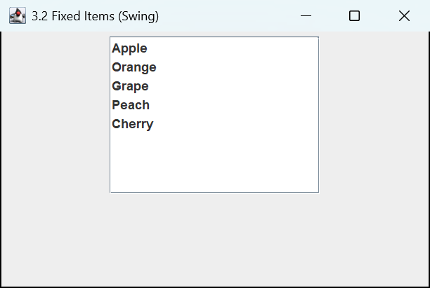 | 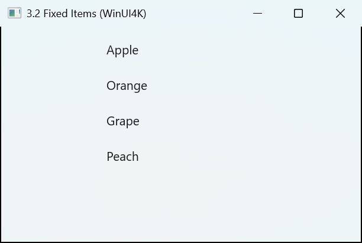 |
| 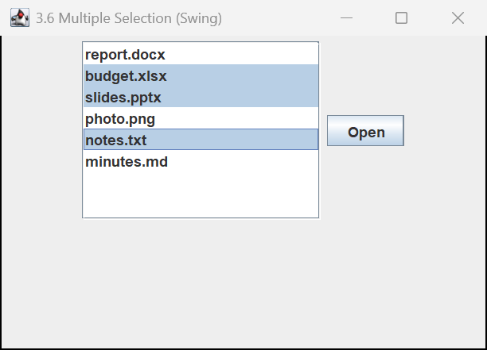 | 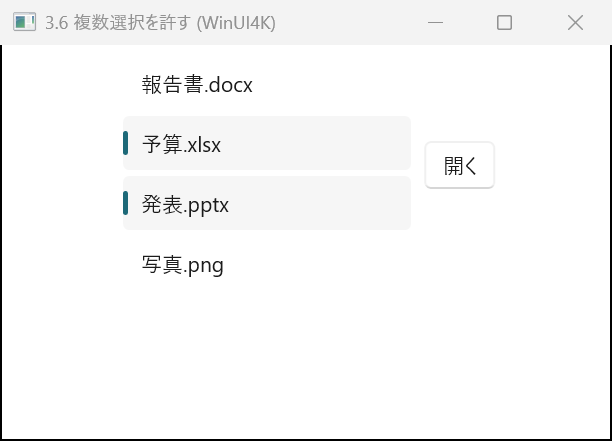 |
| 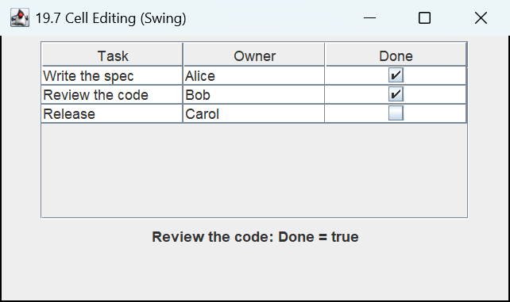 | 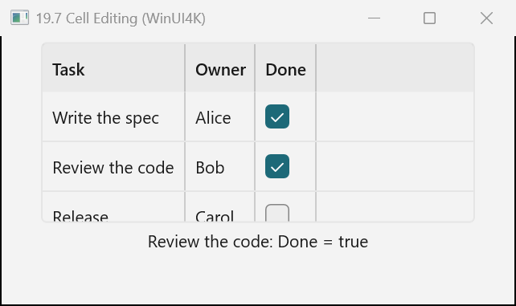 |

- 何が変か: 高さ 150 DIP のリストに 5 項目あるのに 4 項目しか見えず (Cherry が欠ける)、スクロールバーも見えないので、隠れた項目があることが分かりません (JList の Delete・DoubleClick・Listener・Move・Popup・Selected・Select も同じ)。Multiple では 6 項目のうち 4 つしか見えず、Swing の画像で選ばれている notes.txt は見えない行にあります。表は 1 行が約 41 DIP (見出しも同じくらい) で、160 DIP の表に 3 行半しか見えません。
- Swing では: リストの行は約 27 ピクセル、表の行は 16 ピクセルで、同じ高さに 5〜6 項目が入り、溢れるとスクロールバーが見えます。
- 原因の見立て: WinUI の仕様 (ListViewItem の既定の高さは 40、TableView の Standard の密度)。表は `setDensity(TableDensity.COMPACT)` で詰められます。Swing と同じ高さのまま移すと、見える行がおよそ半分になります。文書の画像では「5 項目並べた」例が 4 項目に見えるので、サンプルの高さを大きめにする手もあります。
- 文書の節: [3.2](swing_to_winui4k.md#list-basic)、[3.6](swing_to_winui4k.md#list-multiple)、[3.10](swing_to_winui4k.md#list-rows)、[19.2](swing_to_winui4k.md#table-basic)

#### 表示 23. スクロールバーが見えない (ALWAYS でも)

| Swing | WinUI4K |
|---|---|
| 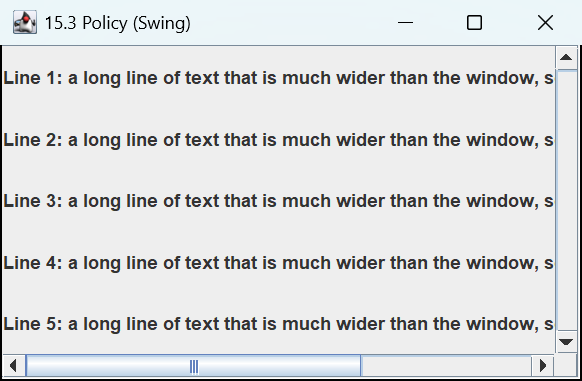 | 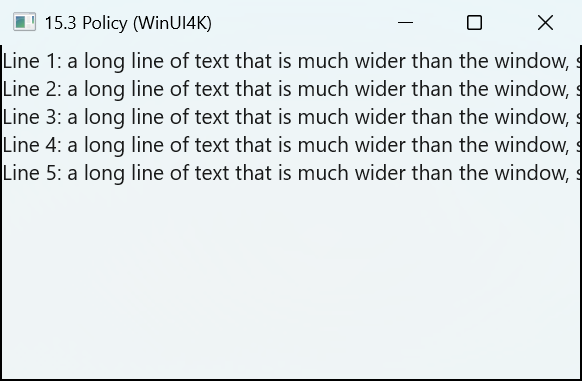 |
| 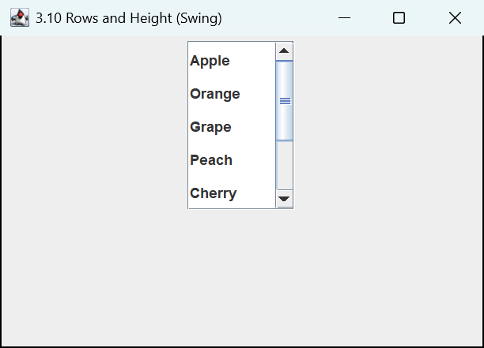 | 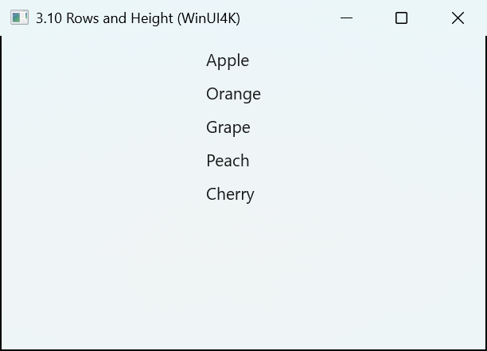 |

- 何が変か: `VERTICAL_SCROLLBAR_ALWAYS` と、はみ出しのある `HORIZONTAL_SCROLLBAR_AS_NEEDED` を指定しても、縦にも横にもバーが写っていません。文字が右端で切れているだけで、横にスクロールできることが画面から分かりません。リストも 8 項目のうち 5 項目だけが見え、バーがありません (ほかの JScrollPane・JScrollBar の画像も同じ)。
- Swing では: 縦と横のバーがはっきり出ます。
- 原因の見立て: WinUI の仕様。スクロールバーはマウスを重ねたときだけ太く出ます (ScrollBarVisibility.Visible でも同じ)。撮るときはマウスを使わないので写りません。Swing から移った人には「ALWAYS が効いていない」ように見えます。
- 文書の節: [15.3](swing_to_winui4k.md#scroll-policy)、[3.10](swing_to_winui4k.md#list-rows)

#### 表示 24. チェックボックス・ラジオボタンの間が広く、不ぞろい

| Swing | WinUI4K |
|---|---|
| 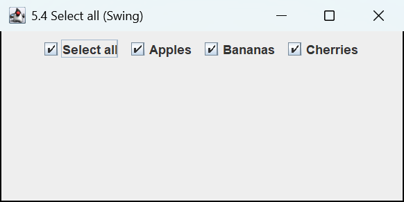 | 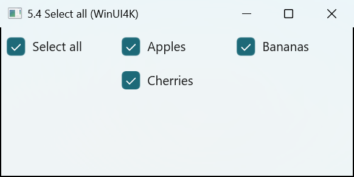 |
| 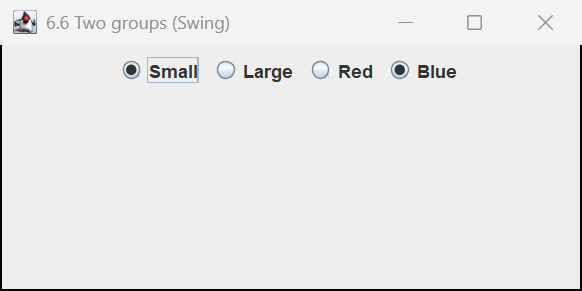 | 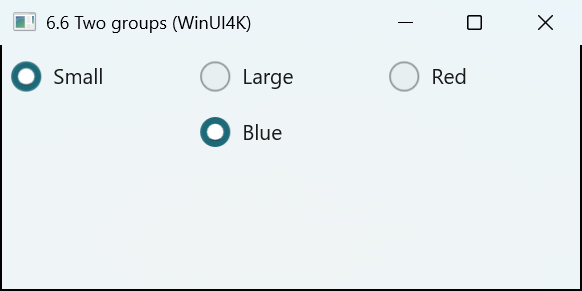 |
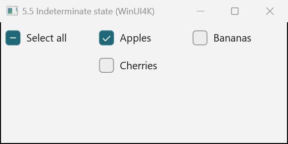

- 何が変か: 「Apples」と「Bananas」、「Medium」と「Large」の間などに大きな空白があり、短い文字の項目ほど右の余白が大きいです。Swing では 1 行に収まる 4 項目が 2 行になり、2 行目の「Cherries」「Blue」がぽつんと中央に置かれます (JRadioButton の Group も同じ)。
- Swing では: 文字の幅に合わせて詰めて並び、1 行に収まります。
- 原因の見立て: WinUI の仕様。CheckBox と RadioButton の既定のスタイルは MinWidth が 120 です (microsoft-ui-xaml の `CheckBox_themeresources.xaml:273`、`RadioButton_themeresources.xaml:194`)。
- 文書の節: [5.4](swing_to_winui4k.md#checkbox-selectall)、[5.5](swing_to_winui4k.md#checkbox-winui)、[6.2](swing_to_winui4k.md#radio-group)、[6.6](swing_to_winui4k.md#radio-twogroups)

#### 表示 25. 同じ列数でも、入力欄が Swing よりかなり広い

| Swing | WinUI4K |
|---|---|
| 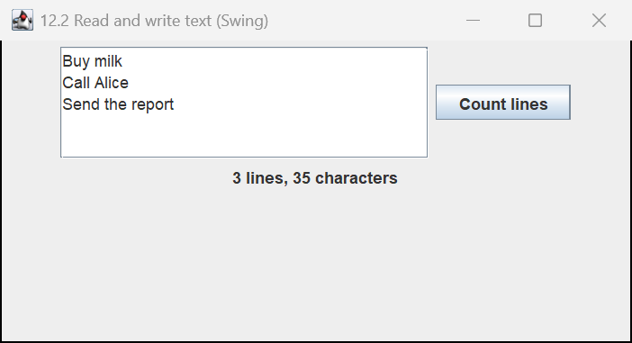 | 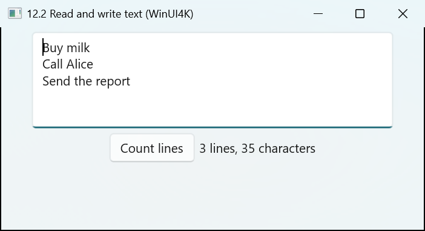 |
| 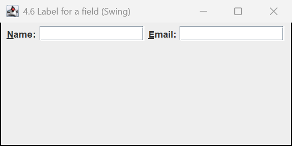 | 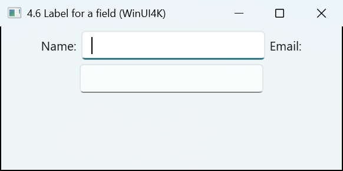 |

- 何が変か: `new WTextPane(5, 30)` の欄がウィンドウ (480 DIP) の幅いっぱい近くまで広く (画素で約 595。Swing の `JTextArea(5, 30)` は約 405)、[12.3](swing_to_winui4k.md#textarea-wrap) の 20 列の欄も 2 つが横に並ばず縦に積まれます。`new WTextField(15)` は Swing の約 1.5 倍 (約 310 と約 205) の幅で、「Email:」のラベルが 1 行目の右端に残り、その入力欄だけが 2 行目に回って、どのラベルの欄か分かりにくくなります。[2.4](swing_to_winui4k.md#textfield-change) の Register ボタンも次の行に回ります。
- Swing では: 30 列の欄はボタンと横に並び、「Name: [ ] Email: [ ]」は 1 行に収まります。
- 原因の見立て: WinUI の仕様と WinUI4K の測り方。既定の文字が 14 DIP (Swing は 12) と大きく、列の幅を 'm' の幅で測るので、Swing より 1.4〜1.5 倍広くなります。Swing から同じ列数で移すと、並びが崩れやすいです。
- 文書の節: [12.2](swing_to_winui4k.md#textarea-basic)、[12.3](swing_to_winui4k.md#textarea-wrap)、[4.6](swing_to_winui4k.md#label-labelfor)、[2.4](swing_to_winui4k.md#textfield-change)

#### 表示 26. 選んだ項目の色が薄く、見落としやすい

| Swing | WinUI4K |
|---|---|
| 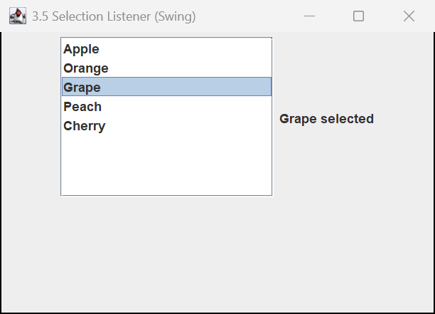 | 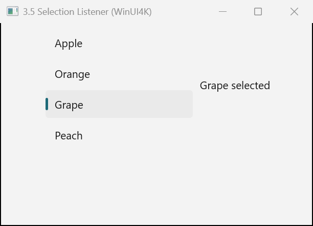 |
| 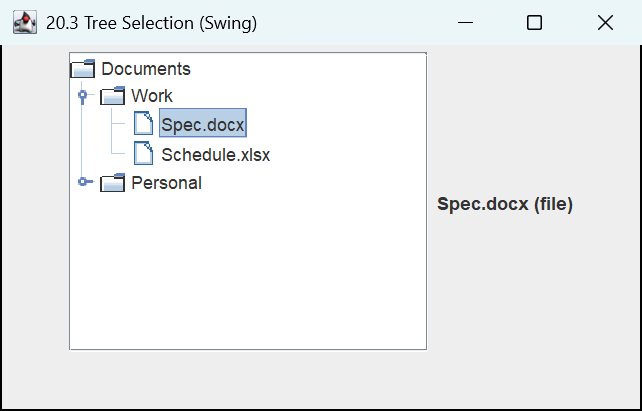 | 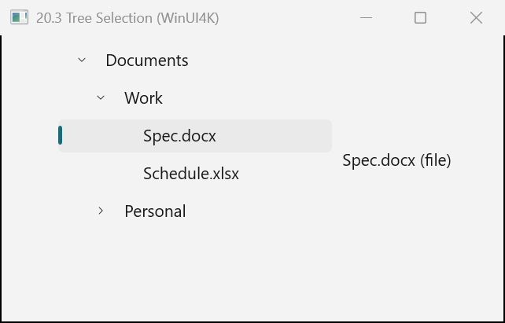 |

- 何が変か: 選んだ項目・節は、薄い灰色の背景と左端の細いアクセントの色の線だけで示され、一目では分かりません (JList の Multiple・Move、JTree の Model も同じ)。
- Swing では: 濃い色の塗り (リストは水色、木は青) で示されます。
- 原因の見立て: WinUI の仕様 (Fluent の選択の見た目)。表では、選んだ行の色を変える API もありません ([`WTable.kt:60-62`](../winui4k/src/main/kotlin/com/appkitbox/winui4k/WTable.kt#L60-L62))。
- 文書の節: [3.5](swing_to_winui4k.md#list-listener)、[3.6](swing_to_winui4k.md#list-multiple)、[20.3](swing_to_winui4k.md#tree-selection)

#### 表示 27. 入力欄の見た目 (下の線・消去ボタン・読み取り専用・選択の色)

| Swing | WinUI4K |
|---|---|
| 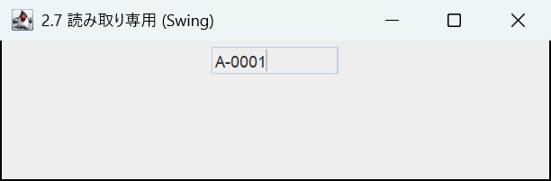 | 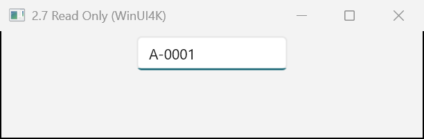 |
| 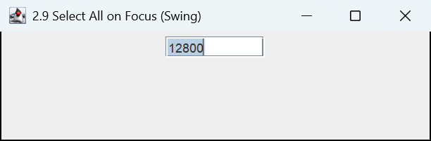 | 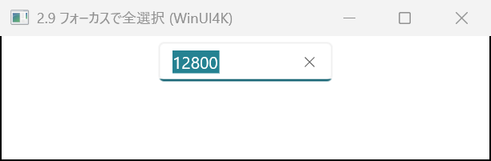 |
| 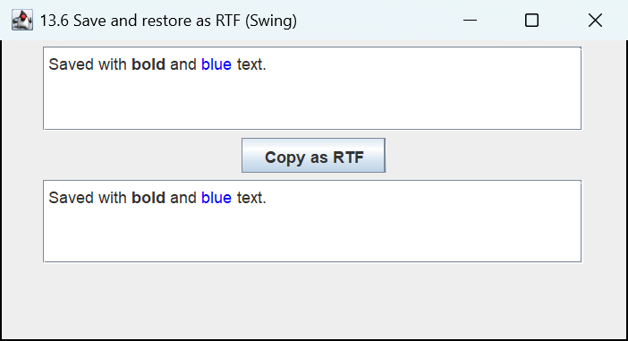 | 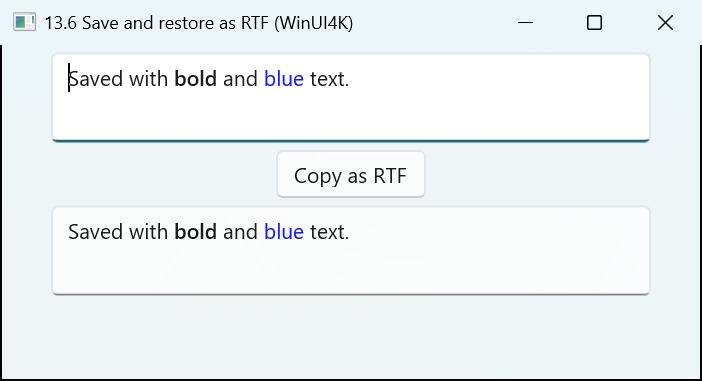 |

- 何が変か:
  - 入力欄の下の端に、アクセントの色の太い線が出ます。中身があるときは右端に × (消去) のボタンが出ます。
  - 読み取り専用の欄が、ふつうの欄と同じ見た目です。
  - 選んだ範囲が濃いアクセントの色の塗りで、文字が白になります (JTextField の Caret も同じ)。
  - 同じ `WTextPane` でも、フォーカスのある欄は白、無い欄はわずかに灰色で、並べると「下の欄は無効?」と見えます (JTextArea の Wrap も同じ)。
- Swing では: 下の線も消去ボタンも無く、読み取り専用の欄は背景がやや灰色、選んだ範囲は薄い水色で黒い文字、欄の背景はどれも白です。
- 原因の見立て: WinUI の仕様 (TextBox・RichEditBox の既定のスタイル。TextControlBackground と TextControlBackgroundFocused の違い)。不具合ではありません。
- 文書の節: [2.7](swing_to_winui4k.md#textfield-readonly)、[2.9](swing_to_winui4k.md#textfield-selectall)、[2.11](swing_to_winui4k.md#textfield-caret)、[13.6](swing_to_winui4k.md#textpane-rtf)

#### 表示 28. ツールバーのボタンが右に寄り、ラベルが出ず、「…」が出る

| Swing | WinUI4K |
|---|---|
| 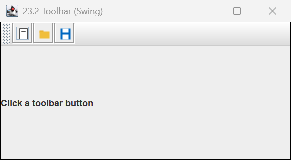 | 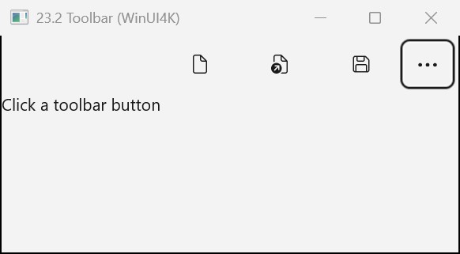 |
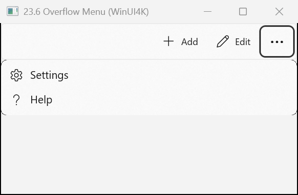

- 何が変か: `WCommandBar` に足したボタンが、バーの左ではなく右に寄って並びます。ボタンの間が広く (1 つが 70 前後)、`WAppBarButton("New", ...)` のラベルは出ず、アイコンだけです。右端に「…」ボタンが出ます。バーの高さも 48 ほどで、Swing (約 30) よりかなり高いです。「…」を開いたメニューは、ウィンドウの左端から右端まで広がり、下の「Ready」のラベルも隠します。
- Swing では: `JToolBar` はボタンを左から詰めて並べ、アイコンだけの小さなボタンになります。
- 原因の見立て: WinUI の CommandBar の仕様 (PrimaryCommands は右寄せ、DefaultLabelPosition が Bottom のラベルはバーを開いたときだけ出る、ラベルを見せるために「…」が出る、オーバーフローのメニューはバーの幅になる)。ただ、Swing から移す人には「おかしい」と感じる見た目です。`toolBar.setHorizontalAlignment(HorizontalAlignment.LEFT)` は、`WBorderLayout.NORTH` に置いたバーでは効きませんでした。
- 文書の節: [23.2](swing_to_winui4k.md#toolbar-basic)、[23.6](swing_to_winui4k.md#toolbar-winui)
- API の一覧: [API 50](#a-missing-table) (左に寄せる方法)

#### 表示 29. ボタンから開いたフライアウトの先頭に、フォーカスの枠が出る

| Swing | WinUI4K |
|---|---|
| 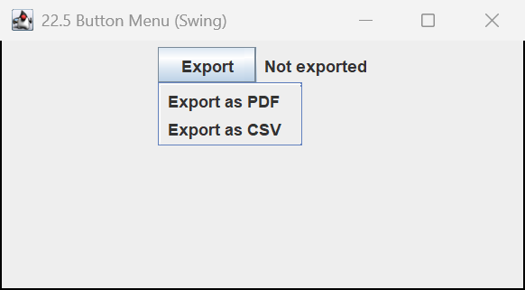 | 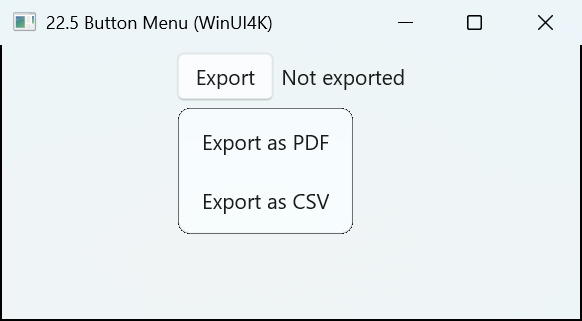 |

- 何が変か: `export.doClick()` で開いたフライアウトの先頭の項目 (Export as PDF) に、黒い太い角丸の枠が付いています。
- Swing では: Metal のメニューは、開いただけでは項目が選ばれた見た目になりません。
- 原因の見立て: WinUI の仕様。ボタンをプログラムから押して開くと、キーボードで開いたのと同じ扱いになり、最初の項目にフォーカスが入って枠が出ます。前の版の画像では、メニュー バーのメニューや `popup.show` で開いたメニューにも枠が付き、Keys では「Ctrl+S」のツールチップも浮いていましたが、表示した直後の操作を並べた後で行うように直した後 (`e065f680`) の画像では、どちらも出ていません。
- 文書の節: [22.5](swing_to_winui4k.md#popup-button)

#### 表示 30. ツールチップが部品の上に出て、タイトル バーを隠す

| Swing | WinUI4K |
|---|---|
| 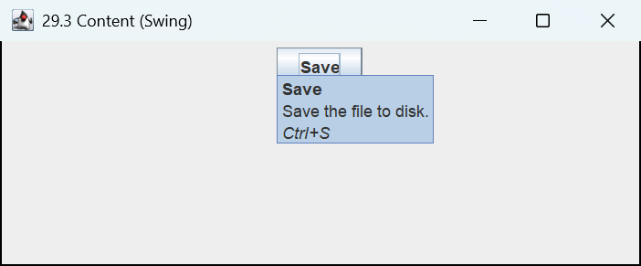 | 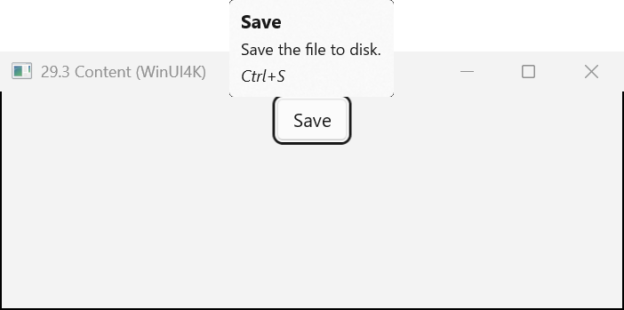 |
| 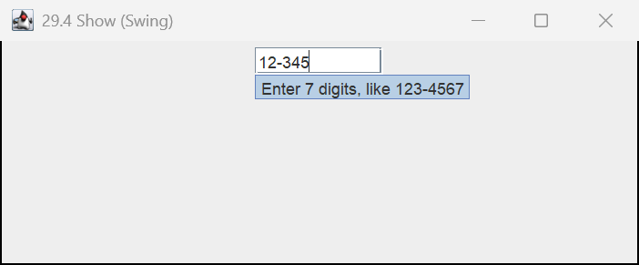 | 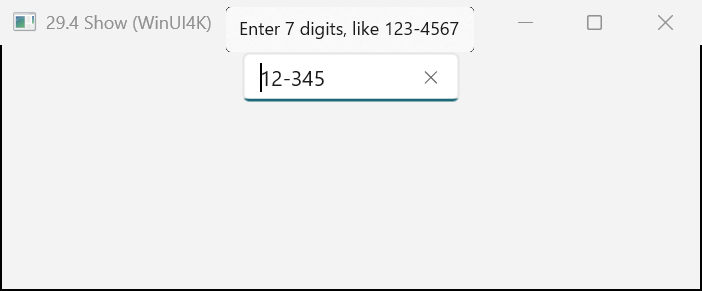 |

- 何が変か: 何も指定しないと、ヒントがボタンや入力欄の上に出て、ウィンドウのタイトル バーに重なります。Content ではウィンドウの外 (上) まではみ出しています。
- Swing では: マウスの位置の下に出ます (この画像では部品の左上にマウスがあることにしたので、部品のすぐ下)。
- 原因の見立て: WinUI の仕様 (ToolTip の既定の Placement は上)。ウィンドウの一番上に並んだ部品では、「隠れて読めない」と感じそうです。
- 文書の節: [29.2](swing_to_winui4k.md#tooltip-placement)、[29.3](swing_to_winui4k.md#tooltip-content)、[29.4](swing_to_winui4k.md#tooltip-show)

#### 表示 31. 進捗バーに割合の文字が出ない・不定のバーが短い線に見える

| Swing | WinUI4K |
|---|---|
| 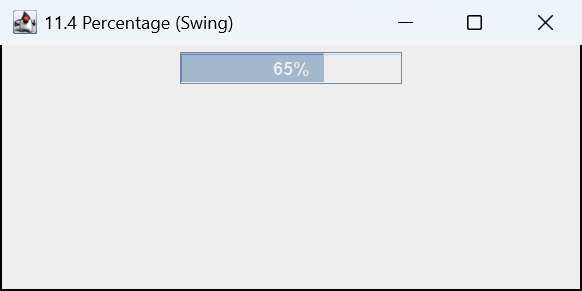 | 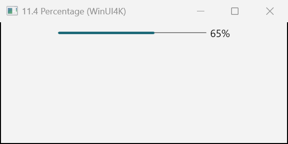 |
| 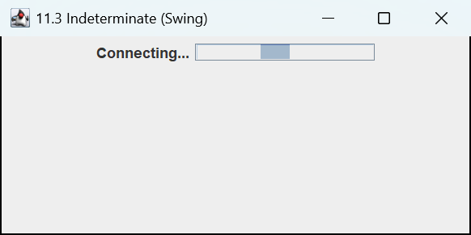 | 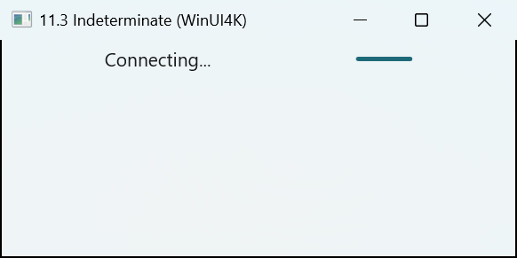 |

- 何が変か: `setStringPainted(true)` でも、バーの上に「65%」が出ません (サンプルは横に `WLabel` を置いて出している)。不定の進捗バーは、背景の線 (トラック) が無く短い線が 1 本あるだけで、止まった画像では何の部品か分かりにくいです。
- Swing では: バーの中央に「65%」が出ます。不定のバーは、枠の付いた帯の中を塊が行き来します。
- 原因の見立て: WinUI の仕様 (ProgressBar には文字を描く部分が無い。不定の ProgressBar はトラックを描かない)。WinUI4K は割合の文字を UI オートメーションに出すだけです ([`ProgressRange.kt:76-78`](../winui4k/src/main/kotlin/com/appkitbox/winui4k/ProgressRange.kt#L76-L78))。
- 文書の節: [11.4](swing_to_winui4k.md#progress-string)、[11.3](swing_to_winui4k.md#progress-indeterminate)
- API の一覧: [API 15](#a-painted)

#### 表示 32. 範囲の外の値が勝手に書き換わる

| Swing | WinUI4K |
|---|---|
| 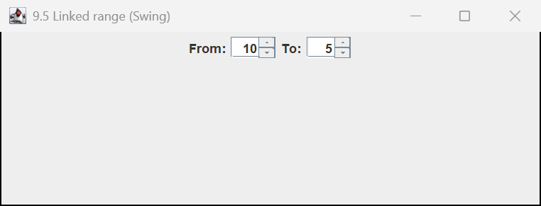 | 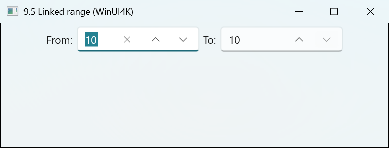 |

- 何が変か: 「From」を 10 にすると、「To」の値が 5 から 10 に変わります (最小を 10 にしただけで、値は変えていない)。
- Swing では: 「To」は 5 のまま (最小の 10 より小さい値を持ち続ける) です。
- 原因の見立て: WinUI の仕様 (NumberBox が値を範囲に切り詰める)。WinUI4K の説明 ([`WSpinner.kt:52-54`](../winui4k/src/main/kotlin/com/appkitbox/winui4k/WSpinner.kt#L52-L54)) にも書かれています。見た目としてはこちらのほうが自然ですが、Swing と動きが違います。
- 文書の節: [9.5](swing_to_winui4k.md#spinner-range)

#### 表示 33. 木にアイコンが無い

| Swing | WinUI4K |
|---|---|
| 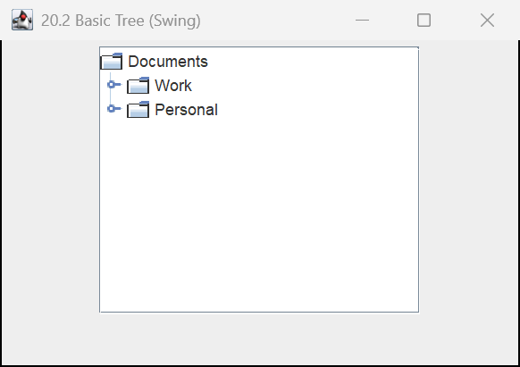 | 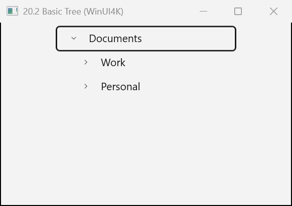 |

- 何が変か: フォルダーとファイルの区別が、開け閉めの印 (シェブロン) があるかどうかでしか分かりません。葉の節には何も付きません。
- Swing では: 既定でフォルダーと紙のアイコンが付きます。
- 原因の見立て: WinUI の仕様 (TreeView は節のアイコンを描かない)。WinUI4K の `WDefaultTreeCellRenderer` も、アイコンの既定は null です ([`WTreeCellRenderer.kt:35-46`](../winui4k/src/main/kotlin/com/appkitbox/winui4k/WTreeCellRenderer.kt#L35-L46))。既定のレンダラーに `Symbol.FOLDER` / `Symbol.DOCUMENT` を入れておく案があります。
- 文書の節: [20.2](swing_to_winui4k.md#tree-basic)、[20.6](swing_to_winui4k.md#tree-renderer)

#### 表示 34. 書式のある文の、段落の間が空かない

| Swing | WinUI4K |
|---|---|
| 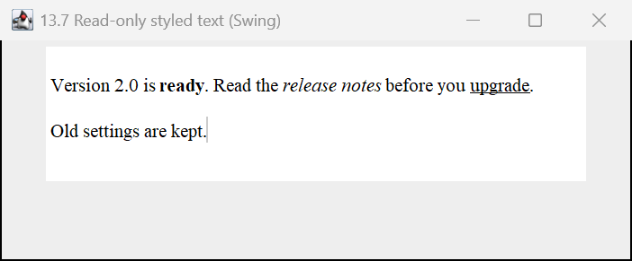 | 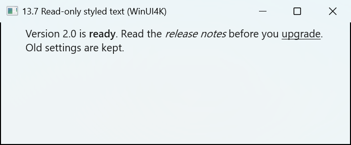 |

- 何が変か: 2 つの段落がすき間なく続き、1 つの段落の中の改行のように見えます。
- Swing では: HTML の `
` なので、段落の間に 1 行ほどの余白があります。
- 原因の見立て: WinUI の仕様 (RichTextBlock の Paragraph の既定の余白は 0)。`WRichTextBlock` には段落の余白を決める API がありません。
- 文書の節: [13.7](swing_to_winui4k.md#textpane-html)

#### 表示 35. ニーモニックの下線が出ない

| Swing | WinUI4K |
|---|---|
| 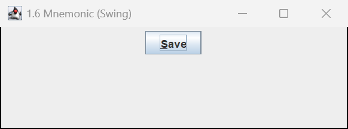 |  |
| 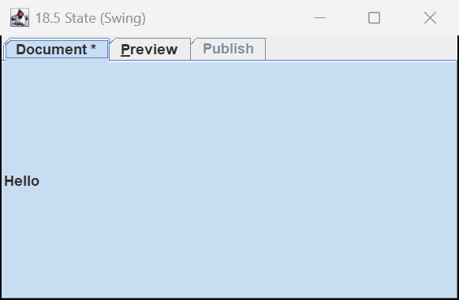 |  |

- 何が変か: `setMnemonic('S')` のボタンや `setMnemonicAt(1, VK_P)` のタブに、下線がありません。Swing の下線と比べると「何も起きていない」ように見えます。
- Swing では: 文字に下線が引かれます。
- 原因の見立て: WinUI の仕様 (アクセス キーは、Alt を押したときに出るヒントで示す)。WinUI4K の設計どおりです。
- 文書の節: [1.6](swing_to_winui4k.md#button-mnemonic)、[18.5](swing_to_winui4k.md#tabbed-state)

#### 表示 36. WRelativePanel で互いを参照すると、ウィンドウが真っ黒になる

| Swing | WinUI4K |
|---|---|
|  |  |

- 画像: 今の `SpringWinUI4K.png` は、サンプルを直した後のものです。
- 何が変か: `panel.placeRightOf(field, label)` と `panel.alignVerticalCenterWith(label, field)` を両方書くと、ウィンドウの中が真っ黒で何も出ませんでした (コンソールには `RelativePanel error: Circular dependency detected` の未処理の例外)。`panel.alignVerticalCenterWith(field, label)` (入力欄をラベルの縦の中央に揃える) にすると、入力欄の下半分が切れました。
- Swing では: `SpringLayout` は向きごとに別の制約なので、互いを参照しても、BASELINE を揃えても問題なく並びます。
- 原因の見立て: WinUI の仕様 (RelativePanel は部品の単位で依存を見るので、横と縦の別の向きでも互いを参照すると循環になる。揃える相手の高さを、揃える部品の使える高さにする)。ただ、WinUI4K は例外を UI スレッドに投げるだけで、`placeRightOf` などを呼んだ場所では分かりません。サンプルはラベルの上の余白で合わせる形にしました。
- 文書の節: [30.7](swing_to_winui4k.md#layout-spring)
- API の一覧: [API 49](#a-relativepanel)

#### 表示 37. そのほかの WinUI との違い (小さいもの)

| 画像 | 何が変か | 原因の見立て | 文書の節 |
|---|---|---|---|
|  | 隙間 0 の `WBorderLayout` なのに、ボタンの間に 2〜3 DIP の隙間があるように見える (位置を測ると隙間は無い) | WinUI のボタンは角が丸く、縁の線が背景より明るい | [30.3](swing_to_winui4k.md#layout-border) |
|  | 開いたペインと中身の領域が同じ背景で、境目が分からない | SplitView のペインの既定の背景が Mica のウィンドウとほぼ同じ色 | [17.6](swing_to_winui4k.md#split-winui) |
|  | 下の段が開いているのに、上の段の右端に「…」が出る。`setPlacement` を指定しないとラベルの上に開いてタイトル バーを隠した (サンプルは下に開くよう直した) | 「…」は下の段を開け閉めするボタン。既定の Placement は上 | [22.6](swing_to_winui4k.md#popup-winui) |
|  | `setText("report.txt")` した入力欄のキャレットが先頭にある (Swing は末尾) | TextBox は Text を入れてもキャレットが 0 のまま。`setText` で末尾に動かすかは判断が要る | [25.3](swing_to_winui4k.md#dialog-validate) |
|  | 幅 520 で撮ったときは、`WTitleBar` の見出しと副題が出ず、検索の欄だけが出た (今の画像は幅 720) | TitleBar は中身が入りきらないと Compact になって見出しを隠す (microsoft-ui-xaml の `TitleBar.cpp:174-178`) | [24.7](swing_to_winui4k.md#frame-winui) |

### 1.3 サンプルや撮り方によるもの

#### 表示 38. ファイルのダイアログがとても大きく、左の一覧に撮った人のフォルダーが写る (ぼかした)

| Swing | WinUI4K |
|---|---|
|  |  |

- 何が変か: WinUI4K の画像は約 1780×1070 ピクセルで、Swing (約 750×535) に比べてとても大きく、並べると文字が小さく見えます。また、左のナビゲーション ウィンドウには「OneDrive - Personal」と、クイック アクセスに固定したフォルダーの名前 (撮った PC の利用者のもの) が出るので、`capture.ps1` がその部分をぼかして保存しています (JFileChooser の WinUI4K の 5 枚すべて)。
- Swing では: Metal の `JFileChooser` には左の一覧が無く、大きさも既定のままです。
- 原因の見立て: OS のダイアログの仕様。前に使ったときの大きさを覚えていて、WinUI4K からは大きさを指定できません。大きさは、撮る前に一度ダイアログを小さくして閉じておけばそろいます。
- 文書の節: [27.2](swing_to_winui4k.md#filechooser-open)、[27.3](swing_to_winui4k.md#filechooser-filter)、[27.4](swing_to_winui4k.md#filechooser-save)、[27.5](swing_to_winui4k.md#filechooser-folder)、[27.6](swing_to_winui4k.md#filechooser-multiple)

#### 表示 39. 起動した直後に撮るので、ツールチップ・メニュー・ヒントが写らない

| Swing | WinUI4K |
|---|---|
|  |  |
|  |  |

- 何が変か: ToolTip の画像はただのボタンで、何の例か分かりません。Action は保存ボタンが無効になるだけで、同じ Action を使うメニューの項目は写りません (Swing 側のアイコンは無効のぼかしが強く、粗く見える)。Mnemonic の WinUI4K は Alt のヒントが出ないので、何も起きていないように見えます ([表示 35](#d35))。
- 原因の見立て: 起動した直後を撮る撮り方の限界。ほかの章のように、サンプルが起動時にヒントやメニューを開くか、キーを送って撮る形にするとよいです。
- 文書の節: [1.5](swing_to_winui4k.md#button-tooltip)、[1.8](swing_to_winui4k.md#button-action)、[1.6](swing_to_winui4k.md#button-mnemonic)

#### 表示 40. ポップアップの角に黒い点・縁が残る

| Swing | WinUI4K |
|---|---|
|  |  |

- 何が変か: 角の丸いヒントの四隅に、小さな黒い点が見えます (JToolTip の Content・Show も同じ)。メニューの角の丸みの外側にも、うっすら黒っぽい縁が残ることがあります。
- 原因の見立て: 撮り方の都合で、実際の画面では出ません。ツールチップやメニューは透明な部分を持つ別のウィンドウで、PrintWindow で撮ると透明な部分が黒になります。真っ黒の画素を透明にして重ねましたが、角の半透明の画素が黒っぽく残りました。
- 文書の節: [29.2](swing_to_winui4k.md#tooltip-placement)、[21.2](swing_to_winui4k.md#menu-basic)

#### 表示 41. Swing と WinUI4K でサンプルがそろっていない・余白が無い

| 画像 | 何が変か | 原因の見立て | 文書の節 |
|---|---|---|---|
|   | WinUI4K だけ「Password」の見出しが付く。Swing は何の欄か分からない | WinUI4K 側だけ `setHeader` を呼んでいる。Swing 側にラベルを足すとそろう | [2.15](swing_to_winui4k.md#textfield-password) |
|   | WinUI4K の欄の幅が案内文「e.g. John Smith」ぎりぎりで、右に余白がほとんど無い (Swing は 20 列の広い欄) | `new WTextField("...")` は案内文で、列数を同時に渡せない ([API 1](#a-placeholder)) | [2.8](swing_to_winui4k.md#textfield-placeholder) |
|   | 見出しの文字の太さと、アイコンの形 (Swing は塗りつぶしの人、WinUI4K は線の人) がそろわない | Swing 側の png を `Symbol.CONTACT` に合わせる手もある | [3.9](swing_to_winui4k.md#list-renderer) |
|  | リストの下のラベルが、4 つ目の項目の真下に付いて、項目の続きに見える (Delete も同じ) | リストの高さを決め、`WFlowLayout` の縦の隙間だけで並べている。Swing は `JScrollPane` の枠がある | [3.4](swing_to_winui4k.md#list-selected) |
|  | 2 つのリストが間を置かずに並び、区別が無い。チェックボックスのほうは何も選ばれていない | 起動時に選択を 1 つ入れ、間を空けるとよい | [3.15](swing_to_winui4k.md#list-winui) |
|  | 本文のラベルがウィンドウの左端に余白なしで接している | `setContentPane(new WGrid())` にすると、既定の中身の余白 (24) が無くなる | [24.7](swing_to_winui4k.md#frame-winui) |
|  | 状態の行 (「Ready」) が左下の角に余白なしで置かれる | `BorderLayout` の仕様どおりで、Swing も同じ | [24.5](swing_to_winui4k.md#frame-menubar) |
|   | コードの文字は英語なのに、ボタンが日本語 (Swing は「はい(Y)」「取消」、WinUI4K は「はい」「キャンセル」) | 両方とも既定のロケール (日本語) に従う。WinUI4K は「(Y)」を付けない | [26.3](swing_to_winui4k.md#optionpane-confirm) |

### 1.4 Swing 側の画像で気になるもの

| 画像 | 何が気になるか | 原因の見立て | 文書の節 |
|---|---|---|---|
|  | Swing の画像は文字がすべて太字で、ボタンは立体のグラデーション。同じ文字列でも WinUI4K と幅が違う | Metal の既定 (「Dialog」の太字)。比べるときに「Swing は太字」と分かっていると誤解が無い | [「この文書の読み方」](swing_to_winui4k.md#reading) |
|  | 赤い Delete ボタンの右端に、細い別の色の帯が出る | 背景の色を変えた Metal のボタンの描き方 | [1.11](swing_to_winui4k.md#button-appearance) |
|  | 既定ボタンの OK は枠が少し濃いだけで、既定とは分かりにくい (WinUI4K はアクセントの色) | Metal の仕様 | [1.7](swing_to_winui4k.md#button-default) |
|  | JEditorPane の HTML だけ、明朝体 (セリフ体) になる | HTMLEditorKit の既定のスタイルシートが serif | [13.7](swing_to_winui4k.md#textpane-html) |
|  | 「New folder」で足した Folder 2 と、子の無い Personal が紙 (葉) のアイコンで出る (WinUI4K は開け閉めの印が出ない) | `new DefaultTreeModel(root)` は子の無い節を葉にする。`new DefaultTreeModel(root, true)` にすればフォルダーになる | [20.5](swing_to_winui4k.md#tree-model) |
|  | 閉じようとした後のメッセージが「Click Save or Discard to cl...」で切れる (WinUI4K は全文) | `pack()` で短い文字に合わせた大きさのまま、長い文字に替えた | [25.4](swing_to_winui4k.md#dialog-close) |
|  | HTML の `width: 250px` の折り返しが、WinUI4K の `setWidth(250)` より広い (画素で約 450 と約 370) | HTML の px の扱いの違い。異常ではない | [4.7](swing_to_winui4k.md#label-wrap) |

## 2. Swing から移るときに不自然な API

ソースへのリンクは `winui4k/src/main/kotlin/com/appkitbox/winui4k/` の下のファイルです (行番号は直す前のもの)。★ は重いもの (コンパイルが通るのに黙って違う動きになるもの、例外になるもの、よく使う API) です。

2026-11-07 の 2 回目の修正で、多くの項目を Swing に合わせて直しました。直した項目は「直した」とコミットの短いハッシュを書き、残る不自然さがあればそれだけを書いています。直さずに残した項目には「残した理由」と「案」を書き、API の形を決める必要があるものには **判断が要る** と付けています。

### 2.1 Swing と同じ名前で、意味や振る舞いが違う

#### API 1. `new WTextField("…")` / `new WTextPane("…")` の文字列が案内文になる (直した: `afd2f27b`)

- 直した後: `WTextField(String)`・`WPasswordField(String)`・`WTextPane(String)` の文字列は、Swing と同じく初めの文字列です。`WTextField(String, int)`・`WPasswordField(String, int)` も足しました。案内文は `setPlaceholderText` だけで入れます。
- 文書の節: [2.8](swing_to_winui4k.md#textfield-placeholder)、[2.17](swing_to_winui4k.md#textfield-notes)、[12.2](swing_to_winui4k.md#textarea-basic)、[29.4](swing_to_winui4k.md#tooltip-show)

#### API 2. ★ `setHorizontalAlignment` / `setVerticalAlignment` が文字の揃えではない (残した。判断が要る)

- Swing: `JTextField.setHorizontalAlignment(JTextField.RIGHT)`・`JLabel.setHorizontalAlignment(SwingConstants.RIGHT)`・`JLabel.setVerticalAlignment(SwingConstants.TOP)` は、部品の中の文字の揃え。
- WinUI4K: 同じ名前の `horizontalAlignment` ([`WComponent.kt:1026`](../winui4k/src/main/kotlin/com/appkitbox/winui4k/WComponent.kt#L1026))・`verticalAlignment` ([`WComponent.kt:1036`](../winui4k/src/main/kotlin/com/appkitbox/winui4k/WComponent.kt#L1036)) は、親の中での部品そのものの置き場所。文字の揃えは `textAlignment`。ラベルの中の縦の揃えは無い。`8f7e44ca` で KDoc に、Swing と意味が違うことと代わりの API を書いただけです。
- 何が不自然か: `SwingConstants.RIGHT` を `HorizontalAlignment.RIGHT` に置き換えるだけの書き換えでコンパイルが通り、文字ではなく部品が右に寄ります。
- 残した理由: 基底の `horizontalAlignment` は 372 か所で使われていて、名前を移すと利用者のコードも大きく変わります。どちらの案も新しい名前と値の型 (int の定数か列挙か) を決める必要があります。
- 案 A: 基底の 2 つを別の名前 (`layoutHorizontalAlignment` など) に移し、`WLabel`・`WTextField`・ボタンに Swing と同じ意味の `horizontalAlignment` / `verticalAlignment` を作る。
- 案 B: 基底はそのままにし、Java 向けに `setHorizontalAlignment(int)` (`SwingConstants` の値) の多重定義を足す。`WLabel` に `textVerticalAlignment` を足す。
- 決めること: 新しい名前、値の型、`SwingConstants` に当たる定数を作るか。
- 文書の節: [2.14](swing_to_winui4k.md#textfield-appearance)、[2.17](swing_to_winui4k.md#textfield-notes)、[4.5](swing_to_winui4k.md#label-alignment)

#### API 3. `setLayout` の後の `getContentPane().add(...)` が画面に出ない (直した: `5966d9cd`)

- 直した後: `getContentPane()` は今の中身 (`WContainer`) を返し、`setLayout` は中身を替えずにレイアウト マネージャーだけを替えます。`getContentPane().add(c, BorderLayout.CENTER)` の形も書けます。
- 文書の節: [24.5](swing_to_winui4k.md#frame-menubar)、[30.7](swing_to_winui4k.md#layout-spring)、[30.10](swing_to_winui4k.md#layout-notes)

#### API 4. `setMargin` が外側の余白 (直した: `fea98ebe`)

- 直した後: ボタンと入力欄 (`WButtonBase`・`WTextField`・`WPasswordField`・`WTextPane`) に、Swing と同じ意味 (内側の余白) の `setMargin(WInsets)` を足しました。`new WInsets(上, 左, 下, 右)` で `Insets` と同じ順に渡せます。
- 残る不自然さ: 4 つの数だけの `setMargin(左, 上, 右, 下)` は、WinUI の外側の余白のままです (KDoc に違いを書いた)。[API 29](#a-order) も見てください。
- 文書の節: [1.1](swing_to_winui4k.md#button-table)、[2.1](swing_to_winui4k.md#textfield-table)

#### API 5. `WComboBox.removeItem(1)` が 2 番目の項目を消す (直した: `9f8eb388`)

- 直した後: `removeItem(int)` を外しました。Java の `removeItem(1)` は Swing と同じく `1` に等しい項目を消し、位置で消すのは `removeItemAt` だけです。
- 文書の節: [8.9](swing_to_winui4k.md#combo-notes)

#### API 6. `WComboBox.getSelectedItem()` が項目ではなく表示の文字列を返す (直した: `974f35cc`)

- 直した後: `getSelectedItem()` と `getItemAt(i)` は Swing と同じく項目そのものを返します。表示の文字列は `getSelectedItemText()` と `getItem(i)` で読みます (`dabb557a` でテストを合わせた)。文書の 8.6 は `(Country) country.getSelectedItem()` に戻しました。
- 文書の節: [8.1](swing_to_winui4k.md#combo-table)、[8.6](swing_to_winui4k.md#combo-renderer)

#### API 7. `WTextField.getSelectedText()` が、選んでいないときに空の文字列を返す (直した: `c6d334a7`)

- 直した後: `WTextField`・`WTextPane` の `getSelectedText()` は、Swing と同じく選んでいないと `null` です。文書の 21.6 は `!= null` の判定に戻しました。
- 文書の節: [21.6](swing_to_winui4k.md#menu-listener)

#### API 8. `WColor.RED` などの値が AWT の `Color` と違う (直した: `05a28e00`)

- 直した後: `WColor` の定数は `java.awt.Color` と同じ値です (`RED` は (255, 0, 0)、`ORANGE` は (255, 200, 0) など)。`DARK_GRAY`・`PINK`・`MAGENTA`・`CYAN` も足しました。AWT に無い `PURPLE` は前の値のままです。
- 文書の節: [4.3](swing_to_winui4k.md#label-font)、[13.3](swing_to_winui4k.md#textpane-highlight)、[28.3](swing_to_winui4k.md#colorchooser-embed)

#### API 9. `<html>` の文字が、そのまま表示される (直した: `eba504be`)

- 直した後: `WLabel`・ボタンのラベル・`setToolTipText` の `<html>` で始まる文字は、Swing と同じく書式付きの文字として表示します。`getText()` は入れた文字列のままです。
- 残る不自然さ: 写すタグは基本のもの (`b`・`strong`・`i`・`em`・`u`・`br`・`p`・`div`・`font color`) だけで、ほかのタグ (表・画像・`style` の幅など) は外して中身の文字だけを出します。`WToolTip.setText` とコンボの項目は HTML を解釈しません。
- 文書の節: [1.16](swing_to_winui4k.md#button-notes)、[4.7](swing_to_winui4k.md#label-wrap)、[29.3](swing_to_winui4k.md#tooltip-content)

#### API 10. `setWrapStyleWord(true)` で折り返さなくなる (直した: `ec8a1ea7`)

- 直した後: Swing と同じく `setLineWrap(true); setWrapStyleWord(true);` で単語の切れ目で折り返します ([表示 11](#d11))。
- 残る違い: WinUI の折り返しははじめから単語の切れ目なので、`setWrapStyleWord(false)` でも単語の切れ目で折り返します。
- 文書の節: [12.3](swing_to_winui4k.md#textarea-wrap)

#### API 11. `setForeground` が入力欄の文字の色にならない (直した: `16accf8e`)

- 直した後: フォーカスを持った欄の文字もその色になります ([表示 10](#d10))。
- 文書の節: [12.6](swing_to_winui4k.md#textarea-appearance)、[2.14](swing_to_winui4k.md#textfield-appearance)

#### API 12. ★ `WTable.setSelectionMode(MULTIPLE_INTERVAL_SELECTION)` が黙って単一の選択になる (残した。判断が要る)

- Swing: `JTable` の既定は複数の区間の選択で、`getSelectedRows()` で何行も取れる。列やセルの選択もある。
- WinUI4K: `setSelectionMode(int)` ([`WTable.kt:393-401`](../winui4k/src/main/kotlin/com/appkitbox/winui4k/WTable.kt#L393-L401)) は値を確かめた後、いつも `SINGLE_SELECTION` にする。`columnSelectionAllowed` / `cellSelectionEnabled` は何もしない。
- 何が不自然か: 例外も出ずに単一になるので、「選んだ行をまとめて消す」などのコードが、黙って 1 行だけを処理します。
- 残した理由: WinUI の `TableView` (実験版) が None / Single の選択しか持たないためで、WinUI4K の側では複数にできません。
- 案: `MULTIPLE_INTERVAL_SELECTION` などを渡されたときに警告を出すか、例外にするか、今のまま KDoc と文書で強調するかを決める。`TableView` が複数の選択に対応したら写す。
- 文書の節: [19.5](swing_to_winui4k.md#table-selection)

#### API 13. ★ Swing では使える設定が、例外になる (残した)

| Swing | WinUI4K | 何が起きるか | 残した理由 | 案 | 文書の節 |
|---|---|---|---|---|---|
| `new JSpinner(new SpinnerListModel(...))`・`SpinnerDateModel` | `WSpinner.model` ([`WSpinner.kt:105`](../winui4k/src/main/kotlin/com/appkitbox/winui4k/WSpinner.kt#L105)) | `WSpinnerListModel` / `WSpinnerDateModel` を渡すと `IllegalArgumentException` | `NumberBox` が数しか表示できず、一覧と日時には別の部品の組み立てが要る | 一覧と日時を表示できるスピナーを作る。それまでは受け取る型を `WSpinnerNumberModel` にしてコンパイルで分かるようにする | [9.1](swing_to_winui4k.md#spinner-table) |
| `new JDialog(frame, "Find", false)` (モードレス) | `WContentDialog(owner, title, modal)` | `modal = false` は `IllegalArgumentException` | `ContentDialog` はモーダルだけ | 持ち主付きの `WFrame` (AppWindow の owner) を作れる `WDialog` を足す | [25.5](swing_to_winui4k.md#dialog-nonblocking) |
| `new JToolBar(JToolBar.VERTICAL)` | `WCommandBar.orientation` | `IllegalArgumentException` | `CommandBar` は横だけ | 縦に並べる代わりの書き方 (`WPanel` に `WButton`) を案内する | [23.1](swing_to_winui4k.md#toolbar-table) |

#### API 14. `WButtonGroup` に入れないラジオボタンも、1 つしか選べない (直した: `2b7844cf`)

- 直した後: `WButtonGroup` に入れない `WRadioButton` は、Swing と同じく同じ親の中でもそれぞれ別にオン・オフできます (ボタンごとに一意の `GroupName` を中で付ける)。
- 文書の節: [6.2](swing_to_winui4k.md#radio-group)、[6.8](swing_to_winui4k.md#radio-notes)

#### API 15. `setStringPainted(true)` が Swing のように描かない (残した。`setPaintTicks(true)` は直した: `699193f8`)

- Swing: `JProgressBar.setStringPainted(true)` でバーの上に「65%」。
- WinUI4K: `isStringPainted` ([`WProgressBar.kt:99`](../winui4k/src/main/kotlin/com/appkitbox/winui4k/WProgressBar.kt#L99)) は UI オートメーションに文字を入れるだけ。
- 何が不自然か: 同じ名前の設定でコンパイルが通り、画面に何も出ません ([表示 31](#d31))。
- 残した理由: WinUI の `ProgressBar` のテンプレートに文字を描く場所が無く、重ねて描くには部品の作りを変える必要があります。
- 案: バーの上か横に `TextBlock` を重ねて描く (描かないなら名前を変える)。
- 文書の節: [11.4](swing_to_winui4k.md#progress-string)

#### API 16. `list.getInputMap()` (WHEN_FOCUSED) に入れたキーが効かない (効くことを確かめた: `b73ade73`)

- 確かめた後: `list.getInputMap().put(...)` に入れたキーは、項目にフォーカスがあるときも効きます (`getSource()` はリスト)。リストの外にフォーカスがあるときは効きません。文書の 3.11 とサンプルは Swing と同じ `getInputMap()` に戻しました。
- 文書の節: [3.11](swing_to_winui4k.md#list-delete)

#### API 17. スクロールペインの中身の `revalidate()` で、続きの読み込みが余分に起きる (直した: `e3e050a1`)

- 直した後: 中身の `revalidate()` で測り直す間の一時的な位置は、スクロールのリスナーに知らせません。文書の 16.2・16.5 のサンプルは、Swing と同じく `revalidate()` を呼ぶ形に戻しました。
- 文書の節: [16.5](swing_to_winui4k.md#scrollbar-loadmore)

#### API 18. そのほかの、同じ名前で違う振る舞い

論理フォントの名前は直しました (`d6209c10`。`new WFont("SansSerif", ...)`・`"Dialog"`・`"Serif"`・`"Monospaced"`・`"DialogInput"` を部品に入れるときに Segoe UI・Times New Roman・Consolas に置き換え、`WFont.SANS_SERIF` などの定数を足した)。残りの行は残しました。
残した理由: どれも WinUI のコントロールのテンプレートや既定の動き (AccessKey・ContentDialog・RichEditBox・CommandBar・ファイルのダイアログ) に沿った振る舞いで、変えるには部品ごとの作り直しか、Swing と WinUI のどちらに寄せるかの判断が要るためです。

| Swing | WinUI4K | 何が不自然か | 案 | 文書の節 |
|---|---|---|---|---|
| `JLabel.setEnabled(false)` で文字が灰色 | `WLabel.isEnabled` ([`WLabel.kt:213`](../winui4k/src/main/kotlin/com/appkitbox/winui4k/WLabel.kt#L213)) は `disabledIcon` を切り替えるだけ | 入力欄と一緒にラベルを無効にしても見た目が変わらない | 無効の間は文字の色をテーマの無効の色にする | [4.9](swing_to_winui4k.md#label-notes) |
| `label.setLabelFor(button)` + `setDisplayedMnemonic` は、フォーカスを移すだけ | 対象の AccessKey になる ([`WLabel.kt:446-453`](../winui4k/src/main/kotlin/com/appkitbox/winui4k/WLabel.kt#L446-L453)) | 対象がボタンだと押される。対象の `mnemonic` も上書きされる | 対象がボタンのときは、フォーカスだけを移す | [4.6](swing_to_winui4k.md#label-labelfor) |
| `JCheckBox.setIcon` / `setSelectedIcon` は、チェックの印そのものを絵に替える | 印の右にアイコンを足す | 星やハートのチェックボックスが、印と絵の 2 つになる | Javadoc と文書で案内する (印を替えるにはテンプレートの差し替えが要る) | [5.1](swing_to_winui4k.md#checkbox-table) |
| `checkBox.setHorizontalTextPosition(LEADING)` で文字を印の左に | `horizontalTextPosition` はアイコンと文字の位置だけ | 呼べるのに効かない | FlowDirection で入れ替えるか、効かないことを Javadoc に書く | [5.1](swing_to_winui4k.md#checkbox-table) |
| `JCheckBox.setBorderPainted(true)` で枠 (既定は false) | `isBorderPainted` ([`WToggleButton.kt:267`](../winui4k/src/main/kotlin/com/appkitbox/winui4k/WToggleButton.kt#L267)) | CheckBox・RadioButton のテンプレートは枠を描かず、既定も true で逆 | 既定を false にし、true のときは枠を描く | [5.1](swing_to_winui4k.md#checkbox-table) |
| `new DefaultCellEditor(comboBox)` は渡したコンボそのものを置く | 作った時点の設定を写した XAML ([`table/TableCellEditor.kt:35-44`](../winui4k/src/main/kotlin/com/appkitbox/winui4k/table/TableCellEditor.kt#L35-L44)) | 後から項目やリスナーを足しても効かない | 項目のリストを受け取る形にし、Javadoc で強調する | [19.7](swing_to_winui4k.md#table-edit) |
| `dialog.setDefaultCloseOperation(DO_NOTHING_ON_CLOSE)` は × だけを止める | Esc と閉じるボタンを止める ([`WContentDialog.kt:549`](../winui4k/src/main/kotlin/com/appkitbox/winui4k/WContentDialog.kt#L549)) | `setCloseButtonText("Close")` で置いたボタンを押しても閉じない | 閉じるボタンは止めない (Esc だけを × とみなす) | [25.4](swing_to_winui4k.md#dialog-close) |
| `dialog.setSize(440, 300)` | `WContentDialog` が継ぐ `setSize` | 呼べるのに大きさが変わらない | 上書きして KDoc に書くか、`@Deprecated` で警告を出す | [25.7](swing_to_winui4k.md#dialog-notes) |
| `setFloatable(true)`・`setRollover(false)` | `WCommandBar.isFloatable` / `isRollover` | 黙って無視される | 無視する設定をクラスの説明の先頭にまとめる | [23.1](swing_to_winui4k.md#toolbar-table) |
| `toolBar.add(action)` はアイコンだけのボタン | `WCommandBar.add(action)` は `NAME` をラベルにする | バーを開いたりラベルを右に出したりすると、文字が出る | `labelPosition = COLLAPSED` にするか、違いを Javadoc に書く | [23.3](swing_to_winui4k.md#toolbar-action) |
| `tree.setShowsRootHandles(false)` | `showsRootHandles` は値を覚えるだけ | 例外も警告も無く効かない | 効かないことを文書でも示す | [20.7](swing_to_winui4k.md#tree-lazy) |
| `setFileSelectionMode(FILES_AND_DIRECTORIES)` | ファイルを選ぶダイアログになる | 例外も出ずにフォルダーが選べない | OS のダイアログの制約なので、文書で明記する | [27.5](swing_to_winui4k.md#filechooser-folder) |
| `FileFilter` を継いで `accept` を書く | ダイアログに出るのは `WFileNameExtensionFilter` と「すべてのファイル」だけ | 独自のフィルターは黙って無視される | 拡張子以外のフィルターが来たら警告を出す | [27.3](swing_to_winui4k.md#filechooser-filter) |
| `JTextPane.getCharacterAttributes()` はキャレットの前の文字の書式 | キャレットの後ろの 1 文字 ([`WTextPane.kt:700`](../winui4k/src/main/kotlin/com/appkitbox/winui4k/WTextPane.kt#L700)) | 太字の語の直後で、「太字」ボタンの状態が Swing と逆になる | キャレットの前の文字 (先頭なら後ろ) の書式を返す | [13.5](swing_to_winui4k.md#textpane-caret) |
| `doc.insertString(offs, str, null)` は書式の無い文字 | 前の文字の書式を引き継ぐ | 太字の後の文字が太字になる | `null` のときは既定の書式を入れる | [13.2](swing_to_winui4k.md#textpane-styled) |
| 2 つの状態の部品はどれも `AbstractButton` | `WToggleSwitch` は `WSelectable` でなく、`text` は `header` の別名 | `WButtonGroup` や `Action` に使えず、`setText` がスイッチの上の見出しを変える | `WSelectable` を実装して `Action` を受ける | [7.6](swing_to_winui4k.md#toggle-winui) |
| (Swing はマウスのリスナーと `getPathForLocation`) | `WTree.addItemInvokedListener` | モデルを表示している木では、節の代わりに null が来る | モデルの木では `TreePath` を渡すリスナーを足す | [20.9](swing_to_winui4k.md#tree-notes) |
| `setMnemonic('S')` はラベルに下線 | Alt のヒント | 「(S)」を書く手間が残る。`_S` のような記法も無い | ラベルの `_S` の記法を足す | [1.6](swing_to_winui4k.md#button-mnemonic) |
| 既定ボタンは Enter で押される | `WFrame.defaultButton` | Enter を自分で処理する部品にフォーカスがあると押されない | Javadoc のとおり。文書で触れる | [1.7](swing_to_winui4k.md#button-default) |

### 2.2 既定値が違う

#### API 19. `WFrame` の中身が `BorderLayout` ではなく、制約付きの `add` が例外になる (直した: `5966d9cd`)

- 直した後: `WFrame` と `WContentDialog` の中身の既定は、`JFrame` / `JDialog` と同じく `WBorderLayout` の `WLayoutPanel` (周りの余白なし) です。`setLayout` を呼ばずに `frame.add(c, WBorderLayout.NORTH)` が効き、制約なしの `add` は中央に入ります。`WContentDialog` は `JDialog` の `pack()` と同じく中身の希望の大きさまで広がります。文書のサンプルから、`BorderLayout` のために足していた `setLayout` を外しました。
- 文書の節: [0.2](swing_to_winui4k.md#basics-differences)、[24.1](swing_to_winui4k.md#frame-table)、[25.2](swing_to_winui4k.md#dialog-basic)、[30.3](swing_to_winui4k.md#layout-border)、[付録 A](swing_to_winui4k.md#checklist)

#### API 20. `new WLayoutPanel()` のレイアウトが null (直した: `e150f862`)

- 直した後: `new WLayoutPanel()` は `new JPanel()` と同じく `WFlowLayout` です。マネージャーを持たないパネルは `new WLayoutPanel(null)` で明示します。
- 文書の節: [0.2](swing_to_winui4k.md#basics-differences)、[14.1](swing_to_winui4k.md#panel-table)、[付録 A](swing_to_winui4k.md#checklist)

#### API 21. 入れ子の `WLayoutPanel` や、スクロールペインの中身の `WLayoutPanel` が、希望の大きさで並ばない (直した: `804e7a31`)

- 直した後: 入れ子の `WLayoutPanel` は子を測った後の希望の大きさで並び、`WScrollPane` の中身は `JViewport` と同じく希望の大きさと表示領域の大きい方で並びます ([表示 1](#d1))。
- 文書の節: [14.2](swing_to_winui4k.md#panel-nest)、[15.2](swing_to_winui4k.md#scroll-basic)

#### API 22. `WScrollPane` の横のスクロールが、既定で無効 (直した: `bafddd77`)

- 直した後: 横の既定は `JScrollPane` と同じ `AS_NEEDED` (AUTO) で、広い中身を縮めずに横にスクロールします。
- 残る違い: 縦の既定は WinUI の `VISIBLE` (`getVerticalScrollBarPolicy()` は `ALWAYS`) のままで、Swing の `AS_NEEDED` と違います。WinUI のスクロールバーはマウスを重ねるまで細いので見た目の差は小さいですが、値を読むコードは違う値を受け取ります。案: 縦も `AUTO` を既定にするか決める (**判断が要る**)。
- 文書の節: [15.3](swing_to_winui4k.md#scroll-policy)

#### API 23. スライダー・進捗バー・進捗リング・スピナーに、希望の大きさが無い (直した: `9ffda622`)

- 直した後: どれも Swing (無ければ WinUI の既定のスタイル) と同じ希望の大きさを持ちます ([表示 5](#d5))。
- 文書の節: [9.2](swing_to_winui4k.md#spinner-basic)、[10.2](swing_to_winui4k.md#slider-basic)、[11.2](swing_to_winui4k.md#progress-basic)

#### API 24. `WTextPane` の `lineWrap` の既定が逆 (直した: `a9ce21c5`)

- 直した後: `lineWrap` の既定は `JTextArea` と同じ false で、ウィンドウに載せる前も後も折り返さないと読めます。`JTextPane` (幅で折り返す) を写したサンプルは `setLineWrap(true)` を書きます。
- 文書の節: [12.3](swing_to_winui4k.md#textarea-wrap)、[13.9](swing_to_winui4k.md#textpane-notes)

#### API 25. リストと木の選択の既定が、1 つだけ (リストは直した: `d81547cc`)

- 直した後: `WList` と `WListBox` の既定は `JList` と同じ `MULTIPLE_INTERVAL_SELECTION` (Ctrl / Shift の EXTENDED) です。
- 残る違い: `WTree` の既定は `SINGLE_TREE_SELECTION` のままです (Swing は `DISCONTIGUOUS_TREE_SELECTION`)。
- 残した理由: WinUI の `TreeView` には Ctrl / Shift で選び足す形が無く、複数にすると節ごとのチェックボックスの形になり、親をチェックすると子孫も選ばれるためです。KDoc で強調しました。
- 案: `TreeView` が Ctrl / Shift の選択に対応したら写す。
- 文書の節: [3.6](swing_to_winui4k.md#list-multiple)、[20.3](swing_to_winui4k.md#tree-selection)

#### API 26. 表の列の既定の幅と、数値の列の揃えが、説明と違う (直した: `7178e9a3`・`6814a8be`)

- 直した後: 幅を決めない列は表の幅を分け合い、`Number` の列は右に寄ります ([表示 12](#d12)・[表示 13](#d13))。
- 残る違い: `setAutoResizeMode` に当たる設定はありません。
- 文書の節: [19.2](swing_to_winui4k.md#table-basic)、[19.4](swing_to_winui4k.md#table-columns)

#### API 27. `WSpinner` の上下のボタンが、既定で出ない (直した: `83d82fa0`)

- 直した後: `spinButtonPlacementMode` の既定は `INLINE` で、`JSpinner` と同じく上下のボタンを出します。文書のサンプルから `setSpinButtonPlacementMode(INLINE)` を外しました。
- 文書の節: [9.2](swing_to_winui4k.md#spinner-basic)

#### API 28. そのほかの既定値の違い

| Swing の既定 | WinUI4K の既定 | 直したか・残した理由と案 | 文書の節 |
|---|---|---|---|
| `new JSpinner()` は Integer の 0 | 直した (`18f07a7d`): `new WSpinner()` は Integer の 0 から 1 ずつ。入力を消すと直前の値に戻る。空欄を許すのは `WSpinner(Double.NaN)` と明示したときだけ | ― | [9.6](swing_to_winui4k.md#spinner-winui)、[9.8](swing_to_winui4k.md#spinner-notes) |
| `new JSlider()` は 0〜100 で値 50 | 直した (`714d768c`): `WSlider()` と `WSlider(orientation)` は 50、`WSlider(min, max)` は `(min + max) / 2` | ― | [10.1](swing_to_winui4k.md#slider-table) |
| `JComboBox` は最初に足した項目を選び、選んでいる項目を消すと隣を選び、項目の外の `setSelectedIndex` は例外 | 直した (`4e7d5684`): どのコンストラクターでも同じ | ― | [8.9](swing_to_winui4k.md#combo-notes) |
| `JTabbedPane` に「+」ボタンは無い | 直した (`4eed42af`): 既定で出さず、「+」のリスナーを付けたときに出す | ― | [18.6](swing_to_winui4k.md#tabbed-winui) |
| タブに閉じるボタンは無い | 直した (`17ec87f1`): `new WTabViewItem(title)` も閉じるボタンを出さない | 残る違い: `setClosable(true)` のタブの × を押しても、リスナーで `removeTabAt` を呼ばないと閉じない。案: 既定で閉じるかを決める (**判断が要る**) | [18.4](swing_to_winui4k.md#tabbed-close) |
| 幅が足りないと末尾を「...」にする | 直した (`d3a68bfa`): `WLabel.textTrimming` の既定は `CHARACTER_ELLIPSIS` | ― | [4.7](swing_to_winui4k.md#label-wrap) |
| `JDialog` は既定ボタンが無い | 同じ (`WContentDialog.defaultButton` は NONE)。`e2609796` で KDoc に書いた | ― | [25.2](swing_to_winui4k.md#dialog-basic) |
| `JFrame` は `HIDE_ON_CLOSE` | 残した: `DISPOSE_ON_CLOSE`。最後のウィンドウが閉じるとアプリが終わる | 残した理由: 隠したウィンドウでアプリが終わらなくなるのを避ける、WinUI4K の決めた動き。変えない | [0.2](swing_to_winui4k.md#basics-differences)、[24.3](swing_to_winui4k.md#frame-closing) |
| `JColorChooser` は既定で透明度のスライダーがある | 残した: ウィンドウに置く `WColorPicker` の `isAlphaEnabled` は false (`e2609796` で KDoc に書いた)。ダイアログ (`showDialog`) は Swing と同じく透明度も選べる (`75e6b649`) | 残した理由: WinUI の `ColorPicker` の既定に合わせた | [28.4](swing_to_winui4k.md#colorchooser-alpha) |
| `DefaultTreeCellRenderer` は L&F のフォルダーと葉のアイコン | 残した: `leafIcon` / `openIcon` / `closedIcon` は null | 残した理由: WinUI の `TreeView` に既定のアイコンが無い。案: `Symbol.FOLDER` / `Symbol.DOCUMENT` を既定にするか決める | [20.6](swing_to_winui4k.md#tree-renderer) |
| ツールチップはマウスの位置の下 | 残した: `WToolTip.placement` の既定は上 | 残した理由: WinUI の `ToolTip` の既定。案: ずらす量 (offset) を足す | [29.2](swing_to_winui4k.md#tooltip-placement) |
| `isIndeterminate()` は false | 残した: `new WProgressRing()` は true、`new WProgressRing(0, 100)` は false | 残した理由: 引数なしは WinUI の `ProgressRing` の既定に合わせた。案: どちらかにそろえる | [11.7](swing_to_winui4k.md#progress-winui) |
| `getInputMap()` に矢印や Ctrl+C などの既定のキーが入っている | 残した: 入っていない | 残した理由: キーは WinUI の部品が自分で処理する | [2.12](swing_to_winui4k.md#textfield-keybinding) |
| `setVisibleRowCount` の既定 8 が高さに効く | 残した: 設定するまで効かない | 残した理由: WinUI のリストは親の大きさに合わせて伸びるのが普通のため | [3.10](swing_to_winui4k.md#list-rows) |

### 2.3 名前や型・単位・引数の順が違う

#### API 29. ★ 余白の 4 つの数の順が、API ごとに違う (一部直した: `20b46dee`)

- 直した後: `WControl` と `WBorder` に、Swing の `Insets` と同じ上・左・下・右の順の `setPadding(WInsets)` を足し、4 つの数の `setPadding` の KDoc に順の違いを書きました。パネルの余白は `setBorder(WBorderFactory.createEmptyBorder(上, 左, 下, 右))` でも取れます (`c1470bb1`)。
- 残る不自然さ: 4 つの数だけの `setMargin(左, 上, 右, 下)`・`setPadding(左, 上, 右, 下)` は WinUI の Thickness の順 (左・上・右・下) のままです。外側の余白を `WInsets` で渡す形はありません。
- 残した理由: ボタンと入力欄の `setMargin(WInsets)` を Swing と同じ内側の余白にした ([API 4](#a-margin)) ので、同じ名前で外側の `WInsets` を受ける形は足せません。
- 案: 外側の余白を `WInsets` で受ける別の名前 (`setOuterMargin(WInsets)` など) を足す (**判断が要る**: 名前)。
- 文書の節: [14.5](swing_to_winui4k.md#panel-padding)、[15.6](swing_to_winui4k.md#scroll-header)、[30.6](swing_to_winui4k.md#layout-gridbag)

#### API 30. ★ 値や大きさが double (一部直した: `d58be607`。残した。判断が要る)

- 直した後: Swing で int を受けるレイアウト (`WFlowLayout`・`WBorderLayout`・`WGridLayout`)・`WSlider`・`WProgressBar` のコンストラクターと、ポップアップの `show(invoker, x, y)` に `Int` の形を足し、Kotlin でも `.0` や `toDouble()` を付けずに書けます。
- 残る不自然さ: 値を読む側 (`WSlider.getValue()`・`WProgressBar.getValue()`・`WSpinner.getValue()`・`TableColumn.getPreferredWidth()`・`WComponent.getWidth()` など) は `double` のままです。Java の `"Volume: " + slider.getValue()` は「Volume: 70.0」になり、`int v = progress.getValue();` や `(Integer) spinner.getValue()` はコンパイルできません。
- 残した理由: 戻り値の型を変えると、今の利用者のコードがコンパイルできなくなるか、黙って値が丸められます。
- 案: `getValue()` を `int` にし `double` は別の名前 (`getDoubleValue` など) にする、または `int` の getter (`getIntValue`) を足す。スピナーの `getValue()` をモデルの値 (`Object`) にする。決めること: どの案にするか、どの部品まで広げるか。
- 文書の節: [9.3](swing_to_winui4k.md#spinner-listener)、[10.2](swing_to_winui4k.md#slider-basic)、[19.4](swing_to_winui4k.md#table-columns)、[30.9](swing_to_winui4k.md#layout-kotlin)

#### API 31. ★ `WList` と `WComboBox` に型引数が無い (残した。判断が要る)

- Swing: `JList<E>.getSelectedValue(): E`・`getSelectedValuesList(): List<E>`、`JComboBox<E>.addItem(E)`。
- WinUI4K: `WList` は `selectedValue: Any?`・`selectedValuesList: List<Any?>`。`WComboBox` の `addItem`・`insertItemAt` は `String` だけを受ける。モデル (`WDefaultListModel<E>`・`WDefaultComboBoxModel<E>`) は型引数を持つ。
- 何が不自然か: 選んだ値を読むたびにキャストが要ります。`JComboBox<String>` の `<String>` を消す書き換えが要り、文字列でない項目はモデルを作ってから渡すしかありません。
- 残した理由: 型引数を足すと、`WList` / `WComboBox` を使う今のコードがすべて生の型の警告になり、Kotlin では型引数を書く必要が出ます。
- 案: `WList<E>`・`WComboBox<E>` にする (Kotlin では `WList<Any?>` を既定にする書き方も検討)。決めること: 版を上げて変えるか、別のクラスを足すか。
- 文書の節: [3.4](swing_to_winui4k.md#list-selected)、[3.17](swing_to_winui4k.md#list-notes)、[8.6](swing_to_winui4k.md#combo-renderer)

#### API 32. ダイアログの持ち主に `WFrame` を渡せない API がある (直した: `70211dde`)

- 直した後: `WContentDialog.show`・`showAndWait` と `WColorPicker.showDialog` の持ち主は `WDialogParent?` で、`WOptionPane`・`WFileChooser` と同じく `WFrame`・部品・`null` (表示中のウィンドウ) を渡せます。文書の 28.2 はラベルを持ち主にする回避を外し、25.5 は `show(frame, ...)` にしました。
- 残る不自然さ: コンストラクターで渡した `owner` は `show` では使われず、`show(onClosed)` だけの形はありません。
- 文書の節: [28.2](swing_to_winui4k.md#colorchooser-dialog)、[25.5](swing_to_winui4k.md#dialog-nonblocking)

#### API 33. クラスの名前から、Swing の部品が引けない (残した。判断が要る)

`4c7c7b15` で、`WPanel`・`WUniformGridLayout`・`WVariableSizedWrapGrid` の KDoc を、Swing の `JPanel`・`GridLayout`・`FlowLayout` に当たるクラス (`WLayoutPanel`・`WGridLayout`・`WFlowLayout`) を案内する説明に直しました。クラスの別名は足していません。
残した理由: 別名を足すと同じ部品に 2 つの名前ができ、どちらを使うかの決まりと、Kotlin の typealias か継いだクラスかの決めが要るためです。

| Swing | WinUI4K | 何が不自然か | 案 | 文書の節 |
|---|---|---|---|---|
| `JTextArea` | `WTextPane` | `WTextArea` が無く、名前から探せない | `WTextArea` を足す | [12 章](swing_to_winui4k.md#textarea) |
| `JMenu` | `WMenuBarItem` | 「Item」が付くので項目 (`JMenuItem`) に見える | `WMenu` を用意する ([API 34](#a-submenu)) | [21.1](swing_to_winui4k.md#menu-table) |
| `JMenuItem` / `JCheckBoxMenuItem` / `JRadioButtonMenuItem` / `JPopupMenu` | `WMenuFlyoutItem` / `WToggleMenuFlyoutItem` / `WRadioMenuFlyoutItem` / `WMenuFlyout` | API はほぼ Swing と同じ名前なのに、クラスの名前だけ WinUI | `WMenuItem` などの別名を用意する | [21.1](swing_to_winui4k.md#menu-table)、[22.1](swing_to_winui4k.md#popup-table) |
| `JToolBar` + `JButton` | `WCommandBar` + `WAppBarButton` | ボタンも専用のクラスに替える必要がある | `WToolBar` の別名を用意する | [23.1](swing_to_winui4k.md#toolbar-table) |
| `JPanel` | `WLayoutPanel` (`WPanel` は StackPanel) | 名前から `WPanel` が `JPanel` に当たると思える | KDoc は直した。`WPanel` を `WStackPanel` などにする案 | [14.1](swing_to_winui4k.md#panel-table)、[30 章](swing_to_winui4k.md#layout) |
| `GridBagLayout` / `SpringLayout` | `WGrid` / `WRelativePanel` (どちらもパネル) | レイアウト マネージャーではないので `frame.setLayout` に渡せない | [API 36](#a-gridbag) | [30.6](swing_to_winui4k.md#layout-gridbag)、[30.7](swing_to_winui4k.md#layout-spring) |

#### API 34. サブメニューが別のクラスで、`JMenu` を入れ子にする書き方ができない (残した)

- Swing: `menu.add(new JMenu("Open Recent"))` (同じ `JMenu` をバーにもサブメニューにも使う)。
- WinUI4K: バーのメニューは `WMenuBarItem`、サブメニューは `WMenuFlyoutSubItem`。`WMenuBarItem.add` は `WMenuFlyoutItemBase` しか受けない。
- 何が不自然か: メニューを組み立てる共通の関数で作ったメニューを、バーにもサブメニューにも置くことができません。
- 残した理由: WinUI の `MenuBarItem` と `MenuFlyoutSubItem` は別の型で、1 つのクラスで両方を表すには、入れた場所に合わせて中の WinUI の要素を作り分ける大きな設計が要ります。
- 案: `WMenu` を足し、バーに入れたら `MenuBarItem`、メニューに入れたら `MenuFlyoutSubItem` を作る。
- 文書の節: [21.4](swing_to_winui4k.md#menu-submenu)

#### API 35. レンダラーの書き方が Swing と違い、部品ごとにもそろっていない (一部直した: `eac8dc95`)

- 直した後: リスト・表・木の既定のレンダラーの KDoc に、Swing のどの上書き (`super` の後の `setText`・`setIcon`、表の `setValue`、木の `convertValueToText`) がどのフック (`getText`・`getIcon`・`configure`) に当たるかを書きました。文書の 3.9・19.4・20.6 にも対応を書きました。
- 残る不自然さ: 返すラベルが呼び出しごとに新しいので、Swing のようにレンダラー自身を変えて `this` を返す書き方はできません。フックの引数の数は表・リスト・木でばらばらで、`WTree.convertValueToText` は上書きできません。
- 残した理由: フックの形をそろえると、今のレンダラーの上書きがすべてコンパイルできなくなります。
- 案: 表・リスト・木で同じ形のフックにそろえる。`convertValueToText` を `open` にする。
- 文書の節: [3.9](swing_to_winui4k.md#list-renderer)、[19.4](swing_to_winui4k.md#table-columns)、[20.6](swing_to_winui4k.md#tree-renderer)、[8.6](swing_to_winui4k.md#combo-renderer)

#### API 36. `GridBagLayout` に当たる `WGrid` で、行と列の順が逆 (一部直した: `2a475a09`)

- 直した後: `WGrid` の KDoc に、`GridBagLayout` から移すときの行と列の順 (`gridx`・`gridy` と逆)・重み・`insets`・`fill` の当たる先を書きました。Kotlin では名前付きの引数で取り違えずに書けます。
- 残る不自然さ: `add(component, row, column)` の順はそのまま (変えると今の呼び出しが黙って行と列を入れ替える) で、重みは子ではなく行と列に付けます。
- 残した理由: Swing と同じ計算の `WGridBagLayout` は新しく作る必要があります。
- 案: `WGridBagLayout` と `WGridBagConstraints` を Swing と同じ計算で用意する (`WFlowLayout` などと同じ方針)。
- 文書の節: [30.6](swing_to_winui4k.md#layout-gridbag)

#### API 37. そのほかの名前・型の違い

直したもの: `WTreeNode` の KDoc を「Swing から移すなら `tree.DefaultMutableTreeNode` と `WTree.model`」に直した (`d947ecab`)。既定ボタンの KDoc に `WFrame` と `WContentDialog` で受ける型が違うことを書いた (`d947ecab`)。`WTextPane` の `canUndo`・`canRedo` を `WTextField` と同じメソッドにした (`4dda8224`)。`WSpinner` に `stepSize` を足した (`22f2c5e9`)。
残した行は次のとおりです。残した理由: どれも型や置き場所を変えると今のコードがコンパイルできなくなるもので、Swing に寄せるかを決める必要があります。

| Swing | WinUI4K | 何が不自然か | 案 | 文書の節 |
|---|---|---|---|---|
| `javax.swing.table.DefaultTableModel`・`javax.swing.tree.DefaultMutableTreeNode`・`DefaultListModel` | 表と木は W なしで `table` / `tree` パッケージ。リストは `WDefaultListModel` でルートのパッケージ | 付け方と置き場所がそろわない。`com.appkitbox.winui4k.*` だけでは表と木のコードがコンパイルできない | どちらかにそろえる。W なしを続けるなら、import を文書と Javadoc に書く | [「この文書の読み方」](swing_to_winui4k.md#reading)、[19.1](swing_to_winui4k.md#table-table)、[20.1](swing_to_winui4k.md#tree-table) |
| `ButtonGroup.getSelection()` は `ButtonModel`、`button.getModel().isPressed()` | `getSelection()` は `WSelectable?`、`getModel()` は無い | `group.setSelected(b.getModel(), true)` などがコンパイルできない | 自分自身を返す `getModel()` を足す | [6.3](swing_to_winui4k.md#radio-selected)、[6.5](swing_to_winui4k.md#radio-clear) |
| `addItemListener(e -> ...)` の `e` は `ItemEvent` | Java のラムダは `WItemListener`、Kotlin のラムダは `(Boolean?) -> Unit` | 同じ書き方で Java と Kotlin の受け取る型が違う | Kotlin のラムダも `WItemEvent` にそろえる | [5.3](swing_to_winui4k.md#checkbox-listener)、[5.6](swing_to_winui4k.md#checkbox-kotlin) |
| `JList.getSelectionMode(): int` | setter は Swing の定数、`selectionMode` の getter は `ListViewSelectionMode` の列挙 | setter と getter の型が違う | getter を Swing の int にそろえる | [3.6](swing_to_winui4k.md#list-multiple) |
| `split.addPropertyChangeListener(DIVIDER_LOCATION_PROPERTY, ...)` | `addChangeListener` だけ | `e.getNewValue()` を使うコードを書き換える | `addPropertyChangeListener(String, listener)` を足す (`WPropertyChangeListener` は `87813da3` で足した) | [17.4](swing_to_winui4k.md#split-listener) |
| `setMinimumSize(Dimension)` と `setPreferredSize(Dimension)` は同じ型 | `WFrame.minimumSize` / `maximumSize` は `WDimension?`、`preferredSize` は `WSize` | `new WSize(360, 240)` を渡すとコンパイルエラー | `setMinimumSize(WSize)` を足す | [24.2](swing_to_winui4k.md#frame-basic) |
| `frame.setIconImage(Image)` | ファイルのパスと `WImageIcon` だけ | jar の中の画像をアイコンにできない | バイト列や InputStream を受ける形を足す | [24.4](swing_to_winui4k.md#frame-icon) |
| `Box Box.createHorizontalBox()` | `WBox.createHorizontalBox(): WLayoutPanel` | `WBox buttons = ...` がコンパイルできない | `WBox` を `WLayoutPanel` の派生にする | [30.5](swing_to_winui4k.md#layout-box) |
| (DocumentListener) | `WTextField.addTextChangedListener` は文字を受け、`WTextPane` は引数なし | ラムダを移すとコンパイルできない | `WTextPane` にも文字を受ける形を足す | [12.9](swing_to_winui4k.md#textarea-notes) |
| `JLabel.getFont()` は null を返さない前提 | `WLabel.font` は `WFont?` だが読むと null にならない | Kotlin で `!!` が要る | 読む側は null にならない型にする | [4.8](swing_to_winui4k.md#label-kotlin) |
| `BorderLayout.getConstraints(c)` は文字列 | `Constraint?` | 文字列の比較を書き換える | 今のままでよい | [30.3](swing_to_winui4k.md#layout-border) |

### 2.4 表示した直後に使えないなど、使う時機の制約

#### API 38. 表示する前の `setText` が、`addTextChangedListener` に届かない (直した: `e354832a`)

- 直した後: 表示する前でも `setText` の中ですぐリスナーが呼ばれます ([表示 2](#d2))。残る違い: `WAutoSuggestBox` は表示した後に 1 回だけ知らせます。
- 文書の節: [2.4](swing_to_winui4k.md#textfield-change)、[3.13](swing_to_winui4k.md#list-filter)

#### API 39. 表示した後の `WLabel.setText` で、並べ直されない (直した: `355623db`)

- 文書の節: [4.2](swing_to_winui4k.md#label-basic)

#### API 40. 表示した直後のウィンドウに、ダイアログを開くと例外になる (直した: `e652273a`)

- 文書の節: [25.2](swing_to_winui4k.md#dialog-basic)、[26.2](swing_to_winui4k.md#optionpane-message)

#### API 41. 表示した直後にメニューやポップアップを開いても、黙って開かない (直した: `e065f680`・`962a14a9`)

- 直した後: メニュー・フライアウトの `show` に加えて、ボタンの `doClick()` で開くフライアウト・`WToolTip.setOpen(true)`・`WTeachingTip.show()` も、表示した直後に呼ぶと並べた後で開きます (待っている間の `isOpen()` は true)。`WCommandBar.setOpen(true)` は表示した直後でも開くことを確かめました。文書のサンプルから `WinUiUtilities.schedule(500, ...)` を外しました。
- 文書の節: [22.5](swing_to_winui4k.md#popup-button)、[23.6](swing_to_winui4k.md#toolbar-winui)、[29.4](swing_to_winui4k.md#tooltip-show)、[29.5](swing_to_winui4k.md#tooltip-winui)

#### API 42. 表示する前の選択やスクロールが、画面に写らない (直した: `3c075d1f`・`a343108e`)

- 文書の節: [3.7](swing_to_winui4k.md#list-select)、[19.3](swing_to_winui4k.md#table-model)、[19.5](swing_to_winui4k.md#table-selection)

#### API 43. 表示した直後のスクロールの位置・仕切りの位置が効かない (直した: `0c0c992d`・`9092016b`・`47bcaf17`)

- 直した後: 表示した直後の位置の設定は並べた後で当てます。`getMaximum()`・`getViewSize()` は表示した直後と中身を足した直後にも読め、表示した直後の `setValue(getMaximum())` で末尾までスクロールします。`getLastDividerLocation()` は Swing と同じくリスナーの後で替わります。
- 残る不自然さ: 表示した直後 (最初のレイアウトの前) の `getVisibleAmount()`・`getExtentSize()` は並べるまで 0 です。最初のレイアウトの前の `getMaximum()` は中身だけを測った見積もりで、丸めの分だけ並べた後の値と違うことがあります。
- 撮り直しで分かった不自然さ: 表示した直後の `setValue(getMaximum())` は、最初のレイアウトの前の頼みとして覚えられ、その間に `AdjustmentListener` が中身を足すと、足した後の末尾に当たります。[16.5](swing_to_winui4k.md#scrollbar-loadmore) のサンプルは Swing では 40 件で止まりますが、WinUI4K では続きの読み込みがもう 1 回起きて 60 件になります (`revalidate()` の有無によらない)。案: 頼んだときの値 (見積もりの末尾) を覚えて当てる。
- 残した理由: 表示領域の大きさはウィンドウ全体を並べないと決まらず、並べると後から頼んだ位置が本当のレイアウトの前に当たって失われるため、見積もりにとどめています。
- 案: 表示した直後に読まれたら、ウィンドウの大きさから表示領域を見積もる。
- 文書の節: [15.8](swing_to_winui4k.md#scroll-notes)、[16.2](swing_to_winui4k.md#scrollbar-bottom)、[16.7](swing_to_winui4k.md#scrollbar-notes)、[17.4](swing_to_winui4k.md#split-listener)

#### API 44. スクロールのリスナーが、後から呼ばれる (直した: `e9bc62bd`)

- 直した後: `setValue`・`setViewPosition` の中で、表示した直後もその場でリスナーを呼び、後から来る ViewChanged では重ねて知らせません。
- 残る不自然さ: 中身の大きさだけが変わったときは、リスナーが呼ばれません (Swing は範囲の変化でも呼ぶ)。`getAdjustmentType()` はいつも `TRACK` です。
- 残した理由: 中身の大きさの変化は ScrollViewer の ViewChanged に来ないので、別に大きさの変化を見張る仕組みが要ります。
- 案: 中身と表示領域の `SizeChanged` でも知らせる。
- 文書の節: [15.5](swing_to_winui4k.md#scroll-listener)、[16.3](swing_to_winui4k.md#scrollbar-listener)

### 2.5 Swing にあって WinUI4K に無い

#### API 45. `InputVerifier` が無い (直した: `b3e223e3`)

- 直した後: `WInputVerifier` と `WComponent.inputVerifier` / `verifyInputWhenFocusTarget` を足しました。確かめに通らなければ、WinUI の LosingFocus を取り消してフォーカスを元に残します。文書の 2.10 のサンプルを Swing と同じ形に書き換えました。
- 文書の節: [2.10](swing_to_winui4k.md#textfield-validate)

#### API 46. 繰り返しの `Timer`・`invokeAndWait`・`SwingWorker` が無い (直した: `87813da3`)

- 直した後: `javax.swing.Timer` に当たる `WTimer`、`WinUiUtilities.invokeAndWait`、`SwingWorker` に当たる `WSwingWorker` (`publish` / `process` / `setProgress` / `done`) を足しました。文書の 1.13・11.5 のサンプルを `WSwingWorker` に書き換えました。
- 文書の節: [0.2](swing_to_winui4k.md#basics-differences)、[1.13](swing_to_winui4k.md#button-background)、[11.5](swing_to_winui4k.md#progress-background)

#### API 47. ラベルやパネルに、背景・枠・内側の余白を付けられない (直した: `c1470bb1`)

- 直した後: `WLabel` に `isOpaque`・`background`・`border` を、`WPanel` と `WLayoutPanel` に `border` を足しました。`setBorder(WBorderFactory...)` の線・空・組み合わせの枠が使え、`WLayoutPanel` では枠の幅が `insets` になります。文書の 14.3・14.5・15.6 のサンプルを `setBorder` に書き換えました。
- 残る不自然さ: `TitledBorder` は無く、パネル (`WContainer`) の `setOpaque` もありません。
- 文書の節: [4.9](swing_to_winui4k.md#label-notes)、[14.3](swing_to_winui4k.md#panel-border)、[14.5](swing_to_winui4k.md#panel-padding)、[15.6](swing_to_winui4k.md#scroll-header)

#### API 48. `CardLayout` などのレイアウト マネージャーが無い (`CardLayout` は直した: `c911d5dc`)

- 直した後: `WCardLayout` を足しました (`show` / `next` / `previous` / `first` / `last`)。
- 残る不自然さ: `GroupLayout`・`OverlayLayout` はありません。案: `OverlayLayout` を Swing と同じ計算で足す。`GroupLayout` は `MigLayoutManager` を案内する。
- 文書の節: [30.1](swing_to_winui4k.md#layout-table)、[付録 B](swing_to_winui4k.md#none)

#### API 49. `SpringLayout` に当たる `WRelativePanel` に、距離・ベースライン・循環の検出が無い (循環の検出は直した: `fceea5a9`)

- 直した後: 循環する位置の指定は、呼んだ行でその場で `IllegalArgumentException` になります ([表示 36](#d36))。基準の子を外したら、それを基準にした指定も外します。
- 残る不自然さ: 距離の引数とベースラインの揃えはありません (WinUI の `RelativePanel` に無い。クラスの説明に書いた)。
- 文書の節: [30.7](swing_to_winui4k.md#layout-spring)

#### API 50. そのほかの、Swing にあって無いもの

直したもの: `tabs.remove(1)` (`62ebb00d`)、`WAppBarButton(icon)`・`WAppBarToggleButton(icon, selected)` などのコンストラクター (`2ac5bbe8`)、`toggleSelectionUnderline()` (`b3a1c3cc`)、`WFrame.maximumSize` (`9ff9e537`)、`WColorPicker.showDialog` の透明度 (`75e6b649`)、`WSpinner.NumberEditor` (前の修正)。
残した行は次のとおりです。残した理由: どれも WinUI のコントロールに当たる機能が無く、新しく作るか、Swing と違う形で用意するかを決める必要があるためです。

| 部品 | Swing の API | WinUI4K の今 | 案 | 文書の節 |
|---|---|---|---|---|
| 入力欄 | `JTextArea.setTabSize`、`JTextComponent.setCaretColor` / `setDisabledTextColor` | 無い | `tabSize` を RichEditBox の DefaultTabStop で、キャレットの色は CaretBrush で足す (`disabledTextColor` は足せる) | [12.1](swing_to_winui4k.md#textarea-table)、[2.1](swing_to_winui4k.md#textfield-table) |
| 入力欄 | `JFormattedTextField` | 無い (数は `WSpinner` が近い) | `WFormattedTextField` を足す | [付録 B](swing_to_winui4k.md#none) |
| 書式のある文 | `StyleConstants.setBackground` / `setStrikeThrough` / `setAlignment`、`addStyle` / `setParagraphAttributes`、`insertIcon`、書式の `Action` | 属性は 6 つだけ。切り替えはメソッドだけ | 背景・打ち消し線・段落の揃えから足す。書式の `Action` を足す | [13.1](swing_to_winui4k.md#textpane-table) |
| HTML | `new JEditorPane("text/html", html)`・`setPage(url)`・`addHyperlinkListener` | 無い。近いのは `WRichTextBlock` | 入れ子の書式や `hyperlink(text, url)` を足す | [13.7](swing_to_winui4k.md#textpane-html) |
| 表 | `editCellAt`・`scrollRectToVisible(getCellRect(...))`・`setRowHeight`・`setAutoResizeMode` | 無い | TableView の ScrollIntoView・BeginEdit で `scrollRowToVisible`・`editCellAt` を足す | [19.1](swing_to_winui4k.md#table-table)、[19.7](swing_to_winui4k.md#table-edit) |
| 木 | `setEditable(true)`・`TreeCellEditor`・`startEditingAtPath` | 無い | レンダラーに TextBox を出す形で足す | [20.5](swing_to_winui4k.md#tree-model) |
| スライダー・進捗 | `setPaintLabels`・`setLabelTable`・`JProgressBar(VERTICAL)` | 無い | 目盛りの数字は Slider の外に TextBlock を並べて足す。縦は回転で | [10.3](swing_to_winui4k.md#slider-ticks)、[11.1](swing_to_winui4k.md#progress-table) |
| コンボ | `getEditor()`・`setPrototypeDisplayValue`・`setKeySelectionManager` | 無い | `setPrototypeDisplayValue` を幅の計算として足す | [8.1](swing_to_winui4k.md#combo-table) |
| スクロール | `setUnitIncrement(16)`・`setBlockIncrement`・`setModel`、単独の `JScrollBar` | 無い | **判断が要る**: `setUnitIncrement` は値を覚えるだけにして Swing のコードをコンパイルさせるか、ホイールを自分で処理して量を効かせるか。`WScrollBar` を足す | [16.1](swing_to_winui4k.md#scrollbar-table)、[16.7](swing_to_winui4k.md#scrollbar-notes) |
| 分割 | `setOneTouchExpandable(true)` | 無い | 仕切りに小さなボタンを 2 つ置いて足す | [17.1](swing_to_winui4k.md#split-table) |
| タブ | `setTabPlacement`・`setTabComponentAt`・`setTabLayoutPolicy` | 無い | `setTabComponentAt` は TabViewItem.Header に部品を置いて足す | [18.1](swing_to_winui4k.md#tabbed-table) |
| メニュー | サブメニューの `setPopupMenuVisible(true)` / `isPopupMenuVisible` / `doClick()` | `WMenuFlyoutSubItem` には無い (`WMenuBarItem` にはある) | 足す | [21.4](swing_to_winui4k.md#menu-submenu) |
| ツールバー | 左から並べるツールバー | `WCommandBar` はボタンを右に寄せ、左に寄せる方法が無い ([表示 28](#d28)) | **判断が要る**: WinUI の CommandBar の見た目のまま案内するか、左寄せ・ラベルを右に出す Swing 風の設定を足すか | [23.2](swing_to_winui4k.md#toolbar-basic)、[23.8](swing_to_winui4k.md#toolbar-notes) |
| ツールチップ | `ToolTipManager`、`getToolTipText(MouseEvent)` の上書き | 無い。文字のヒントをプログラムから出す口も無い | 全体の有効・無効、ToolTip.Opened での文字の差し替え、offset を足す | [29.1](swing_to_winui4k.md#tooltip-table)、[29.7](swing_to_winui4k.md#tooltip-notes) |
| ファイル・色 | `setAccessory`・`setFileView`・`createDialog`・`setChooserPanels`・`setPreviewPanel` | 無い | ファイルは OS の制約なので文書で明記 | [27.8](swing_to_winui4k.md#filechooser-notes)、[28.7](swing_to_winui4k.md#colorchooser-notes) |
| ウィンドウ | `setIconImages`・`setOpacity`・`getRootPane()`、持ち主付きのトップレベル ウィンドウ | 無い | `getRootPane()` を薄いオブジェクトで返す | [24.1](swing_to_winui4k.md#frame-table) |
| リスト | `setLayoutOrientation(HORIZONTAL_WRAP)`・`setDragEnabled` | 無い (`WItemsView` を案内) | 文書で案内する | [3.17](swing_to_winui4k.md#list-notes) |

### 2.6 Kotlin・Java から使うときの不便

#### API 51. Java の `component.setToolTip(null)` が曖昧でコンパイルできない (直した: `2be7f335`)

- 直した後: 文字のヒントは `toolTipText` だけにし、`toolTip` は結び付けた `WToolTip?` のプロパティにしました。Java の `setToolTip(null)` はヒントを外します。Kotlin では `button.toolTip = WToolTip()` と書けます。
- 文書の節: [29.1](swing_to_winui4k.md#tooltip-table)、[29.6](swing_to_winui4k.md#tooltip-kotlin)

#### API 52. Kotlin から `WActionListener` を `addActionListener` に渡せない (直した: `5c3d0997`)

- 直した後: Java の関数型インターフェースを受けるリスナーの登録 (141 の名前) を、Kotlin からも Java と同じ名前で呼べるようにしました。`val l = WActionListener { ... }; button.addActionListener(l)` が書けます。
- 文書の節: [1.15](swing_to_winui4k.md#button-kotlin)、[6.7](swing_to_winui4k.md#radio-kotlin)

#### API 53. そのほかの Kotlin・Java の不便

直したもの: `MigLayoutManager` の 1・2 引数の形 (`52c2aeea`)、`WPoint`・`WSize` などの `p.x`・`size.width` のフィールド (`4eeccea6`)、`DefaultMutableTreeNode` の Kotlin のプロパティ (`68057c6f`)、`WComboBox` の Java 向けの `setRenderer(Function)` / `getRenderer()` (`44bfda4a`。Kotlin の `renderer` の getter は JVM では synthetic なので、Java からは `Function` を返す形だけが見える)、パスワードを 0 で埋めても消えないことの説明 (`c3f2b7cd`)。

| Swing | WinUI4K | 何が不自然か | 案 | 文書の節 |
|---|---|---|---|---|
| `new JButton(null)` は `JButton(String)` か `JButton(Icon)` かで曖昧 (Swing も同じ) | `2ac5bbe8` で `WAppBarButton(icon)` を足したので、Java の `new WAppBarButton(null)` が `(String)` と `(WIcon)` のどちらか決まらずコンパイルできなくなった | 今まで書けた形が書けなくなった (Swing の `JButton` も同じ曖昧さを持つ) | 今のままでよいか決める (**判断が要る**)。`(String) null` で書ける | [23.1](swing_to_winui4k.md#toolbar-table) |
| `KeyStroke.getKeyStroke("control Z")` | `WKeyStroke.getKeyStroke(s: String?): WKeyStroke?` | 書式が違うと null (Swing と同じ) なので、Kotlin では `!!` が要る | 今のままでよい | [2.12](swing_to_winui4k.md#textfield-keybinding) |

## まとめ: 優先して直したいもの

1 回目 (表示の不具合) と 2 回目 (API) の修正で直したものは、表から外しました ([1.1](#display-bug)・[2.](#api))。残っているものを、移すときに引っかかる重さの順に並べます。**判断が要る** と付けたものは、API の形を決めてから直します。

| 順 | 項目 | 種類 | 理由 |
|---|---|---|---|
| 1 | [`setHorizontalAlignment` が文字の揃えでない](#a-alignment) (**判断が要る**) | 意味の違い | 機械的な書き換えでコンパイルが通り、黙って違う動きになる。名前と値の型を決める必要がある |
| 2 | [値を読む側が double](#a-double) (**判断が要る**) | 型の違い | `"Volume: " + slider.getValue()` が黙って「70.0」になる。`int v = progress.getValue();` がコンパイルできない |
| 3 | [`WTable` の複数の選択](#a-table-selection) (**判断が要る**) | 意味の違い | 例外も出ずに 1 行だけを処理する。警告にするか例外にするかを決める |
| 4 | [`WList` と `WComboBox` に型引数が無い](#a-generic) (**判断が要る**) | 型の違い | 選んだ値を読むたびにキャストが要る |
| 5 | [`setStringPainted(true)` が描かない](#a-painted) | 意味の違い | 同じ名前の設定でコンパイルが通り、画面に何も出ない |
| 6 | [スピナーの一覧・日時、モードレスのダイアログ](#a-exception-settings) | 例外 | Swing では使える設定が実行時に例外になる |
| 7 | [クラスの別名](#a-class-names)・[サブメニューの `WMenu`](#a-submenu) (別名は **判断が要る**) | 名前の違い | 名前から Swing の部品が引けず、メニューを入れ子にする書き方ができない |
| 8 | [ツールバーの左寄せ・`setUnitIncrement`](#a-missing-table) (**判断が要る**) | 無いもの | Swing のツールバーと見た目が大きく違う。`setUnitIncrement` の行がコンパイルできない |
| 9 | [`GridBagLayout` に当たるレイアウト マネージャー](#a-gridbag) | 無いもの | `WGrid` に書き直す必要があり、行と列の順も逆 |
